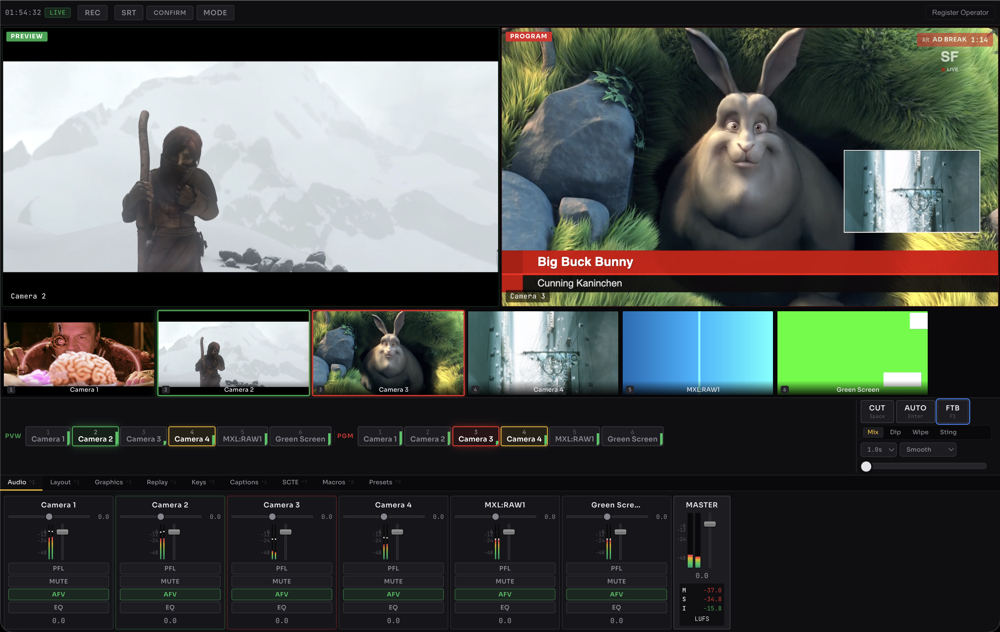

<p align="center">
  
</p>

<h1 align="center">SwitchFrame</h1>

<p align="center">
  Browser-based live video production switcher with GPU acceleration and AI-powered captions
</p>

<p align="center">
  <a href="https://github.com/zsiec/switchframe/actions/workflows/ci.yml"></a>
  &nbsp;
  <a href="https://go.dev"></a>
  &nbsp;
  <a href="LICENSE"></a>
</p>

<br>

<p align="center">
  
</p>

<br>

SwitchFrame is a live video switcher where the server handles all switching, mixing, encoding, and compositing. Browsers connect over WebTransport as control surfaces — they view sources and send commands, but don't produce the output. Sources arrive via [Prism](https://github.com/zsiec/prism) MoQ ingest, [SRT](https://github.com/zsiec/srtgo) input (listener or caller mode), or [MXL](https://tech.ebu.ch/dmf/mxl) shared-memory transport.

Every source is continuously decoded to raw YUV420. Cuts are instant. All video processing — transitions, keying, compositing, scaling, color grading, AI segmentation — happens server-side in BT.709 YUV420, with optional GPU acceleration on Metal (macOS) and CUDA (Linux).

## Features

**Switching** — Cut, mix, dip-to-black, wipe (6 directions with soft-edge blending), stinger (PNG sequence + audio), fade to black with reverse. Manual T-bar. Frame synchronization with motion-compensated interpolation for mixed-rate sources.

**Audio** — Per-channel faders, 3-band parametric EQ, single-band compressor, input trim, mute, AFV. Master bus with brickwall limiter. BS.1770-4 loudness metering (momentary, short-term, integrated). Per-source delay for lip-sync correction. Clock-driven output ticker decouples mix timing from source arrival. Signal chain bypasses decode/encode when a single source is at unity with processing bypassed.

**AI Captions** — Live speech-to-text via whisper.cpp with Silero VAD for neural speech detection. Per-word confidence scoring. Transcripts feed into the CEA-608 caption encoder for real-time closed captioning on program output. CUDA GPU acceleration supported.

**AI Background Removal** — TensorRT-accelerated U2-Net person segmentation. Removes backgrounds without a green screen. Temporal smoothing (EMA), edge refinement (3x3 erosion), and GPU-resident mask pipeline. Runs as a pipeline node alongside keying and compositing.

**Color Grading** — GPU-accelerated 3D LUT color grading with 6 built-in broadcast looks (cinematic, warm natural, cool drama, broadcast news, vivid, log-to-Rec.709). Industry-standard .cube file import. LUT uploaded to GPU memory with generation-counter caching for zero-overhead steady state.

**Graphics & Keying** — 8-layer downstream key compositor with fade, fly-in/out, slide, and pulse animations. 6 built-in broadcast templates. Per-source upstream chroma and luma keying. PIP, side-by-side, and quad layouts with slot transitions and live drag positioning via WebTransport datagrams. ST map per-pixel coordinate remapping for lens correction (barrel, pincushion, fisheye, corner pin) and animated program effects (heat shimmer, dream, ripple, vortex).

**Closed Captions** — CEA-608/708 captioning with three modes: off, passthrough (re-encode source captions), and author (live text input or AI transcription). H.264 SEI injection for MPEG-TS output. SMPTE ST 334 / CDP VANC output for MXL.

**Instant Replay** — Per-source circular buffers (configurable up to 5 minutes), mark-in/out, variable-speed playback down to 0.25x with pause/resume/seek. Quick-replay buttons and JKL shuttle control. Pitch-preserved audio via phase vocoder. Frame interpolation: duplication, alpha blend, motion-compensated (MCFI), or hold-crossfade (default).

**SRT Input** — Listener (push) and caller (pull) modes for ingesting SRT sources. Any codec FFmpeg can decode, normalized to YUV420. Persistent config across reconnects. Exponential backoff reconnection. Per-source latency override and connection stats.

**Output** — MPEG-TS recording with time and size rotation. Multi-destination SRT output, push and pull. CEA-608 closed captions embedded in output. Per-destination SCTE-35 ad insertion with signal conditioning rules engine. SCTE-104 automation on MXL data flows. Confidence monitor (1fps JPEG thumbnail).

**Multi-Operator** — Director, audio, graphics, and viewer roles with per-subsystem locking. Macro system with 60 action types across 11 categories covering switching, audio, graphics, replay, layout, SCTE-35, and color grading with step validation and keyboard triggers.

**Operator Comms** — Built-in voice channel for multi-operator coordination. Opus codec over WebTransport bidirectional streams. N-1 mixing (hear everyone except yourself). Push-to-talk with backtick key. Auto-duck dims program audio during active comms. Up to 6 participants.

**GPU Acceleration** — Metal on macOS (Apple Silicon), CUDA on Linux (NVIDIA). 9 Metal compute shaders and 12 CUDA kernels covering format conversion, transition blending, scaling, chroma/luma keying, PIP compositing, DSK overlay, ST map warp, frame rate up-conversion, V210 conversion, color grading, AI preprocessing, and mask smoothing. Auto-detected at startup with graceful CPU fallback. Apple Silicon unified memory enables zero-copy upload/download. 59 hand-written SIMD assembly kernels (amd64 SSE/AVX + arm64 NEON) for CPU-path graphics, transitions, audio, FFT, V210, motion estimation, and ST map warp.

**MXL** — Optional shared-memory transport for uncompressed V210 video and float32 audio. Sources bypass H.264 decode entirely — raw YUV420p into the pipeline. Program output routes back to MXL. NMOS IS-04 flow discovery. Bidirectional SCTE-104 on data flows.

**Infrastructure** — WebTransport/QUIC for media and state, REST polling fallback. Hardware encoder auto-detection (NVENC, VA-API, VideoToolbox, libx264). Preview proxy encoding (480p, 500kbps per source) drops browser bandwidth from ~55 Mbps to ~10 Mbps. mmap-backed frame pool allocations outside the Go GC heap. Single-binary deployment with embedded UI. Prometheus metrics and pprof.

## Quick Start

```bash
git clone https://github.com/zsiec/switchframe.git && cd switchframe
make demo
```

Open **http://localhost:5173**. Four simulated cameras + two SRT sources with full audio mixer.

<details>
<summary>Prerequisites</summary>
<br>

Go 1.25+, Node.js 22+, and codec development libraries.

**macOS**
```bash
brew install ffmpeg fdk-aac pkg-config
```

**Debian / Ubuntu**
```bash
sudo apt install libavcodec-dev libavutil-dev libavformat-dev libswscale-dev libswresample-dev libx264-dev libfdk-aac-dev pkg-config
```

</details>

## Architecture

```
Sources (H.264 via MoQ, any codec via SRT, or V210 via MXL shared memory)
  → per-source decode to YUV420
    → ST map lens correction · frame synchronizer · delay buffer
      → switching engine
        → pipeline: upstream key → PIP → DSK → color grade → AI segment → encode
          → program relay
            ├── browsers (WebTransport/MoQ, 480p preview proxy)
            ├── recording (MPEG-TS with CEA-608 captions)
            ├── SRT destinations (with per-destination SCTE-35)
            └── MXL output (V210 + VANC)

Audio: decode → trim → EQ → compressor → fader
  → mix → master → limiter → LUFS metering → encode
    → ASR (Whisper) → caption pacer → CEA-608 output

GPU: upload NV12 → key → layout → DSK → color grade → AI segment → ST map → download YUV420
```

The server uses [Prism](https://github.com/zsiec/prism) for MoQ/WebTransport media distribution. The frontend is a [Svelte 5](https://svelte.dev/) SPA that connects over a single QUIC connection for both media streams and control state.

The video pipeline is a chain of immutable processing nodes, atomically swapped at runtime for zero-frame-drop reconfiguration. Sources are routed through lock-free atomic pointers. The hot path holds locks for under 1us per frame at 30fps.

## Controls

| | Mouse | Keyboard |
|---|---|---|
| Preview | Click source tile | `1`–`9` |
| Cut | CUT button | `Space` |
| Auto transition | AUTO button | `Enter` |
| Fade to black | FTB button | `F1` |
| Hot-punch to program | — | `Shift`+`1`–`9` |
| Run macro | — | `Ctrl`+`1`–`9` |
| Comms mute toggle | — | `` ` `` (backtick) |

Press **?** for the full shortcut overlay. Append `?mode=simple` for a volunteer-friendly layout.

## Documentation

| | |
|---|---|
| **[API Reference](docs/api.md)** | REST endpoints with request/response examples |
| **[Architecture](docs/architecture.md)** | System design, data flow, design decisions |
| **[Deployment](docs/deployment.md)** | CLI flags, Docker, TLS, monitoring |
| **[Pipeline](docs/pipeline.md)** | Processing nodes, frame pool, atomic swap |
| **[Concurrency](docs/locking-and-concurrency.md)** | Lock inventory, frame flow, ordering rules |
| **[SCTE-35](docs/scte35.md)** | Ad insertion, rules engine, SCTE-104 |
| **[MXL](docs/mxl.md)** | Shared-memory transport, V210, NMOS |
| **[GPU Acceleration](docs/gpu.md)** | Metal, CUDA, SIMD kernels, TensorRT |
| **[AI Captions](docs/asr.md)** | Whisper.cpp, VAD, caption pacing |

## Development

```bash
make dev           # Go + Vite dev servers
make demo          # 4 simulated cameras
make build         # Production binary (embedded UI)
make docker        # Multi-stage Docker image
make test-all      # Go + Vitest + Playwright
```

## License

[MIT](LICENSE)
