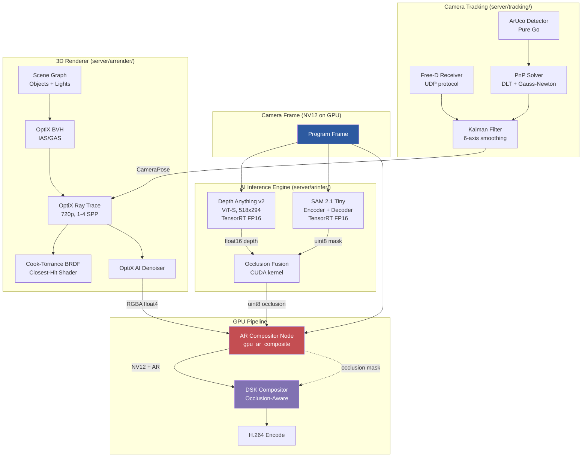
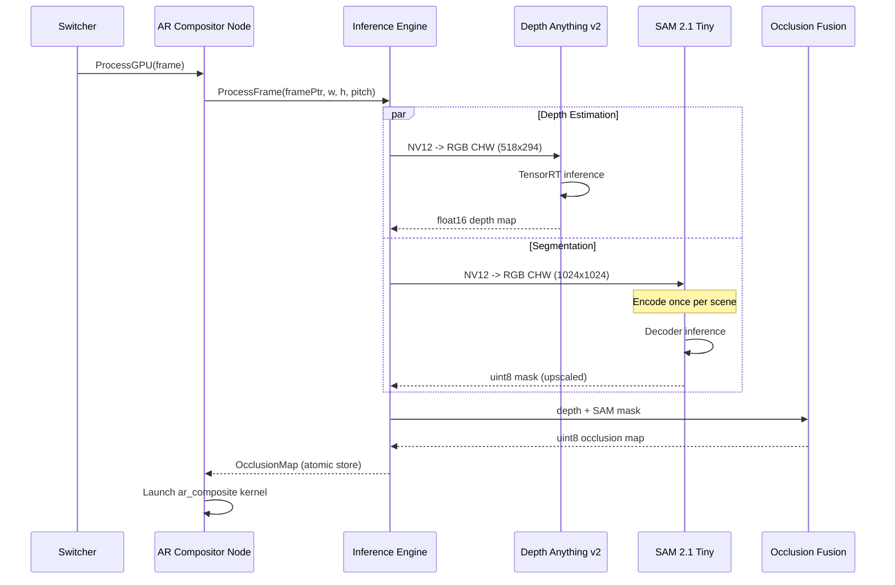
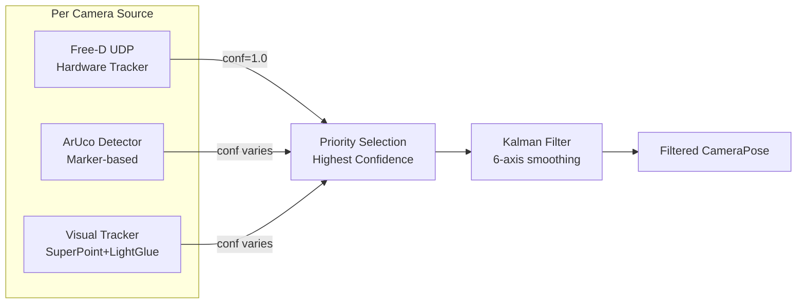
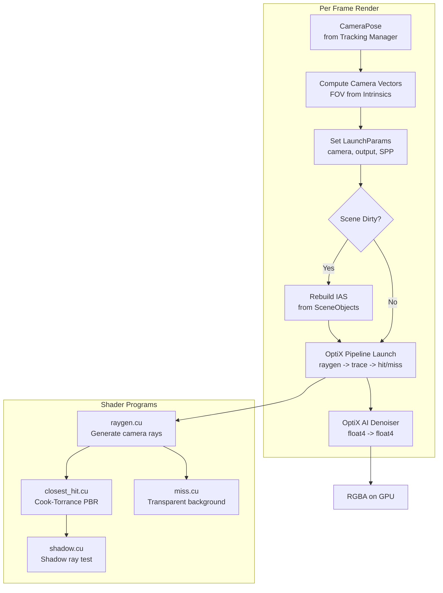
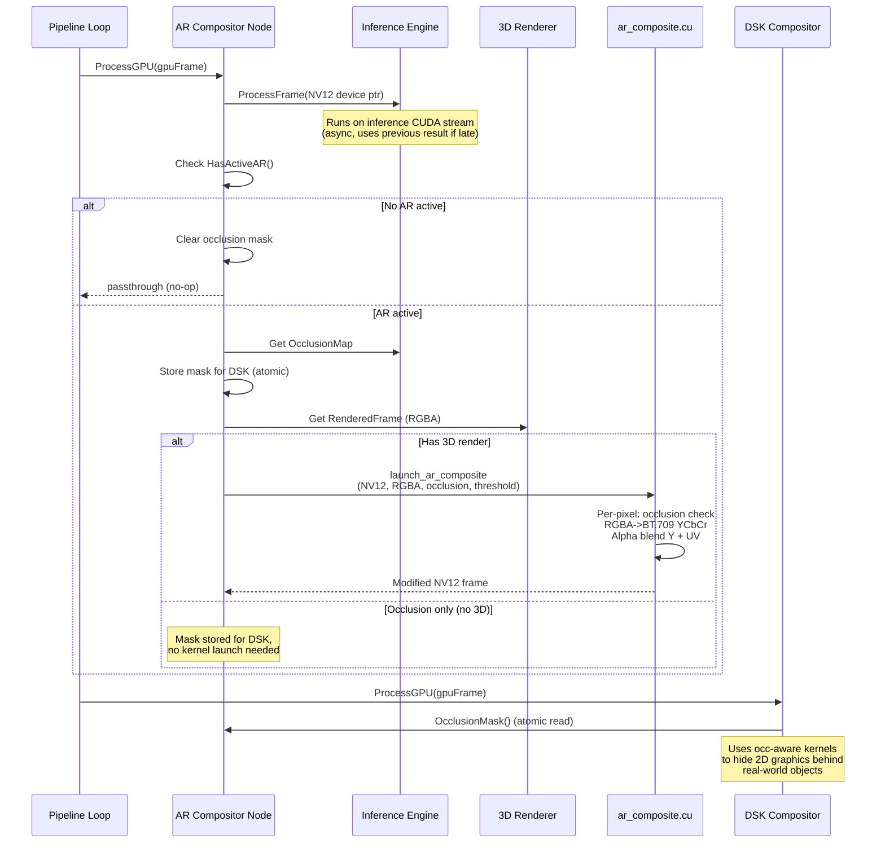

# AR Graphics

Augmented reality graphics for Switchframe: AI-powered occlusion, real-time camera tracking, and GPU ray-traced 3D rendering via NVIDIA OptiX. Three independent subsystems deliver standalone value and compose together for full AR compositing.

## Overview

The AR system comprises three subsystems that can be used independently or together:

| Subsystem | Package | Purpose |
|-----------|---------|---------|
| **AI Occlusion** | `server/arinfer/` | Depth estimation + segmentation produce per-pixel occlusion maps so virtual content renders behind real-world objects |
| **Camera Tracking** | `server/tracking/` | 6DoF camera pose from Free-D hardware, ArUco markers, or AI visual localization with Kalman filtering |
| **3D Rendering** | `server/arrender/` | OptiX ray tracing with Cook-Torrance PBR shading, scene graph, glTF/USD asset loading |

All three feed into the **AR Compositor** GPU pipeline node (`server/gpu/ar_composite.go`), which alpha-blends rendered 3D content onto the NV12 program frame with depth-aware occlusion masking.

## Architecture



Key properties:

- **Each subsystem is independent** -- occlusion works without tracking, tracking works without the renderer
- **Everything stays on GPU** -- no CPU round-trips in the hot path
- **Zero overhead when inactive** -- `<1us` passthrough check when no AR features are enabled
- **Dedicated CUDA streams** -- inference, tracking, and rendering run concurrently on separate streams
- **Previous-frame fallback** -- if inference is late, the compositor reuses the last occlusion map (depth changes slowly; one stale frame is invisible to viewers)

## AI Occlusion

### How It Works

The inference engine runs two AI models on each program frame to determine which pixels belong to real-world foreground objects (people, desks, equipment). The resulting occlusion map tells the AR compositor where virtual 3D content should be hidden behind real objects.



### Depth Anything v2

The depth model (`server/arinfer/depth.go`) runs Depth Anything v2 ViT-S via TensorRT FP16:

- **Input**: NV12 GPU frame, preprocessed to RGB float32 CHW at 518x294 via a fused CUDA kernel (`nv12_to_rgb_chw`)
- **Output**: Float16 inverse depth map at 518x294 (stays on GPU)
- **Model**: TensorRT `.plan` file, auto-discovered from `~/.switchframe/ar_models/depth_anything_v2.plan`
- **Build tag**: `cgo && cuda && tensorrt` (stub returns `ErrDisabled` without these)

The depth map is bilinearly upsampled to frame resolution inside the occlusion fusion kernel. At 518x294 the depth quality is sufficient for occlusion decisions while keeping inference under budget.

### SAM 2.1 Tiny

The segmentation model (`server/arinfer/segment.go`) runs SAM 2.1 Tiny in a two-phase pipeline:

**Phase 1 -- Image Encoder (Hiera Tiny)**: Run once when the scene changes or prompts are first added. Produces three feature maps that persist until the next encode:

| Output | Shape | Size |
|--------|-------|------|
| `image_embed` | `[1, 256, 64, 64]` | 4 MB |
| `high_res_feat0` | `[1, 32, 256, 256]` | 8 MB |
| `high_res_feat1` | `[1, 64, 128, 128]` | 4 MB |

**Phase 2 -- Mask Decoder**: Runs every frame with the cached embeddings plus prompt coordinates. Produces a 256x256 logit map that is bilinearly upscaled to frame resolution and thresholded to a uint8 binary mask (0 or 255).

Prompts are user-specified point or box selections identifying objects to track:

```json
{
  "id": "anchor-desk",
  "type": "point",
  "points": [[960, 540]],
  "label": "Anchor"
}
```

Up to 16 concurrent prompts are supported. Prompt coordinates are normalized to the encoder's 1024x1024 input resolution at inference time.

### Occlusion Map Fusion

The occlusion fusion kernel (`server/gpu/cuda/occlusion_fuse.cu`) combines depth and SAM masks into a single per-pixel uint8 confidence map:

- **Depth contribution**: Bilinear-sampled from the low-res depth map. Pixels closer than `depth_near` threshold get high confidence; the `softness` parameter controls the transition gradient.
- **SAM override**: Where the SAM mask indicates foreground (value > 128), the SAM confidence takes priority over depth. This provides sharper object edges than depth estimation alone.
- **Output**: 255 = definite foreground (don't overlay AR), 0 = background (safe to overlay)

### DSK Integration

The AR compositor node exposes the occlusion mask to the downstream DSK compositor via the `OcclusionMaskProvider` interface:

```go
type OcclusionMaskProvider interface {
    OcclusionMask() (devPtr uintptr, width, height int)
}
```

The DSK compositor reads this mask and uses occlusion-aware kernels (`DSKCompositeFullFrameOcc`, `DSKCompositeRectOcc` in `server/gpu/dsk.go`) that prevent 2D lower-thirds and graphics from drawing on top of real-world foreground objects. This means a lower-third will appear to go behind the anchor's body, not on top of it.

### Configuration

The engine starts dormant. Models are loaded on demand via the REST API:

| Setting | Default | Description |
|---------|---------|-------------|
| `ModelsDir` | `~/.switchframe/ar_models/` | Directory containing `.plan` files |
| `MaxInferenceMs` | `20` | Frame budget before skipping |
| Depth resolution | 518 x 294 | Fixed by the ONNX export |
| SAM encoder input | 1024 x 1024 | Fixed by the SAM 2.1 architecture |
| SAM max prompts | 16 | Hard limit in segment.go |

### REST API

#### Enable occlusion

```bash
# Enable depth estimation only
curl -X POST http://localhost:8080/api/ar/occlusion/enable \
  -H 'Content-Type: application/json' \
  -d '{"mode": "depth"}'

# Enable both depth and SAM
curl -X POST http://localhost:8080/api/ar/occlusion/enable \
  -d '{"mode": "both"}'
```

Mode must be `"depth"`, `"sam"`, or `"both"`.

#### Disable occlusion

```bash
curl -X POST http://localhost:8080/api/ar/occlusion/disable
```

Disables both models, waits for in-flight frames to complete, and releases GPU resources.

#### Add a SAM prompt

```bash
# Point prompt: mark the anchor's position
curl -X POST http://localhost:8080/api/ar/occlusion/prompt \
  -H 'Content-Type: application/json' \
  -d '{
    "id": "anchor",
    "type": "point",
    "points": [[960, 540]],
    "label": "Anchor"
  }'

# Box prompt: mark a desk region
curl -X POST http://localhost:8080/api/ar/occlusion/prompt \
  -d '{
    "id": "desk",
    "type": "box",
    "box": [200, 600, 1720, 1080],
    "label": "News desk"
  }'
```

#### List prompts

```bash
curl http://localhost:8080/api/ar/occlusion/prompts
```

#### Delete a prompt

```bash
curl -X DELETE http://localhost:8080/api/ar/occlusion/prompts/anchor
```

#### Get status

```bash
curl http://localhost:8080/api/ar/occlusion/status
```

Response:

```json
{
  "depthReady": true,
  "samReady": true,
  "depthLatencyMs": 3.82,
  "samLatencyMs": 15.7,
  "framesProcessed": 1847,
  "framesSkipped": 3,
  "gpuMemUsedMB": 0
}
```

### Performance

Measured on NVIDIA L4 GPU (GCP g2-standard-8):

| Component | Latency | Notes |
|-----------|---------|-------|
| Depth Anything v2 inference | ~3.8 ms | TensorRT FP16, 518x294 |
| SAM 2.1 encoder (one-time) | ~150 ms | Run once per scene change |
| SAM 2.1 decoder (per frame) | ~16 ms | With prompt propagation |
| Occlusion fusion kernel | ~0.2 ms | Bilinear depth upscale + SAM merge |
| **Total per frame** | **~20 ms** | Within the 33ms frame budget |

## Camera Tracking

### How It Works

The tracking manager (`server/tracking/manager.go`) maintains per-camera tracking sources with priority blending. Each source provides 6DoF camera poses (position + orientation) that the 3D renderer uses to match virtual camera placement to the real camera.



Multiple trackers can be registered per camera source. The manager polls all trackers at ~30Hz, selects the highest-confidence pose per source, and filters it through a per-source Kalman filter for temporal smoothing.

### Free-D Protocol

The Free-D receiver (`server/tracking/freed.go`) parses the 29-byte UDP packet format used by camera tracking systems (Mo-Sys StarTracker, stYpe, Stype RedSpy, etc.):

| Byte Range | Field | Encoding |
|------------|-------|----------|
| 0 | Packet type | `0xD1` = position/orientation |
| 1 | Camera ID | uint8 |
| 2-4 | Pan | 24-bit signed, 32768 counts/degree |
| 5-7 | Tilt | 24-bit signed, 32768 counts/degree |
| 8-10 | Roll | 24-bit signed, 32768 counts/degree |
| 11-13 | X position | 24-bit signed, 64 counts/mm |
| 14-16 | Y position | 24-bit signed, 64 counts/mm |
| 17-19 | Z position | 24-bit signed, 64 counts/mm |
| 20-22 | Zoom | 24-bit unsigned, raw encoder |
| 23-25 | Focus | 24-bit unsigned, raw encoder |
| 26-27 | Reserved | |
| 28 | Checksum | Sum of bytes 0-27 mod 256 |

The receiver filters by camera ID (0 = accept all), validates the checksum, and stores the latest pose atomically. Hardware tracking always reports confidence 1.0.

### AI Visual Localization

Visual tracking uses SuperPoint feature extraction + LightGlue matching + PnP solving against a pre-scanned studio map. This is the most complex tracking path:

1. **Studio scan phase** (one-time): Capture photos/video of the studio, process with COLMAP to produce a 3D point cloud + SuperPoint feature database. Stored in `~/.switchframe/studio_maps/`.
2. **Runtime per-frame**: SuperPoint feature extraction (~5-8ms TensorRT) -> LightGlue matching (~10-20ms TensorRT) -> PnP solve (<1ms CPU) -> Kalman filter.

**Current status**: The visual tracking pipeline endpoint returns HTTP 501 -- TensorRT model integration is pending. The PnP solver and all supporting math is fully implemented.

### ArUco Markers

The ArUco detector (`server/tracking/aruco.go`) provides drift-correction poses from printed markers placed in the studio:

- **Pure Go implementation** -- no OpenCV dependency. Uses adaptive thresholding, contour detection, and 4x4 dictionary decoding.
- **Pipeline**: Grayscale image -> adaptive threshold -> find quadrilaterals -> decode 4x4 bit pattern -> match against DICT_4X4_50 -> PnP solve from known 3D positions
- **Use case**: Markers placed in non-visible areas anchor the coordinate system and correct drift from AI tracking.
- **PnP solver** (`server/tracking/pnp.go`): DLT (Direct Linear Transform) with Gauss-Newton refinement. Requires at least 6 point correspondences (2 markers with 4 corners each = 8 points).

### Kalman Filter

The pose filter (`server/tracking/filter.go`) runs 6 independent single-axis constant-velocity Kalman filters (pan, tilt, roll, X, Y, Z):

- **Motion model**: Constant velocity with configurable process noise
- **Measurement model**: Direct observation of position
- **Default process noise**: 0.5 (how much to trust the motion model)
- **Default measurement noise**: 0.2 (how much to trust new measurements)
- **Reset behavior**: If the time gap exceeds 2 seconds, the filter reinitializes from the new measurement

### Lens Calibration

The calibration store (`server/tracking/calibration.go`) persists per-camera lens intrinsics to `~/.switchframe/tracking/`:

```json
{
  "focalLengthCurve": [[0, 8.5], [0.5, 25], [1.0, 100]],
  "principalPoint": [0.5, 0.5],
  "distortion": [0, 0, 0, 0, 0],
  "sensorWidth": 36.0
}
```

The `focalLengthCurve` maps zoom encoder values (from Free-D) to focal lengths in mm. At runtime, the system linearly interpolates the curve to determine the current focal length, which is critical for accurate projection matrices.

### Configuration

| Setting | Default | Description |
|---------|---------|-------------|
| Poll interval | 33 ms (~30Hz) | Tracking manager polling rate |
| Process noise | 0.5 | Kalman filter motion model trust |
| Measurement noise | 0.2 | Kalman filter measurement trust |
| Calibration dir | `~/.switchframe/tracking/` | Per-camera JSON calibration files |

### REST API

#### List tracking sources

```bash
curl http://localhost:8080/api/ar/tracking/sources
```

Response:

```json
{
  "cam1": [
    {"name": "freed", "type": "freed", "running": true, "confidence": 1.0},
    {"name": "aruco", "type": "aruco", "running": true, "confidence": 0.85}
  ]
}
```

#### Add Free-D source

```bash
curl -X POST http://localhost:8080/api/ar/tracking/sources/cam1/freed \
  -H 'Content-Type: application/json' \
  -d '{"addr": ":6301", "cameraID": 1}'
```

Creates a UDP listener on the specified address. Camera ID 0 accepts packets from any camera.

#### Get current pose

```bash
curl http://localhost:8080/api/ar/tracking/sources/cam1/pose
```

Response:

```json
{
  "position": [1.234, 0.567, 2.890],
  "orientation": [15.5, -8.2, 0.3],
  "focalLength": 50.0,
  "focusDistance": 0,
  "confidence": 1.0,
  "timestamp": 8100000,
  "source": "freed"
}
```

#### Set lens calibration

```bash
curl -X PUT http://localhost:8080/api/ar/tracking/calibration/cam1 \
  -H 'Content-Type: application/json' \
  -d '{
    "focalLengthCurve": [[0, 8.5], [0.5, 25], [1.0, 100]],
    "principalPoint": [0.5, 0.5],
    "distortion": [0, 0, 0, 0, 0],
    "sensorWidth": 36.0
  }'
```

#### Configure ArUco marker positions

```bash
curl -X PUT http://localhost:8080/api/ar/tracking/aruco \
  -H 'Content-Type: application/json' \
  -d '{
    "markers": {
      "0": [0.0, 0.0, 0.0],
      "1": [3.0, 0.0, 0.0],
      "2": [0.0, 2.0, 0.0],
      "3": [3.0, 2.0, 0.0]
    }
  }'
```

Marker IDs are string keys mapping to `[X, Y, Z]` positions in meters.

#### Remove a tracker

```bash
curl -X DELETE http://localhost:8080/api/ar/tracking/sources/cam1/freed
```

## 3D Rendering

### How It Works

The renderer (`server/arrender/renderer.go`) uses NVIDIA OptiX for hardware-accelerated ray tracing. Each frame, it traces rays from the tracked camera pose through the scene, evaluates PBR materials at hit points, and produces an RGBA buffer on the GPU that the AR compositor blends onto the video.



### OptiX Ray Tracing

The renderer creates an OptiX pipeline with four shader entry points compiled from PTX:

| Program | Entry Point | Purpose |
|---------|-------------|---------|
| Ray Generation | `__raygen__render` | Generates primary camera rays from pose + intrinsics |
| Closest Hit | `__closesthit__pbr` | Cook-Torrance PBR shading at intersection points |
| Miss | `__miss__transparent` | Returns transparent (alpha=0) for rays that miss geometry |
| Shadow Miss | `__miss__shadow` | Shadow ray test for direct lighting |
| Any Hit | `__anyhit__shadow` | Early termination for shadow queries |

The pipeline supports up to 2 trace depths (primary + shadow rays). The acceleration structure uses a two-level hierarchy: per-object GAS (Geometry Acceleration Structure) instanced into a top-level IAS (Instance Acceleration Structure). BVH rebuilds are triggered only when the scene's dirty flag is set.

### PBR Shading (Cook-Torrance)

The closest-hit shader (`server/arrender/shaders/closest_hit.cu`) implements physically-based rendering using the Cook-Torrance microfacet model:

- **Normal Distribution (D)**: GGX/Trowbridge-Reitz
- **Geometry (G)**: Smith's method with Schlick-GGX approximation
- **Fresnel (F)**: Schlick approximation

The material model follows the glTF metallic-roughness workflow:
- `base_color` -- albedo (linear RGB)
- `metallic` -- 0 = dielectric, 1 = metal (F0 interpolation)
- `roughness` -- 0 = mirror, 1 = fully rough (clamped to 0.04 minimum)
- `emission` -- additive emissive color

When no scene lights are configured, the shader falls back to a hardcoded key light (upper-right, warm) and fill light (lower-left, cool) plus a 0.03 ambient term.

### Scene Graph

The scene (`server/arrender/scene.go`) is a thread-safe container for objects and lights:

- **Objects**: `SceneObject` with ID, asset reference, position/rotation/scale, visibility toggle
- **Lights**: `Light` with type (point/directional/area), position, direction, color, intensity
- **Dirty flag**: Atomic boolean that triggers BVH rebuild on next render
- **onChange callback**: Notifies the app layer when the scene is mutated (for state broadcast)

Scene mutations (add/update/remove objects or lights) are protected by a read-write mutex. The objects and lights maps are keyed by string IDs for O(1) lookup.

### Asset Management (glTF, USD)

**glTF/GLB** (`server/arrender/gltf_loader.go`): Parsed via the `qmuntal/gltf` Go library. Extracts:
- Vertex positions, normals, texture coordinates
- Triangle indices (uint8/uint16/uint32)
- PBR materials (baseColor, metallic, roughness, emissive)

**USD** (`server/arrender/usd_loader.go`): Parsed by shelling out to Python with an embedded conversion script (`usd_convert.py`). Supports `.usd`, `.usda`, `.usdc`, and `.usdz` formats. The Python script extracts mesh geometry and `UsdPreviewSurface` materials as JSON, which is then converted to the same `GLTFMesh` intermediate format.

### Bundled Test Models

The asset store (`server/arrender/store.go`) embeds three sample GLB files that are automatically loaded on startup:

| Model | File | Description |
|-------|------|-------------|
| Podium | `testdata/podium.glb` | News podium |
| Clock | `testdata/clock.glb` | Studio clock |
| Light Stand | `testdata/ltstand.glb` | Studio light stand |

The asset store supports up to 64 assets (configurable), stored in `~/.switchframe/ar_assets/`. Each asset gets a random hex ID, and metadata is persisted atomically as `assets.json`.

### Configuration

| Setting | Default | Description |
|---------|---------|-------------|
| Render width | 1280 | Ray trace resolution (upscaled to output) |
| Render height | 720 | Ray trace resolution |
| SPP | 2 | Samples per pixel |
| Denoise | true | OptiX AI temporal denoiser |
| Max assets | 64 | Asset store capacity |
| Assets dir | `~/.switchframe/ar_assets/` | Asset file storage |
| Max upload | 256 MB | Per-file upload limit |

### REST API

#### Get scene state

```bash
curl http://localhost:8080/api/ar/scene
```

Response:

```json
{
  "objects": [
    {"id": "podium-1", "assetId": "abc123", "position": [0, 0, -2],
     "rotation": [0, 0, 0], "scale": [1, 1, 1], "visible": true}
  ],
  "lights": [
    {"id": "key", "type": "point", "position": [2, 3, 1],
     "direction": [0, 0, 0], "color": [1, 0.95, 0.9], "intensity": 100}
  ],
  "settings": {"width": 1280, "height": 720, "spp": 2, "denoise": true},
  "hasEnvMap": false
}
```

#### Add an object

```bash
curl -X POST http://localhost:8080/api/ar/scene/objects \
  -H 'Content-Type: application/json' \
  -d '{
    "id": "virtual-podium",
    "assetId": "abc123def456",
    "position": [0, 0, -3],
    "rotation": [0, 45, 0],
    "scale": [1, 1, 1],
    "visible": true
  }'
```

#### Update an object

```bash
curl -X PUT http://localhost:8080/api/ar/scene/objects/virtual-podium \
  -d '{"position": [1, 0, -3], "rotation": [0, 90, 0], "scale": [1.5, 1.5, 1.5], "visible": true}'
```

#### Delete an object

```bash
curl -X DELETE http://localhost:8080/api/ar/scene/objects/virtual-podium
```

#### Manage lights

```bash
# Add a point light
curl -X POST http://localhost:8080/api/ar/scene/lights \
  -d '{"id": "key-light", "type": "point", "position": [2, 3, 1], "color": [1, 0.95, 0.9], "intensity": 100}'

# Update light
curl -X PUT http://localhost:8080/api/ar/scene/lights/key-light \
  -d '{"type": "directional", "direction": [-1, -2, -1], "color": [1, 1, 1], "intensity": 5}'

# Delete light
curl -X DELETE http://localhost:8080/api/ar/scene/lights/key-light
```

#### Render settings

```bash
# Get current settings
curl http://localhost:8080/api/ar/render/settings

# Update settings
curl -X PUT http://localhost:8080/api/ar/render/settings \
  -d '{"width": 1920, "height": 1080, "spp": 4, "denoise": true}'
```

#### Upload an asset

```bash
curl -X POST http://localhost:8080/api/ar/assets \
  -F "asset=@model.glb" \
  -F "name=Studio Desk"
```

#### List assets

```bash
curl http://localhost:8080/api/ar/assets
```

#### Load a scene file

```bash
# Upload and add a glTF or USD scene
curl -X POST http://localhost:8080/api/ar/scene/load \
  -F "scene=@studio.glb"
```

Supports `.glb`, `.gltf`, `.usd`, `.usda`, `.usdc`, and `.usdz` formats.

## GPU Pipeline Integration

### Pipeline Node Order

The AR compositor sits between the existing DSK (downstream key) compositor and the encoder in the GPU pipeline:

```
decode -> upstream_key -> layout -> DSK -> AR compositor -> encode
```

The AR compositor node (`gpuARCompositorNode`) implements the `GPUPipelineNode` interface:

```go
type gpuARCompositorNode struct {
    ctx     *Context
    pool    *FramePool
    arState ARCompositorState  // provides occlusion + rendered frame
    // ... atomic fields for occlusion mask sharing
}
```

### Data Flow (per frame)



### Memory Budget

GPU memory allocations for the AR subsystem on an NVIDIA L4 (24 GB VRAM):

| Component | Allocation | Size |
|-----------|-----------|------|
| Depth model input buffer | float32 RGB CHW 518x294x3 | ~1.8 MB |
| Depth model output buffer | float16 518x294 | ~0.3 MB |
| SAM encoder input | float32 RGB CHW 1024x1024x3 | ~12 MB |
| SAM image embeddings | float32 256x64x64 | ~4 MB |
| SAM high_res_feat0 | float32 32x256x256 | ~8 MB |
| SAM high_res_feat1 | float32 64x128x128 | ~4 MB |
| SAM decoder output | float32 256x256 | ~0.25 MB |
| SAM mask output (1080p) | uint8 1920x1080 | ~2 MB |
| OptiX render output | float4 1280x720 | ~14 MB |
| OptiX denoise buffer | float4 1280x720 | ~14 MB |
| TensorRT engine weights | depth + SAM encoder + SAM decoder | ~100-200 MB |
| OptiX BVH (scene-dependent) | IAS + GAS | ~1-50 MB |
| **Total (typical)** | | **~170-310 MB** |

This leaves the majority of the L4's 24 GB available for video pipeline buffers, NVENC, and other operations.

### Performance Characteristics

All measurements on NVIDIA L4 GPU, 1080p 30fps:

| Component | CUDA Stream | Latency | Notes |
|-----------|-------------|---------|-------|
| Depth Anything v2 | Inference | ~3.8 ms | TensorRT FP16, 518x294 |
| SAM 2.1 propagation | Inference | ~16 ms | After first-frame encode |
| Occlusion fusion | Pipeline | ~0.2 ms | Bilinear upsample + merge |
| AR composite kernel | Pipeline | ~0.5 ms | RGBA->NV12 blend + occlusion |
| OptiX render | Render | ~15-25 ms | 720p, 2 SPP + denoiser |
| **Total (pipelined)** | | **~20-25 ms** | Streams overlap |

The inference stream runs concurrently with the pipeline stream. In practice, the compositor uses the previous frame's inference results, adding zero additional latency to the pipeline critical path after the first frame.

## Deployment

### Build Requirements

The full AR pipeline requires several GPU-specific build tags and dependencies:

| Feature | Build Tags | Runtime Dependencies |
|---------|-----------|---------------------|
| AI Occlusion | `cgo`, `cuda`, `tensorrt` | CUDA 12.x, TensorRT 8.x, model `.plan` files |
| Camera Tracking | *(none -- pure Go)* | *(none)* |
| 3D Rendering | `cgo`, `cuda`, `optix` | CUDA 12.x, OptiX 8.x SDK |

Without these build tags, stub implementations return `ErrDisabled` or `ErrRendererNotReady`, and the system degrades gracefully. Camera tracking is always available since it is pure Go.

### Model Files

TensorRT `.plan` files must be placed in `~/.switchframe/ar_models/`:

| File | Source Model | Export |
|------|-------------|--------|
| `depth_anything_v2.plan` | Depth Anything v2 ViT-S | ONNX -> `trtexec --fp16` |
| `sam2_encoder.plan` | SAM 2.1 Tiny Hiera encoder | `server/arrender/export_sam2.py` -> `trtexec --fp16` |
| `sam2_decoder.plan` | SAM 2.1 Tiny mask decoder | `server/arrender/export_sam2.py` -> `trtexec --fp16` |

Plans are GPU-architecture-specific and must be rebuilt when moving between GPU types.

### OptiX SDK

The OptiX SDK headers must be available at compile time for the renderer. The OptiX runtime is part of the NVIDIA driver (no separate installation needed). PTX shaders in `server/arrender/shaders/` are compiled with `nvcc` using the `compile_ptx.sh` script.

## Troubleshooting

### Common Issues

**"arinfer: feature disabled"** -- The server was built without `cgo && cuda && tensorrt` build tags. Rebuild with GPU support enabled.

**"arrender: renderer not ready"** -- Either the GPU context is nil (no CUDA device) or the OptiX pipeline has not been initialized. Check that the OptiX SDK is available and PTX shaders are compiled.

**Inference consistently skipping frames** -- The `framesSkipped` counter in status is climbing. Check GPU utilization; the inference budget (`MaxInferenceMs=20`) may be too tight. Consider reducing to depth-only mode or lowering other GPU workloads.

**SAM mask not appearing after adding prompts** -- Ensure occlusion is enabled in `"sam"` or `"both"` mode before adding prompts. The SAM encoder runs on the first frame after prompts are added; watch `samLatencyMs` in status.

**Free-D packets not arriving** -- Verify the UDP port is not blocked by the firewall. Check that the camera ID filter matches the tracker's output. Set `cameraID: 0` to accept all cameras for debugging.

**ArUco detection not triggering PnP** -- PnP requires at least 6 point correspondences (minimum 2 markers with 4 corners each). Ensure marker positions are registered via `PUT /api/ar/tracking/aruco` and at least 2 registered markers are visible to the camera.

**Calibration curve returning wrong focal length** -- The `focalLengthCurve` maps raw zoom encoder values (from Free-D bytes 20-22) to focal lengths in mm. Verify the curve endpoints match your lens's actual zoom range. Values outside the curve are clamped to the nearest endpoint.

### Diagnostics

Check overall AR status:

```bash
# Inference engine status
curl http://localhost:8080/api/ar/occlusion/status

# All tracking sources and confidence
curl http://localhost:8080/api/ar/tracking/sources

# Current pose for a source
curl http://localhost:8080/api/ar/tracking/sources/cam1/pose

# Scene state (objects, lights, render settings)
curl http://localhost:8080/api/ar/scene

# Asset library
curl http://localhost:8080/api/ar/assets
```

### Source Files Reference

| File | Description |
|------|-------------|
| `server/arinfer/engine.go` | Inference engine lifecycle, frame processing |
| `server/arinfer/depth.go` | Depth Anything v2 TensorRT wrapper |
| `server/arinfer/segment.go` | SAM 2.1 TensorRT wrapper |
| `server/arinfer/types.go` | Config, Status, OcclusionMap, SAMPrompt types |
| `server/tracking/types.go` | CameraPose, CameraIntrinsics, TrackingSource interface |
| `server/tracking/freed.go` | Free-D UDP receiver |
| `server/tracking/aruco.go` | ArUco marker detector (pure Go) |
| `server/tracking/pnp.go` | PnP solver (DLT + Gauss-Newton) |
| `server/tracking/filter.go` | Kalman filter for pose smoothing |
| `server/tracking/calibration.go` | Lens calibration persistence |
| `server/tracking/projection.go` | View/projection matrix computation |
| `server/tracking/manager.go` | Multi-source tracking manager |
| `server/arrender/renderer.go` | OptiX renderer lifecycle |
| `server/arrender/scene.go` | Thread-safe scene graph |
| `server/arrender/gltf_loader.go` | glTF/GLB parser |
| `server/arrender/usd_loader.go` | USD scene loader (Python bridge) |
| `server/arrender/store.go` | Asset store with bundled test models |
| `server/arrender/types.go` | SceneObject, Light, RenderSettings |
| `server/arrender/shaders/common.cuh` | PBR shader types, vector math, RNG |
| `server/arrender/shaders/closest_hit.cu` | Cook-Torrance closest-hit shader |
| `server/arrender/shaders/raygen.cu` | Camera ray generation |
| `server/arrender/shaders/miss.cu` | Transparent miss shader |
| `server/arrender/shaders/shadow.cu` | Shadow ray test |
| `server/gpu/ar_composite.go` | AR compositor pipeline node |
| `server/gpu/cuda/ar_composite.cu` | AR composite CUDA kernel |
| `server/gpu/cuda/occlusion_fuse.cu` | Depth + SAM occlusion fusion kernel |
| `server/gpu/dsk.go` | Occlusion-aware DSK composite functions |
| `server/gpu/occlusion.go` | Occlusion fusion Go wrapper |
| `server/control/api_ar.go` | All REST API handlers |
| `server/cmd/switchframe/app_ar.go` | App-level wiring and adapters |
