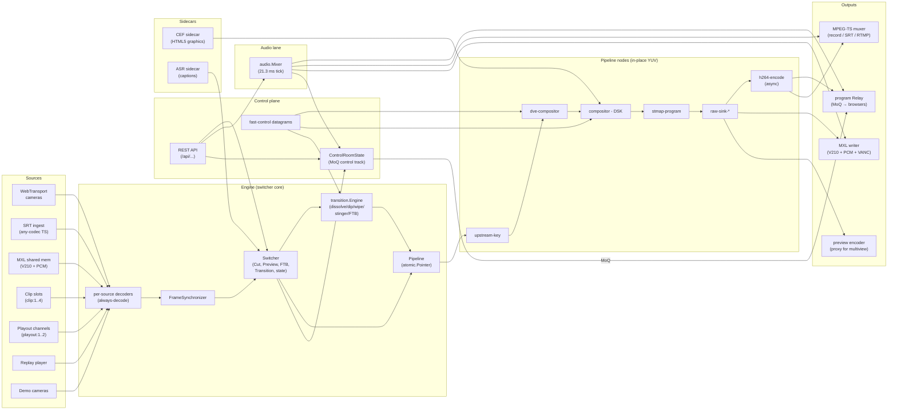
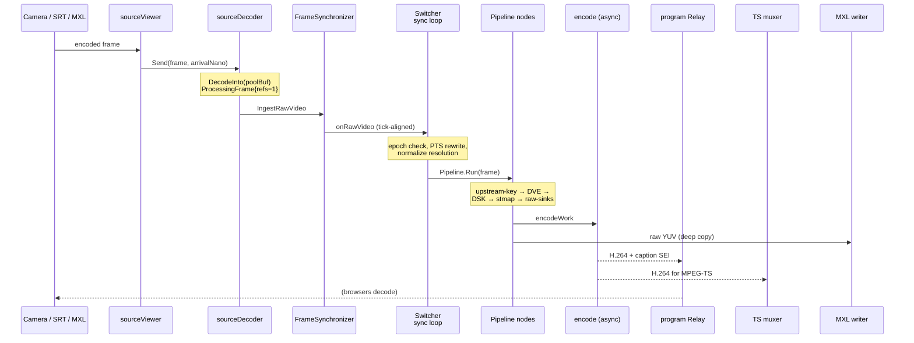
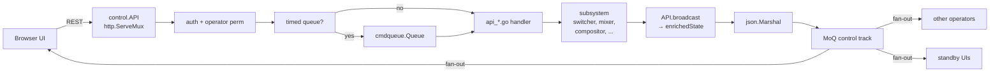

# Switchframe architecture

**TL;DR** Switchframe is a live video switcher that runs as a single Go binary on one host. A Svelte UI talks to it over QUIC / WebTransport; sources (SRT, MXL, MoQ cameras, file clips, playout channels) feed raw YUV into a [`Switcher`](../server/switcher/switcher.go); that YUV passes through an atomic in-place [`Pipeline`](../server/switcher/pipeline_loop.go) of nodes — upstream key, DVE, graphics, ST map, raw sinks, H.264/HEVC encode — and the encoded program fans out to a program relay for browsers, the MPEG-TS muxer for SRT / RTMP / recording, and MXL shared memory for baseband downstream. Audio runs in a sibling lane through the mixer, captions ride in SEI NALUs, SCTE-35 rides on its own TS PID, and a single `ControlRoomState` JSON blob broadcasts over a MoQ control track so every connected UI sees the same state in real time. This doc is the ground-level map of those pieces and how they connect.

## Read this first

If you have ten minutes, read just this file. It covers what Switchframe is, how a frame gets from the camera to the viewer, how the UI talks to the engine, and where to click next for depth on any one of those.

If you have an hour, follow the links. Each subsystem lives in its own doc under `subsystems/`, each wire format and API surface lives under `reference/`, and the cross-cutting mental models (locking, timing, GPU) live under `concepts/`. Every paragraph here earns its place by linking you somewhere specific.

## The big picture

The diagram hides most of the subsystems — clips, playout, replay, comms, SCTE-35, captions, color grading — but the skeleton is always the same. Every source arrives as raw YUV, the switcher decides what to do with it, the pipeline nodes process it in place, and the output fans out to every destination that asked for it. Everything else (audio, captions, SCTE-35, graphics) is a parallel lane that rejoins at a well-defined point.

## The media path

The [media-path doc](concepts/media-path.md) walks one video frame end to end. In summary: a frame arrives at a Prism `distribution.Relay`, its per-source [`sourceViewer`](../server/switcher/source_viewer.go) forwards the encoded bytes to a dedicated [`sourceDecoder`](../server/switcher/source_decoder.go) goroutine, the decoder emits YUV into a [`ProcessingFrame`](../server/switcher/processing_frame.go) from the pre-allocated [`FramePool`](../server/switcher/frame_pool.go), the [`FrameSynchronizer`](../server/switcher/frame_sync.go) aligns it to the pipeline tick grid, and the switcher's [`videoProcessingLoop`](../server/switcher/switcher.go) runs the atomic [`Pipeline`](../server/switcher/pipeline_loop.go) over it. The first principle is **always decode every source, every frame** so a cut never waits for the next IDR — see [concepts/pipeline.md](concepts/pipeline.md). The second is **atomic hot swap of the pipeline** so operators can toggle a chroma key or add a PIP slot without dropping a frame — see [concepts/pipeline.md#the-node-chain-and-atomic-swap](concepts/pipeline.md#the-node-chain-and-atomic-swap). Timing and PTS rewriting are covered in [concepts/frame-sync-and-timing.md](concepts/frame-sync-and-timing.md).

A single frame's life looks like this:

Three subsystems own most of this path. The [switcher](subsystems/switcher.md) owns state, the frame synchronizer, and the processing goroutine. The [transition engine](subsystems/transition.md) blends two sources when a dissolve/dip/wipe/stinger is active. The [output engine](subsystems/output.md) owns the MPEG-TS muxer, the CBR pacer, and every downstream destination (file recorder, SRT push, SRT pull, RTMP).

## Control plane

Every operator action — a button click, a macro step, an automation webhook — crosses the control plane before it reaches the media path. The [control-plane subsystem doc](subsystems/control-plane.md) walks the full vertical from HTTP middleware to state broadcast; [reference/api.md](reference/api.md) is the index into the 291 REST endpoints organized by subsystem.

The shape is: REST handler → optional timed command queue → subsystem mutation → state broadcast. A CUT, for example, lands on `POST /api/switch/cut` (see [reference/api/switching.md](reference/api/switching.md)), passes CORS + auth + operator permission middleware (see [subsystems/control-plane.md](subsystems/control-plane.md#middleware-stack)), optionally enters the [`cmdqueue`](../server/cmdqueue/queue.go) for dual-engine timing, invokes [`Switcher.Cut`](../server/switcher/switcher.go) which bumps the program epoch and forces the next IDR, then serializes the updated [`ControlRoomState`](../server/internal/types.go) and pushes it onto the MoQ control track.

The state-broadcast reference is [reference/state-broadcast.md](reference/state-broadcast.md) — it enumerates every field in the `ControlRoomState` JSON and when it ticks. High-frequency operator input (T-bar drag, DVE slot drag, graphics layer move) skips REST entirely and uses WebTransport datagrams on a tiny binary wire; see [reference/fast-control.md](reference/fast-control.md). The datagrams are fire-and-forget during the drag, then a single REST commit on `pointerup` produces the authoritative state broadcast. Multi-operator presence, subsystem locking, and role-based permissions live in [`server/operator/`](../server/operator/) and are documented alongside the rest of the control plane in [subsystems/control-plane.md](subsystems/control-plane.md#operators-sessions-and-locks).

## Audio

Audio takes a deliberately separate lane from video. Source AAC frames arrive at ~47 fps (1024 samples at 48 kHz) - almost incommensurate with the 30 fps video tick - so forcing audio through the frame synchronizer would produce bursty output that browser `AudioContext` cannot absorb. Instead, each source's ingest path decodes, applies the per-channel DSP chain (trim, phase, HPF, gate, EQ, compressor, balance, delay), and pushes processed PCM into a per-source ring buffer. Each ring is stamped with the media time of its newest samples. On every tick of the reference clock, the sync loop pulls each active ring's samples at the tick's read point (the media time the tick's video shows), sums them, applies master processing (master gain, BS.1770-4 LUFS, brickwall limiter), and encodes them with the tick's output PTS. The full story lives in [subsystems/audio.md](subsystems/audio.md).

A small `ptsCorrectionDelta` atomic bridges the two lanes: the frame sync tracks how far it has rewritten video PTS, publishes the delta, and the audio handler reads it before passing each audio frame to the mixer — so A/V stays aligned across video freezes. See [concepts/frame-sync-and-timing.md](concepts/frame-sync-and-timing.md).

## Graphics, DVE, and keying

Three distinct compositing stages ride on top of the switcher pipeline, all in YUV420 space with SIMD kernels per architecture. See [subsystems/graphics-and-dve.md](subsystems/graphics-and-dve.md) for the full story; [subsystems/stmap.md](subsystems/stmap.md) for coordinate warps.

- **Upstream keys** (per source, before mix). Chroma or luma key a talent source against a virtual-set fill before it enters the program bus.
- **DVE** (digital video effects) arranges up to eight source slots into PIP layouts with 2D affine and 3D homogeneous transforms, per-slot animations, and broadcast-quality transitions.
- **DSK** (downstream keyer) blends RGBA graphics — lower thirds, score bugs, tickers, animated PNG sequences, HTML5 templates — onto the finished program frame. Server-rendered text uses an embedded Inter font. Browser-rendered graphics arrive via the [CEF sidecar](integration/cef-protocol.md).
- **ST maps** are per-pixel coordinate remapping — lens correction, barrel/pincushion, fisheye-to-rectilinear, corner pin, plus creative effects (ripple, vortex, heat shimmer). Runs per-source (in the decoder callback) or per-program (as a pipeline node).

## Ad break signaling

SCTE-35 rides inside MPEG-TS on its own PID telling downstream splicers and packagers where commercial opportunities begin and end. SCTE-104 is the upstream automation protocol — same semantics carried in a different envelope, typically over SMPTE ST 291 VANC on SDI or MXL data flows. Switchframe speaks both through a single internal [`CueMessage`](../server/scte35/message.go) type. The [SCTE-35 injector](../server/scte35/injector.go) owns the lifecycle (inject, auto-return, hold, extend, cancel, webhook fan-out); an optional rules engine conditions inbound cues; the output TS muxer co-locates sections with the IDR they reference. See [subsystems/scte35.md](subsystems/scte35.md) for the bidirectional translation and the full story.

## Automation

Three layers stack from coarsest to finest: playout, macros, and presets.

**Playout** ([subsystems/playout.md](subsystems/playout.md)) is schedule-driven automated playback — two virtual channels (`playout:1`, `playout:2`) each running a validated playlist of clip / live / slate items, with internal transitions between items, SCTE-35 pod boards for ad breaks, black-frame-detected splice coordination, as-run logging, and crash-recovery state snapshots. The channel registers as a switcher source, so the operator can cut to it like any other camera.

**Macros** ([`server/macro/`](../server/macro/)) are named sequences of switcher operations — cut, wait, transition, graphics, audio, preset recall — that run sequentially with per-step progress broadcast. See [subsystems/control-plane.md#macros](subsystems/control-plane.md#macros).

**Presets** ([`server/preset/`](../server/preset/)) capture program / preview sources, transition settings, and audio channel snapshots for one-button recall. See [subsystems/control-plane.md#presets](subsystems/control-plane.md#presets).

## Outputs, in more detail

The output engine is the wide end of the funnel. One [`output.Manager`](../server/output/manager.go) owns a lazily-created [`TSMuxer`](../server/output/muxer.go) plus a dynamic set of destination adapters: on-disk recording, SRT push (caller), SRT listener (pull, N connections), and RTMP direct FLV. A [CBR pacer](../server/output/cbr_pacer.go) inserts null packets to give SRT destinations a constant muxrate; an [async adapter](../server/output/async_adapter.go) shields the hot path from slow disks and networks; a [confidence monitor](../server/output/confidence.go) emits a 1 fps JPEG thumbnail for the UI. A separate [MXL writer](subsystems/mxl.md) publishes uncompressed V210 + float32 PCM to POSIX shared memory for baseband-grade downstream. See [subsystems/output.md](subsystems/output.md) for the full story and [subsystems/srt-ingest.md](subsystems/srt-ingest.md) for the matching input side.

## Storage and sources

Inputs and library content cover six distinct substrates. Most operators never touch more than two of them.

- **WebTransport / MoQ** — browsers uploading camera video via Prism. The default path in demo mode and any browser-fed source.
- **SRT ingest** — operators pointing any-codec-over-TS at us over the public internet. See [subsystems/srt-ingest.md](subsystems/srt-ingest.md).
- **MXL shared memory** — NMOS-described uncompressed flows for broadcast plants. See [subsystems/mxl.md](subsystems/mxl.md).
- **Clips** — uploaded media library with four player slots; see [subsystems/clips.md](subsystems/clips.md).
- **Replay** — GOP-aligned per-source circular buffer with phase-vocoder audio time-stretch; see [subsystems/replay.md](subsystems/replay.md).
- **Playout** — schedule-driven virtual channels; see [subsystems/playout.md](subsystems/playout.md).

All six land at the same door: raw YUV + PCM delivered to the switcher's [`handleRawVideoFrame`](../server/switcher/switcher.go) and the mixer's [`IngestFrame`](../server/audio/mixer_ingest.go) / [`IngestPCM`](../server/audio/mixer_ingest.go). The path from there is identical regardless of where the bytes came from.

## Observability

The admin HTTP server ([`admin.go`](../server/cmd/switchframe/admin.go)) on a separate port exposes Prometheus metrics, Go pprof, and health/ready probes. Metric names and label cardinality are documented in [reference/metrics.md](reference/metrics.md). For operator-facing diagnostics, the debug snapshot endpoint aggregates per-subsystem state (pipeline node timings, source health, SRT connection stats, output destination state). See [subsystems/control-plane.md](subsystems/control-plane.md) for how the `Debug` interface is plumbed and [reference/api/debug-perf.md](reference/api/debug-perf.md) for the REST surface.

## Concurrency model

Switchframe runs dozens of goroutines. The concurrency rules are three sentences long:

1. **Configuration is mutex-protected; frames are not.** Every subsystem's `SetFoo` goes under a mutex; every per-frame `Process` runs lock-free.
2. **Atomics carry counters and snapshot pointers, never mutable state.** Pipelines, layouts, key snapshots, and callback pointers are `atomic.Pointer` to immutable values; rebuild = build-new + swap + drain-old.
3. **Channels cross goroutine boundaries; mutexes stay inside one goroutine's write path.** PCM samples, video frames, and encoded bytes all move between goroutines through bounded channels or ring buffers; shared state has a dedicated owner.

The full lock inventory, lock ordering rules, and deadlock-free guarantees live in [concepts/locking-and-concurrency.md](concepts/locking-and-concurrency.md).

## GPU acceleration

Switchframe runs on three video substrates: CUDA on Linux with NVIDIA GPUs, Metal on macOS, and pure CPU SIMD everywhere else. The backend is chosen at build time by Go build tag (`cuda`, `darwin`) and at runtime by a probe; failing to initialize the GPU context silently falls back to the CPU path. Every GPU operation has a CPU equivalent, and the switcher's pipeline runner transparently switches between them. See [concepts/gpu.md](concepts/gpu.md) for the full story: CUDA context and Metal unified memory, the pitched frame pool, upload/download kernels, the full kernel catalog, the GPU source manager's per-source cache, and the encoder integration (NVENC on Linux, VideoToolbox on macOS).

## Integration points

Three process boundaries matter outside the engine itself, each documented under `integration/`:

- **[UI ↔ engine](integration/ui-server-contract.md)** — the REST + MoQ + fast-control datagram + operator auth contract between the Svelte UI and the Go server. If you're writing a new client or a mobile app, start here.
- **[CEF sidecar](integration/cef-protocol.md)** — the C++ Chromium Embedded Framework sidecar that renders HTML5 graphics (OGraf templates, CasparCG, custom) to shared-memory RGBA, piped back to the DSK compositor.
- **[ASR sidecar](integration/asr-sidecar.md)** — the automatic speech recognition process (Parakeet-TDT via TensorRT, whisper.cpp with Metal) that produces captions from program audio.

Each integration is a separate process that the engine supervises; each talks over a dedicated local IPC channel (Unix socket or POSIX shared memory). Failures are isolated — the engine keeps running when a sidecar crashes.

## Reading order for new contributors

1. **Skim this file once.** You now know the shape.
2. **[concepts/media-path.md](concepts/media-path.md)** — one frame, end to end. If nothing else, know this.
3. **[concepts/pipeline.md](concepts/pipeline.md)** — why decoding is per-source-always and how the node chain swaps atomically.
4. **[concepts/frame-sync-and-timing.md](concepts/frame-sync-and-timing.md)** — how jittery sources become a smooth output.
5. **[concepts/locking-and-concurrency.md](concepts/locking-and-concurrency.md)** — the three rules that make it deadlock-free.
6. **[reference/api.md](reference/api.md)** + **[reference/state-broadcast.md](reference/state-broadcast.md)** — the control surface.
7. **Whichever subsystem you're about to touch** under `subsystems/`.

For operators and deployers, [operations/deployment.md](operations/deployment.md) covers how the binary runs in production.

## Related docs

- **Concepts:** [pipeline](concepts/pipeline.md) · [media-path](concepts/media-path.md) · [frame-sync-and-timing](concepts/frame-sync-and-timing.md) · [locking-and-concurrency](concepts/locking-and-concurrency.md) · [gpu](concepts/gpu.md)
- **Reference:** [api](reference/api.md) · [state-broadcast](reference/state-broadcast.md) · [fast-control](reference/fast-control.md) · [metrics](reference/metrics.md) · [config-and-flags](reference/config-and-flags.md) · [file-formats](reference/file-formats.md)
- **Subsystems:** [switcher](subsystems/switcher.md) · [transition](subsystems/transition.md) · [graphics-and-dve](subsystems/graphics-and-dve.md) · [stmap](subsystems/stmap.md) · [audio](subsystems/audio.md) · [captions](subsystems/captions.md) · [comms](subsystems/comms.md) · [output](subsystems/output.md) · [srt-ingest](subsystems/srt-ingest.md) · [mxl](subsystems/mxl.md) · [codec](subsystems/codec.md) · [control-plane](subsystems/control-plane.md) · [replay](subsystems/replay.md) · [clips](subsystems/clips.md) · [playout](subsystems/playout.md) · [scte35](subsystems/scte35.md)
- **Integration:** [ui-server-contract](integration/ui-server-contract.md) · [cef-protocol](integration/cef-protocol.md) · [asr-sidecar](integration/asr-sidecar.md)
- **Operations:** [deployment](operations/deployment.md)
- **Index:** [README](README.md)
