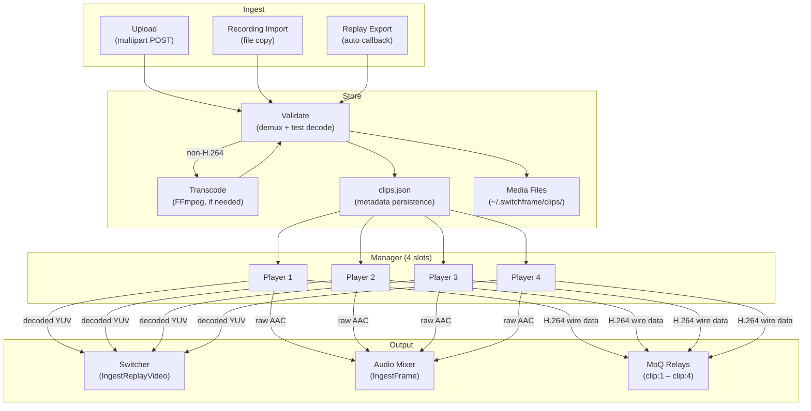
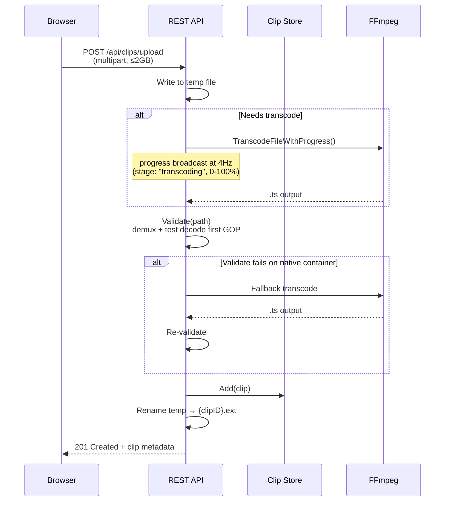
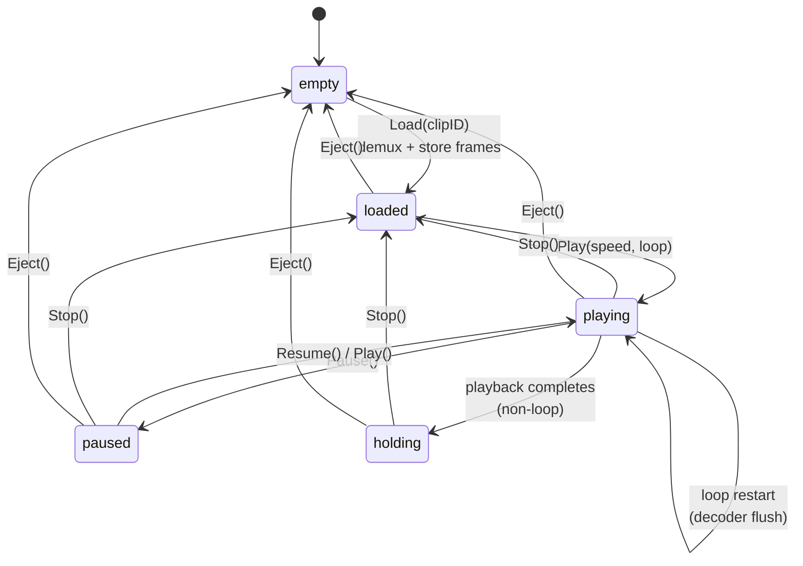

# Media Clip Library

1. [What Clips Does](#1-what-clips-does)
2. [Architecture](#2-architecture)
3. [Upload & Validation](#3-upload--validation)
4. [Player Lifecycle](#4-player-lifecycle)
5. [Transport Controls](#5-transport-controls)
6. [REST API Reference](#6-rest-api-reference)
7. [State Broadcast](#7-state-broadcast)
8. [Configuration](#8-configuration)
9. [File Reference](#9-file-reference)

---

## 1. What Clips Does

The clip library lets operators store, manage, and play back pre-recorded media files through the SwitchFrame switcher. Clips can be uploaded from disk, imported from recordings, or exported from instant replay. Once in the library, clips are loaded into one of **4 player slots** and played to program output — the same way a live camera source is switched.

Each player slot is a virtual source registered with the switcher. When a clip is playing, the operator can cut or dissolve to it, mix its audio through the audio mixer (with AFV enabled by default), and see it in the multiview alongside live cameras.

### Key capabilities

- **Media library** — Upload, list, rename, delete clips with metadata persistence
- **4 player slots** — Independent load/play/pause/stop per slot
- **Variable speed** — 0.25× to 2.0× playback
- **Loop & hold** — Loop mode or hold-last-frame when playback completes
- **Seek** — Jump to any position (0.0–1.0 normalized)
- **Format support** — H.264 in TS/MP4/MOV natively; MKV, WebM, AVI, FLV, MXF, WMV, MPG, OGV via transcode
- **Ephemeral clips** — Replay exports are auto-managed with configurable TTL
- **Per-player MoQ relay** — Each slot has a dedicated relay for browser preview

---

## 2. Architecture



### Store

The `Store` manages clip metadata as a JSON file (`clips.json`) alongside the media files in `~/.switchframe/clips/`. Each clip is identified by a random 32-character hex ID. Metadata includes codec, resolution, FPS, duration, audio parameters, and source origin. Persistence uses atomic writes (temp file → fsync → rename).

### Manager

The `Manager` owns the 4 player slots and bridges the store with the player instances. It handles:

- **Source registration** — Registers/unregisters each active player as a virtual source with the switcher and audio mixer
- **PTS anchoring** — Reads the program PTS at play time and offsets clip output to prevent backward PTS jumps when cut to program
- **Decoder/encoder lifecycle** — Creates per-player H.264 decoders (single-threaded for minimal latency) and re-encoders for browser compatibility

### Player

The `Player` runs a background goroutine that iterates through pre-demuxed frames with wall-clock pacing. It produces two parallel output streams:

1. **Decoded YUV** → scaled to pipeline resolution → `Switcher.IngestReplayVideo()` for the processing pipeline
2. **H.264 wire data** → re-encoded to 8-bit when needed → `MoQ relay.BroadcastVideo()` for browser playback

Audio frames are distributed proportionally across video output frames, maintaining sync at all playback speeds.

### MoQ Relays

Each player slot has a dedicated MoQ relay (`clip:1` through `clip:4`) registered with the Prism media server. Browsers subscribe to these relays to preview clip sources in the multiview. When GPU preview encoding is available, the relay receives 480p preview frames instead of full-quality re-encoded video.

---

## 3. Upload & Validation

### Accepted Formats

| Category | Extensions | Processing |
|----------|-----------|------------|
| Native (H.264) | `.ts`, `.mp4`, `.m4v`, `.mov` | Direct demux via Go-native parser |
| Transcode required | `.mkv`, `.webm`, `.avi`, `.flv`, `.mxf`, `.wmv`, `.mpg`, `.mpeg`, `.ogv` | FFmpeg transcode to H.264+AAC TS |
| Non-H.264 in native container | `.mp4` with HEVC, `.mov` with ProRes, etc. | Detected by `ProbeFile()`, transcoded |

### Upload Flow



### Three-Stage Validation

1. **Container probe** — Check extension, demux file (TS or MP4 path), extract SPS metadata for resolution
2. **Test decode** — Decode first GOP (up to 30 frames) using the real video decoder to verify codec integrity, check for dimension mismatches (±16px tolerance for macroblock alignment)
3. **Metadata extraction** — Compute duration from PTS span, estimate FPS (snap to standard broadcast rates), build probe result

### Demuxing

The demuxer dispatches by file extension:

| Container | Parser | Video Format | Audio Format |
|-----------|--------|-------------|-------------|
| `.ts` / `.mts` / `.m2ts` | `go-astits` | PES → Annex B → AVC1 (SPS/PPS extracted) | ADTS → raw AAC payloads |
| `.mp4` / `.m4v` / `.mov` | `go-mp4` box-tree walker | Sample table → AVC1 (SPS/PPS from avcC box) | Sample table → raw AAC payloads |

Video frames are kept in **decode order** (not PTS/display order) because the H.264 decoder needs reference frames before B-frames. Audio frames are sorted by PTS.

### Transcode-on-Upload

When a file needs transcoding (non-H.264 codec or transcode-only extension), the upload handler:

1. Detects via `NeedsTranscode()` — probes the file with FFmpeg if the extension is a native container
2. Runs `codec.TranscodeFileWithProgress()` — produces H.264+AAC MPEG-TS output
3. Polls progress at 4Hz via atomic int32 — broadcasts `"transcoding"` stage updates to the browser
4. Validates the transcoded output through the normal pipeline

A fallback path exists for MP4/MOV files that pass the H.264 probe but fail the Go-native demuxer (fragmented MP4, unusual box layouts). These are caught at validation time and retried through FFmpeg transcode.

### Clip Sources

| Source | Origin | Ephemeral |
|--------|--------|:---------:|
| `upload` | User file upload | No |
| `recording` | Import from recording file | No |
| `replay` | Automatic export from instant replay | Yes |

Ephemeral clips are automatically cleaned on startup if older than `--clip-ephemeral-ttl`. Clips currently loaded in player slots are protected from cleanup. An ephemeral clip can be pinned (made permanent) via `POST /api/clips/{id}/pin`.

---

## 4. Player Lifecycle



### States

| State | Description |
|-------|-------------|
| `empty` | Slot has no clip loaded |
| `loaded` | Clip demuxed and frames stored in memory; ready to play |
| `playing` | Background goroutine outputting frames at wall-clock rate |
| `paused` | Playback suspended; last frame held; channel blocks on `pauseCh` |
| `holding` | Playback complete (non-loop); last frame output at 1fps to keep source alive |

### Load

`Manager.Load()` looks up the clip in the store, demuxes the media file into in-memory frame buffers (video + audio), and stores them in the player slot. If the slot already has content, it ejects the existing clip first (stopping playback if active). The slot transitions to `loaded`.

### Play

`Manager.Play()` creates a `Player` with the stored frames and starts a background goroutine. Before starting:

1. Reads the current program PTS via `ptsProvider` and offsets by one frame (3003 ticks at 30fps) to prevent backward PTS jumps
2. Creates a per-player H.264 decoder (single-threaded for minimal latency)
3. Registers the player as a virtual source with the switcher and audio mixer

The player estimates source FPS from the PTS span of the demuxed frames, snapping to standard broadcast rates (23.976, 24, 25, 29.97, 30, 50, 59.94, 60).

### Hold-Last-Frame

When a non-looping clip reaches the end:

1. State transitions to `holding`
2. `OnDone` callback fires (decoder is closed but player stays alive)
3. `holdLoop` outputs the last decoded YUV frame and last keyframe wire data at 1fps
4. The source stays registered — health checks see it as alive, the browser gets periodic keyframes

### Loop

When loop mode is enabled and playback reaches the end:

1. The decoder is flushed via `FlushableDecoder.Flush()` so it can handle fresh SPS/PPS
2. Decode error tracking resets
3. `videoInfoSent` resets so the browser gets fresh codec parameters
4. Audio indices reset to zero
5. Playback restarts from frame 0

---

## 5. Transport Controls

### Speed (0.25× – 2.0×)

Speed control uses frame duplication for slow-motion and frame pacing for fast-forward:

| Speed Range | Mechanism | Example |
|:-----------:|-----------|---------|
| 0.25× – 1.0× | Frame duplication (`dupCount = round(1/speed)`) | 0.5× → each frame output twice |
| 1.0× – 2.0× | Faster pacing (`frameDuration = 1 / (fps × speed)`) | 2.0× → half the normal frame interval |

PTS increments are adjusted accordingly: `ptsPerFrame = 90000 / (sourceFPS × dupCount)`.

Speed can be changed mid-playback via `SetSpeed()`. The player recalculates timing parameters, resets the pacing clock, and continues from the current frame.

### Pause / Resume

Pause is implemented with a channel-based blocking mechanism:

- **Pause**: Replace `pauseCh` with a new open channel; playback goroutine blocks on `<-pauseCh`
- **Resume**: Close the channel to unblock; state returns to `playing`

The pause check happens before each frame output, so pause takes effect within one frame interval.

### Seek

Seek accepts a normalized position (0.0–1.0) and translates to a frame index:

```
targetIdx = position × totalClipFrames
```

Seeking resets the pacing clock to prevent a burst of catch-up frames and proportionally adjusts the audio index. The seek channel is buffered (capacity 1) with drain-and-replace semantics — rapid seeks always use the latest position.

### Pacing

Frame pacing uses absolute time to prevent drift from callback overhead:

```
deadline = playbackStart + (pacingIdx × frameDuration)
wait = deadline - now
```

A reusable `time.Timer` handles the wait, with context cancellation support for clean shutdown.

---

## 6. REST API Reference

### Clip Library

| Method | Path | Description |
|:------:|------|-------------|
| GET | `/api/clips` | List all clips (sorted by creation time, newest first) |
| GET | `/api/clips/{id}` | Get clip metadata by ID |
| PUT | `/api/clips/{id}` | Update mutable fields (`{"name": "...", "loop": true}`) |
| DELETE | `/api/clips/{id}` | Delete clip and its media file |
| POST | `/api/clips/{id}/pin` | Mark ephemeral clip as permanent |
| POST | `/api/clips/upload` | Upload media file (multipart, `file` field, ≤2GB) |
| POST | `/api/clips/from-recording` | Import recording file (`{"path": "..."}`) |
| GET | `/api/clips/recordings` | List available recording files for import |

### Player Controls

| Method | Path | Body | Description |
|:------:|------|------|-------------|
| GET | `/api/clips/players` | — | List state of all 4 player slots |
| POST | `/api/clips/players/{n}/load` | `{"clipId": "..."}` | Load clip into slot (1–4) |
| POST | `/api/clips/players/{n}/eject` | — | Eject clip from slot |
| POST | `/api/clips/players/{n}/play` | `{"speed": 1.0, "loop": false}` | Start/resume playback |
| POST | `/api/clips/players/{n}/pause` | — | Pause playback |
| POST | `/api/clips/players/{n}/stop` | — | Stop playback (keep clip loaded) |
| POST | `/api/clips/players/{n}/seek` | `{"position": 0.5}` | Seek to position (0.0–1.0) |
| POST | `/api/clips/players/{n}/speed` | `{"speed": 0.5}` | Change speed mid-playback (0.25–2.0) |
| POST | `/api/clips/players/{n}/loop` | `{"loop": true}` | Change loop setting |

### Error Responses

| Status | Error | Condition |
|:------:|-------|-----------|
| 400 | `ErrInvalidPlayer` | Player ID not 1–4 |
| 400 | `ErrInvalidSpeed` | Speed outside 0.25–2.0 |
| 400 | `ErrInvalidFormat` | Unsupported file extension |
| 400 | `ErrOddDimensions` | Video dimensions not even (required for YUV420) |
| 404 | `ErrNotFound` | Clip ID not in store |
| 404 | `ErrPlayerEmpty` | Slot has no clip loaded |
| 409 | Upload in progress | Concurrent upload attempted |
| 422 | `ErrNoVideo` | No video stream in file |
| 422 | `ErrCorruptFile` | File corrupt or decode failure |
| 422 | `ErrTranscodeFailed` | FFmpeg transcode failed |
| 507 | `ErrStorageFull` | Storage limit exceeded |

---

## 7. State Broadcast

Clip state is included in `ControlRoomState` and pushed to browsers via the MoQ control track on every state change (load, play, pause, stop, eject, speed change, loop change, progress update).

```typescript
interface ControlRoomState {
  clipPlayers: ClipPlayerInfo[];
  clipCount: number;
  clipUpload?: ClipUploadProgress;
  // ... other fields
}

interface ClipPlayerInfo {
  id: number;         // 1–4
  clipId?: string;
  clipName?: string;
  state: "empty" | "loaded" | "playing" | "paused" | "holding";
  speed?: number;     // 0.25–2.0 (only when playing/paused)
  position?: number;  // 0.0–1.0 playback progress
  loop?: boolean;
}

interface ClipUploadProgress {
  stage: "uploading" | "analyzing" | "transcoding" | "validating";
  percent: number;    // 0–100 within current stage
  filename?: string;
}
```

The `clipPlayers` array always contains exactly 4 elements (one per slot). `clipCount` reflects the total number of clips in the store. `clipUpload` is present only during an active upload and is cleared when the upload completes or fails.

---

## 8. Configuration

### CLI Flags

| Flag | Default | Description |
|------|:-------:|-------------|
| `--clip-storage-max` | `10737418240` (10GB) | Maximum total storage for non-ephemeral clips in bytes |
| `--clip-ephemeral-ttl` | `24h` | Time-to-live for ephemeral clips (replay exports). `0` disables cleanup. |

### Storage Paths

| Path | Contents |
|------|----------|
| `~/.switchframe/clips/` | Media files and `clips.json` metadata |
| `~/.switchframe/clips/clips.json` | JSON array of clip metadata (atomic writes) |

The state directory prefix (`~/.switchframe/`) is configurable via the application's `statePath()` function.

### Concurrency

The `Store` uses a `sync.RWMutex` — reads (`Get`, `List`, `TotalBytes`) acquire `RLock`, writes (`Add`, `Update`, `Delete`, `Pin`, `CleanEphemeral`) acquire full `Lock`. The `save()` method writes atomically (temp file → fsync → rename) and must be called with the mutex held.

The `Manager` uses a single `sync.Mutex` protecting the player slots array. State change callbacks and player lifecycle callbacks (`onPlayerStart`, `onPlayerStop`) are invoked outside the lock to prevent deadlock — the callback may re-enter via `PlayerStates()` which acquires the same mutex.

The `Player` uses lock-free atomics for its hot path:
- `atomic.Value` for state and speed
- `atomic.Int64` for progress (stored as milliprogress 0–1000)
- `atomic.Bool` for loop
- `atomic.Pointer[chan struct{}]` for the pause channel

The upload handler allows only one concurrent upload, guarded by `uploadMu`. A 10-minute timeout prevents stale uploads from blocking new ones.

---

## 9. File Reference

```
server/clip/
  types.go          Clip, ClipPlayerState, PlayerState, ProbeResult, sentinel errors,
                    VideoDecoder/VideoEncoder interfaces, MaxPlayers=4
  store.go          Store: CRUD, storage limit, ephemeral cleanup, atomic JSON persistence
  manager.go        Manager: 4 player slots, source registration, PTS anchoring,
                    output callback wiring, lifecycle callbacks
  player.go         Player: background playback goroutine, pause/resume/seek/speed/loop,
                    hold-last-frame, re-encode for browser, audio distribution
  demux.go          DemuxFile: format dispatch, MPEG-TS demuxer (go-astits),
                    Annex B → AVC1 conversion, ADTS → raw AAC splitting
  demux_mp4.go      MP4 box-tree parser (go-mp4): track metadata, sample table,
                    DTS/CTS computation, NALU length normalization, ESDS parsing
  validator.go      Validate: 3-stage pipeline (container probe, test decode, metadata),
                    SPS dimension parser, FPS estimation, NeedsTranscode, CanTranscodeFallback

server/control/
  api_clips.go      18 REST API handlers, multipart upload with progress broadcast,
                    transcode polling, recording import, concurrency guard

server/cmd/switchframe/
  app_clips.go      Application wiring: store + manager init, per-player MoQ relay
                    registration, GPU preview encoding, raw/video/audio output callbacks,
                    replay export integration, ephemeral cleanup
```

---

*See also: [Architecture](architecture.md) · [API Reference](api.md) · [Pipeline](pipeline.md) · [Deployment](deployment.md)*
