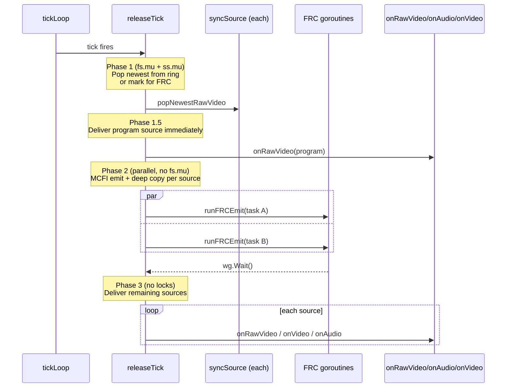
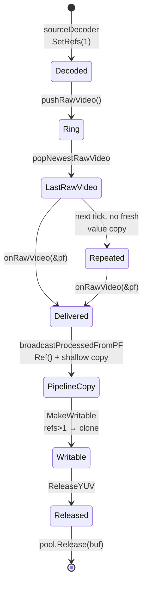

# Frame synchronization and timing

> **Where you are:** [docs](../README.md) → concepts → frame-sync-and-timing
> **Read this first:** [architecture.md](../architecture.md)
> **See also:** [media-path](media-path.md) · [pipeline](pipeline.md) · [locking-and-concurrency](locking-and-concurrency.md)

**TL;DR** — Independent sources freewheel on their own PTS clocks; the switcher has to turn their jittery arrival into a single smooth 30/60 fps output stream. [`FrameSynchronizer`](../../server/switcher/frame_sync.go) holds a small per-source ring buffer, ticks at the program frame rate, releases the newest available frame on each tick, repeats the last frame when a source falls silent (freeze), and optionally synthesizes in-between frames with motion-compensated interpolation for slow-motion replay. Video PTS is rewritten to a monotonic grid on the MPEG-TS 90 kHz clock; audio skips the sync entirely and is only corrected by a small published delta so A/V stays aligned across freezes. Decoded YUV lives in reference-counted [`ProcessingFrame`](../../server/switcher/processing_frame.go) buffers from a pre-allocated [`FramePool`](../../server/switcher/frame_pool.go) so the garbage collector never sees the hot path.

## The story

Freerun switching is a classical broadcast problem. Two cameras cabled to a router arrive at exactly the same vertical sync because genlock enforces it. Two IP sources do not. A WebTransport camera, an SRT feed, a clip player, and an MXL flow each ticks on its own clock — some quantized (file replay at exact 30 fps), some jittery (an operator dialing in over LTE), and some drifting (a hardware encoder whose crystal is 150 ppm fast). If the switcher simply forwarded whichever frame happened to arrive most recently, the program output would show stutter at every cut, fractional lips on every dissolve, and A/V sync would drift within a single broadcast hour.

Switchframe solves this with a software **freerun frame sync** — conceptually the same as a hardware time-base corrector plus frame synchronizer. It absorbs source jitter into per-source ring buffers, releases frames at a fixed tick grid at the program frame rate, repeats the last frame ("freezes") when a source hiccups, and clamps PTS forward so downstream decoders never see a regression. Because the ring buffer releases are paced by a clock (either a `time.Timer` or, optionally, the [reference clock sync loop](../subsystems/switcher.md#reference-clock-mode)), the program output's cadence is bounded by one tick even in the face of wildly uneven source arrival.

There's a subtle second problem: what if a source runs *slower* than the pipeline? A 24 fps clip into a 60 fps program can't be handled by freeze alone — you'd freeze 60% of the time, which looks awful on motion. Switchframe's **frame rate conversion (FRC)** fills the gap. At the lowest quality it picks the nearest source frame in PTS; blend quality linearly interpolates (which introduces ghosting on motion); MCFI quality estimates 16×16 motion vectors with a SIMD-accelerated diamond search and warps the previous frame forward with bilinear sampling for a genuinely synthesized intermediate. MCFI is expensive (~5-15 ms on 1080p) so the program source gets full quality and non-program sources are demoted to nearest.

Audio does not travel this path. AAC frames arrive at ~47 fps (1024 samples at 48 kHz) — almost incommensurate with the 30 fps video tick. Batching audio to tick boundaries makes browsers pop. So audio takes a sibling lane: frames go straight to the mixer, and a small **correction delta** is published by the frame sync so the mixer knows how far video PTS has been rewritten and can track A/V sync through freezes.

## How it works

### Clock, tick interval, and rational frame rates

The switcher measures time in the MPEG-TS 90 kHz clock. That constant — `mpegtsClock = 90000` in [`frame_sync.go`](../../server/switcher/frame_sync.go) — is the unit of every PTS in the system. Tick intervals are computed as rational numbers so NTSC rates (29.97, 59.94, 23.976) don't truncate and drift.

A 29.97 fps pipeline has a tick PTS interval of `90000 * 1001 / 30000 = 3003`. A 59.94 fps pipeline is `90000 * 1001 / 60000 = 1501.5`, which truncates to 1501 — off by 0.5 per tick, accumulating to one frame every two seconds without correction. [`tickPTSWithRemainder`](../../server/switcher/frame_sync.go) uses a Bresenham-style accumulator per source: on each tick it adds the numerator remainder to `ptsRemAccum`; when the accumulator exceeds the denominator it bumps the interval by one and subtracts. Over time the average interval matches the rational rate exactly.

PTS arithmetic uses `ptsMask33 = (1 << 33) - 1` because MPEG-TS PTS wraps at 33 bits (about 26.5 hours). [`ptsAfter`](../../server/switcher/frame_sync.go) computes "is A after B" with wrap tolerance by treating the 33-bit range as circular — forward distances in the lower half mean after, upper half means wrapped behind. This matters less on a given broadcast but is critical for 24/7 operation.

### Per-source ring buffers

Every source registered with the synchronizer gets a [`syncSource`](../../server/switcher/frame_sync.go) structure containing:

- `pendingRawVideo [2]*ProcessingFrame` — a 2-slot ring buffer for newly arrived raw YUV frames.
- `lastRawVideo` — the most recently released frame, repeated on freeze.
- `pendingAudio` and `audioQueue` — audio gets both a ring (for freeze) and a FIFO (for drain-all-on-tick behavior because audio frames must never be dropped).
- An `frcSource` pointer when FRC is enabled.
- A `driftEstimator` that tracks PTS-vs-wall-clock drift for diagnostics.

Two slots is the minimum that lets one frame be consumed while the next arrives. When a third arrives before the tick fires, the oldest is evicted and its pool buffer is released — newest-wins is the right policy for live video because nobody wants to see last-tick's stale frame.

Ingestion goes through `pushRawVideo`, ingestion's only choice being whether to also sample drift and ingest into FRC's own buffers. When FRC is active, `frc.ingest(pf)` takes an independent reference on the frame via `Ref()`, so the ring's release on overwrite doesn't free a buffer FRC is still holding. This is the FFmpeg AVBufferRef model carried through.

### The tick loop

[`FrameSynchronizer.tickLoop`](../../server/switcher/frame_sync.go) is a single goroutine running a monotonic deadline loop. Each iteration waits for the earlier of:

1. The next scheduled tick (`time.Timer` fires).
2. `programFrameReady` signal — the program source's `IngestRawVideo` landed a fresh frame and wants immediate release.
3. `done` for shutdown.

Early release is the **phase-lock** trick that reduces end-to-end latency. If the program source happens to produce a frame, why wait up to one tick period for the timer? Fire immediately, advance the tick grid by one period (so the next timer fire is still one tick away rather than extra), and the program frame reaches the pipeline with ~0 ms sync-wait instead of up to 33 ms at 30 fps. Non-program sources still pay sync wait (they're only read for graphics caches and transitions), but the program path is effectively zero-delay.

Clock-driven mode (`SetClockDriven(true)`) disables the early release. In that mode the timer is the sole driver, decoupling output cadence entirely from source jitter — the hardware frame-sync behavior, at the cost of up to one frame of latency. This is the setting you want for broadcast TX paths where steady timing outweighs latency.

### releaseTick, three phases

On every tick, [`FrameSynchronizer.releaseTick`](../../server/switcher/frame_sync.go) runs three phases:

**Phase 1** (fs.mu + per-source ss.mu held briefly): for each source, pop the newest frame from its ring or, if FRC is configured and can interpolate, queue an FRC task for Phase 2. Fresh pops reset the FRC "ticks since last fresh" counter; empty rings increment it and fall back to `lastRawVideo` for freeze. Audio's FIFO queue is drained entirely (no drops) and the newest audio is also tracked for freeze fallback.

**Phase 1.5** (no lock): if the program source has a fresh frame and isn't waiting on FRC, deliver it immediately. This saves up to ~6.6 ms of waiting for other sources' MCFI to finish. Disabled in clock-driven mode, where all sources are delivered together in Phase 3 for consistent timing.

**Phase 2** (each FRC task locks only its own ss.mu): run MCFI emit + deep copy in parallel. One source runs inline; multiple spawn goroutines and join with a WaitGroup. Transforms total tick time from O(sum of MCFI times) to O(max of MCFI times).

**Phase 3** (no locks): deliver remaining sources. PTS assignment happens here in [`FrameSynchronizer.deliverRelease`](../../server/switcher/frame_sync.go):

- Fresh source frame: preserve source PTS; if behind `lastReleasedPTS`, clamp forward to tick+1 to prevent backward PTS.
- Repeated/frozen frame: advance `lastReleasedPTS` by one tick interval (with Bresenham remainder).
- FRC-interpolated frame: use the computed `frcPTS`.

The `ptsCorrectionDelta` — the signed difference between the rewritten PTS and the original source PTS — is stored atomically on `syncSource`. The switcher's [`handleAudioFrame`](../../server/switcher/switcher.go) reads this delta (via `FrameSynchronizer.GetSourcePTSCorrection`) and adds it to each audio frame's PTS before passing it to the mixer, keeping A/V aligned across video freezes.

### Frame pool lifecycle

The [`FramePool`](../../server/switcher/frame_pool.go) is where every YUV buffer lives. See [the pipeline doc](pipeline.md#the-framepool) for the allocation mechanics. For timing purposes, what matters is the **reference count lifecycle** of a single frame:

The **creation ref** (`SetRefs(1)` in the decoder) is held by `lastRawVideo`. The **pipeline ref** is added by `broadcastProcessedFromPF` and carried through the processing loop. When the pipeline's `MakeWritable` decides to clone (because `refs > 1`), it drops its shared ref and attaches a fresh refcount with the new buffer — so modifying the compositor output never touches the frame sync's `lastRawVideo`.

FRC is slightly different: [`runFRCEmit`](../../server/switcher/frame_sync.go) allocates a fresh pool buffer, copies the MCFI output into it, and sets `r.frcAllocated = true`. `deliverRelease` drops that creation ref after `onRawVideo` returns. Without this the MCFI output buffer would leak (FRC's scratch is repeatedly overwritten, so the pipeline's ref is sole owner once the tick returns).

### Delay buffers

Per-source lip-sync delay (`0-500 ms`) is handled by [`DelayBuffer`](../../server/switcher/delay_buffer.go), a zero-goroutine scheduler: each delayed frame is scheduled via `time.AfterFunc`, which fires a callback to forward the frame to the real handler. When delay is 0 for a source, the frame passes through immediately — no allocation, no scheduling cost.

The delay buffer is used only when frame sync is **not** active. Frame sync and delay buffer are mutually exclusive because frame sync's tick-based release and delay buffer's AfterFunc-based release would interact unpredictably. [`Switcher.SetFrameSync`](../../server/switcher/switcher.go) explicitly swaps each source viewer between the two, storing `nil` into the unused `atomic.Pointer` slot.

### MCFI and slow motion

Motion-compensated frame interpolation has two separate use cases in Switchframe:

1. **FRC inside the frame sync** — when a slow source needs intermediate frames to reach the tick grid. Quality decisions happen in `frcSource` (see [`frc.go`](../../server/switcher/frc.go) and `frc_me.go`).
2. **Slow-motion replay** — the replay player duplicates source frames at 0.25× / 0.5× speed and calls `FrameInterpolator.Interpolate` to synthesize in-betweens instead of freezing. The pluggable interpolator interface lives in [`replay/interpolator.go`](../../server/replay/interpolator.go); [`MCFIState`](../../server/switcher/mcfi_interpolate.go) is the standalone implementation the replay system uses.

The standalone MCFI is carefully designed for replay's access pattern: **one source frame pair, many calls with different alpha values**. Motion vectors are estimated once per frame pair and cached by frame pointer identity — subsequent calls in the same pair do only the warp (~8-18 ms at 1080p) instead of re-estimating MVs (~5-15 ms on top). Near-threshold checks short-circuit extreme alpha (below 0.05 or above 0.95) to a plain copy.

The MV field is computed at 16×16 block granularity using SIMD-accelerated SAD (see [`frcasm/`](../../server/switcher/frcasm/)) and diamond search. The warp uses 16.16 fixed-point bilinear sampling in [`mcfi_warp_fast.go`](../../server/switcher/mcfi_warp_fast.go) — no floating point, one row per goroutine, with per-pixel MV interpolation to eliminate block boundary artifacts. On scene change (adaptive SAD threshold) it falls back to linear blend.

See [subsystems/replay](../subsystems/replay.md) for the full replay story.

### Clock drift tracking

Each `syncSource` carries a [`driftEstimator`](../../server/switcher/frame_sync.go) that samples PTS vs wall clock on every ingest. After 100 samples it computes `driftPPM = (wallElapsed - expectedWallNs) * 1M / expectedWallNs`. Positive means the source clock is faster than the pipeline — over time, frames will arrive slightly early and the freeze/repeat counter will tend toward drops; negative means the source is slow and repeats will accumulate. The value is exposed in the debug snapshot; production operations use it to diagnose hardware encoders with drifting oscillators.

## Key types and entry points

- Clock and masks: [`server/switcher/frame_sync.go`](../../server/switcher/frame_sync.go) → `mpegtsClock`, `ptsMask33`, `ptsAfter`, `tickPTSWithRemainder`.
- Per-source state: [`server/switcher/frame_sync.go`](../../server/switcher/frame_sync.go) → `syncSource`.
- Top-level sync: [`server/switcher/frame_sync.go`](../../server/switcher/frame_sync.go) → `FrameSynchronizer`, `IngestRawVideo`, `IngestAudio`, `releaseTick`, `deliverRelease`.
- Tick loop: [`server/switcher/frame_sync.go`](../../server/switcher/frame_sync.go) → `FrameSynchronizer.tickLoop()`.
- FRC integration: [`server/switcher/frc.go`](../../server/switcher/frc.go), `frc_me.go`, `frcasm/`.
- Standalone MCFI: [`server/switcher/mcfi_interpolate.go`](../../server/switcher/mcfi_interpolate.go) → `MCFIState.Interpolate`, `MCFIState.InterpolateInto`.
- Delay buffer: [`server/switcher/delay_buffer.go`](../../server/switcher/delay_buffer.go) → `DelayBuffer.SetDelay`, `handleRawVideoFrame`.
- Frame pool: [`server/switcher/frame_pool.go`](../../server/switcher/frame_pool.go) → `FramePool.Acquire`, `Release`, `Close`.
- PTS audio correction: [`server/switcher/switcher.go`](../../server/switcher/switcher.go) → `Switcher.handleAudioFrame` consumes `GetSourcePTSCorrection`.

State ownership: `fs.mu` guards the sources map and lifecycle flags. Each `syncSource` has its own `ss.mu` protecting ring buffers and last-frame state. Locking order is always `fs.mu → ss.mu`; Phase 2 FRC runs without `fs.mu` specifically so ingest calls don't block on MCFI. See [locking-and-concurrency](locking-and-concurrency.md) for the global order.

## Gotchas and invariants

**Audio never flows through the frame sync.** The [`sourceViewer.SendAudio`](../../server/switcher/source_viewer.go) path intentionally bypasses the synchronizer: quantizing ~47 fps audio to a 30 fps video tick creates bursts that browser `AudioContext` cannot absorb. The `ptsCorrectionDelta` mechanism exists specifically to keep audio aligned with the video PTS rewrites without coupling its delivery to the video tick.

**Fresh-vs-repeated changes PTS strategy per frame.** Fresh source frames preserve their original PTS unless they would be backward-in-time relative to the last released PTS — in which case they're clamped forward. Repeats advance by one tick interval. FRC-synthesized frames use the pre-computed interpolation PTS. All three paths clear `DecodeEndNano`/`DecodeStartNano`/`ArrivalNano` on non-fresh frames so sync-wait measurements don't inherit a stale 36 ms from the original frame.

**Fresh delivery to the pipeline goes through `Ref()` not `DeepCopy`.** The raw video path in [`Switcher.broadcastProcessedFromPF`](../../server/switcher/switcher.go) takes a shallow value copy of the frame and calls `Ref()`, sharing the buffer with the frame sync's `lastRawVideo`. The pipeline's `MakeWritable` on first in-place write is what detaches. This is the FFmpeg AVBufferRef pattern — one buffer, many holders, copy on write.

**Unmanaged FRC output uses `DeepCopy`.** FRC scratch buffers (`nearestOut`, `blendOut`) are reused across calls, so a reference-shared pipeline delivery would alias next tick's output. [`runFRCEmit`](../../server/switcher/frame_sync.go) allocates a fresh pool buffer, sets `r.frcAllocated = true`, and `deliverRelease` releases the creation ref after the callback returns.

**Program-source demotion on cut for MCFI.** When frame sync quality is MCFI and the program source changes, [`FrameSynchronizer.SetProgramSource`](../../server/switcher/frame_sync.go) demotes the old program source to `FRCNearest` and promotes the new one to full MCFI. This is how Switchframe bounds MCFI CPU cost to a single source at any moment — MCFI on every source at 1080p would blow the frame budget.

**33-bit wrap is a real concern.** Linear PTS math will break at the 26.5-hour boundary. All comparisons use `ptsAfter` with modular distance; all advances apply `& ptsMask33` after addition. Signed-delta computation in `deliverRelease` explicitly adjusts when the masked delta lands in the upper half (treating as negative), so the correction delta atomic stays accurate across wrap.

**The frame pool's duplicate check is load-bearing.** On pipeline rebuild, a frame in flight might be released twice if two code paths both drop their ref — the pool's scan of `free` by base pointer turns double-release into a no-op instead of an alias. The scan is O(pool size), which is typically 4-16 entries at rest, negligible.

**`time.AfterFunc` in the delay buffer has no lifetime tie.** The callbacks fire regardless of `RemoveSource` being called later. The generation counter on `sourceDelay` is the guard: when `RemoveSource` bumps it, already-scheduled callbacks see the mismatch and drop the frame. The `stopped` flag covers full shutdown. This is why setting and removing a delayed source repeatedly does not leak goroutines.

## Related docs

- **Concepts:** [pipeline](pipeline.md), [media-path](media-path.md), [locking-and-concurrency](locking-and-concurrency.md)
- **Subsystems:** [switcher](../subsystems/switcher.md), [transition](../subsystems/transition.md), [audio](../subsystems/audio.md), [replay](../subsystems/replay.md), [codec](../subsystems/codec.md)
- **Reference:** [metrics](../reference/metrics.md#switcher-metrics), [config-and-flags](../reference/config-and-flags.md)
- **Integration:** [ui-server-contract](../integration/ui-server-contract.md)
