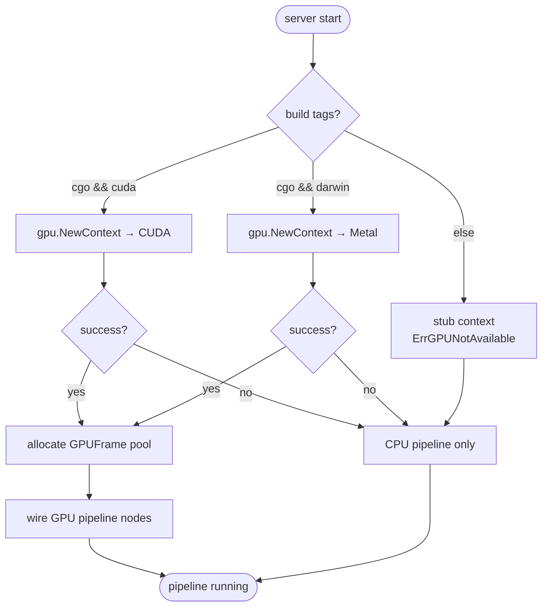
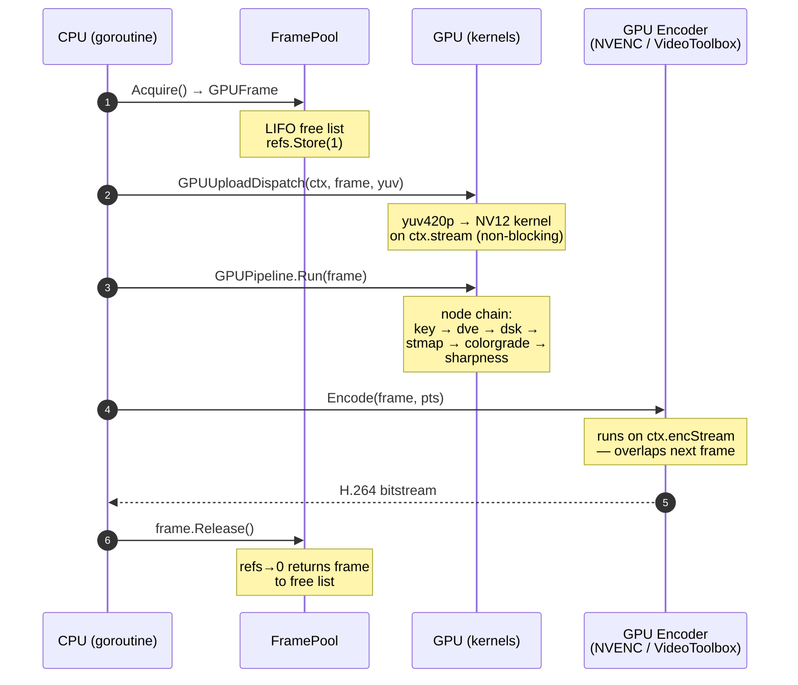

# GPU Backends

> **Where you are:** [docs](../README.md) → concepts → gpu
> **Read this first:** [architecture.md](../architecture.md)
> **See also:** [pipeline.md](./pipeline.md) · [media-path.md](./media-path.md) · [frame-sync-and-timing.md](./frame-sync-and-timing.md) · [locking-and-concurrency.md](./locking-and-concurrency.md)

**TL;DR** Switchframe runs on three video substrates: CUDA on Linux with NVIDIA GPUs, Metal on macOS, and a pure-CPU fallback. The backend is chosen by build tag (`cuda`, `darwin`, neither) and by runtime probe — if the GPU context fails to initialize, the server silently falls back to CPU. All three paths implement the same node interface, so the switcher pipeline does not know which one is active. When a GPU is present, frames live in VRAM (or unified memory on Metal) from decode to encode, and the CPU only touches them for upload, download, and network I/O.

## The story

A broadcast frame at 1080p60 is about 3 MB of YUV data. Streaming that through the CPU pipeline at 60 fps is 180 MB/s of memory bandwidth per source, every source, every output. The CPU can do it — SIMD helps — but GPUs do it an order of magnitude faster, and while the CPU is busy copying pixels it is not serving control traffic, doing SRT ARQ math, or running the mixer. Switchframe's GPU path is not about peak throughput; it is about keeping the CPU free for the parts that cannot move off-CPU.

Three substrates matter:

- **CUDA + NVENC/NVDEC on Linux** gives Switchframe direct access to NVIDIA's hardware encoders and the broad ecosystem of TensorRT AI models. It is the production target. The code uses the Runtime API (`cudaSetDevice`, `cudaStreamCreateWithFlags`, `cudaMallocPitch`) because the primary context is shared across OS threads, which is what cgo needs when goroutines migrate.
- **Metal on macOS** is the developer substrate. Apple Silicon has unified memory — a buffer allocated with `MTLStorageModeShared` is visible to both CPU and GPU with zero PCIe transfer. Upload is a pointer cast. Our shaders compile to a `.metallib` that we embed in the binary so the server ships with its GPU code attached.
- **CPU fallback** exists so Switchframe runs anywhere. Every GPU operation has a CPU equivalent in the switcher, transition, graphics, and DVE packages. SIMD kernels in amd64 and arm64 assembly give the CPU path broadcast-usable throughput on workstation-class hardware.

Which path is active is decided at two points. At build time, Go build tags pick which files compile. A `//go:build cgo && cuda` file only compiles when you build with `-tags cuda` on a platform that has NVCC and the CUDA toolkit. A `//go:build cgo && darwin` file only compiles on macOS. The stub path (`//go:build !cgo || (!cuda && !darwin)`) covers everything else. At runtime, the server calls [`gpu.NewContext()`](../../server/gpu/context.go). If that returns `ErrGPUNotAvailable` — no NVIDIA GPU, no CUDA runtime, Metal initialization failure — the switcher logs "GPU not available, using CPU pipeline" and configures the CPU path. The UI never sees the difference; the state broadcast just reports which backend is active.

The rest of this doc is how those pieces fit together: the context and resource lifecycle, the frame pool, the upload and download kernels, the catalog of GPU operations, and how GPU nodes plug into the switcher's pipeline runner.

## How it works

### Backend selection

The decision is encoded in `initGPU` in [`app_gpu.go`](../../server/cmd/switchframe/app_gpu.go). If the context fails, `initGPU` logs "GPU not available, using CPU pipeline" and returns `nil`, and nothing wires the GPU-only paths. If it succeeds, the server allocates a `FramePool` sized for the pipeline resolution, installs a GPU source manager on the switcher, and builds a GPU pipeline with nodes for upload, key, layout (DVE), compositor (DSK), ST map, sharpness, color grade, FRUC, and encode. The CPU pipeline stays wired too, as a fallback for errors — the switcher checks `gpuRunner.Load()` on every frame, and if the GPU path returns an error, the frame falls through to the CPU path for that frame only.

### CUDA context

[`gpu.Context`](../../server/gpu/context.go) is the top-level CUDA resource. It holds:

- a default processing stream (`cudaStreamNonBlocking`) for the main frame path,
- a separate encode stream so encode can overlap with the next frame's processing,
- persistent staging buffers for YUV upload and download (avoids 180 `cudaMalloc` / `cudaFree` per second at 30 fps),
- persistent scratch buffers for Lanczos-3 scaling and Gaussian blur (grown on demand),
- a mutex (`mu`) that serializes `Close` against in-flight `Sync` / `SyncStream` calls,
- an atomic `closed` flag that is the first barrier — once set, new `Sync` callers return early.

The streams are created non-blocking because the null stream in CUDA implicitly synchronizes with every other stream. If a kernel is launched on the null stream, every kernel on a non-blocking stream must wait — that serializes the whole pipeline. By using explicit non-blocking streams and never touching the null stream, processing and encode can genuinely overlap.

`NewContext()` uses the Runtime API's primary context (`cudaSetDevice(0)`). The Runtime API shares this context across all OS threads, which matters because cgo may migrate a goroutine between threads between calls. Driver-API contexts would need explicit `cuCtxSetCurrent` on every thread entry; the primary context removes that class of bug entirely. `CUDAContext()` is exposed to FFmpeg so `AVBufferRef*` hardware device contexts can share the same context for NVDEC/NVENC.

### Metal context

[`metalContext`](../../server/gpu/metal_context.go) is the Metal counterpart. It holds:

- a `MTLDevice` and `MTLCommandQueue`,
- a `MTLLibrary` loaded from disk or from an embedded `.metallib`,
- a cache of `MTLComputePipelineState` objects, lazily compiled per kernel (`pipelinesMu` protects the cache),
- scratch buffers and a luma-key LUT.

The Metal library lookup tries the environment variable `METAL_LIBRARY_PATH`, then `gpu/metal/` relative to the binary, then the current directory. If none of those work, it falls back to the embedded metallib via `go:embed` — [`metal_embed_darwin.go`](../../server/gpu/metal_embed_darwin.go) embeds `metal/switchframe_gpu.metallib` (~126 KB compressed) into the binary. The embed is written to a temp file on startup and the path is held in `tempMetallibPath` for cleanup on `Close`.

Apple Silicon's unified memory is the real performance story. On discrete-GPU systems, the CPU writes YUV data to a staging buffer, calls `cudaMemcpyAsync` to transfer over PCIe, and waits for the DMA to complete. On Apple Silicon, the CPU writes to an `MTLBuffer` allocated with `StorageModeShared` and the GPU reads the same physical bytes. There is no PCIe bus to cross. [`metal_upload.go`](../../server/gpu/metal_upload.go) still runs a shader to convert the YUV420p planar layout to the NV12 semi-planar layout that encoders want, but it runs on the CPU-written buffer in place — no copy.

### GPU frame pool

Frames live in a pool so the hot path never allocates. Both backends have a `FramePool` with the same API: `Acquire()`, `release()`, `Close()`, `Stats()`.

On CUDA ([`pool.go`](../../server/gpu/pool.go)), the pool uses `cudaMallocPitch` to allocate pitched buffers. NVENC requires 256-byte row alignment; `cudaMallocPitch` computes the optimal pitch for the hardware and reports it back. The pool pre-allocates 32 frames at pipeline resolution at startup. Acquire pops the LIFO, Release pushes it back. Pool exhaustion logs a miss and allocates a new frame inline — undersized pools can fall into an allocation loop under load, which is why the pool is sized for worst-case concurrency (9 cached source frames + 9 stmapTmp + 1 pipeline + 1 stmap temp + 1 mask + 3 headroom = 24, rounded up to 32).

On Metal ([`metal_pool.go`](../../server/gpu/metal_pool.go)), the pitch is computed manually: `(width + 255) &^ 255`, then aligned buffers are allocated via `allocBufferAligned`. Because Metal buffers are directly addressable by both CPU and GPU, the `GPUFrame` carries both the `MTLBuffer*` (for kernel dispatches) and a `uintptr` (for direct CPU access).

Both pools support separate NV12 (8-bit 4:2:0) and P210 (10-bit 4:2:2) formats. The `GPUFrame.Format` field is checked on every dispatch in `gpu/dispatch.go` and routes to the correct kernel variant — P210 kernels use uint16 per sample and full-height chroma, NV12 kernels use uint8 and half-height chroma.

Frame lifetime uses a refcount (`GPUFrame.refs` — an `atomic.Int32`). Acquire sets it to 1. Nodes that share a frame (GPU source manager caching, compositor sharing across slots) call `Ref()` to bump and `Release()` to decrement. When it hits zero, the pool's `release` is called, which resets the frame dimensions and format to pool defaults and returns it to the free list.

### Upload and download

Browsers and MPEG-TS muxers speak NV12; our internal CPU format is YUV420p (3 planes: Y, Cb, Cr). So "upload" means YUV420p (CPU) → NV12 (GPU) and "download" is the reverse.

**CUDA upload** ([`upload.go`](../../server/gpu/upload.go)): the three CPU planes are copied to persistent staging buffers on the device (avoiding a `cudaMalloc` on every call — at 30 fps × 3 planes × 2 directions = 180 allocations/sec saved). A `yuv420p_to_nv12` kernel reads the three planes and writes interleaved NV12. Everything happens on the context's default stream so the next pipeline step can queue without waiting for the upload to finish on the device.

**Metal upload** ([`metal_upload.go`](../../server/gpu/metal_upload.go)): the CPU writes YUV420p directly into a shared-mode `MTLBuffer`, then a `convert_yuv420p_to_nv12` shader runs on the GPU against the same bytes. No copy crosses the memory hierarchy; it is a shader pass on CPU-written memory.

**Download** ([`download.go`](../../server/gpu/download.go), [`metal_download.go`](../../server/gpu/metal_download.go)): the reverse operation converts NV12 back to YUV420p for the CPU pipeline (when a GPU frame needs to egress to the CPU side — e.g., a raw sink feeding MXL output, the confidence monitor's JPEG encode path, or when the GPU pipeline falls back to CPU on an error).

Both sides have 10-bit variants ([`cuda_upload_10bit.go`](../../server/gpu/cuda_upload_10bit.go), [`metal_upload_10bit.go`](../../server/gpu/metal_upload_10bit.go), [`metal_download_10bit.go`](../../server/gpu/metal_download_10bit.go)) that move YUV422P10LE (16-bit samples, 10 bits used) to P210 and back. Professional broadcast color formats use 10-bit.

### Kernel catalog

The kernels are mirrored across CUDA and Metal. Each `.cu` file has a corresponding `.metal` file implementing the same operation, and Go wrappers ([`blend.go`](../../server/gpu/blend.go), [`scale.go`](../../server/gpu/scale.go), etc.) dispatch to the right one based on the active context.

| Operation | CUDA | Metal | Purpose |
|---|---|---|---|
| YUV ↔ NV12/P210 | `convert.cu`, `convert_p210.cu` | `convert.metal` | Planar ↔ semi-planar conversion for encoder input |
| Fill black / color / rect | inline in convert | inline | Black frames, solid-color regions, background fills |
| Blend (mix, FTB, wipe, stinger) | `blend.cu` | `blend.metal` | Transition blending with softness and direction |
| Wipe map blend | `blend.cu` | `blend.metal` | Gradient-map-driven wipe transitions |
| Scale bilinear / Lanczos-3 | `scale.cu` | `scale.metal` | Resolution changes (source → pipeline, pipeline → preview) |
| Chroma / luma key | `key.cu` | `key.metal` | Upstream keying in YUV space |
| PIP composite (with crop) | `composite.cu` | `composite.metal` | DVE slot compositing |
| DSK graphics | `dsk.cu` | `dsk.metal` | Downstream keyer (RGBA overlay blended onto YUV program) |
| DVE transform | `dve.cu`, `dve3d.cu` | `dve.metal`, `dve3d.metal` | 2D affine + 3D perspective DVE slot transforms |
| ST map warp | `stmap.cu` | `stmap.metal` | Per-pixel coordinate remapping (lens correction, creative warps) |
| FRUC | `fruc.cu` | `fruc.metal` | Frame rate up-conversion for replay slow motion |
| V210 ↔ NV12 / P210 | `v210.cu` | `v210.metal` | SDI-style 10-bit 4:2:2 packed conversion for MXL |
| Sharpness | `sharpness.cu` | (CPU fallback) | Unsharp mask for master output |
| Color grade (3D LUT) | `colorgrade.cu` | `colorgrade.metal` | 33×33×33 LUT sampling with intensity blend |
| Blur | `blur.cu` | `blur.metal` | Gaussian blur for background replacement |
| Neural key preprocess | `neural_key.cu`, `preprocess.cu` | (not implemented) | RGB tensor prep for CorridorKey ONNX model |
| AI segmentation compose | `ar_composite.cu`, `mask_smooth.cu`, `occlusion_fuse.cu` | (not implemented) | Background replacement via segmentation mask |

Metal versions are behind on AI features because our production AI path is TensorRT on CUDA; the Mac path is development only.

### Upload → process → download

Each arrow labeled "GPU" is a kernel launch; each one returns to the CPU immediately because the stream is asynchronous. CPU code continues through the chain while the GPU executes work in order on the stream. Only `Context.Sync()` or `Context.SyncStream()` blocks the CPU — and those are called only at lifecycle points (output readback, shutdown drain), not on the hot path.

### GPU pipeline bridge

The switcher's pipeline interface ([`switcher.PipelineNode`](../../server/switcher/pipeline_node.go)) expects a node to take a `ProcessingFrame` (CPU YUV). The GPU runs on `GPUFrame` (device memory). [`GPUPipelineNode`](../../server/gpu/gpu_interfaces.go) is the parallel interface for the GPU path, with `ProcessGPU(frame *GPUFrame)` instead of `Process(pf *ProcessingFrame)`.

[`GPUPipeline`](../../server/gpu/pipeline.go) is the analog of `switcher.Pipeline`. It holds an ordered list of nodes, per-node timing counters, and an `inflight` WaitGroup for safe teardown. Its `Run(frame)` walks the active nodes in order, calling `ProcessGPU` on each. If a node returns an error, it is logged and the pipeline continues — a single failed node does not abort the frame. Per-node bypass flags (atomic bools keyed by name) let the operator disable a node live from the UI without rebuilding the pipeline; thumbnail capture after each node lets the UI show the state at every hop.

The bridge from the switcher's CPU pipeline to the GPU pipeline is atomic: `Switcher.gpuRunner` is an `atomic.Pointer[gpuRunnerHolder]`. When set, `videoProcessingLoop` routes frames through the GPU path instead of the CPU path. When nil, the CPU path runs. Toggling the GPU path at runtime is a simple atomic store — no locks, no pipeline rebuild on the CPU side. The GPU source manager — [`SourceManager`](../../server/gpu/source_manager.go) — handles per-source uploads upstream of the program pipeline: each source's raw YUV is uploaded to a cached `GPUFrame` on arrival, so the program pipeline's composite step can reference any source's GPU frame without re-uploading.

### Encoder integration

NVENC on Linux and VideoToolbox on macOS both accept NV12 or P210 directly from device memory. [`encode.go`](../../server/gpu/encode.go) wraps NVENC via FFmpeg's `h264_nvenc` / `hevc_nvenc` encoders, sharing the same CUDA context so there is no upload/download round trip — the encoder reads straight from the pool's buffer. [`metal_encode.go`](../../server/gpu/metal_encode.go) wraps VideoToolbox and serializes submit calls under a mutex (the callback is asynchronous; the mutex only protects submission).

The encode stream is separate from the processing stream so frame N's encode can run concurrently with frame N+1's processing. The CPU side waits only when the encoder callback fires with output bytes, then hands them to the output manager for direct muxer write.

## Key types and entry points

| Symbol | File | Role |
|---|---|---|
| [`Context`](../../server/gpu/context.go) (cuda) / [`metalContext`](../../server/gpu/metal_context.go) / [stub](../../server/gpu/stub_context.go) | gpu/ | Top-level GPU handle, streams, staging buffers |
| [`NewContext()`](../../server/gpu/context.go) | gpu/ | Entry point — returns `ErrGPUNotAvailable` on stub/failure |
| [`FramePool`](../../server/gpu/pool.go) / [`metal_pool.go`](../../server/gpu/metal_pool.go) | gpu/ | Pre-allocated pool of `GPUFrame` with LIFO free list |
| [`GPUFrame`](../../server/gpu/frame.go) | gpu/ | Device buffer wrapper + refcount |
| [`GPUPipeline`](../../server/gpu/pipeline.go) | gpu/ | Node chain runner with drain barrier |
| [`GPUPipelineNode`](../../server/gpu/gpu_interfaces.go) | gpu/ | Node interface (Name/Configure/ProcessGPU/Close) |
| [`SourceManager`](../../server/gpu/source_manager.go) | gpu/ | Per-source GPU cache + upload + ST map orchestration |
| [`GPUUploadDispatch`](../../server/gpu/dispatch.go) | gpu/ | Format-dispatching upload entry point |
| [`GPUDownloadDispatch`](../../server/gpu/dispatch.go) | gpu/ | Format-dispatching download entry point |
| [`embeddedMetallib`](../../server/gpu/metal_embed_darwin.go) | gpu/ | `//go:embed metal/switchframe_gpu.metallib` |
| [`findMetallib`](../../server/gpu/metal_context.go) | gpu/ | Search order: env var → next to binary → cwd → embedded |

## Gotchas and invariants

- **Never use the CUDA null stream.** All operations use `ctx.stream` or `ctx.encStream`, both created `cudaStreamNonBlocking`. Writes or kernels on the null stream break concurrency — the null stream implicitly synchronizes with every non-blocking stream.
- **GPU `Close` is a two-phase barrier.** Set `closed` atomically first (so new `Sync` returns immediately), then take `mu` and destroy streams / free memory. Destroying a stream with an in-flight kernel crashes the driver.
- **`GPUFrame.Release` resets dimensions to pool defaults.** Callers that temporarily mutate `frame.Width`, `frame.Height`, or `frame.Format` (stinger overlays at different resolution, IngestYUV at source resolution) don't have to reset them; the pool's `release` does it. Skipping this corrupts the next frame popped from the pool.
- **256-byte pitch alignment is load-bearing.** NVENC requires it, and `cudaMallocPitch` picks it; the Metal pool replicates the alignment by hand. Bypassing the pool to allocate a custom buffer without aligning pitch will give you visible corruption on encoded output.
- **Metal shaders compile on first use, per-kernel.** The first dispatch of a kernel is slow (a few ms for MSL compilation); subsequent dispatches hit the cache under `pipelinesMu`. Do not treat first-frame latency as steady-state.
- **FFmpeg's hw_device_ctx must share the CUDA context.** `Context.CUDAContext()` returns the `CUcontext` pointer for the Runtime API primary context; pass it to FFmpeg's NVDEC/NVENC device contexts so they bind to the same context. Mismatched contexts cause `avcodec_send_frame` failures that look like data corruption.
- **Source GPU cache lifetime is refcounted, not pooled.** `SourceManager.Lookup` returns a `GPUFrame` with an additional ref; the caller is responsible for `Release`. Forgetting leaks VRAM until the pool exhausts and the allocator starts logging misses.
- **The CPU fallback is always compiled in.** Every GPU operation has a CPU path (SIMD or pure Go). An error from a GPU node falls the frame through to the CPU path for that frame only — do not assume the GPU is the only implementation when reasoning about correctness.

## Related docs

- **Concepts:** [pipeline.md](./pipeline.md), [media-path.md](./media-path.md), [frame-sync-and-timing.md](./frame-sync-and-timing.md), [locking-and-concurrency.md](./locking-and-concurrency.md)
- **Reference:** [metrics.md](../reference/metrics.md), [config-and-flags.md](../reference/config-and-flags.md), [api.md](../reference/api.md)
- **Subsystems:** [switcher.md](../subsystems/switcher.md), [codec.md](../subsystems/codec.md), [transition.md](../subsystems/transition.md), [graphics-and-dve.md](../subsystems/graphics-and-dve.md), [stmap.md](../subsystems/stmap.md), [output.md](../subsystems/output.md), [replay.md](../subsystems/replay.md), [mxl.md](../subsystems/mxl.md)
- **Integration:** [asr-sidecar.md](../integration/asr-sidecar.md)
- **Operations:** [deployment.md](../operations/deployment.md)
- **Root:** [architecture.md](../architecture.md), [README.md](../README.md)
