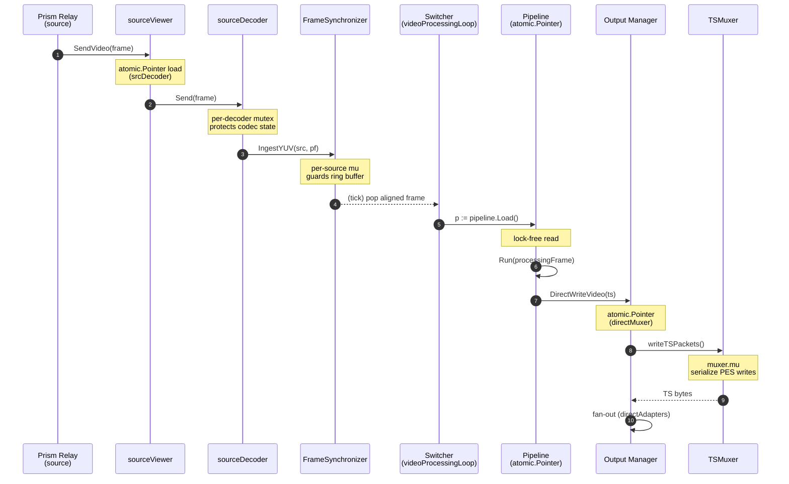

# Locking and Concurrency

> **Where you are:** [docs](../README.md) → concepts → locking-and-concurrency
> **Read this first:** [architecture.md](../architecture.md)
> **See also:** [pipeline.md](./pipeline.md) · [media-path.md](./media-path.md) · [frame-sync-and-timing.md](./frame-sync-and-timing.md) · [gpu.md](./gpu.md)

**TL;DR** Switchframe processes video at 24–60 fps across dozens of goroutines. Three rules govern how they share state: locks protect configuration, channels carry frames, atomics track metrics. No lock is held while decoding, blending, or encoding. The hot per-frame path reads the processing pipeline via `atomic.Pointer` with no lock at all, so reconfiguring the pipeline never stalls running frames.

## The story

A live video switcher has to do two contradictory things at once. It has to accept control commands — a director pressing CUT, an API call toggling a graphics layer, a producer loading a replay clip — and it has to never drop a frame. Dropping a frame shows on-air; delaying a command by a frame does not. The concurrency model is engineered around that asymmetry.

The server is built from a small number of long-lived goroutines and many short-lived ones. Each source has its own viewer goroutine ([`sourceViewer.SendVideo`](../../server/switcher/source_viewer.go)) that receives frames from the Prism relay and a decoder goroutine ([`sourceDecoder`](../../server/switcher/source_decoder.go)) that turns H.264 into YUV. The switcher has a [`videoProcessingLoop`](../../server/switcher/pipeline_loop.go) goroutine that pulls one raw frame per tick, runs it through the processing pipeline, and hands the encoded result to the output fan-out. The mixer has an [`outputTicker`](../../server/audio/mixer_ticker.go) goroutine that wakes every ~21.3 ms, reads from per-source PCM ring buffers, mixes, limits, encodes, and pushes to the program relay. Each SRT ingest source has a decoder and a stats poller. Each output destination has an async writer and, for SRT, a reconnect loop.

The rules that make this tractable are simple.

**Configuration is writer-serialized; frames take zero switcher-level locks.** The switcher's hot-path state — program and preview source keys, transition state, audio and graphics handlers, the sources map, the frame synchronizer — is published via a family of `atomic.Pointer` bundles ([`hotState`](../../server/switcher/hotstate.go), [`graphicsHandlers`](../../server/switcher/handlers.go), [`audioHandlers`](../../server/switcher/handlers.go), [`frameSyncBundle`](../../server/switcher/handlers.go), `sourcesAtomic`) plus scalar atomics (`ftbDurationMsAtomic`, `transitionAbortThresholdAtomic`, `pipeCodecsAtomic`). A writer takes `configMu` (a plain `sync.Mutex`) to serialize publication — build a new snapshot, Store, done. Frame-delivery handlers (`handleRawVideoFrame`, `handleVideoFrame`, `handleAudioFrame`) acquire no switcher lock at all; they read the snapshot pointers and keep going. When the API rebuilds the pipeline (a key changes, a format changes, a layout changes), the new pipeline is atomically swapped in with [`Switcher.swapPipeline`](../../server/switcher/switcher.go); the old one drains its in-flight frames via a `sync.WaitGroup` and is closed on a background goroutine. Running frames never observe a half-reconfigured pipeline.

**Atomics carry counters, not control.** Everywhere you see `atomic.Int64`, `atomic.Pointer`, or `atomic.Bool`, the value is either a counter (frames sent, audio samples mixed), a snapshot pointer (the current pipeline, the current layout, the current key state), or a boolean gate (video-started, GPU-active). They are never used to synchronize mutation of a data structure — that role belongs to the mutex. `atomicutil.UpdateMax` provides a lock-free CAS loop for high-water-mark tracking without contention.

**Channels cross goroutine boundaries; mutexes stay inside one goroutine's write path.** PCM samples cross from the per-source ingest path to the mixer output ticker through a [`PCMRingBuffer`](../../server/audio/ringbuf.go) — a circular sample buffer protected only by the mixer mutex, which is held for microseconds. Video frames cross from the source decoder into the switcher through a channel into [`videoProcessingLoop`](../../server/switcher/pipeline_loop.go). Encoded output frames cross from the pipeline into the TSMuxer through a direct callback registered under `Manager.mu` during startup — once wired, calls proceed with no lock.

The rest of this doc walks the lock inventory subsystem by subsystem. If you are tracing a deadlock, start at "Lock inventory"; if you are reasoning about a new feature, start at "Frame flow".

## How it works

### Frame flow through the locks

A program-destined video frame traverses maybe five mutexes between arriving at the server and leaving as encoded MPEG-TS. None of them are held for more than a few microseconds.

The only locks touched per frame are:

1. [`sourceDecoder.decoderMu`](../../server/switcher/source_decoder.go) — held while calling FFmpeg `avcodec_send_packet` / `avcodec_receive_frame`. Single-writer per source.
2. [`FrameSynchronizer.mu`](../../server/switcher/frame_sync.go) (per source) — holds for the ring-buffer push, a few slice operations.
3. [`Pipeline.inflight`](../../server/switcher/pipeline_loop.go) — a `sync.WaitGroup` incremented at Run entry, decremented at Run exit. Writers acquire none of this; only pipeline rebuild waits on it.
4. [`TSMuxer.mu`](../../server/output/muxer.go) — serializes PES packet writes so two callers don't interleave bytes.

The switcher's `configMu` is never held while a frame is being processed — neither for reads nor writes. `handleRawVideoFrame`, `handleVideoFrame`, and `handleAudioFrame` snapshot program state, handler bundles, and the sources map via `atomic.Pointer.Load()` and proceed with no ancestor lock held.

### Lock-free patterns

Switchframe leans on three lock-free idioms.

**`atomic.Pointer` for hot-swap configuration.** When the switcher rebuilds its processing pipeline (because a DSK key toggled, a format changed, a GPU pipeline came online), it constructs a new [`Pipeline`](../../server/switcher/pipeline_loop.go) off-loop and swaps it in with `pipeline.Store(newPipeline)`. Every subsequent `pipeline.Load()` in `videoProcessingLoop` sees the new one; anything mid-Run on the old pipeline continues to completion because `Pipeline.inflight` (a `WaitGroup`) is incremented at the top of Run. The old pipeline only closes after its in-flight count reaches zero, drained on a background goroutine tracked by `Switcher.drainWg`.

The same pattern appears in [`Switcher.hotState`](../../server/switcher/hotstate.go), [`Switcher.graphicsHandlers`](../../server/switcher/handlers.go), [`Switcher.audioHandlers`](../../server/switcher/handlers.go), [`Switcher.frameSyncBundle`](../../server/switcher/handlers.go), [`Switcher.sourcesAtomic`](../../server/switcher/switcher.go), [`Switcher.gpuRunner`](../../server/switcher/switcher.go), [`Switcher.gpuSourceMgr`](../../server/switcher/switcher.go), [`sourceViewer.srcDecoder`](../../server/switcher/source_viewer.go), [`Mixer.outputAudioCallback`](../../server/audio/mixer.go), [`Mixer.rawAudioSink`](../../server/audio/mixer.go), and [`Manager.directMuxer`](../../server/output/manager.go). In all cases the invariant is: *the pointer is the single source of truth; the thing it points to is immutable once published; rebuild = build new + swap + drain old*.

The switcher bundles — `hotState`, `graphicsHandlers`, `audioHandlers`, `frameSyncBundle`, `sourcesAtomic` — all follow a **copy-on-write** shape: a writer under `configMu` loads the current pointer, copies the struct/map, mutates the copy, and `Store`s the new pointer. Readers never hold a lock; when a handler needs a coherent snapshot across multiple bundles, the two-load race is benign by design (see the `handleRawVideoFrame` comment in `server/switcher/switcher.go` for the routing invariant — either interleaving produces a correct frame disposition).

**`atomic.CompareAndSwap` for high-water marks.** `atomicutil.UpdateMax` in [`internal/atomicutil/max.go`](../../server/internal/atomicutil/max.go) updates a running maximum without locking. Pipeline timing, mix-cycle latency, inter-frame gap tracking — all use this. The pattern is a tight CAS loop that retries only if a concurrent writer raced with a higher value, which is cheap because progress is still monotonic.

**Ring buffers for PCM hand-off.** The audio mixer's [`PCMRingBuffer`](../../server/audio/ringbuf.go) carries samples from source ingest (bursty, per-packet) to the output ticker (fixed 21.3 ms cadence). It is not thread-safe on its own; instead, the mixer's `mu` is held for the microseconds required to push or pop, and the buffer's circular layout means there is no allocation per frame. When the buffer underruns, `Pop` returns silence rather than blocking — bursty SRT delivery would otherwise stall the output ticker.

### Lock ordering

The project has one ordering rule documented explicitly and several implied by reading the code.

**Output Manager → Destination.** [`output/manager.go`](../../server/output/manager.go) comments it directly: *"Lock ordering: Manager.mu must be acquired before Destination.mu. Never acquire Manager.mu while holding a destination lock."* `Manager.mu` guards the destinations map and adapter list. `Destination.mu` guards per-destination state (status, stats). When starting a destination the manager acquires its own lock to mutate the map, then hands a reference to the destination and releases Manager.mu before the destination's own setup path takes its lock.

**Switcher → callback → Mixer.** The switcher's audio handler is a callback published via `audioHandlers atomic.Pointer`. When a source's audio frame arrives, `handleAudioFrame` loads the bundle pointer, takes no lock, and invokes the callback. The callback then calls `Mixer.IngestFrame`, which takes `Mixer.mu`. No switcher lock is ever held when the mixer lock is acquired.

**Pipeline swap → codec close.** `Switcher.swapPipeline` tracks drain goroutines in `drainWg`. `Switcher.Close()` waits on `drainWg` before it closes `pipeCodecs` (which owns the FFmpeg encoder/decoder handles). This prevents use-after-close on the encoder by a pipeline that is still draining.

**GPU Context → Pool.** [`gpu.Context.Close`](../../server/gpu/context.go) sets `closed` atomically first, then takes `Context.mu` to destroy CUDA streams, staging buffers, and the frame pool. `Context.Sync` and `Context.SyncStream` take `mu` and check `closed` under the lock, so after `closed` is true no new sync proceeds and existing syncs run to completion before Close destroys resources.

**Metal Context → Pipelines.** [`metalContext`](../../server/gpu/metal_context.go) has two locks: `mu` for GPU resources, `pipelinesMu` for the lazily-built compute pipeline cache. They are independent — the pipeline cache is read on every dispatch, so keeping it on a separate mutex avoids a serialization point with `Sync()`.

### Lock inventory by subsystem

Every package that touches shared state has a declared mutex. The table below summarizes what each one protects and roughly how long it is held.

| Subsystem | Mutex (file) | Protects | Hold time |
|---|---|---|---|
| Switcher | [`Switcher.configMu`](../../server/switcher/switcher.go) (Mutex) | writer-serialization only — publishes copy-on-write snapshots into `hotState`, `graphicsHandlers`, `audioHandlers`, `frameSyncBundle`, `sourcesAtomic`, scalar atomics, and the legacy-storage fields they mirror (mixer, captionMgr, state callbacks, cmdQueue, encoder config, etc.) | microseconds per publish; never held on the frame path |
| Switcher | hot-path `atomic.Pointer` bundles ([`hotState`](../../server/switcher/hotstate.go), [`graphicsHandlers`](../../server/switcher/handlers.go), [`audioHandlers`](../../server/switcher/handlers.go), [`frameSyncBundle`](../../server/switcher/handlers.go), `sourcesAtomic`) | program/preview keys, transition state, key/DVE compositors, audio + caption handlers, frame synchronizer, per-source map | lock-free load per frame |
| Switcher | [`FrameSynchronizer.mu`](../../server/switcher/frame_sync.go) (per source) | ring buffer + last-frame state | microseconds per push/pop |
| Switcher | [`DelayBuffer.mu`](../../server/switcher/delay_buffer.go) | frame/audio deque for per-source lip-sync delay | microseconds |
| Switcher | [`FramePool.mu`](../../server/switcher/frame_pool.go) | LIFO free list of YUV buffers | microseconds |
| Switcher | [`healthMonitor.mu`](../../server/switcher/health.go) (RWMutex) | per-source stats, freshness thresholds | microseconds |
| Switcher | [`pipelineCodecs.mu`](../../server/switcher/pipeline_codecs.go) | shared encoder handle | held only during lifecycle (create, destroy) — encode is single-threaded |
| Switcher | [`Pipeline.inflight`](../../server/switcher/pipeline_loop.go) (WaitGroup) | drain barrier for pipeline swap | zero cost on the frame path; blocks only Close/swap |
| Audio mixer | [`Mixer.mu`](../../server/audio/mixer.go) (RWMutex) | channels map, master gain, crossfade state, AFV state, stinger overlay state, mute/FTB | held for the duration of `tick()` and `IngestFrame` (sub-millisecond) |
| Audio mixer | [`Limiter.mu`](../../server/audio/limiter.go) | limiter envelope state | microseconds (lookahead advance) |
| Audio mixer | [`Compressor.mu`](../../server/audio/compressor.go) (per channel) | compressor envelope state | microseconds |
| Audio mixer | [`DelayBuffer.mu`](../../server/audio/delay_buffer.go) | per-channel sample deque | microseconds |
| Output | [`Manager.mu`](../../server/output/manager.go) | destinations map, adapter list pointers, CBR config, lifecycle state | microseconds (start/stop); never held during frame delivery |
| Output | [`Destination.mu`](../../server/output/destination.go) (per destination) | destination status, SRT connection state | microseconds |
| Output | [`TSMuxer.mu`](../../server/output/muxer.go) | muxer state, PES buffer, continuity counters | held during one TS packet flush (sub-millisecond) |
| Output | [`CBRPacer.mu`](../../server/output/cbr_pacer.go) | pacing state, null-packet budget | microseconds per tick |
| Output | [`SRTCaller.mu`](../../server/output/srt_caller.go) | SRT connection, ring buffer, reconnect state | microseconds; reconnect runs on its own goroutine |
| Output | [`SRTListener.mu`](../../server/output/srt_listener.go) (RWMutex) | per-connection adapter map | microseconds |
| Output | [`recorder.mu`](../../server/output/recorder.go) | file handle, rotation state | microseconds |
| Output | [`ConfidenceMonitor.mu`](../../server/output/confidence.go) (RWMutex) + `bufMu` | last thumbnail JPEG; frame buffer | microseconds |
| Output | [`asyncAdapter.mu`](../../server/output/async_adapter_test.go) | overflow counter, enqueue state | lock-free enqueue; mu only for stats |
| SRT ingest | [`srt.Store.mu`](../../server/srt/store.go) (RWMutex) | persisted source configs map | microseconds |
| SRT ingest | [`srt.StatsManager.mu`](../../server/srt/stats.go) (RWMutex) | per-connection stats map | microseconds; polled 1 Hz |
| SRT ingest | [`srt.Listener.mu`](../../server/srt/listener.go) | active listener socket, per-stream state | microseconds |
| SRT ingest | [`srt.Caller.mu`](../../server/srt/caller.go) | outbound socket state, reconnect backoff | microseconds |
| SRT ingest | [`srt.decoder.decoderMu`](../../server/srt/decoder.go) (RWMutex) | FFmpeg decoder handle | microseconds |
| MXL | [`mxl.Writer.mu`](../../server/mxl/writer.go) | ticker state, data writer pointer | microseconds |
| MXL | [`mxl.demo.mu`](../../server/mxl/demo.go) | demo source lifecycle | microseconds |
| Graphics | [`Compositor.mu`](../../server/graphics/compositor.go) (RWMutex) | layer list, per-layer rect/alpha/image | held for compositing pass (tens of microseconds) |
| Graphics | [`KeyProcessor.mu`](../../server/graphics/key_processor.go) (RWMutex) | per-source key config map | microseconds |
| Graphics | [`KeyProcessorBridge.mu`](../../server/graphics/key_processor_bridge.go) | fill YUV buffer, scratch buffers | microseconds |
| Graphics | [`TickerEngine.mu`](../../server/graphics/ticker.go) | scrolling ticker state | microseconds |
| Graphics | [`TextAnimationEngine.mu`](../../server/graphics/text_animation.go) | per-layer text animation state | microseconds |
| Graphics | [`SequenceEngine.mu`](../../server/graphics/sequence_engine.go) | per-layer PNG sequence cursor | microseconds |
| Graphics | [`textrender.mu`](../../server/graphics/textrender/textrender.go) | freetype face cache | microseconds |
| DVE | [`Compositor.mu`](../../server/dve/compositor.go) | layout (slots + transforms), active animations | microseconds |
| DVE | [`PresetStore.mu`](../../server/dve/preset.go) (RWMutex) | file-based preset CRUD | file I/O duration |
| Caption | [`caption.Manager.mu`](../../server/caption/manager.go) | mode, pending-pairs queue | microseconds |
| Caption | [`caption.Encoder.mu`](../../server/caption/encoder.go) | per-frame pair buffer | microseconds |
| Comms | [`comms.Manager.mu`](../../server/comms/manager.go) | participants map | microseconds |
| Comms | [`comms.Participant.mu`](../../server/comms/participant.go) | per-participant Opus state, PCM queue | microseconds |
| Replay | [`replay.Manager.mu`](../../server/replay/manager.go) | per-source buffers, active players | microseconds |
| Replay | [`replay.buffer.mu`](../../server/replay/buffer.go) (RWMutex) | GOP-aligned circular buffer | microseconds |
| Replay | [`replay.Player.pauseMu`](../../server/replay/player.go) + [`gpu_player.pauseMu`](../../server/replay/gpu_player.go) | pause / resume state | microseconds |
| Replay | [`replay.filering.mu`](../../server/replay/filering.go) (RWMutex) | tmpfs file-ring state | microseconds |
| Clips | [`clip.Manager.mu`](../../server/clip/manager.go) | 4 player slots, state | microseconds |
| Clips | [`clip.Store.mu`](../../server/clip/store.go) (RWMutex) | clip metadata map, file lifecycle | file I/O duration |
| Clips | [`clip.Player.pauseMu` + `holdMu`](../../server/clip/player.go) | pause/seek state, hold-last-frame guard | microseconds |
| Playout | [`playout.Manager.mu`](../../server/playout/manager.go) | channel list, pod board refs | microseconds |
| Playout | [`playout.Channel.mu`](../../server/playout/channel.go) | cursor, item-start time, transition state | microseconds |
| Playout | [`playout.scheduler.mu`](../../server/playout/scheduler.go) | tick state, next event | microseconds |
| Playout | [`playout.Cache.mu`](../../server/playout/cache.go) | LRU map, access order, used bytes | microseconds (plus file I/O on Put/Evict) |
| Playout | [`playout.prefetch.mu`](../../server/playout/prefetch.go) | fetch-in-progress set | microseconds |
| Playout | [`playout.PodBoard.mu`](../../server/playout/pod_board.go) | pod registry | microseconds |
| Playout | [`playout.splice.mu`](../../server/playout/splice.go) | splice-in-progress state | microseconds |
| Playout | [`playout.idle.mu` + `idle_10bit.mu`](../../server/playout/idle.go) | idle-loop asset iterator | microseconds |
| Playout | [`playout.watchdog.mu`](../../server/playout/watchdog.go) | stall detection state | microseconds |
| Playout | [`playout.PodTemplateStore.mu`](../../server/playout/pod_template.go) | template map | microseconds |
| Playout | [`asrun.mu`](../../server/playout/asrun.go) | ring buffer, JSONL encoder | microseconds per event |
| SCTE-35 | [`Injector.mu`](../../server/scte35/injector.go) | active cue, scheduled cues, hold/extend state | microseconds |
| SCTE-35 | [`RulesStore.mu`](../../server/scte35/rules_store.go) (RWMutex) | rule list, default action | file I/O on mutate |
| SCTE-35 | [`RuleEngine.mu`](../../server/scte35/rules.go) (RWMutex) | compiled rules + regex cache | microseconds |
| Transition | [`Engine.mu`](../../server/transition/engine.go) (RWMutex) | active transition state, progress position | microseconds |
| Transition | [`wipemap.WipeMapStore.mu`](../../server/transition/wipemap/store.go) (RWMutex) | gradient map registry | microseconds |
| Operator | [`operator.Store.mu`](../../server/operator/store.go) (RWMutex) | operator slice, token index, id index | microseconds; file I/O on register/delete |
| Operator | [`operator.SessionManager.mu`](../../server/operator/session.go) | active sessions, subsystem locks | microseconds |
| Macro | [`macro.Store.mu`](../../server/macro/store.go) (RWMutex) | macro list | file I/O on save/delete |
| Preset | [`preset.Store.mu`](../../server/preset/store.go) (RWMutex) | preset list | file I/O on save/delete |
| Control | [`API.macroMu`](../../server/control/api.go) | in-flight macro execution | held for entire macro run |
| Control | [`API.uploadMu`](../../server/control/api.go) | active clip upload | held during upload |
| Control | [`API.asrConfigMu`](../../server/control/api.go) | ASR reconfigure request | held during reconfigure |
| STMap | [`stmap.Registry.mu`](../../server/stmap/registry.go) (RWMutex) | per-source + program map assignments | microseconds |
| Stinger | [`stinger.Store.mu`](../../server/stinger/store.go) (RWMutex) | clip registry, pending uploads | microseconds; file I/O on upload |
| GPU | [`gpu.Context.mu`](../../server/gpu/context.go) (CUDA) | CUDA streams, staging buffers, tmp bufs | microseconds; held across cudaFree |
| GPU | [`gpu.metalContext.mu`](../../server/gpu/metal_context.go) | Metal device + queue + resources | microseconds |
| GPU | [`gpu.metalContext.pipelinesMu`](../../server/gpu/metal_context.go) | compute pipeline cache | microseconds |
| GPU | [`gpu.FramePool.mu`](../../server/gpu/pool.go) + [`metal_pool.mu`](../../server/gpu/metal_pool.go) | LIFO free list of GPU frames | microseconds |
| GPU | [`gpu.metal_encode.mu`](../../server/gpu/metal_encode.go) | VideoToolbox encode callback serialization | held for encode submit |
| GPU | [`gpu.SourceManager.mu`](../../server/gpu/source_manager.go) (RWMutex) | per-source GPU cache, segmentation config | microseconds |
| GPU | [`gpu.SegmentationEngine.mu`](../../server/gpu/segmentation_engine.go) (RWMutex) + [`SegmentationProxy.mu`](../../server/gpu/segmentation_proxy.go) | per-source mask cache, inflight count | microseconds |

### Output Manager + Playout Channel field audit

The `Manager.mu` and `Channel.mu` entries above summarize what each mutex protects. This subsection is the per-field ledger — written after the DEBT-021 audit so future readers know which fields are hot-path-reachable and exactly how each is synchronized. Every field not in `atomic.*` is either strictly covered by the mutex or single-writer-by-goroutine-ownership.

**`output.Manager`** (`server/output/manager.go:37-119`) — 33 fields total:

- **atomic on the hot path (`DirectWriteVideo` / muxer callback):** `directMuxer`, `adapters`, `frameAdapters`, `cbrPacer`, `directAdapters`, `confidence`, `lipSyncSource` (boxed in `atomic.Pointer[lipSyncProvider]`), `smoothedLipSync`, `lipSyncLatched`, `lastDirectVideoPTS`. Hot path takes no locks.
- **protected by `Manager.mu` (warm paths only — start/stop/reconfigure):** `muxer`, `recorder`, `srtOutput`, `destinations`, `asyncWrappers`, `cbrMuxrate`, `onState`, `onMuxStart`, `closed`, `stopping`, `promMetrics`, `srtConnectFn`, `srtAcceptFn`, `scte35Injector`, `scte35PID`, `videoWidth`, `videoHeight`, `srtStatsManager`, `engineLabel`, `captionMgr`. None are ever read from the `DirectWriteVideo` hot path.
- **init-once / immutable after `NewManager`:** `log`, `ctx`, `cancel`.

**`playout.Channel`** (`server/playout/channel.go:67-138`) — 40 fields total:

- **atomic counters (read by `Status()` from any goroutine):** `itemProgress`, `itemRemainMs`.
- **strict single-writer (the `run()` tick goroutine owns them; joined via `<-doneCh` in `Stop()`):** `clipIter`, `clipFPS`, `clipTotal`, `clipFrame`, `clipOutputFrame`, `clipLastFrame`, `outputPTS`, `outputAudioPTS`. No cross-goroutine reader exists today. Promoting these to atomics would be defensive; skipped to avoid churn until a reader actually appears.
- **protected by `Channel.mu` (all external callers + tick preamble):** `state`, `clipItemID`, `clipStartTime`, `gpuAlias`, `gpuSourceTap`, `lastLiveTapMiss`, `activeLiveSource`, `onLiveAudio`, `rawVideoOutput`, `audioOutput`, `onStateChange`, `onStart`, `onStop`, `ptsProvider`, `secondaryHandler`, `secondaryScheduler`, `secondaryItemID`, `spliceCoordinator`, `asRunLog`, `itemStartTime`, `cancel`, `done`. The tick goroutine grabs callbacks at the top of `tick()` into locals, then releases the lock before emitting the frame.
- **init-once / immutable after `NewChannel`:** `id`, `config`, `scheduler`, `idleLoop`, `compositor`, `gpuAliasedSentinel`, `slateFrame`, `frameDuration`.

Pattern to follow when adding new fields: if the value is read on the per-frame hot path (`DirectWriteVideo` for output, `emitFrame`/`frameForItem` for playout), it must be `atomic.*`. If it's read only from warm paths, `Manager.mu` / `Channel.mu` is fine. Function-valued fields need `atomic.Pointer` boxing if they're read off-lock — a plain `func` is a fat pointer and an unsynchronized swap races the read even when the race detector happens not to trip.

### Goroutine ownership

Each long-lived goroutine owns specific data and reads shared state only through the locks or atomics above. The separation means no goroutine ever needs to wait on another to make progress on a frame.

| Goroutine | File | Lifetime | Owns |
|---|---|---|---|
| `sourceViewer.SendVideo` callback | [`source_viewer.go`](../../server/switcher/source_viewer.go) | per source | atomic counters (videoSent/audioSent/captionSent); dispatches to decoder via atomic.Pointer |
| `sourceDecoder` loop | [`source_decoder.go`](../../server/switcher/source_decoder.go) | per source | FFmpeg decoder handle (single-writer under decoderMu) |
| `videoProcessingLoop` | [`pipeline_loop.go`](../../server/switcher/pipeline_loop.go) | per switcher | pipeline execution (reads Pipeline via atomic.Pointer) |
| `outputTicker` | [`mixer_ticker.go`](../../server/audio/mixer_ticker.go) | per mixer | audio output cadence (holds Mixer.mu for the tick) |
| `srt.Source` stats poller | [`srt/source.go`](../../server/srt/source.go) | per SRT source | stats via StatsManager.mu |
| `srt.Caller` reconnect loop | [`srt/caller.go`](../../server/srt/caller.go) | per SRT caller | backoff timer, connection state under Caller.mu |
| `srt.Listener` accept loop | [`srt/listener.go`](../../server/srt/listener.go) | per listener | incoming connection dispatch |
| `output.SRTCaller` send loop | [`output/srt_caller.go`](../../server/output/srt_caller.go) | per SRT destination | outbound ring buffer, reconnect |
| `output.SRTListener` accept loop | [`output/srt_listener.go`](../../server/output/srt_listener.go) | per SRT output listener | per-connection writer goroutines |
| `ConfidenceMonitor` | [`output/confidence.go`](../../server/output/confidence.go) | per output | 1 fps JPEG encode ticker |
| `mxl.Reader` video/audio/data loops | [`mxl/reader.go`](../../server/mxl/reader.go) | per MXL source | three per-flow goroutines |
| `mxl.Writer` ticker | [`mxl/writer.go`](../../server/mxl/writer.go) | per MXL output | steady-rate output ticker |
| `playout.Channel` tick | [`playout/channel.go`](../../server/playout/channel.go) | per channel | frame router, compositor, scheduler dispatch |
| `playout.Watchdog` | [`playout/watchdog.go`](../../server/playout/watchdog.go) | per manager | stall detection, auto-recovery trigger |
| `playout.StatePersister` | [`playout/persist.go`](../../server/playout/persist.go) | per manager | atomic state snapshot every 5 s |
| `caption.Manager` | [`caption/manager.go`](../../server/caption/manager.go) | per manager | CC frame pair queue |
| `comms.Manager` mix loop | [`comms/manager.go`](../../server/comms/manager.go) | per manager | N-1 PCM mix tick |
| `asr.Engine` | [`asr/engine.go`](../../server/asr/engine.go) | per engine | ASR sidecar send/receive |
| `peer.health.poller` | [`peer/health.go`](../../server/peer/health.go) | per app | inter-engine polling |
| `cmdqueue.Queue` drain | [`cmdqueue/queue.go`](../../server/cmdqueue/queue.go) | per app | PTP-timed command drain |
| Prism distribution server | external (Prism) | per app | WebTransport session / MoQ broadcast |

Short-lived goroutines — a macro run, a clip upload transcode, a transition engine's blend worker — each take a single lock at a well-defined scope and never hold it while performing expensive work.

### Deadlock-free guarantees

Three structural properties make the system deadlock-free without formal verification.

1. **No lock is held across a cgo call that may block.** FFmpeg close, FDK-AAC encode, cudaStreamSynchronize, Metal command buffer commit — none run with a Go-side mutex held. The pattern `m.mu.Lock(); collect resources; m.mu.Unlock(); Close(resources)` appears throughout ([`Mixer.Close`](../../server/audio/mixer.go), [`Context.Close`](../../server/gpu/context.go), [`metalContext.Close`](../../server/gpu/metal_context.go)).
2. **Callbacks are read lock-free via `atomic.Pointer` bundles, invoked with no ancestor lock held.** `Switcher.handleVideoFrame`, `Switcher.handleAudioFrame`, and `Switcher.handleRawVideoFrame` dereference their callback bundles (`audioHandlers`, `graphicsHandlers`, `frameSyncBundle`) via `atomic.Pointer.Load()` and invoke them directly. `Mixer.tick` takes a brief read lock on `Mixer.mu` but releases it before invoking the output and state callbacks. Either way, the callback code runs with no ancestor lock held and can take any other lock without violating ordering.
3. **Pipeline swap drains before destruction.** New pipeline is built, installed with `atomic.Pointer.Store`; running frames on the old pipeline complete because `Pipeline.inflight.Wait()` is called on a drain goroutine before `Close()`. The switcher's own `drainWg` tracks these so shutdown waits for all outstanding drains before closing shared codec handles.

The one explicit ordering rule — Manager → Destination in `output/manager.go` — is the only place two locks in the same subsystem are acquired in sequence. Elsewhere, locks are independent islands, so there is nothing to order.

## Gotchas and invariants

- **Never acquire `Switcher.configMu` from inside an audio or video handler callback.** The callback is invoked with no switcher lock held; re-entering via the public API would deadlock. Use the per-source state that the handler receives as a parameter.
- **The switcher hot-path bundles are immutable once published.** `hotState`, `graphicsHandlers`, `audioHandlers`, `frameSyncBundle`, and the `sourcesAtomic` map pointer are all copy-on-write. Never mutate a pointer returned by `Load()`; always load, copy, mutate the copy, then `Store`. Writers do this under `configMu`; readers do not.
- **Two-bundle snapshots are intentionally racy.** A handler that loads `hotState` and `sourcesAtomic` in sequence can observe them from different versions. This is benign: the routing branches in `handleRawVideoFrame` produce a correct disposition (program, filtered, or transition source) for any interleaving. Don't "fix" it with a lock.
- **`atomic.Pointer[T]` implies T is immutable once published.** If you mutate a pipeline, layout, or key snapshot after `Store`, readers can observe torn state. Always `build new; swap; dispose of old`.
- **`Close` on any goroutine-owning struct waits on its own WaitGroup.** `Switcher.Close`, `Mixer.Close`, `Manager.Close`, `Context.Close`. Do not skip the wait — cgo resources may still be in flight.
- **Ring-buffer push is newest-wins.** The mixer's [`PCMRingBuffer.Push`](../../server/audio/ringbuf.go) discards oldest samples on overflow; the output ticker would otherwise stall on a bursty SRT source. Underruns return silence, not the last frame, because freeze-repeat sounds worse on live audio than a brief mute.
- **GPU Context close is a two-phase barrier.** Setting `closed` atomically first prevents new `Sync` calls; taking `mu` then waits for in-flight syncs before destroying streams. Do not invert this — destroying streams while a sync is in flight will crash CUDA.
- **Operator / macro locks hold for the entire operation.** `API.macroMu` is held for the full macro run; `API.uploadMu` for the full clip upload. These are mutexes not queues — concurrent requests block until the in-flight one finishes.
- **Prometheus registry is global but per-subsystem metrics are passed in.** See [metrics.md](../reference/metrics.md). A subsystem receives its `*metrics.Metrics` via `SetMetrics` under its own mutex, so metric emission itself is a single atomic counter increment with no contention.
- **Don't hold `Compositor.mu` while calling the fill path.** The DSK compositor's `ProcessYUV` reads the snapshot under its RWMutex's read lock, releases, then runs the blend lock-free. The blend can take tens of microseconds; holding the lock across it would serialize all sources.

## Related docs

- **Concepts:** [pipeline.md](./pipeline.md), [media-path.md](./media-path.md), [frame-sync-and-timing.md](./frame-sync-and-timing.md), [gpu.md](./gpu.md)
- **Reference:** [metrics.md](../reference/metrics.md), [config-and-flags.md](../reference/config-and-flags.md), [file-formats.md](../reference/file-formats.md), [api.md](../reference/api.md), [state-broadcast.md](../reference/state-broadcast.md), [fast-control.md](../reference/fast-control.md)
- **Subsystems:** [switcher.md](../subsystems/switcher.md), [audio.md](../subsystems/audio.md), [output.md](../subsystems/output.md), [srt-ingest.md](../subsystems/srt-ingest.md), [mxl.md](../subsystems/mxl.md), [graphics-and-dve.md](../subsystems/graphics-and-dve.md), [stmap.md](../subsystems/stmap.md), [transition.md](../subsystems/transition.md), [captions.md](../subsystems/captions.md), [comms.md](../subsystems/comms.md), [replay.md](../subsystems/replay.md), [clips.md](../subsystems/clips.md), [playout.md](../subsystems/playout.md), [scte35.md](../subsystems/scte35.md), [codec.md](../subsystems/codec.md), [control-plane.md](../subsystems/control-plane.md)
- **Operations:** [deployment.md](../operations/deployment.md)
- **Root:** [architecture.md](../architecture.md), [README.md](../README.md)
