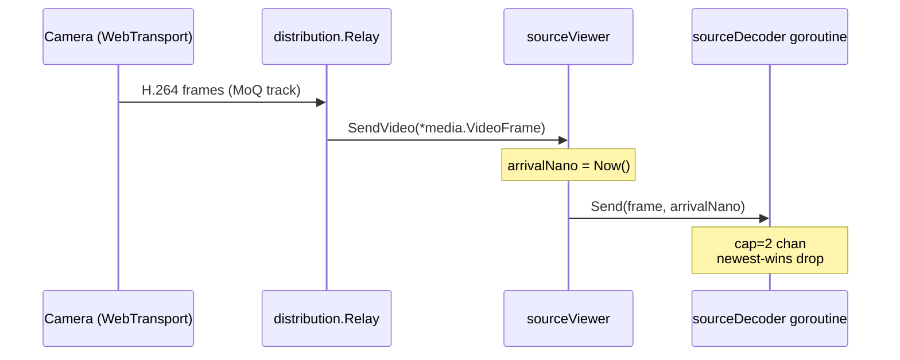
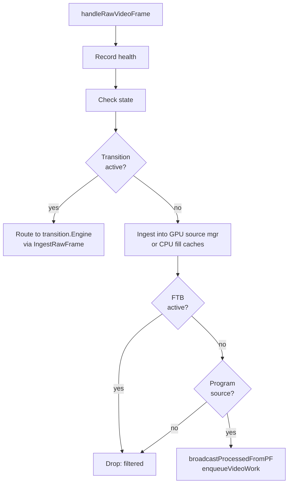
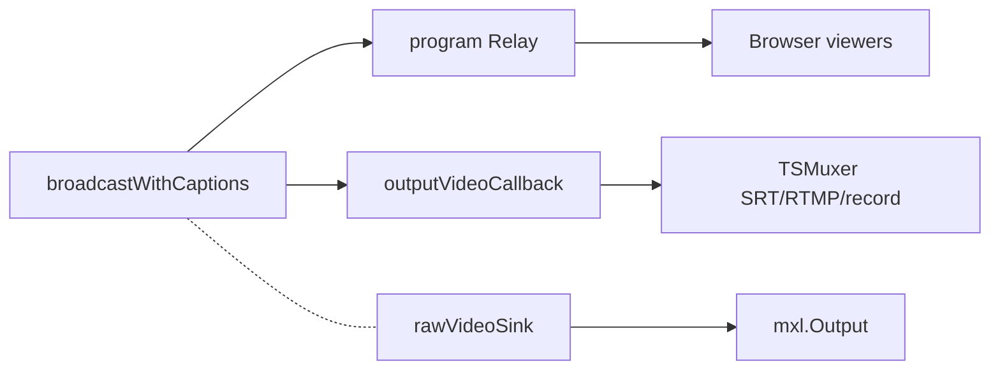

# The media path: from source to output

> **Where you are:** [docs](../README.md) → concepts → media-path
> **Read this first:** [architecture.md](../architecture.md)
> **See also:** [pipeline](pipeline.md) · [frame-sync-and-timing](frame-sync-and-timing.md) · [locking-and-concurrency](locking-and-concurrency.md)

**TL;DR** — Follow a single video frame from a camera all the way to a viewer's browser. It enters a Prism relay, fans out to a [`sourceViewer`](../../server/switcher/source_viewer.go) that feeds a per-source decoder goroutine, crosses the [`FrameSynchronizer`](../../server/switcher/frame_sync.go) into the switcher's hot path, flows through the [atomic pipeline](pipeline.md) — upstream key, DVE, compositor, ST map, raw sinks, async encode — and finally reaches the program relay that multicasts it to browser multiview, the MPEG-TS output muxer (SRT/RTMP/recording), and the MXL shared-memory output. Along the way the same decoded YUV buffer is shared by reference and then released back to the [`FramePool`](../../server/switcher/frame_pool.go) when the last consumer is done.

## The story

The video hot path is the longest thing in the program. Everything else — REST APIs, state broadcasts, the UI — exists to steer it. If you understand the path a frame takes from arrival to output, the rest of the server becomes much smaller. This document walks that path end-to-end, in the order a frame actually visits things.

Two principles govern the whole journey. First, **producers never block consumers**. Every queue in the path is bounded, every drop policy is newest-wins, and long work (decode, encode, graphics) sits behind its own channel and goroutine so a 40 ms H.264 decode spike can't starve audio delivery. Second, **frames are owned by reference**. A single YUV buffer acquired from the pool may be ingested by the DVE compositor's source cache, read by the GPU source manager for zero-upload routing, retained by the frame sync for freeze/repeat, and simultaneously flowing through the pipeline for the program output — all without copy. Reference counts on [`ProcessingFrame`](../../server/switcher/processing_frame.go) make this safe; see [the pipeline doc](pipeline.md#processingframe-and-reference-counting) for the refcount invariant.

The path splits naturally into four stages: **arrival** (source relay → decoder), **synchronization** (frame sync → switcher handler), **processing** (atomic pipeline), and **fan-out** (program relay, output manager, raw sinks). Audio, captions, and the transition engine take sibling paths that rejoin at well-defined points.

## How it works

### Stage 1: arrival

A source enters the server through a Prism [`distribution.Relay`](https://github.com/zsiec/prism/tree/main/distribution), the same primitive Prism uses to fan out WebTransport streams. Sources come from several places:

- **WebTransport camera uploads** arrive as a Prism stream automatically, handled by [`App.onStreamRegistered`](../../server/cmd/switchframe/app_streams.go) which calls [`Switcher.RegisterSource`](../../server/switcher/switcher.go).
- **SRT ingest** is wired by `app_srt.go` / the [`srt`](../../server/srt/) package — `srt.Source` decodes MPEG-TS internally and delivers raw YUV, calling `Switcher.RegisterSRTSource` + `IngestRawVideo`.
- **MXL shared-memory** sources use [`mxl.Source`](../../server/mxl/source.go) to read NMOS flows and deliver raw YUV; `RegisterMXLSource` registers them without a relay/viewer pair.
- **Clips and playout** channels produce raw YUV from file decoders and feed the switcher the same way.

Every non-raw source gets a [`sourceViewer`](../../server/switcher/source_viewer.go) attached to its relay. The viewer is a `distribution.Viewer` implementation whose `SendVideo`/`SendAudio`/`SendCaptions` methods route to the `frameHandler` interface (implemented by [`Switcher`](../../server/switcher/switcher.go) itself). If always-decode mode is on — which it is in production — the viewer also carries an `atomic.Pointer[sourceDecoder]`, and `SendVideo` short-circuits into the decoder's input channel.

The per-source decoder goroutine (see [`source_decoder.go`](../../server/switcher/source_decoder.go)) converts AVC1 → Annex B in reusable scratch buffers, prepends VPS/SPS/PPS on keyframes so the FFmpeg decoder can initialize mid-stream, calls `DecodeInto` directly into a [`FramePool`](../../server/switcher/frame_pool.go) buffer, then stamps a fresh [`ProcessingFrame`](../../server/switcher/processing_frame.go) with `SetRefs(1)`, propagates timing markers (`ArrivalNano`, `DecodeStartNano`, `DecodeEndNano`), optionally applies an ST map warp, and invokes its callback.

The callback (built by [`Switcher.makeDecoderCallback`](../../server/switcher/switcher.go)) routes the YUV frame through the frame sync if active, through the delay buffer if a per-source lip-sync delay is set, or directly into [`Switcher.handleRawVideoFrame`](../../server/switcher/switcher.go) otherwise.

### Stage 2: synchronization

The [`FrameSynchronizer`](../../server/switcher/frame_sync.go) is the central clock of the freerun pipeline. Sources freewheel on their own PTS clocks; the frame sync aligns them to a single tick grid at the pipeline frame rate. See the [frame-sync doc](frame-sync-and-timing.md) for the full story on PTS rewriting, Bresenham remainder accumulation, and MCFI interpolation.

From the media-path perspective, what matters is:

1. `IngestRawVideo` pushes the decoded frame into the per-source ring buffer and, if this source is the program source, signals `programFrameReady` so the tick loop can fire immediately instead of waiting for the timer.
2. The tick loop's three-phase `releaseTick` pops one frame per source, stamps monotonic PTS, runs FRC interpolation in parallel goroutines if needed, and invokes `onRawVideo` (which is [`Switcher.handleRawVideoFrame`](../../server/switcher/switcher.go)) for each.

The program source gets **early delivery** inside the tick — Phase 1.5 — so its frame reaches the pipeline without waiting for other sources' MCFI to finish. Non-program sources' frames flow into graphics and DVE fill caches for transitions and PIPs, where they'll be read from memory when the operator arms a slot.

### Stage 3: the switcher handler

[`Switcher.handleRawVideoFrame`](../../server/switcher/switcher.go) is the decision point:

During a transition (see [subsystems/transition.md](../subsystems/transition.md)), both `fromSource` and `toSource` raw frames are ingested into the [`transition.Engine`](../../server/transition/engine.go). The engine blends them and calls the switcher's `broadcastProcessed` output, which wraps the blended YUV in a fresh `ProcessingFrame` and enqueues it — same channel as the normal path, except the epoch is zero (always accepted).

During normal operation, only the program source's frame makes it onto the queue. The `sourceKey` is stamped on the `videoProcWork` so the GPU pipeline can use `RunFromCache` to skip the CPU→GPU upload entirely when a GPU source manager is attached.

Every enqueue goes through [`Switcher.enqueueVideoWork`](../../server/switcher/switcher.go), a tiny helper that implements newest-wins drop when `videoProcCh` is full. Critically, it releases the dropped frame's pool buffer — without that, a sustained overload would empty the pool and the decoder goroutines would fall back to heap allocations.

### Stage 4: the processing goroutine

[`Switcher.videoProcessingLoop`](../../server/switcher/switcher.go) is a single dedicated goroutine, `runtime.LockOSThread`-pinned, that drains `videoProcCh`. Its body is short:

1. **Epoch check** — if `work.epoch` is nonzero and doesn't match `programEpoch`, release and continue. This is how a Cut that races frame delivery discards stale frames from the old program source.
2. **Sub-stage timing** — compute decode queue time, decode duration, sync wait, and process-queue wait from the frame's timing fields into atomic counters for the perf endpoint.
3. **Resolution normalize** — if the frame's dimensions differ from the pipeline format, scale with bilinear into a fresh pool buffer.
4. **Wall-clock PTS rewrite** — [`Switcher.wallClockVideoPTS`](../../server/switcher/switcher.go) rebases source PTS onto a frame-counter locked to the audio mixer's epoch, preventing A/V drift across source cuts.
5. **GPU or CPU** — if a GPU pipeline runner is registered, try `RunFromCache` (zero-upload), then `RunWithUpload` (CPU→GPU, pipeline stays GPU-side), and fall back to the CPU pipeline on error.
6. **CPU path** — load the atomic pipeline pointer and call `Run(work.yuvFrame)`.
7. **Thumbnail capture** (if a client is polling), then release.

The CPU pipeline's `Run` walks the active nodes — see the [pipeline doc](pipeline.md#the-node-chain-and-atomic-swap) for the chain. Briefly, they execute in this order:

| Node | What it does | Active when |
|---|---|---|
| `upstream-key` | Chroma/luma key in YUV420 | any key has an enabled fill |
| `dve-compositor` | PIP/split-screen/quad layouts | compositor has an active layout |
| `compositor` | DSK graphics overlay | always attached (fast-path inside) |
| `stmap-program` | Per-program coordinate warp | registry has a program effect |
| `raw-sink-mxl` | Deep-copy + callback to MXL | raw video sink is set |
| `raw-sink-preview` | Deep-copy + callback to preview encoder | preview sink is set |
| `h264-encode` | Async H.264/HEVC encode | always |

Raw sinks run **before** encode, so MXL and preview consumers receive the finished frame even if the encoder is temporarily backed up.

The encode node is special: its `Process()` increments a ref and hands the frame to a background goroutine via a `chan encodeWork` (buffer 4). The encode loop does the real work and calls `onEncoded` — which is [`Switcher.broadcastWithCaptions`](../../server/switcher/switcher.go). If the encode channel is full, the frame is dropped from H.264 output but already fed the raw sinks, so MXL and preview continue to tick. This async boundary is why a single slow frame can't stall the pipeline.

### Stage 5: caption injection and program broadcast

[`Switcher.broadcastWithCaptions`](../../server/switcher/switcher.go) is the last station. It:

1. Consumes any pending CEA-608 pairs from the [`caption.Manager`](../../server/caption/manager.go) via `ConsumeForFrameWithVANC`.
2. Builds an SEI NALU — combining `pic_timing` (for broadcast decoder compliance) and `user_data_registered_itu_t_t35` (the actual caption payload) — with [`caption.BuildPicTimingAndCaptionSEI`](../../server/caption/sei.go) or `BuildSEINALU`.
3. Converts the encoded frame's wire format (AVC1/length-prefixed) → Annex B, inserts the SEI before the first VCL NALU, converts back to wire format.
4. Hands the frame to `broadcastOwnedToProgram`, which rewrites GroupID monotonically, records diagnostic counters, and broadcasts via the program relay.

The program relay fans out to three kinds of consumers:

Program relay viewers — added by [`output.Manager`](../../server/output/manager.go) for recording/SRT, by `app_state.go` for the program preview encoder, and by every browser connected via WebTransport — each get the frame through a buffered channel. The **direct output callback** (`outputVideoCallback`) bypasses the relay entirely for the MPEG-TS muxer, avoiding three goroutine hops and three channel buffers on the critical recording/SRT path.

### Audio: the parallel lane

Audio takes a sibling path deliberately decoupled from video. A source's AAC frames arrive through [`sourceViewer.SendAudio`](../../server/switcher/source_viewer.go), go straight to [`Switcher.handleAudioFrame`](../../server/switcher/switcher.go) (bypassing the frame sync because audio is a continuous sample stream at ~47 fps at 48 kHz/1024 samples, and quantizing it to the 30 fps video tick would produce bursty output). The handler hands every source's audio to the mixer via `audioHandler`. The mixer decodes to PCM, sums per-channel, applies EQ/compressor/limiter/LUFS, and re-encodes to AAC at its own ~21.3 ms tick. The mixed AAC frames are broadcast to the program relay in parallel with video.

PTS alignment is handled with a small correction delta: the frame sync tracks how far it's rewriting video PTS relative to source, and publishes that delta atomically; [`Switcher.handleAudioFrame`](../../server/switcher/switcher.go) reads it and adds it to the audio frame's PTS so A/V stays in sync across freezes.

See [subsystems/audio](../subsystems/audio.md) for the mixer internals.

### Captions: the third lane

CEA-608/708 captions ride in the same SEI NALUs as `pic_timing`. The [`caption.Manager`](../../server/caption/manager.go) has three modes — off, passthrough (re-encode operator-inserted or source-extracted text), and author (live input from the UI). On the hot path, captions travel with video: they enter via [`Switcher.handleCaptionFrame`](../../server/switcher/switcher.go) (or are fabricated by the manager), the manager buffers a per-frame `[]CCPair`, and `broadcastWithCaptions` consumes them when the encoded frame is ready to broadcast. See [subsystems/captions](../subsystems/captions.md).

## Key types and entry points

- Relay → viewer: [`server/switcher/source_viewer.go`](../../server/switcher/source_viewer.go) → `sourceViewer.SendVideo/SendAudio/SendCaptions`.
- Per-source decode: [`server/switcher/source_decoder.go`](../../server/switcher/source_decoder.go) → `sourceDecoder.decodeLoop()`.
- Frame sync release: [`server/switcher/frame_sync.go`](../../server/switcher/frame_sync.go) → `FrameSynchronizer.releaseTick()`.
- Switcher routing: [`server/switcher/switcher.go`](../../server/switcher/switcher.go) → `Switcher.handleRawVideoFrame`, `Switcher.handleVideoFrame`, `Switcher.handleAudioFrame`, `Switcher.handleCaptionFrame`.
- Enqueue + dedup: [`server/switcher/switcher.go`](../../server/switcher/switcher.go) → `Switcher.broadcastProcessedFromPF`, `Switcher.enqueueVideoWork`.
- Processing goroutine: [`server/switcher/switcher.go`](../../server/switcher/switcher.go) → `Switcher.videoProcessingLoop()`.
- Caption injection and broadcast: [`server/switcher/switcher.go`](../../server/switcher/switcher.go) → `Switcher.broadcastWithCaptions`, `Switcher.broadcastOwnedToProgram`.
- Output fan-out: [`server/output/manager.go`](../../server/output/manager.go) → `Manager`.
- Direct output callback: [`server/output/manager.go`](../../server/output/manager.go) registers via `Switcher.SetOutputVideoCallback`.

## Gotchas and invariants

**Audio skips the frame sync deliberately.** Forcing audio through the 30 fps tick grid causes a bursty arrival pattern downstream browsers cannot absorb cleanly. See the comment on [`sourceViewer.SendAudio`](../../server/switcher/source_viewer.go) — audio always flows through `handleAudioFrame` directly, with PTS correction applied from the frame sync's published delta.

**Raw sinks run before encode, on purpose.** MXL output and program preview encoder consume raw YUV. Putting them after the encode node would make them pay for H.264 encoding and then throw it away. Putting them before means a stalled encoder still ticks raw output — critical for MXL broadcast continuity.

**Direct output bypasses the relay for the muxer.** The MPEG-TS muxer runs at microsecond precision to hit CBR targets. A relay → viewer channel → drain goroutine adds three hops of jitter. [`Switcher.outputVideoCallback`](../../server/switcher/switcher.go) is a synchronous function call from the encode goroutine to the muxer, eliminating that variance. See [`app_state.go`](../../server/cmd/switchframe/app_state.go) for where it's wired.

**Every frame carries an epoch.** `programEpoch` is bumped on Cut and transition complete. The video processing loop drops work items whose epoch is stale. Without this, a sequence like "deliver frame from A → cut to B → frame-from-A-still-in-queue lands on program" would produce a single-frame flash of the old source. Transition/FRC output stamps epoch=0 to always pass.

**`MakeWritable` is called once per frame at the top of `Pipeline.Run`.** Source frames delivered via shallow copy + `Ref` from `frame_sync` would otherwise be mutated in place by the compositor, corrupting the fill cache. The invariant is: anything that modifies `src.Data` inside a `Process()` method has already had `MakeWritable` run for that call, so in-place writes are safe.

**The frame pool is closed after the processing goroutine exits.** [`Switcher.Close`](../../server/switcher/switcher.go) closes `videoProcCh`, waits on `videoProcDone` (the loop's defer closes it), then waits on `drainWg` (old pipelines still draining), then closes `pipeCodecs` (kills the encoder), then closes the frame pool. Reversing any of those steps risks use-after-close on the encoder or buffer releases into a munmapped pool.

**Transition frames do not carry a source key.** The transition engine blends two sources into a synthetic frame. Stamping a source key on the `videoProcWork` would make the GPU pipeline try `RunFromCache(sourceKey)` for a frame that doesn't exist in the cache. The engine's output path explicitly passes `sourceKey=""`, and the cache path is skipped.

## Related docs

- **Concepts:** [pipeline](pipeline.md), [frame-sync-and-timing](frame-sync-and-timing.md), [locking-and-concurrency](locking-and-concurrency.md), [gpu](gpu.md)
- **Subsystems:** [switcher](../subsystems/switcher.md), [transition](../subsystems/transition.md), [audio](../subsystems/audio.md), [captions](../subsystems/captions.md), [output](../subsystems/output.md), [srt-ingest](../subsystems/srt-ingest.md), [mxl](../subsystems/mxl.md), [codec](../subsystems/codec.md)
- **Reference:** [metrics](../reference/metrics.md#pipeline), [api](../reference/api.md), [fast-control](../reference/fast-control.md)
- **Integration:** [ui-server-contract](../integration/ui-server-contract.md)
