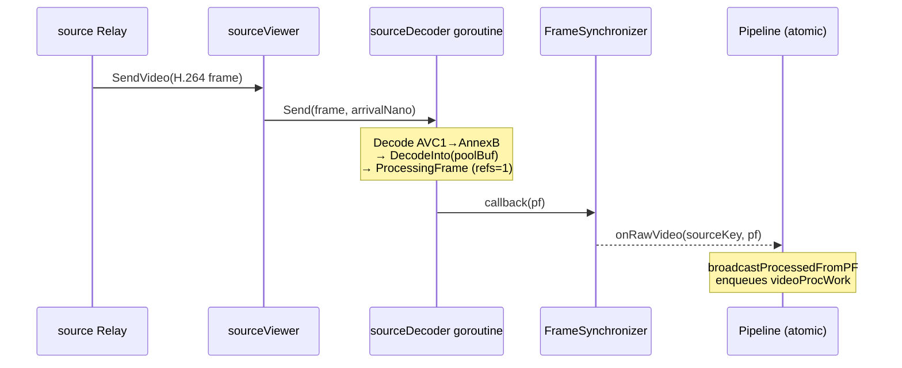
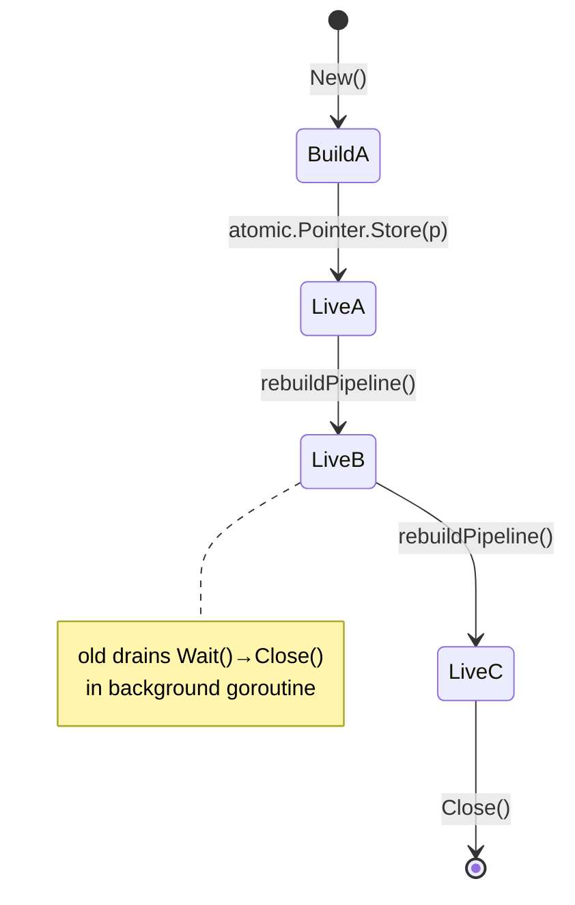

# The video pipeline

> **Where you are:** [docs](../README.md) → concepts → pipeline
> **Read this first:** [architecture.md](../architecture.md)
> **See also:** [media-path](media-path.md) · [frame-sync-and-timing](frame-sync-and-timing.md) · [locking-and-concurrency](locking-and-concurrency.md)

**TL;DR** — Switchframe decodes every source all the time, so a cut is free: the next frame from the new source is already in YUV and ready to encode. Those YUV frames flow through a small chain of in-place [`PipelineNode`](../../server/switcher/pipeline_node.go) processors — keying, DVE, compositing, raw taps, encode — that is rebuilt and hot-swapped via an `atomic.Pointer` whenever the operator toggles a feature. Buffers live in a pre-allocated [`FramePool`](../../server/switcher/frame_pool.go) outside the Go heap, and a small reference count on each [`ProcessingFrame`](../../server/switcher/processing_frame.go) lets a single YUV buffer fan out to multiple consumers safely. The net effect: cuts happen on the next tick, reconfiguration never pauses the stream, and the GC never sees gigabytes of video.

## The story

A broadcast switcher is judged in frames, not in seconds. When the operator hits CUT, the program output is expected to change on the very next field — not at the next keyframe, not after a GOP re-aligns, not once a transcoder catches up. Most software that accepts compressed video in (H.264, HEVC) inherits a hidden tax: the decoder needs a fresh IDR before it can emit a picture. If you only decode the source that happens to be on-air, then the moment you cut to a different source you stall until its next IDR arrives, which for typical 2-second GOPs is a lifetime on air.

Switchframe removes that tax by inverting the trade-off. Every registered source runs its own single-threaded decoder goroutine from the moment it is registered — see [`sourceDecoder`](../../server/switcher/source_decoder.go) in `switcher/`. No source is ever "cold." A cut simply changes which source's already-decoded YUV frames the central pipeline consumes. The FFmpeg decoder state for each source is permanently warm, and the program output switches within one frame budget. This is the **always-decode-per-source** architecture, and it is the single biggest reason the switcher feels instantaneous.

That decision has a corollary: every change to the downstream processing chain — turning on a chroma key, adding a DVE slot, attaching a raw sink for MXL output — must not interrupt the 30/60 fps cadence. The pipeline is therefore expressed as a list of [`PipelineNode`](../../server/switcher/pipeline_node.go) values, and a new list can be built, configured, and **atomically swapped** into place on a live stream. The old pipeline drains its in-flight frames in a background goroutine while the new one starts processing the next frame. Operators never see a reconfiguration artifact.

The last piece of the story is memory. A 1920×1080 YUV420 frame is about 3 MB. At 30 fps with multiple sources and several points of fan-out, the Go garbage collector would be scanning a small fortune of pixels. So pipeline buffers come from a [`FramePool`](../../server/switcher/frame_pool.go) that `mmap`s its backing store outside the Go heap — invisible to the GC — and every [`ProcessingFrame`](../../server/switcher/processing_frame.go) carries a reference count so the same buffer can feed multiple consumers before returning to the pool.

## How it works

### Always-decode-per-source

When [`Switcher.RegisterSource`](../../server/switcher/switcher.go) is called with a source key and a Prism relay, the switcher attaches a [`sourceViewer`](../../server/switcher/source_viewer.go) to the relay and, if `sourceDecoderFactory` is set, creates a dedicated [`sourceDecoder`](../../server/switcher/source_decoder.go) goroutine. Incoming H.264/HEVC frames land in a tiny `chan decoderInput` (capacity 2, newest-wins drop) so the delivery goroutine never blocks. The decoder loop converts AVC1 length-prefixed wire data to Annex B in reusable scratch buffers, prepends VPS/SPS/PPS on keyframes, and calls `DecodeInto` — a FFmpeg fast path that writes YUV directly into a pool buffer, skipping an allocation and a copy on every frame. The decoded frame becomes a [`ProcessingFrame`](../../server/switcher/processing_frame.go) and fires a callback to route it through the frame sync or delay buffer on its way to the switcher's frame handler.

Each decoder carries its own scratch: `annexBBuf`, `prependBuf`, an optional `scaleBuf` for resolution normalization, and an `stmapBuf` for ST map warps. Everything is per-source, single-writer, no locking on the hot path.

The cost is memory: roughly 3 MB of YUV scratch per active source at 1080p. [`Switcher.RegisterSource`](../../server/switcher/switcher.go) logs a warning once the total exceeds 256 MB. The value from always-decode is that cut latency is bounded by one frame, not one GOP.



### The node chain and atomic swap

Inside the switcher, [`Switcher.buildNodeList`](../../server/switcher/switcher.go) assembles a fixed order of CPU pipeline nodes for the program path:

```
upstream-key → dve-compositor → compositor → stmap-program → raw-sink-mxl → raw-sink-preview → h264-encode
```

Each node is a small type satisfying the [`PipelineNode`](../../server/switcher/pipeline_node.go) interface (`Name`, `Configure`, `Active`, `Process`, `Err`, `Latency`, `Close`). Every node decides for itself whether it is currently meaningful — an `upstreamKeyNode` reports `Active() == false` when no chroma/luma keys are configured — and [`Pipeline.Build`](../../server/switcher/pipeline_loop.go) filters inactive nodes out entirely so idle features cost literally nothing. Latency budgets advertised by each node sum into [`Pipeline.TotalLatency`](../../server/switcher/pipeline_loop.go), which the audio mixer uses for lip-sync compensation.

The hot path itself is small: [`Pipeline.Run`](../../server/switcher/pipeline_loop.go) takes a [`ProcessingFrame`](../../server/switcher/processing_frame.go), calls `MakeWritable` to make sure we own the YUV buffer, and then walks `activeNodes` calling `Process(dst, src)` on each. In-place nodes modify `src.Data` and return `src`; there is no copy unless the node explicitly asks for one. Per-node timing goes into atomic counters that drive Prometheus and the debug endpoint.

Reconfiguration is the interesting part. Any event that changes node activity — `SetCompositor`, `SetKeyBridge`, `SetRawVideoSink`, `SetPipelineFormat`, the DVE compositor's own `OnActiveChange` callback — calls [`Switcher.rebuildPipeline`](../../server/switcher/switcher.go). That builds a fresh [`Pipeline`](../../server/switcher/pipeline_loop.go) from the current node list and swaps it in with [`Switcher.swapPipeline`](../../server/switcher/switcher.go):

```go
old := s.pipeline.Swap(newPipeline)
if old != nil {
  s.drainWg.Add(1)
  go func() {
    defer s.drainWg.Done()
    old.Wait()       // sync.WaitGroup — in-flight frames finish
    _ = old.Close()  // then close nodes
  }()
}
```

The swap is a single pointer store. Reads from the sync loop ([`sync_loop.go`](../../server/switcher/sync_loop.go)) always see either the old pipeline or the new one - never a half-configured mix. The old pipeline's `inflight` wait group lets a frame that was already mid-flight finish cleanly before its nodes' `Close()` runs. Bypass flags are carried across rebuilds via [`Pipeline.RestoreBypass`](../../server/switcher/pipeline_loop.go) so the operator's "bypass compositor" toggle survives a graphics-layer change.



### ProcessingFrame and reference counting

[`ProcessingFrame`](../../server/switcher/processing_frame.go) is a small struct with a YUV data slice, dimensions, PTS/DTS, a color format tag, several diagnostic timestamps (`ArrivalNano`, `DecodeStartNano`, `DecodeEndNano`, `SyncReleaseNano`), a `*FramePool` back-pointer, and — critically — a shared `*atomic.Int32` reference count. The refcount model is FFmpeg's [`av_frame_make_writable`](https://ffmpeg.org/doxygen/trunk/group__lavu__frame.html) pattern carried into Go.

Why refcounting? A single decoded YUV frame may need to reach:
- the [`FrameSynchronizer`](../../server/switcher/frame_sync.go) ring buffer, as `lastRawVideo` for freeze/repeat,
- the key bridge and DVE compositor's per-source fill caches,
- the GPU source manager for zero-upload GPU compositing,
- the pipeline's own in-place processing,
- and (after encode) raw sinks for MXL output and preview.

Copying for each would mean multiple megabytes of memmove per frame. Refcounting lets everyone share one buffer. `Ref()` increments; `ReleaseYUV()` decrements and only returns the buffer to the pool when the count reaches zero. If the pipeline wants to modify the data, [`ProcessingFrame.MakeWritable`](../../server/switcher/processing_frame.go) first checks `refs <= 1`; if another consumer holds a ref, it clones the buffer, decrements the shared count, and attaches a fresh refcount so the pipeline's in-place writes can't corrupt the fill cache. This is the invariant that lets the `compositorNode` write into `src.Data` safely.

Unmanaged frames (those with `refs == nil`) exist for tests and transient wrappers — `ReleaseYUV` just returns the buffer to the pool once. Mixing the two patterns is deliberate: production paths always `SetRefs(1)` on creation; test paths are simpler and leak-proof without it.

### The FramePool

[`FramePool`](../../server/switcher/frame_pool.go) is a mutex-guarded LIFO free list of byte slices sized to the current pipeline resolution. Pre-allocated buffers come from [`mmaputil.Alloc`](../../server/mmaputil/) which uses `MAP_PRIVATE|MAP_ANON` so the memory lives outside the Go heap — at 512 buffers × ~3 MB each for 1080p, that's roughly 1.5 GB the GC never scans. The LIFO ordering means a freshly released buffer is the next one handed out, keeping hot cache lines warm.

When demand spikes beyond capacity, `Acquire()` falls back to a heap allocation so the switcher never stalls on buffer starvation. The fallback is counted in `misses`. `Release()` has two small but important guards: it discards buffers whose `cap` doesn't match the current pool size (so a pending release after a resolution change doesn't corrupt the new pool) and it rejects duplicates by scanning the free list's base pointers (so a double-release doesn't alias a live buffer into the pool). These cost a few ns on a pool that typically has 4-16 free entries at rest.

The pool is recreated on format change in [`Switcher.SetPipelineFormat`](../../server/switcher/switcher.go); old-sized buffers drain naturally through `Release()`'s cap check.

### From ingest to encode

Decoded YUV enters through [`Switcher.IngestRawVideo`](../../server/switcher/switcher.go). It is stamped with media time, fed to the GPU source manager or the CPU fill caches of every source, and buffered in the [`FrameSynchronizer`](../../server/switcher/frame_sync.go). On each reference-clock tick, the sync loop ([`sync_loop.go`](../../server/switcher/sync_loop.go)) takes the program source's frame due at the read point. During a transition it takes both sources' frames and blends them. It stamps the tick's PTS, normalizes the resolution, and runs the atomic pipeline pointer's `Run` on its own goroutine. See [frame-sync-and-timing](frame-sync-and-timing.md).

## Key types and entry points

- Entry: [`server/switcher/switcher.go`](../../server/switcher/switcher.go) -> `Switcher.IngestRawVideo()`; [`server/switcher/sync_loop.go`](../../server/switcher/sync_loop.go) -> `processVideoTick()`.
- Pipeline root: [`server/switcher/pipeline_loop.go`](../../server/switcher/pipeline_loop.go) → `Pipeline` struct, `Pipeline.Build`, `Pipeline.Run`, `Pipeline.RestoreBypass`.
- Hot swap: [`server/switcher/switcher.go`](../../server/switcher/switcher.go) → `Switcher.pipeline` is `atomic.Pointer[Pipeline]`; `Switcher.rebuildPipeline` and `Switcher.swapPipeline` are the write path.
- Node interface: [`server/switcher/pipeline_node.go`](../../server/switcher/pipeline_node.go) → `PipelineNode` (7 methods).
- Default node chain: [`server/switcher/switcher.go`](../../server/switcher/switcher.go) → `Switcher.buildNodeList`.
- Frame carrier: [`server/switcher/processing_frame.go`](../../server/switcher/processing_frame.go) → `ProcessingFrame`, `Ref`, `ReleaseYUV`, `MakeWritable`, `DeepCopy`.
- Buffer pool: [`server/switcher/frame_pool.go`](../../server/switcher/frame_pool.go) → `FramePool`, `Acquire`, `Release`.
- Async encode: [`server/switcher/node_encode.go`](../../server/switcher/node_encode.go) → `encodeNode.start()` / `encodeNode.encodeLoop()`.

State guarded by `Switcher.mu` (write lock for mutations, read lock for per-frame reads): `sources`, `programSource`, `previewSource`, `transEngine`, `compositorRef`, `keyBridge`, `dveCompositor`, `stmapRegistry`, `pipeCodecs`, `sourceDecoderFactory`. Hot-path reads avoid this lock wherever possible via `atomic.Pointer` and `atomic.Bool` (e.g. `pipeline`, `gpuRunner`, `gpuSourceMgr`, `rawVideoSink`, `gpuSourceActive`).

## Gotchas and invariants

**Cut latency is one frame, not one GOP.** This is only true because source decoders are permanently warm and because source H.264 keyframes are *not* propagated through the raw YUV pipeline. Downstream IDR placement is controlled by [`Switcher.forceNextIDR`](../../server/switcher/switcher.go), which `Cut()` sets so the program encoder emits a keyframe. See the comment in [`source_decoder.go`](../../server/switcher/source_decoder.go) where `IsKeyframe` is intentionally set to `false` on every decoded frame — propagating source keyframes caused excessive IDRs on the output (one per source GOP boundary).

**The pipeline pointer is read lock-free.** The sync loop loads it with `s.pipeline.Load()` on every frame. Never hold `s.mu` while doing pipeline work - builders go under the lock, but the swap itself (`atomic.Pointer.Swap`) is lock-free, and drain runs in a detached goroutine. `Switcher.Close` explicitly waits on `drainWg` before closing `pipeCodecs` so a still-draining old pipeline cannot touch a closed encoder.

**`MakeWritable` is mandatory before in-place modification.** The fill caches in `graphics.KeyProcessorBridge` and `dve.Compositor` may retain the exact buffer the pipeline is about to modify. Without `MakeWritable` the compositor would rewrite the fill cache, breaking the next frame's key. [`Pipeline.Run`](../../server/switcher/pipeline_loop.go) calls it as its first step; any node that acts on `src.Data` without going through the standard chain must call it explicitly.

**Refcount underflow leaks, it does not panic.** [`ProcessingFrame.ReleaseYUV`](../../server/switcher/processing_frame.go) logs an error when `refs < 0` and bails out rather than crashing. A leaked buffer is a memory cost the system will absorb; a panic on the encode goroutine would take the whole broadcast down. The same philosophy governs the panic recover in [`encodeNode.processWorkItem`](../../server/switcher/node_encode.go) — a cgo crash invalidates the encoder so the next frame recreates it, instead of killing the program output.

**Bypass flags belong to node names, not positions.** When the pipeline rebuilds, node positions may shift (a newly active node inserts into the chain). [`Pipeline.BypassState`](../../server/switcher/pipeline_loop.go) returns a `map[string]bool` keyed on `node.Name()`, and `RestoreBypass` reapplies by name. This is how operator bypass toggles survive enabling a chroma key — both before and after, `compositor` is still `compositor`.

**Async encode can drop under sustained overload.** The encode channel has a buffer of 4. When a hardware encoder stalls (NVENC warmup, stinger spike), Process() drops the newest frame and re-arms `forceNextIDR` so the next successful encode is a keyframe. Raw sinks (MXL, preview) have already received the frame because they run *before* encode in the chain. H.264 viewers see the same drop they would have seen with channel backpressure, but MXL and preview continue to tick.

## Related docs

- **Concepts:** [media-path](media-path.md), [frame-sync-and-timing](frame-sync-and-timing.md), [locking-and-concurrency](locking-and-concurrency.md), [gpu](gpu.md)
- **Subsystems:** [switcher](../subsystems/switcher.md), [transition](../subsystems/transition.md), [graphics-and-dve](../subsystems/graphics-and-dve.md), [codec](../subsystems/codec.md), [stmap](../subsystems/stmap.md)
- **Reference:** [metrics](../reference/metrics.md#pipeline-metrics), [config-and-flags](../reference/config-and-flags.md), [api](../reference/api.md)
- **Integration:** [ui-server-contract](../integration/ui-server-contract.md)
