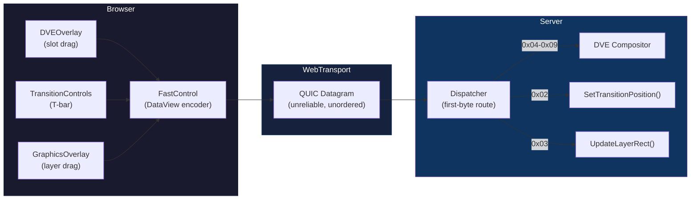
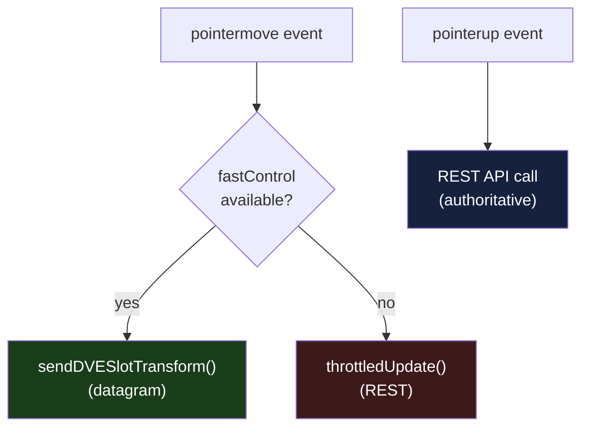
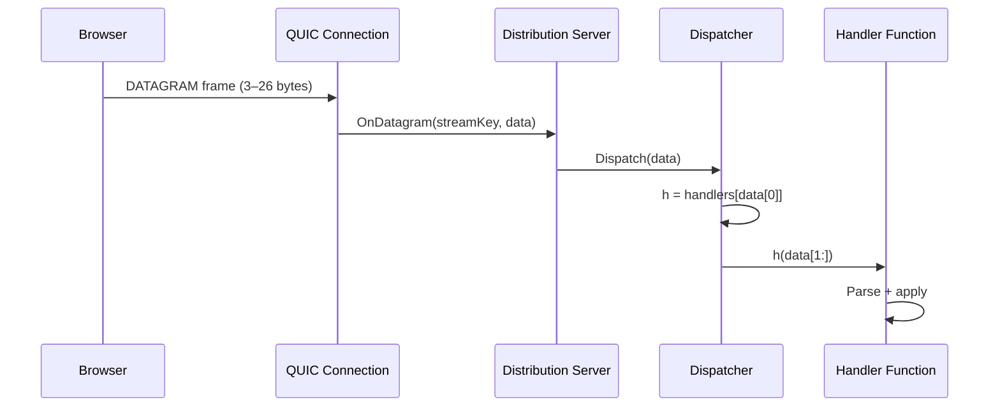
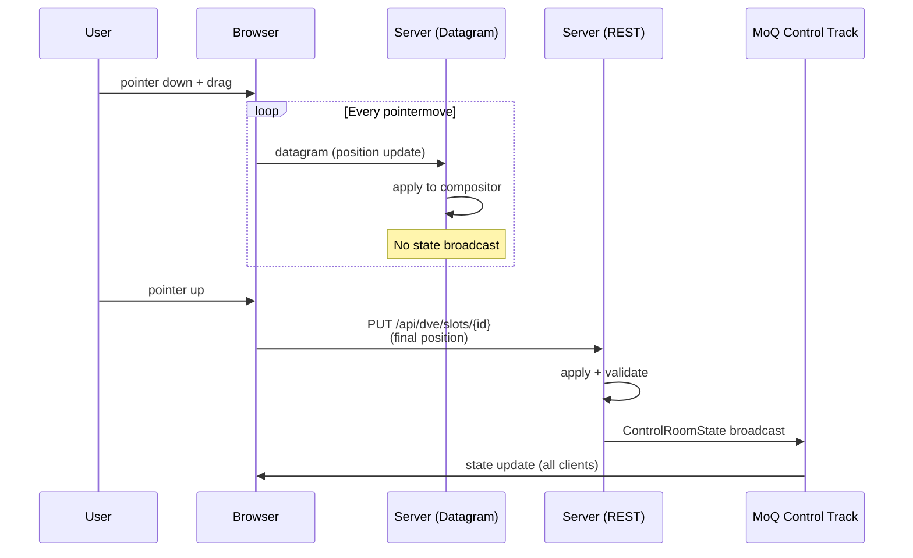

# Fast-Control Datagram Channel

1. [Overview](#1-overview)
2. [Transport: Datagrams vs REST](#2-transport-datagrams-vs-rest)
3. [Message Format](#3-message-format)
4. [Message Types](#4-message-types)
5. [Binary Encoding](#5-binary-encoding)
6. [Client-Side Usage](#6-client-side-usage)
7. [Server-Side Dispatch](#7-server-side-dispatch)
8. [REST Confirmation Pattern](#8-rest-confirmation-pattern)
9. [File Reference](#9-file-reference)

---

## 1. Overview

The fast-control channel is a low-latency binary protocol carried over [WebTransport datagrams](https://www.w3.org/TR/webtransport/#datagrams) for real-time control inputs that require sub-frame update rates. Four operation categories use it:

| Operation | UI Gesture | Update Rate |
|-----------|-----------|-------------|
| DVE slot transform | Pointer drag on DVE overlay | Every `pointermove` event (~60–120 Hz) |
| DVE slot parameters | Knob/slider on DVE controls | Every `input` event (~60 Hz) |
| T-bar transition | Slider input on transition controls | Every `input` event (throttled) |
| Graphics layer drag/resize | Pointer drag on graphics overlay | Every `pointermove` event (~60–120 Hz) |

These interactions generate dozens of position updates per second. Sending each as a REST request would add HTTP framing overhead and head-of-line blocking. WebTransport datagrams are fire-and-forget UDP messages within the QUIC connection — no request/response framing, no ordering guarantees, no retransmission. A single datagram is 5–11 bytes and arrives at the server in under 1ms on a local network.



---

## 2. Transport: Datagrams vs REST

| Property | WebTransport Datagram | REST API |
|----------|----------------------|----------|
| **Latency** | <1ms (LAN) | 2–10ms (HTTP/3 request/response) |
| **Framing** | None (raw bytes on QUIC DATAGRAM frame) | HTTP headers + JSON body |
| **Reliability** | Unreliable — no retransmission | Reliable — HTTP/3 stream with ACKs |
| **Ordering** | Unordered | Ordered (per-stream) |
| **State broadcast** | No — server applies silently | Yes — triggers `ControlRoomState` update |
| **Overhead per update** | 5–11 bytes payload | ~200+ bytes (headers + JSON) |

### When to Use Which

**Datagrams** for continuous real-time position updates during drag/slider gestures. Dropped datagrams are harmless — the next one carries the current position. No state broadcast is triggered, keeping the MoQ control channel quiet during rapid updates.

**REST** for authoritative final state. On `pointerup`, the browser sends a REST call to confirm the final position. This triggers a state broadcast so all connected clients see the committed position.

---

## 3. Message Format

Every fast-control datagram follows a simple TLV-like structure with no length field — the message type implicitly defines the payload size.

```
┌──────────────────────────────────────────┐
│  Byte 0        │  Bytes 1..N            │
│  Message Type  │  Payload               │
│  (uint8)       │  (type-specific)       │
└──────────────────────────────────────────┘
```

The dispatcher reads byte 0, strips it, and passes bytes 1..N to the registered handler. An empty datagram (0 bytes) returns `ErrEmptyDatagram`. An unregistered type returns `ErrUnknownType`.

### Registered Types

| Byte | Constant | Payload Size | Total Size |
|:----:|----------|:------------:|:----------:|
| `0x02` | `MsgTransitionPosition` | 4 bytes | 5 bytes |
| `0x03` | `MsgGraphicsLayerPosition` | 10 bytes | 11 bytes |
| `0x04` | `MsgDVESlotTransform` | 25 bytes | 26 bytes |
| `0x05` | `MsgDVESingleParam` | 7 bytes | 8 bytes |
| `0x06` | `MsgDVESlotSource` | 2+ bytes (variable) | 3+ bytes |
| `0x07` | `MsgDVESlotEnable` | 2 bytes | 3 bytes |
| `0x08` | `MsgDVEScaleMode` | 10 bytes | 11 bytes |
| `0x09` | `MsgDVEBorder` | 12 bytes | 13 bytes |

The 256-element handler table (`[256]Handler`) allows O(1) dispatch with zero allocation.

---

## 4. Message Types

### 0x02 — Transition Position

Sent during T-bar slider input. Sets the transition progress during an active video transition (dissolve, wipe, dip, stinger).

| Field | Purpose | Constraints |
|-------|---------|-------------|
| Position | Transition progress | IEEE 754 float32, range [0.0, 1.0] |

`0.0` = fully on current program source. `1.0` = fully on preview source (transition complete). NaN values are rejected.

### 0x03 — Graphics Layer Position

Sent during graphics layer drag or resize operations. Updates the position and size of a DSK graphics layer on the program output.

| Field | Purpose | Constraints |
|-------|---------|-------------|
| Layer ID | Which graphics layer | uint16 |
| X, Y | Top-left corner in output pixels | Must be even-aligned |
| W, H | Width and height in output pixels | Must be even-aligned, non-zero |

### 0x04 — DVE Slot Transform

Sent during DVE slot drag, resize, or rotation. Updates the full transform of a DVE compositor slot (position, size, rotation, opacity).

| Field | Purpose | Constraints |
|-------|---------|-------------|
| Slot ID | Which DVE slot (0–7) | Must be < `MaxSlots` (8) |
| PositionX, PositionY | Center position in normalized coords | float32, no NaN/Inf |
| Width, Height | Size in normalized coords | float32, > 0.0 |
| Rotation | Rotation in degrees | float32, no NaN/Inf |
| Opacity | Slot opacity | float32, range [0.0, 1.0] |

### 0x05 — DVE Single Parameter

Sent for individual knob or slider adjustments to a single DVE transform parameter (e.g., crop, defocus, corner radius).

| Field | Purpose | Constraints |
|-------|---------|-------------|
| Slot ID | Which DVE slot (0–7) | Must be < `MaxSlots` (8) |
| Param ID | Parameter identifier | uint16 (see param ID table) |
| Value | Parameter value | float32, no NaN/Inf |

**Param IDs:** `0x0000` PositionX, `0x0001` PositionY, `0x0002` Width, `0x0003` Height, `0x0004` RotationDeg, `0x0005` PerspectiveX, `0x0006` PerspectiveY, `0x0008` CropTop, `0x0009` CropBottom, `0x000A` CropLeft, `0x000B` CropRight, `0x000C` Opacity, `0x000D` DefocusRadius, `0x000E` BorderWidth, `0x000F` CornerRadius.

### 0x06 — DVE Slot Source

Sent to assign a source to a DVE slot.

| Field | Purpose | Constraints |
|-------|---------|-------------|
| Slot ID | Which DVE slot (0–7) | Must be < `MaxSlots` (8) |
| Key Length | Length of source key string | uint8 |
| Key | Source key (UTF-8) | Variable length |

### 0x07 — DVE Slot Enable

Sent to enable or disable a DVE slot.

| Field | Purpose | Constraints |
|-------|---------|-------------|
| Slot ID | Which DVE slot (0–7) | Must be < `MaxSlots` (8) |
| Enabled | Enable/disable flag | uint8: 0 = disabled, 1 = enabled |

### 0x08 — DVE Scale Mode

Sent to change a DVE slot's scale mode and crop anchor.

| Field | Purpose | Constraints |
|-------|---------|-------------|
| Slot ID | Which DVE slot (0–7) | Must be < `MaxSlots` (8) |
| Mode | Scale mode | uint8: 0 = stretch, 1 = fill, 2 = fit |
| AnchorX | Crop anchor X | float32, range [0.0, 1.0] |
| AnchorY | Crop anchor Y | float32, range [0.0, 1.0] |

### 0x09 — DVE Border

Sent to update a DVE slot's border properties.

| Field | Purpose | Constraints |
|-------|---------|-------------|
| Slot ID | Which DVE slot (0–7) | Must be < `MaxSlots` (8) |
| Width | Border width in pixels | float32, >= 0.0 |
| Radius | Corner radius in pixels | float32, >= 0.0 |
| Y, Cb, Cr | Border color (BT.709 YCbCr) | uint8 each |

---

## 5. Binary Encoding

All multi-byte integers are big-endian (network byte order). The client uses `DataView` methods which default to big-endian.

### 0x02 — Transition Position (5 bytes)

```
Byte   0       1    2    3    4
     ┌───────┬─────────────────┐
     │ 0x02  │    Position     │
     │ type  │   float32 BE    │
     └───────┴─────────────────┘
```

| Offset | Size | Type | Field | Range |
|:------:|:----:|------|-------|-------|
| 0 | 1 | uint8 | Message type | `0x02` |
| 1–4 | 4 | float32 BE | Transition position | 0.0–1.0 |

The position is an IEEE 754 single-precision float. The server reads the raw 32-bit pattern via `math.Float32frombits()` and validates the range. NaN, negative, and >1.0 values are rejected.

### 0x03 — Graphics Layer Position (11 bytes)

```
Byte   0       1    2       3    4       5    6       7    8       9   10
     ┌───────┬─────────┬─────────┬─────────┬─────────┬─────────┐
     │ 0x03  │ LayerID │    X    │    Y    │    W    │    H    │
     │ type  │ uint16  │ uint16  │ uint16  │ uint16  │ uint16  │
     └───────┴─────────┴─────────┴─────────┴─────────┴─────────┘
```

| Offset | Size | Type | Field | Range |
|:------:|:----:|------|-------|-------|
| 0 | 1 | uint8 | Message type | `0x03` |
| 1–2 | 2 | uint16 BE | Layer ID | 0–65535 |
| 3–4 | 2 | uint16 BE | X position | 0–65534 (even) |
| 5–6 | 2 | uint16 BE | Y position | 0–65534 (even) |
| 7–8 | 2 | uint16 BE | Width | 2–65534 (even, non-zero) |
| 9–10 | 2 | uint16 BE | Height | 2–65534 (even, non-zero) |

The graphics message uses a uint16 for the layer ID because the graphics system supports many independent layers.

### 0x04 — DVE Slot Transform (26 bytes)

```
Byte   0       1         2    3    4    5       6    7    8    9
     ┌───────┬─────────┬─────────────────┬─────────────────┐
     │ 0x04  │ SlotID  │    PositionX    │    PositionY    │
     │ type  │ uint8   │   float32 BE    │   float32 BE    │
     ├───────┴─────────┼─────────────────┼─────────────────┤
     │      Width      │     Height      │    Rotation     │
     │   float32 BE    │   float32 BE    │   float32 BE    │
     ├─────────────────┼─────────────────┼─────────────────┤
     │     Opacity     │
     │   float32 BE    │
     └─────────────────┘
```

| Offset | Size | Type | Field | Range |
|:------:|:----:|------|-------|-------|
| 0 | 1 | uint8 | Message type | `0x04` |
| 1 | 1 | uint8 | Slot ID | 0–7 |
| 2–5 | 4 | float32 BE | PositionX | normalized |
| 6–9 | 4 | float32 BE | PositionY | normalized |
| 10–13 | 4 | float32 BE | Width | > 0.0 |
| 14–17 | 4 | float32 BE | Height | > 0.0 |
| 18–21 | 4 | float32 BE | Rotation | degrees |
| 22–25 | 4 | float32 BE | Opacity | 0.0–1.0 |

### 0x05 — DVE Single Parameter (8 bytes)

```
Byte   0       1         2    3       4    5    6    7
     ┌───────┬─────────┬─────────┬─────────────────┐
     │ 0x05  │ SlotID  │ ParamID │      Value      │
     │ type  │ uint8   │ uint16  │   float32 BE    │
     └───────┴─────────┴─────────┴─────────────────┘
```

| Offset | Size | Type | Field | Range |
|:------:|:----:|------|-------|-------|
| 0 | 1 | uint8 | Message type | `0x05` |
| 1 | 1 | uint8 | Slot ID | 0–7 |
| 2–3 | 2 | uint16 BE | Param ID | see param ID table |
| 4–7 | 4 | float32 BE | Value | param-dependent |

### 0x06 — DVE Slot Source (3+ bytes, variable)

```
Byte   0       1         2          3 .. 2+keyLen
     ┌───────┬─────────┬──────────┬─────────────┐
     │ 0x06  │ SlotID  │ KeyLen   │  Key bytes  │
     │ type  │ uint8   │ uint8    │   UTF-8     │
     └───────┴─────────┴──────────┴─────────────┘
```

| Offset | Size | Type | Field | Range |
|:------:|:----:|------|-------|-------|
| 0 | 1 | uint8 | Message type | `0x06` |
| 1 | 1 | uint8 | Slot ID | 0–7 |
| 2 | 1 | uint8 | Key length | 0–255 |
| 3+ | N | bytes | Source key | UTF-8 string |

### 0x07 — DVE Slot Enable (3 bytes)

```
Byte   0       1         2
     ┌───────┬─────────┬─────────┐
     │ 0x07  │ SlotID  │ Enabled │
     │ type  │ uint8   │ uint8   │
     └───────┴─────────┴─────────┘
```

| Offset | Size | Type | Field | Range |
|:------:|:----:|------|-------|-------|
| 0 | 1 | uint8 | Message type | `0x07` |
| 1 | 1 | uint8 | Slot ID | 0–7 |
| 2 | 1 | uint8 | Enabled | 0 or 1 |

### 0x08 — DVE Scale Mode (11 bytes)

```
Byte   0       1         2         3    4    5    6       7    8    9   10
     ┌───────┬─────────┬─────────┬─────────────────┬─────────────────┐
     │ 0x08  │ SlotID  │  Mode   │    AnchorX      │    AnchorY      │
     │ type  │ uint8   │ uint8   │   float32 BE    │   float32 BE    │
     └───────┴─────────┴─────────┴─────────────────┴─────────────────┘
```

| Offset | Size | Type | Field | Range |
|:------:|:----:|------|-------|-------|
| 0 | 1 | uint8 | Message type | `0x08` |
| 1 | 1 | uint8 | Slot ID | 0–7 |
| 2 | 1 | uint8 | Mode | 0=stretch, 1=fill, 2=fit |
| 3–6 | 4 | float32 BE | AnchorX | 0.0–1.0 |
| 7–10 | 4 | float32 BE | AnchorY | 0.0–1.0 |

### 0x09 — DVE Border (13 bytes)

```
Byte   0       1         2    3    4    5       6    7    8    9      10     11     12
     ┌───────┬─────────┬─────────────────┬─────────────────┬───────┬───────┬───────┐
     │ 0x09  │ SlotID  │     Width       │     Radius      │   Y   │  Cb   │  Cr   │
     │ type  │ uint8   │   float32 BE    │   float32 BE    │ uint8 │ uint8 │ uint8 │
     └───────┴─────────┴─────────────────┴─────────────────┴───────┴───────┴───────┘
```

| Offset | Size | Type | Field | Range |
|:------:|:----:|------|-------|-------|
| 0 | 1 | uint8 | Message type | `0x09` |
| 1 | 1 | uint8 | Slot ID | 0–7 |
| 2–5 | 4 | float32 BE | Border width | >= 0.0 |
| 6–9 | 4 | float32 BE | Corner radius | >= 0.0 |
| 10 | 1 | uint8 | Y | 0–255 |
| 11 | 1 | uint8 | Cb | 0–255 |
| 12 | 1 | uint8 | Cr | 0–255 |

---

## 6. Client-Side Usage

The client module ([`fast-control.ts`](../ui/src/lib/transport/fast-control.ts)) provides encoder functions and a `FastControl` interface that wraps a `WebTransport` datagram writer.

### Creating the Fast-Control Interface

```typescript
import { createFastControl } from '$lib/transport/fast-control';

const fc = createFastControl(transport);
```

`createFastControl()` acquires a writer lock on `transport.datagrams.writable` and returns an object with send methods for each message type. Each method encodes a message into a `Uint8Array` and writes it to the datagram writer. Errors are silently caught (`.catch(() => {})`) — dropped datagrams are expected and harmless.

### Encoding Functions

Each encoder allocates an `ArrayBuffer`, creates a `DataView`, writes the fields, and returns a `Uint8Array`:

```typescript
encodeTransitionPosition(position)                            // → 5 bytes
encodeGraphicsLayerPosition(layerId, x, y, w, h)             // → 11 bytes
encodeDVESlotTransform(slotId, x, y, w, h, rotation, opacity) // → 26 bytes
encodeDVESingleParam(slotId, paramId, value)                  // → 8 bytes
encodeDVESlotSource(slotId, sourceKey)                        // → 3+ bytes
encodeDVESlotEnable(slotId, enabled)                          // → 3 bytes
encodeDVEScaleMode(slotId, mode, anchorX, anchorY)            // → 11 bytes
encodeDVEBorder(slotId, width, radius, y, cb, cr)             // → 13 bytes
```

### Usage in Components

The overlay components use fast-control during pointer events, falling back to throttled REST when WebTransport is unavailable:



---

## 7. Server-Side Dispatch

### Datagram Reception

The Prism distribution server receives QUIC datagrams and invokes the `OnDatagram` callback configured in [`app.go`](../server/cmd/switchframe/app.go). This callback passes the raw bytes directly to the fast-control dispatcher:



### Dispatcher Internals

The `Dispatcher` is a fixed-size 256-element array of handler functions, indexed by message type byte. This provides O(1) dispatch with no map lookup, no allocation, and no hash collision.

```go
type Handler func(data []byte) error

type Dispatcher struct {
    handlers [256]Handler
}

func (d *Dispatcher) Dispatch(data []byte) error {
    if len(data) == 0 {
        return ErrEmptyDatagram
    }
    h := d.handlers[data[0]]
    if h == nil {
        return ErrUnknownType
    }
    return h(data[1:])  // payload only — type byte stripped
}
```

### Handler Registration

Handlers are registered at startup in [`app_fastctrl.go`](../server/cmd/switchframe/app_fastctrl.go):

| Type | Handler | Target |
|:----:|---------|--------|
| `0x02` | `handleFastTransitionUpdate` | `sw.SetTransitionPosition()` |
| `0x03` | `handleFastGraphicsUpdate` | `compositor.UpdateLayerRect()` |
| `0x04` | `handleFastDVETransform` | `dveCompositor.UpdateSlotTransform()` |
| `0x05` | `handleFastDVESingleParam` | `dveCompositor.UpdateSlotParam()` |
| `0x06` | `handleFastDVESlotSource` | `dveCompositor.SetSlotSource()` |
| `0x07` | `handleFastDVESlotEnable` | `dveCompositor.SetSlotEnabled()` |
| `0x08` | `handleFastDVEScaleMode` | `dveCompositor.SetSlotScaleMode()` |
| `0x09` | `handleFastDVEBorder` | `dveCompositor.SetSlotBorder()` |

Each handler parses the binary payload with the appropriate `Parse*` function, validates constraints (even alignment, range checks), and calls the target subsystem method. Errors are logged at debug level — a malformed datagram does not disconnect the client.

### Authentication

Datagrams bypass the HTTP middleware chain (CORS, auth, operator locks). This is acceptable for the trusted-LAN single-operator deployment model. The code includes a note to revisit if multi-operator security requires per-datagram authentication.

---

## 8. REST Confirmation Pattern

Fast-control datagrams provide real-time visual feedback but are unreliable and do not trigger state broadcasts. The browser uses a two-phase pattern:



### Phase 1: Datagram Stream (During Drag)

- Every `pointermove` encodes and sends a datagram
- Server applies the position update immediately (sub-millisecond)
- The compositor picks up the new position on the next video frame
- No `ControlRoomState` broadcast — the MoQ control channel stays quiet
- Dropped datagrams are invisible — the next one carries the latest position

### Phase 2: REST Confirmation (On Release)

- On `pointerup`, the browser sends a REST API call with the final position
- The REST handler validates and applies the position authoritatively
- A `ControlRoomState` broadcast notifies all connected clients
- This ensures consistent state across multi-client scenarios

### Transition T-Bar Exception

The T-bar does not use the two-phase pattern. Transition position is inherently transient — there is no "final position" to confirm. The transition completes when position reaches 1.0 (or aborts at 0.0), which the switcher state machine handles internally regardless of the transport used.

---

## 9. File Reference

| File | Purpose |
|------|---------|
| [`fastctrl/dispatcher.go`](../server/fastctrl/dispatcher.go) | `Dispatcher` struct, `Handler` type, O(1) dispatch by message type |
| [`fastctrl/transition.go`](../server/fastctrl/transition.go) | `ParseTransitionPosition()`, float32 range validation |
| [`fastctrl/graphics.go`](../server/fastctrl/graphics.go) | `ParseGraphicsLayerPosition()`, message type constant `0x03` |
| [`fastctrl/dve.go`](../server/fastctrl/dve.go) | DVE message parsers (`0x04`–`0x09`): transform, single param, source, enable, scale mode, border |
| [`app_fastctrl.go`](../server/cmd/switchframe/app_fastctrl.go) | Handler registration, DVE/transition/graphics handler wiring |
| [`app.go`](../server/cmd/switchframe/app.go) | `OnDatagram` callback binding to `Dispatcher.Dispatch()` |
| [`fast-control.ts`](../ui/src/lib/transport/fast-control.ts) | Client encoder functions, `FastControl` interface, `createFastControl()` |
| [`LayoutOverlay.svelte`](../ui/src/components/LayoutOverlay.svelte) | DVE slot drag: datagram on `pointermove`, REST confirm on `pointerup` |
| [`GraphicsOverlay.svelte`](../ui/src/components/GraphicsOverlay.svelte) | Graphics drag: datagram on `pointermove`, REST confirm on `pointerup` |
| [`TransitionControls.svelte`](../ui/src/components/TransitionControls.svelte) | T-bar: datagram on `input`, REST fallback when no WebTransport |
| [`dve/compositor.go`](../server/dve/compositor.go) | DVE compositor — fast-path slot updates (no state broadcast) |
| [`graphics/compositor.go`](../server/graphics/compositor.go) | `UpdateLayerRect()` — fast-path position update (no state broadcast) |
| [`switcher/switcher.go`](../server/switcher/switcher.go) | `SetTransitionPosition()` — T-bar position on active transition |

---

*See also: [Architecture](architecture.md) · [Pipeline](pipeline.md) · [API Reference](api.md) · [Locking & Concurrency](locking-and-concurrency.md)*
