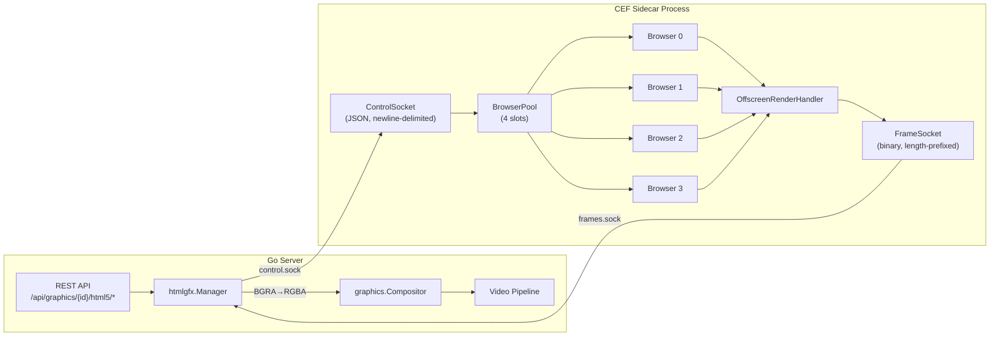
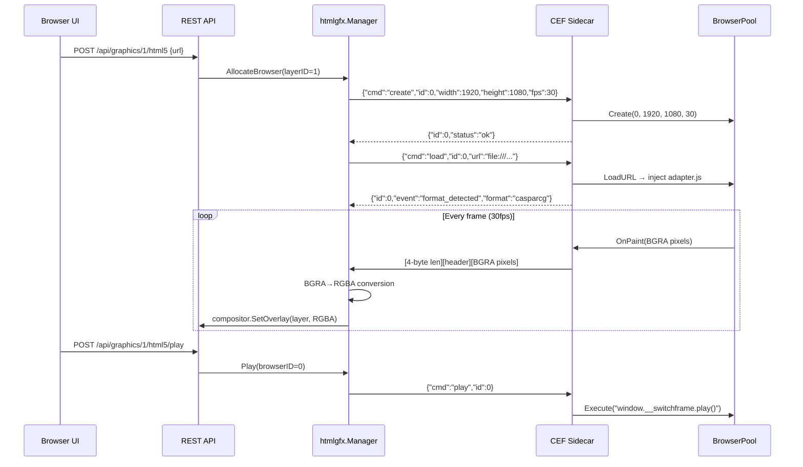

# HTML5 Graphics (CEF Sidecar)

SwitchFrame supports HTML5 broadcast graphics rendered via a Chromium Embedded Framework (CEF) sidecar process. This enables real-time rendering of web-based overlays — lower thirds, scorebugs, tickers, countdown timers, poll results, and any HTML/CSS/JS content — composited directly onto the program output with full alpha transparency.

The sidecar renders HTML pages offscreen at broadcast resolution and streams raw BGRA pixel data to the Go server over a Unix domain socket. The server converts BGRA→RGBA and delivers frames to the DSK graphics compositor, where they are alpha-blended onto the program video alongside static PNG overlays.

## Table of Contents

- [1. Overview](#1-overview)
- [2. Architecture](#2-architecture)
- [3. Template Formats](#3-template-formats)
- [4. Building the CEF Sidecar](#4-building-the-cef-sidecar)
- [5. Running](#5-running)
- [6. Demo Templates](#6-demo-templates)
- [7. REST API Reference](#7-rest-api-reference)
- [8. Socket Protocol Reference](#8-socket-protocol-reference)
- [9. Troubleshooting](#9-troubleshooting)
- [10. File Reference](#10-file-reference)

---

## 1. Overview

### What HTML5 Graphics Provides

| Feature | Description |
|---------|-------------|
| **Chromium offscreen rendering** | Full browser engine renders HTML/CSS/JS at 1080p/4K with GPU acceleration |
| **Alpha transparency** | BGRA pixel output with premultiplied alpha for clean compositing over video |
| **CasparCG compatibility** | Templates using `play()`, `stop()`, `update()` global functions work out of the box |
| **OGraf web components** | Custom elements with `playAction()`, `stopAction()`, `updateAction()` methods |
| **Browser pool** | Up to 4 simultaneous browser instances, independently controlled |
| **Auto-format detection** | Injected adapter.js detects template format and normalizes the control API |
| **Data-driven updates** | JSON data pushed to templates for live score updates, name changes, etc. |

### Why Use HTML5 Graphics?

- **Designer-friendly**: Graphics designers can use standard HTML/CSS/JS tooling (GSAP, CSS animations, web fonts)
- **Live data binding**: Update text, scores, colors in real time without reloading the template
- **CasparCG ecosystem**: Thousands of existing CasparCG HTML templates work without modification
- **OGraf standard**: Web component-based templates with structured manifests for UI-driven control
- **No external renderer**: Runs as a lightweight sidecar — no CasparCG server or separate infrastructure needed

---

## 2. Architecture

The HTML5 graphics system uses a two-process architecture connected by Unix domain sockets:



### Process Lifecycle

1. The Go server spawns `switchframe-cef` as a child process, passing socket paths via CLI flags
2. The sidecar initializes CEF, creates Unix domain socket listeners, and prints `READY` to stdout
3. The Go server connects to both sockets (control + frame)
4. Commands flow from Go→CEF over the control socket; rendered frames flow from CEF→Go over the frame socket
5. On shutdown, Go sends a `shutdown` command; the sidecar exits the CEF message loop and cleans up

### Key Components

| Component | Role |
|-----------|------|
| `htmlgfx.Manager` (Go) | Spawns sidecar, manages pool state, routes frames to compositor |
| `ControlSocket` (C++) | Reads newline-delimited JSON commands, posts to CEF UI thread |
| `FrameSocket` (C++) | Writes length-prefixed binary BGRA frames to Go |
| `BrowserPool` (C++) | Fixed-size array of `CefBrowser` slots with independent resolution/FPS |
| `OffscreenRenderHandler` (C++) | Receives `OnPaint` callbacks from CEF, forwards raw pixels |
| `adapter.js` (embedded) | Injected into every page; detects format and normalizes play/stop/update API |

### Data Flow



---

## 3. Template Formats

The sidecar supports two template formats, detected automatically by the injected `adapter.js` script.

### 3.1 CasparCG Format

Templates define global JavaScript functions on `window`:

```javascript
function play() {
    // Start animation / show graphic
}

function stop() {
    // Hide animation / remove graphic
}

function update(data) {
    // data is a JSON string; parse and apply to DOM
    var fields = JSON.parse(data);
    document.getElementById('name').textContent = fields.name;
}

function next() {
    // Optional: advance to next step/state
}
```

CasparCG templates can include a `manifest.json` for UI-driven field editing:

```json
{
  "name": "Sports Scorebug",
  "description": "Live scorebug with team names, scores, and game clock",
  "format": "casparcg",
  "fields": [
    {"key": "home", "label": "Home Team", "type": "text", "default": "EAGLES"},
    {"key": "homeScore", "label": "Home Score", "type": "number", "default": 0},
    {"key": "clock", "label": "Clock", "type": "text", "default": "15:00"},
    {"key": "clockRunning", "label": "Clock Running", "type": "boolean", "default": false}
  ],
  "actions": [
    {"id": "homeScoreUp", "label": "+1 Home", "update": {"homeScore": "+1"}},
    {"id": "toggleClock", "label": "Start/Stop Clock", "update": {"clockRunning": "toggle"}}
  ]
}
```

### 3.2 OGraf Web Components

OGraf templates use custom HTML elements with a standardized action API:

```javascript
class MyLowerThird extends HTMLElement {
    playAction(params) { /* animate on */ }
    stopAction(params) { /* animate off */ }
    updateAction(params) { /* params.data contains the JSON object */ }
    customAction(params) { /* params.id and params.payload */ }
}
customElements.define('my-lower-third', MyLowerThird);
```

The HTML page must include a manifest link:

```html
<link rel="ograf-manifest" href="manifest.ograf.json">
```

OGraf manifests use JSON Schema for data fields:

```json
{
  "name": "switchframe-lower-third",
  "description": "Professional GSAP-animated lower third with accent bar",
  "version": "1.0.0",
  "steps": 1,
  "dataSchema": {
    "type": "object",
    "properties": {
      "name": {"type": "string", "title": "Name", "default": "Jane Smith"},
      "title": {"type": "string", "title": "Title", "default": "Executive Producer"},
      "accentColor": {"type": "string", "title": "Accent Color", "default": "#e63946"}
    },
    "required": ["name", "title"]
  },
  "renderRequirements": {
    "width": 1920,
    "height": 1080,
    "frameRate": 30
  }
}
```

### 3.3 Format Detection

When a page loads, `adapter.js` is injected and runs format detection:

1. Check for `<link rel="ograf-manifest">` — if found, look for a custom element with `playAction()` method → **ograf**
2. Check for `window.play` function → **casparcg**
3. Neither found → **unknown**

The detected format is reported back to the Go server via a `format_detected` event on the control socket. The `adapter.js` script creates a uniform `window.__switchframe` object that normalizes all commands regardless of the underlying format.

---

## 4. Building the CEF Sidecar

### 4.1 Prerequisites

- CMake 3.19+
- C++17 compiler (clang on macOS, gcc on Linux)
- CEF binary distribution (Standard Distribution for your OS/arch)

### 4.2 Download CEF

Download from the [Spotify CEF builds](https://cef-builds.spotifycdn.com/index.html). Choose the **Standard Distribution** for your platform, then build the wrapper library:

```bash
cd /path/to/cef_binary
mkdir build && cd build
cmake ..
make -j$(nproc) libcef_dll_wrapper
```

### 4.3 Build the Sidecar

```bash
cd cef-sidecar
mkdir build && cd build
cmake -DCEF_ROOT=/path/to/cef_binary ..
make -j$(nproc)
```

The output binary is `build/switchframe-cef`.

### 4.4 Platform Notes

**macOS**: CEF expects the framework at `../Frameworks/Chromium Embedded Framework.framework` relative to the binary. The sidecar resolves this path automatically from the executable location.

**Linux**: CEF resources (`icudtl.dat`, `*.pak`, `locales/`) must be alongside the binary. The sidecar sets `resources_dir_path` and `locales_dir_path` to the binary's directory. You also need to link `pthread` and `dl`.

### 4.5 Running Tests (No CEF Required)

Unit tests for the protocol, JSON parser, and adapter can be built and run without the CEF distribution:

```bash
cd cef-sidecar
make test
```

This builds and runs:
- `protocol_test` — binary frame serialization/parsing
- `adapter_test` — adapter.js content validation
- `json_parse_test` — control command JSON parsing
- `control_socket_test` — command dispatch logic
- `frame_socket_test` — frame socket wire format

---

## 5. Running

### 5.1 Automatic Launch

The Go server launches the sidecar automatically when configured. Set the sidecar binary path and templates directory:

```bash
./bin/switchframe \
  --htmlgfx-binary ./cef-sidecar/build/switchframe-cef \
  --htmlgfx-templates ./cef-sidecar/demo-templates
```

The Manager:
1. Creates a temp directory for Unix sockets (`/tmp/switchframe-cef-XXXXX/`)
2. Spawns the sidecar with `--control-socket`, `--frame-socket`, and `--user-data-dir` flags
3. Waits up to 10 seconds for the `READY` signal on stdout
4. Connects to both sockets and starts read loops
5. Monitors for unexpected exit (logs error, future: auto-restart)

### 5.2 Manual Launch (Testing)

For debugging or development, run the sidecar directly:

```bash
./switchframe-cef \
  --control-socket /tmp/switchframe-cef-ctrl.sock \
  --frame-socket /tmp/switchframe-cef-frame.sock \
  --user-data-dir /tmp/switchframe-cef-data
```

The process prints `READY` to stdout when CEF is initialized and both socket listeners are active. Connect to the sockets to send commands and receive frames.

### 5.3 Configuration

| Parameter | Default | Description |
|-----------|---------|-------------|
| `PoolSize` | 4 | Number of simultaneous browser instances (slots 0..N-1) |
| `Width` | 1920 | Render width in pixels |
| `Height` | 1080 | Render height in pixels |
| `FPS` | 30 | Target frame rate per browser |
| `BinaryPath` | `""` | Path to the `switchframe-cef` binary (empty = disabled) |
| `TemplatesDir` | `""` | Path to the templates directory for discovery |

### 5.4 Socket Paths

The Manager creates sockets in a unique temp directory per session:

```
/tmp/switchframe-cef-XXXXXXX/
├── control.sock    # JSON control channel
├── frames.sock     # Binary frame channel
└── cef-data/       # CEF profile (cache, cookies, singleton lock)
```

Using per-session directories prevents singleton lock conflicts when running multiple instances.

---

## 6. Demo Templates

SwitchFrame ships with 18 demo templates covering common broadcast use cases. Templates are in `cef-sidecar/demo-templates/`.

### OGraf Templates (14)

| Template | Description |
|----------|-------------|
| `ograf-lower-third` | Professional lower third with accent bar |
| `podcast-lower-third` | Podcast-style name and title |
| `interview-nameplate` | Interview nameplate overlay |
| `chapter-title` | Chapter/segment title card |
| `chapter-marker` | Section marker with icon |
| `countdown-timer` | Full-screen countdown with progress ring |
| `donation-goal` | Charity fundraiser progress tracker |
| `election-results` | Election results with animated bars |
| `esports-player-card` | Esports player stat card |
| `event-agenda` | Event schedule/agenda display |
| `live-poll` | Live audience poll with results |
| `now-playing` | Music/media now-playing overlay |
| `quotation-card` | Quote display with attribution |
| `social-media-card` | Social media post display |

### CasparCG Templates (4)

| Template | Description |
|----------|-------------|
| `gsap-lower-third` | GSAP-animated lower third |
| `sports-scorebug` | Live scorebug with clock and scores |
| `news-ticker` | Scrolling news ticker |
| `weather-bug` | Weather conditions display |

### Template Discovery

The `htmlgfx.Manager` scans the templates directory for subdirectories containing `index.html`. For each:

1. If `manifest.ograf.json` exists → OGraf format, parse name/description/dataSchema
2. If `manifest.json` exists → CasparCG format, parse name/description/fields/actions
3. Otherwise → CasparCG format, derive display name from directory name

Templates are returned via `GET /api/graphics/html5/templates` with their URL, format, and data schema.

---

## 7. REST API Reference

All HTML5 graphics endpoints operate on DSK graphics layers. A layer must be created first via `POST /api/graphics`, then an HTML5 graphic can be loaded onto it.

### List Available Templates

```
GET /api/graphics/html5/templates
```

**Response** `200 OK`:
```json
[
  {
    "id": "sports-scorebug",
    "name": "Sports Scorebug",
    "description": "Live scorebug with team names, scores, and game clock",
    "format": "casparcg",
    "url": "file:///path/to/demo-templates/sports-scorebug/index.html",
    "dataSchema": {
      "name": "Sports Scorebug",
      "fields": [...]
    }
  }
]
```

### Load HTML5 Graphic on Layer

```
POST /api/graphics/{id}/html5
```

**Body**:
```json
{
  "url": "file:///path/to/template/index.html",
  "data": {"name": "Jane Smith", "title": "Producer"}
}
```

Allocates a browser from the pool, navigates to the URL, and optionally sends initial data. Returns `409 Conflict` if the pool is exhausted.

### Update Data

```
PUT /api/graphics/{id}/html5/data
```

**Body**:
```json
{
  "data": {"homeScore": 7, "clock": "12:34"}
}
```

### Play / Stop / Next

```
POST /api/graphics/{id}/html5/play
POST /api/graphics/{id}/html5/stop
POST /api/graphics/{id}/html5/next
```

No request body. Triggers the template's play, stop, or next action.

### Custom Action (OGraf Only)

```
POST /api/graphics/{id}/html5/custom
```

**Body**:
```json
{
  "action": "highlight",
  "payload": {"team": "home"}
}
```

### Unload HTML5 Graphic

```
DELETE /api/graphics/{id}/html5
```

Frees the browser slot and stops rendering. Returns `204 No Content`.

### Error Responses

| Status | Condition |
|--------|-----------|
| `400` | Invalid layer ID, missing URL, invalid JSON |
| `404` | No HTML5 graphic loaded on this layer |
| `409` | Browser pool exhausted |
| `503` | CEF sidecar not running |

---

## 8. Socket Protocol Reference

### 8.1 Control Socket (JSON)

The control socket uses newline-delimited JSON messages in both directions. The Go server writes commands; the sidecar writes responses and events.

#### Commands (Go → CEF)

**create** — Allocate a browser slot:
```json
{"cmd":"create","id":0,"width":1920,"height":1080,"fps":30}
```

**load** — Navigate to a URL:
```json
{"cmd":"load","id":0,"url":"file:///path/to/template/index.html"}
```

**play** / **stop** / **next** — Trigger template actions:
```json
{"cmd":"play","id":0}
{"cmd":"stop","id":0}
{"cmd":"next","id":0}
```

**update** — Send data to the template:
```json
{"cmd":"update","id":0,"data":"{\"name\":\"Jane\"}"}
```

**custom** — Send a custom action (OGraf):
```json
{"cmd":"custom","id":0,"action":"highlight","payload":"{\"team\":\"home\"}"}
```

**destroy** — Close a browser slot:
```json
{"cmd":"destroy","id":0}
```

**shutdown** — Exit the sidecar:
```json
{"cmd":"shutdown"}
```

#### Responses (CEF → Go)

**OK**:
```json
{"id":0,"status":"ok"}
```

**Error**:
```json
{"id":0,"status":"error","error":"create failed"}
```

**Format detected** (event):
```json
{"id":0,"event":"format_detected","format":"casparcg"}
```

**Load error** (event):
```json
{"id":0,"event":"load_error","error":"Load error -6: ERR_FILE_NOT_FOUND (file:///bad.html)"}
```

### 8.2 Frame Socket (Binary)

The frame socket uses length-prefixed binary messages. Each message contains one rendered frame from a browser slot.

#### Wire Format

```
┌─────────────────────────────────────────────────────┐
│ 4 bytes: total_length (uint32 big-endian)           │
├─────────────────────────────────────────────────────┤
│ 1 byte:  browser_id (uint8)                         │
│ 2 bytes: width      (uint16 big-endian)             │
│ 2 bytes: height     (uint16 big-endian)             │
├─────────────────────────────────────────────────────┤
│ width × height × 4 bytes: BGRA pixel data           │
│ (premultiplied alpha, row-major)                    │
└─────────────────────────────────────────────────────┘
```

- `total_length` is the byte count of everything after the 4-byte prefix (header + pixels)
- Header size is always 5 bytes
- Pixel data is BGRA with premultiplied alpha (standard CEF output)
- Maximum frame size: 7680 × 4320 × 4 bytes (8K UHD)

#### BGRA → RGBA Conversion

The Go server converts received frames from BGRA (premultiplied alpha) to RGBA (straight alpha) before passing to the compositor. The conversion handles three cases:

| Alpha | Conversion |
|-------|------------|
| `0x00` (transparent) | All channels zeroed |
| `0xFF` (opaque) | Swap B↔R channels |
| Partial | Un-premultiply: `channel = min((premul × 255 + α/2) / α, 255)`, swap B↔R |

---

## 9. Troubleshooting

### "HTML5 graphics sidecar not running" (503)

The sidecar binary was not found at the configured path or failed to start.

- Verify the binary exists: check the `--htmlgfx-binary` path
- Check server logs for "sidecar binary not found" or "start sidecar" errors
- If the binary is a relative path, it resolves relative to the Go server binary's directory

### "browser pool exhausted" (409)

All browser slots are in use. The default pool size is 4.

- Free unused browsers via `DELETE /api/graphics/{id}/html5`
- Increase `PoolSize` in the configuration if more simultaneous graphics are needed

### Sidecar exits immediately

CEF initialization may fail if the framework or resources are not found.

- **macOS**: Ensure `Chromium Embedded Framework.framework` is at `../Frameworks/` relative to the `switchframe-cef` binary
- **Linux**: Ensure `icudtl.dat`, `*.pak` files, and `locales/` directory are alongside the binary

### Template shows "unknown" format

The adapter.js format detection did not find CasparCG globals or OGraf elements.

- CasparCG templates must define `window.play` as a function
- OGraf templates must have `<link rel="ograf-manifest">` and a custom element with `playAction()` method
- Format detection runs ~200ms after page load; ensure elements are in the DOM by then

### Sidecar singleton lock error

CEF enforces a single process per user-data directory. The Manager uses a unique temp directory per session to avoid conflicts. If running manually, pass a unique `--user-data-dir`:

```bash
./switchframe-cef --user-data-dir /tmp/cef-test-$$ ...
```

### No frames received after loading a template

- Check that the sidecar stderr output shows `[render] OnPaint` messages
- Verify the browser was created at the expected resolution
- Ensure the template's background is transparent (`background: transparent` on `<body>` and `<html>`)
- CEF's `windowless_frame_rate` controls the FPS; default is 30

### Frames appear but the overlay is invisible

- The compositor layer must be turned on: `POST /api/graphics/{id}/on`
- Check that the layer has pixels set (SetOverlay has been called)
- Verify the BGRA→RGBA conversion is producing correct alpha values

---

## 10. File Reference

### CEF Sidecar (`cef-sidecar/`)

| File | Description |
|------|-------------|
| `src/main.cpp` | Entry point: CEF init, socket creation, command dispatch loop |
| `src/app.h` / `src/app.cpp` | `SwitchframeCefApp`: CEF process-level callbacks |
| `src/browser_pool.h` / `.cpp` | `BrowserPool` + `BrowserClient`: manages N offscreen browsers |
| `src/render_handler.h` / `.cpp` | `OffscreenRenderHandler`: captures CEF `OnPaint` BGRA frames |
| `src/control_socket.h` / `.cpp` | `ControlSocket`: newline-delimited JSON reader/writer |
| `src/frame_socket.h` / `.cpp` | `FrameSocket`: length-prefixed binary frame writer |
| `src/adapter.h` / `.cpp` | Embedded `adapter.js`: format detection + uniform API |
| `src/protocol.h` | Wire format constants, serializers, JSON helpers |
| `src/json_parse.h` / `.cpp` | Lightweight JSON parser for control commands |
| `CMakeLists.txt` | CMake build configuration (requires `CEF_ROOT`) |
| `Makefile` | Unit test build (no CEF dependency) |

### Go Server (`server/htmlgfx/`)

| File | Description |
|------|-------------|
| `types.go` | `Config`, `TemplateInfo`, `BrowserState`, `DefaultConfig()` |
| `manager.go` | `Manager`: sidecar lifecycle, browser pool, frame/control read loops |
| `protocol.go` | `ControlCommand`, `ControlResponse`, `Frame`, `ReadFrame()`, `WriteFrame()` |
| `convert.go` | `bgraToRGBA()`: BGRA premultiplied → RGBA straight alpha conversion |
| `templates.go` | `DiscoverTemplates()`: directory scanner for template metadata |
| `manager_test.go` | Manager unit tests |
| `protocol_test.go` | Protocol serialization tests |
| `convert_test.go` | BGRA→RGBA conversion tests |
| `integration_test.go` | Integration tests |

### REST API (`server/control/`)

| File | Description |
|------|-------------|
| `api_html5gfx.go` | HTML5 graphics REST handlers (load, play, stop, update, next, custom, unload) |
| `api_html5gfx_test.go` | API handler tests |
| `api_graphics.go` | DSK graphics layer management (shared with static overlays) |
