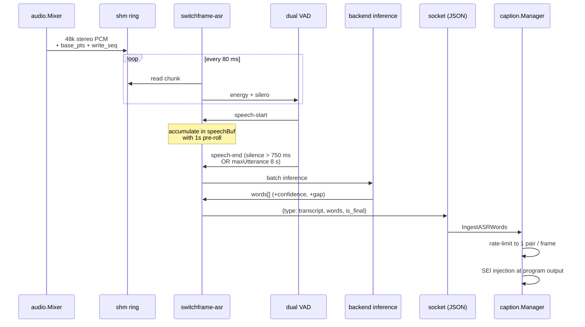

# ASR sidecar protocol

> **Where you are:** [docs](../README.md) → integration → asr-sidecar
> **Read this first:** [architecture.md](../architecture.md)
> **See also:** [subsystems/captions.md](../subsystems/captions.md) · [subsystems/audio.md](../subsystems/audio.md) · [reference/api/asr.md](../reference/api/asr.md) · [reference/api/captions.md](../reference/api/captions.md)

**TL;DR** The ASR sidecar is a separate Go process the engine spawns to turn program audio into caption text. The engine pushes 48 kHz stereo PCM into a POSIX shared-memory ring buffer; the sidecar resamples to 16 kHz mono, gates with an RMS energy VAD and optionally a Silero VAD ONNX model, and runs inference on each detected utterance through one of two pluggable backends — Parakeet-TDT 1.1B via TensorRT on NVIDIA GPUs, or whisper.cpp with CUDA / Metal / CPU. Recognized words flow back over a Unix domain socket as length-prefixed JSON messages that the engine's [`caption.Manager`](../../server/caption/manager.go) ingests in author mode for SEI injection and MoQ broadcast. The sidecar is supervised by [`sidecar.Host`](../../server/sidecar/); if it crashes, the engine restarts it; if no model directory is configured, the whole subsystem degrades off and the engine keeps running without captions.

## The story

Closed captions in broadcast come in three shapes. The first is manually authored — a stenographer types real-time text that the engine encodes as CEA-608 pairs. The second is passthrough — a contribution feed carries captions in the source's own SEI NALUs and the engine just re-encodes them for parity. The third is auto-generated via speech recognition. That third path needs a real model, a real GPU, and ten seconds of audio context to produce fluent output. It's too much weight to put in the main process.

So the ASR subsystem lives in a sidecar. The engine publishes program audio into a shared-memory ring that the sidecar consumes. The sidecar runs its own inference loop on its own cadence (every 80 ms for VAD, bursty for inference), makes its own choices about when an utterance is complete, and sends back transcribed words as soon as each one is ready. Every choice about which model to load, how to gate audio, how much pre-roll to include, how to handle disfluencies — those live in the sidecar code, not in the engine.

The engine's side is lean: pump 48 kHz stereo float32 into the ring, accept words over a socket, feed them to the caption manager in author mode, broadcast `ASRState` over `ControlRoomState` so the UI can show "transcribing" / "idle" / current backend / current model. Everything else is the sidecar's problem. That's the contract this doc documents.

## How it works

```mermaid
flowchart LR
  subgraph engine ["Switchframe engine"]
    Mixer[audio.Mixer]
    Tap[IngestProgram<br/>program mix tap]
    Sidecar[asr.SidecarBackend]
    Host[sidecar.Host<br/>spawn + restart]
    CapMgr[caption.Manager<br/>(author mode)]
    REST[REST /api/asr/*]
  end

  subgraph ipc ["Local IPC"]
    Shm["/switchframe-asr-*<br/>POSIX shm ring"]
    Sock["socket<br/>length-prefix JSON"]
  end

  subgraph sc ["switchframe-asr sidecar"]
    Reader[shmring.Reader]
    Proc[audioProcessor<br/>48k stereo → 16k mono]
    Preroll[prerollBuffer<br/>1s leading context]
    VAD[energyVAD + sileroVAD]
    Backend{backend?}
    Parakeet[Parakeet-TDT<br/>(TensorRT)]
    Whisper[whisper.cpp<br/>(CUDA/Metal/CPU)]
    Dedupe[dedupe / filter]
    Emit[emitWords → IPC]
  end

  Mixer --> Tap --> Sidecar
  Sidecar --> Host
  Host --> sc
  Sidecar --> Shm
  Shm --> Reader
  Reader --> Proc
  Proc --> Preroll
  Preroll --> VAD
  VAD -->|speech end| Backend
  Backend -->|trt| Parakeet
  Backend -->|whisper| Whisper
  Parakeet --> Dedupe
  Whisper --> Dedupe
  Dedupe --> Emit
  Emit --> Sock
  Sock --> Sidecar
  Sidecar --> CapMgr
  CapMgr --> REST
  REST --> Sidecar
```

### Process model

The sidecar binary is `switchframe-asr`, built from [`server/cmd/switchframe-asr/`](../../server/cmd/switchframe-asr/) with backend-specific build tags (`cuda,tensorrt,whisper` on Linux GPU hosts, `whisper` on macOS for Metal, pure stubs without either). The engine spawns it through [`asr.SidecarBackend`](../../server/asr/sidecar.go), which sits on top of the shared [`sidecar.Host`](../../server/sidecar/) supervisor:

1. On engine startup, [`asr.NewSidecarBackend`](../../server/asr/sidecar.go) validates config (binary path, shm name starting with `/`, at least one of TRT model dir or whisper models dir) and creates a Host with `BuildArgs` that translate the engine's configuration into sidecar CLI flags (`--shm-name`, `--socket`, `--model-dir`, `--whisper-models-dir`, `--default-backend`, `--device`, `--vad-model`, `--whisper-threads`).
2. The Host creates a temp directory, opens a Unix socket listener inside it, and forks the sidecar. The sidecar connects back to the socket and opens the shm ring by name.
3. The sidecar emits `READY` on stdout when its model is loaded and the inference loop is armed. The Host observes `READY` before declaring the sidecar alive.
4. The sidecar sends an initial `status` message over the socket reporting active backend, model name, available backends, and available models — the engine's `SidecarBackend` caches these in atomic pointers for low-overhead reads by the REST layer.
5. Under normal operation, the engine writes audio into the shm ring; the sidecar reads on an 80 ms ticker, runs VAD + inference, and emits `transcript` messages over the socket.
6. On crash, Host respawns the sidecar and reconnects. Captions go dark for ~1 s while the model reloads.

If no sidecar binary is configured (`--asr-sidecar ""`) the engine logs an info message and no ASR subsystem initializes. The caption manager still works in passthrough and manual-author modes; only auto mode is unavailable.

### Shared-memory audio ring

The audio feed uses POSIX shared memory because copying 48 kHz stereo float32 (384 kB/s) over a Unix socket would add wasteful context switches. [`server/asr/shmring/`](../../server/asr/shmring/) implements a single-producer / single-consumer ring buffer in a `shm_open` segment:

- **Header** (fixed 256 bytes at offset 0) — magic `0x41535248` ("ASRH"), atomic `write_pos` and `read_pos` byte counters, `sample_rate` (48 000), `channels` (2), `base_pts` (90 kHz PTS of the first sample), `write_seq` (monotonic liveness counter), `capacity_bytes` (ring size, power of 2).
- **Data region** follows at byte 256; default capacity is 192 K float32 samples (~2 seconds of 48 kHz stereo at 4 B per sample).

The engine's mixer taps the program mix (see [subsystems/audio.md](../subsystems/audio.md)) and calls `shmring.Writer.Push(pcm, basePTS)` on every mixer tick; the sidecar's `shmring.Reader` polls every 80 ms and pulls whatever's new. A monotonic `write_seq` lets the sidecar detect liveness (the engine is definitely writing) even during silence where `write_pos` would advance by exactly the same amount as `read_pos` and look static.

### audioProcessor: 48k stereo → 16k mono

Most speech models want 16 kHz mono. [`audioProcessor`](../../server/cmd/switchframe-asr/audio.go) runs a polyphase FIR resampler (3:1 decimation with anti-alias filtering) and a stereo-to-mono mix (equal-power sum of L and R). Output is a `[]float32` at 16 kHz that all downstream stages consume. The mel-spectrogram features for Whisper and the raw PCM for Parakeet both come from this normalized stream.

### Dual-gate VAD

Raw program audio is a noisy signal — background music, room tone, mic bleed. Running inference on every ticker's worth of audio wastes GPU cycles and produces gibberish from silence. The sidecar gates twice:

- **[`energyVAD`](../../server/cmd/switchframe-asr/vad.go)** — simple RMS-based threshold (default -26 dBFS, overridable per-source via the "noise floor" preset: `quiet` -35, `normal` -26, `noisy` -20). Cheap, always available, detects when level rises above ambient. The threshold is exposed and adjustable from the UI so operators can tune for their room.
- **[`sileroVAD`](../../server/cmd/switchframe-asr/silero_vad.go)** — [Silero VAD](https://github.com/snakers4/silero-vad) ONNX model running on GPU (via the active backend's CUDA stream) or CPU. ~1 MB model, very fast, catches the speech-vs-non-speech distinction better than pure energy. Optional — if the ONNX file isn't found, the sidecar runs energy-only.

Both are evaluated per ticker cycle. Speech-start is detected when both say "speech"; speech-end when both say "silence for >750 ms". Between speech-start and speech-end, the sidecar accumulates audio in a `speechBuf`; on speech-end it runs batch inference. Long monologues get force-flushed every `maxUtterance` (8 s) to bound latency.

### Pre-roll buffer

Speech recognition quality improves dramatically with context before the first word. The sidecar keeps a [`prerollBuffer`](../../server/cmd/switchframe-asr/preroll.go) of 1 second of leading audio (16 000 samples) that gets prepended to each new utterance. Without pre-roll, models tend to clip the first phoneme — "oing running" instead of "going running". With 1 s of pre-roll the first word comes through intact. See the `prerollSampleCnt` constant in [`main.go`](../../server/cmd/switchframe-asr/main.go).

### Inference backends

Two backends ship, each with its own build tag:

**Parakeet-TDT 1.1B via TensorRT** ([`backend_trt.go`](../../server/cmd/switchframe-asr/backend_trt.go), [`trt.go`](../../server/cmd/switchframe-asr/trt.go)) is the production path on Linux GPU hosts. Model directory holds pre-built `.plan` files for FP16 inference on the target GPU architecture. First-run flag `--build-engines` compiles `.onnx` files to engine plans and exits — the plan is architecture-specific (SM89 for L4/4090, SM80 for A100, etc.). Parakeet produces word-level transcripts with confidence scores and inter-word gap timing.

**whisper.cpp** ([`backend_whisper.go`](../../server/cmd/switchframe-asr/backend_whisper.go), [`backend_whisper_params.go`](../../server/cmd/switchframe-asr/backend_whisper_params.go)) wraps [whisper.cpp](https://github.com/ggerganov/whisper.cpp) via cgo. Runs on NVIDIA GPUs via CUDA ([`backend_whisper_cuda.go`](../../server/cmd/switchframe-asr/backend_whisper_cuda.go)), on Apple Silicon via Metal ([`backend_whisper_metal.go`](../../server/cmd/switchframe-asr/backend_whisper_metal.go)), or on CPU. Model directory holds GGML files (`ggml-small.en.bin`, `ggml-medium.en.bin`, `ggml-large-v3-turbo-q5_0.bin`, etc.). Supports initial-prompt rolling window so successive utterances inherit vocabulary from prior ones — the sidecar's [`prompt_context.go`](../../server/cmd/switchframe-asr/prompt_context.go) maintains that window.

The sidecar picks a default backend (`--default-backend parakeet|whisper`) and loads only it eagerly; the other loads on demand via a `switch_backend` control message. This conserves VRAM (each model is 1.5–2 GB).

### Post-processing

After inference, the sidecar runs a short pipeline of deterministic filters before emitting words:

- **Dedupe** ([`dedupe.go`](../../server/cmd/switchframe-asr/dedupe.go)) — detects and collapses word-level repeats that arise when whisper-style models loop on music or silence. A repeated trigram within a 5-word window is pruned.
- **Filter** ([`filter.go`](../../server/cmd/switchframe-asr/filter.go)) — strips known hallucinations (e.g., `"Thank you."` appearing on silent segments is a whisper.cpp signature).
- **Token post-processing** ([`tokens.go`](../../server/cmd/switchframe-asr/tokens.go)) — capitalization, spacing, and punctuation rules.

### Wire protocol (asripc)

The Unix socket carries length-prefixed JSON messages defined in [`server/asr/asripc/protocol.go`](../../server/asr/asripc/protocol.go):

```
┌─────────┬────────────────────────┐
│ 4 bytes │      JSON payload       │
│ BE u32  │   (up to 65 536 B)      │
└─────────┴────────────────────────┘
```

`MaxMessageSize = 65 536` caps JSON payloads at 64 KB; anything larger is a protocol error.

The same `Message` struct carries both directions, with `omitempty` so unused fields don't appear:

**Sidecar → engine:**

| `type` | Fields | Meaning |
|---|---|---|
| `transcript` | `words` (`[]{text, confidence, gap_before}`), `is_final` | Batch of recognized words with per-word confidence 0.0–1.0 and `gap_before` in milliseconds of silence. `is_final=false` for partial updates during streaming inference, `true` when the utterance is complete. |
| `status` | `state`, `backend`, `model`, `latency_ms`, `available_backends`, `models`, `backend_config`, `noise_floor` | Periodic status and backend-switch notifications. `state` is `"ready"` or `"inference"`. |
| `error` | `error` | Recoverable error description; sidecar continues. |

**Engine → sidecar:**

| `cmd` | Fields | Meaning |
|---|---|---|
| `start` | (none) | Arm the inference loop. The sidecar ignores audio before `start`. |
| `stop` | (none) | Halt inference; model stays loaded. |
| `reset` | (none) | Drop in-flight utterance buffers (e.g., on program source change). |
| `set_config` | `config` (raw JSON) | Backend-specific configuration (Whisper: prompt context; shared: noise-floor preset, confidence threshold). |
| `shutdown` | (none) | Graceful exit. |

The shared `Message` struct has both sets of fields because Go's `json.Marshal` with `omitempty` emits only the relevant ones; the sidecar and engine each read only the fields that apply to their direction.

### Caption handoff

When the sidecar emits a `transcript` message, [`asr.SidecarBackend`](../../server/asr/sidecar.go) decodes it, updates atomic status caches, and invokes the `onTranscript` callback registered by [`asr.Engine`](../../server/asr/engine.go). That callback feeds the [`caption.Manager`](../../server/caption/manager.go) in author mode — see [subsystems/captions.md](../subsystems/captions.md). The manager's CEA-608 encoder rate-limits to one pair per frame and injects SEI NALUs into the program H.264 stream. Authored captions also broadcast on a MoQ caption track for browser-native rendering alongside the program stream.

Because ASR words arrive faster than CEA-608 can carry them (roll-up CC1 is ~60 characters per second), the caption manager buffers and paces output. During sustained speech the buffer grows and words appear on air with 1–3 s of visual lag — acceptable for live production and standard across broadcast auto-caption systems.

### Evaluation harness

The tree also carries an ASR evaluation harness for quality work. [`scripts/asr-eval/`](../../scripts/asr-eval/) holds:

- `fixtures.txt` — named audio-clip specs with rate, voice, and reference text that `gen-fixtures.sh` synthesizes into WAV files via the macOS `say` command. Fixtures cover normal speech, fast, slow, pauses, run-ons, numbers, disfluencies, punctuation, short / long durations.
- `gen-fixtures.sh` — generates WAV + reference text pairs into [`test/asr-fixtures/`](../../test/asr-fixtures/).

The matching eval tests in [`server/cmd/switchframe-asr/asr_eval_test.go`](../../server/cmd/switchframe-asr/asr_eval_test.go) run the WAVs through each backend and compute WER (word error rate) via [`wer.go`](../../server/cmd/switchframe-asr/wer.go). This is how operators tune VAD thresholds and model choice without a live feed. Fixtures are untracked — regenerated locally as needed — so the repository stays lean.



## Key types and entry points

**Engine side:**

- [`server/asr/sidecar.go`](../../server/asr/sidecar.go) → `SidecarBackend`, `SidecarConfig`, `NewSidecarBackend`, `Start`, `IngestAudio`, `Reset`, `SetConfig`, `SwitchBackend`
- [`server/asr/engine.go`](../../server/asr/engine.go) → `Engine`, `EngineConfig`, `Backend` dispatch with atomic-pointer hot path, `SwitchBackend` for hot-swap between backend names reported by the sidecar
- [`server/asr/backend.go`](../../server/asr/backend.go) → `Backend` interface, `TranscriptWord`
- [`server/asr/asripc/protocol.go`](../../server/asr/asripc/protocol.go) → `Message`, `Word`, `WriteMessage`, `ReadMessage`, `MaxMessageSize`
- [`server/asr/shmring/shmring.go`](../../server/asr/shmring/shmring.go), `writer.go`, `reader.go`, `shm_posix.go` → POSIX shared-memory ring; `header` layout and `DefaultCapacity`
- [`server/caption/manager.go`](../../server/caption/manager.go) → `Manager.IngestText` in author mode
- [`server/cmd/switchframe/app_asr.go`](../../server/cmd/switchframe/app_asr.go) → app-level wiring from the mixer to the sidecar backend
- [`server/control/api_asr.go`](../../server/control/api_asr.go) → REST handlers; see [reference/api/asr.md](../reference/api/asr.md)

**Sidecar side** ([`server/cmd/switchframe-asr/`](../../server/cmd/switchframe-asr/)):

- [`main.go`](../../server/cmd/switchframe-asr/main.go) → entry, flag parsing, backend loading, main tick loop, utterance lifecycle, `emitWords`, `sendStatus`
- [`audio.go`](../../server/cmd/switchframe-asr/audio.go) → `audioProcessor` (48 k stereo → 16 k mono resampler)
- [`mel.go`](../../server/cmd/switchframe-asr/mel.go) → mel-spectrogram features for whisper
- [`vad.go`](../../server/cmd/switchframe-asr/vad.go) → `energyVAD` (RMS threshold)
- [`silero_vad.go`](../../server/cmd/switchframe-asr/silero_vad.go), `silero_vad_common.go` → Silero VAD ONNX runtime integration
- [`preroll.go`](../../server/cmd/switchframe-asr/preroll.go) → 1 s leading context buffer
- [`backend_trt.go`](../../server/cmd/switchframe-asr/backend_trt.go), [`trt.go`](../../server/cmd/switchframe-asr/trt.go) → Parakeet TensorRT backend
- [`backend_whisper.go`](../../server/cmd/switchframe-asr/backend_whisper.go), [`backend_whisper_params.go`](../../server/cmd/switchframe-asr/backend_whisper_params.go), [`backend_whisper_cuda.go`](../../server/cmd/switchframe-asr/backend_whisper_cuda.go), [`backend_whisper_metal.go`](../../server/cmd/switchframe-asr/backend_whisper_metal.go), [`backend_whisper_stub.go`](../../server/cmd/switchframe-asr/backend_whisper_stub.go), [`backend_whisper_models.go`](../../server/cmd/switchframe-asr/backend_whisper_models.go) → whisper.cpp backend, per-platform build tags
- [`inference.go`](../../server/cmd/switchframe-asr/inference.go), [`streaming.go`](../../server/cmd/switchframe-asr/streaming.go) → batch and streaming inference loops
- [`dedupe.go`](../../server/cmd/switchframe-asr/dedupe.go), [`filter.go`](../../server/cmd/switchframe-asr/filter.go), [`tokens.go`](../../server/cmd/switchframe-asr/tokens.go) → post-processing
- [`prompt_context.go`](../../server/cmd/switchframe-asr/prompt_context.go) → whisper rolling initial-prompt window
- [`asr_eval_test.go`](../../server/cmd/switchframe-asr/asr_eval_test.go), [`wer.go`](../../server/cmd/switchframe-asr/wer.go) → accuracy evaluation harness

**Evaluation fixtures** ([`scripts/asr-eval/`](../../scripts/asr-eval/)):

- `fixtures.txt` — declarative fixture specs
- `gen-fixtures.sh` — generates WAV + reference text using macOS `say`

## Gotchas and invariants

- **The sidecar is platform-gated by build tag.** `make build-asr-sidecar-whisper` picks `whisper` on macOS (Metal) or `cuda,tensorrt,whisper` on Linux. Without build tags the binary only has stubs and loading any backend returns `errFFmpegDisabled`-style errors. See [reference/config-and-flags.md#asr-speech-to-text](../reference/config-and-flags.md#asr-speech-to-text).
- **Shared-memory name must start with `/`.** POSIX `shm_open` requires a leading slash on the name. `NewSidecarBackend` validates this; passing `"switchframe-asr-session"` instead of `"/switchframe-asr-session"` returns a config error at startup.
- **`READY` signal is load-bearing.** The sidecar prints `READY` to stdout after loading models. [`sidecar.Host`](../../server/sidecar/) watches for this line; until it arrives, `SidecarBackend.Alive()` returns false and REST calls that need the sidecar return errors. Slow model loads (3–5 s for whisper large, 10+ s for Parakeet plan compilation) can look like a hang from the UI.
- **Every message is length-prefixed JSON.** Don't send bare JSON on the socket; don't send newline-delimited JSON. Both ends use [`asripc.WriteMessage`](../../server/asr/asripc/protocol.go) and `ReadMessage`. Messages larger than `MaxMessageSize` (64 KB) are rejected — this caps how many words can be in one `transcript` batch. Practical cap is ~200 words per batch, comfortably above any real utterance.
- **Audio ring consumes a lot of virtual memory.** Default capacity is 192 K samples × 4 bytes = 768 KB plus 256 B header. Configurable via `DefaultCapacity`, but staying under 2 MB keeps the working set inside typical allocator pages.
- **`write_seq` is separate from `write_pos`.** Liveness detection uses `write_seq`, which increments once per `Push` call regardless of how much data advanced. During silence, the engine still writes zero-level PCM and `write_seq` keeps ticking; without it, the sidecar couldn't tell "silence" from "engine hung."
- **Silero VAD is optional.** The sidecar logs a warning and falls back to energy-only if the ONNX file isn't found at `--vad-model` or in `<model-dir>/silero_vad.onnx`. Energy-only VAD has higher false-positive rate on music / room tone, which shows up as `"Thank you."` hallucinations that the dedupe + filter path strips.
- **Pre-roll is 1 second, not configurable via flag.** `prerollMs = 1000` is a compile-time constant in [`main.go`](../../server/cmd/switchframe-asr/main.go). Shorter pre-roll clips phonemes; longer pre-roll inflates inference latency without measurable gain.
- **`maxUtterance = 8 * time.Second` bounds worst-case latency.** Long monologues that never hit the VAD speech-end threshold get force-flushed at 8 s. This is the sweet spot from eval runs: long enough that whisper has useful context, short enough that captions stay current on air.
- **Hot-swap between backends is asynchronous.** `SwitchBackend("whisper")` sends a `set_config` or equivalent command and waits for the sidecar's `status` reply. Captions may go silent for up to 5 s during the swap while the new model loads. The `onBackendSwitch` atomic callback fires after the new backend is ready so the UI can unfreeze.
- **Caption output is rate-limited, not buffer-backed.** If the sidecar emits 10 words in one batch, the caption manager's CEA-608 encoder queues them and emits one pair per frame (~60 cps). During sustained fast speech the visible captions lag actual speech by 1–3 s; this is a protocol constant of CEA-608 encoding, not a buffering bug.
- **Restart loses in-flight utterances.** When the sidecar crashes mid-utterance, the current `speechBuf` and pre-roll are discarded. Captions resume once the new sidecar reaches `READY`; the interrupted utterance is lost (no retry from shm, because `read_pos` may have advanced past the relevant samples).
- **The default noise-floor preset is "normal" (-26 dBFS).** "quiet" (-35) for studio conditions; "noisy" (-20) for sports / crowd. Per-source adjustment exposed via `SetConfig`. Operators will tune this during rehearsal.
- **Whisper threads default to `min(NumCPU, 8)`.** On many-core servers, pinning more than 8 threads hurts whisper throughput because of cache contention. Override via `--asr-whisper-threads`.
- **TRT engine plans are architecture-specific.** An engine built for SM89 won't run on SM80. `--build-engines` must run on the target GPU; operators deploying across heterogeneous fleets build per-host plans.
- **Sidecar graceful shutdown uses the control socket.** Send `{"cmd":"shutdown"}` for a clean exit; killing by signal works too but skips model-release cleanup. Host's default shutdown path uses the control message when `DisableShutdownMessage` is false (which it is for ASR).

## Related docs

- **Concepts:** [media-path](../concepts/media-path.md) · [frame-sync-and-timing](../concepts/frame-sync-and-timing.md) · [gpu](../concepts/gpu.md) · [locking-and-concurrency](../concepts/locking-and-concurrency.md)
- **Reference:** [api](../reference/api.md) · [api/asr](../reference/api/asr.md) · [api/captions](../reference/api/captions.md) · [state-broadcast](../reference/state-broadcast.md) · [config-and-flags](../reference/config-and-flags.md)
- **Subsystems:** [captions](../subsystems/captions.md) · [audio](../subsystems/audio.md) · [switcher](../subsystems/switcher.md)
- **Integration:** [ui-server-contract](ui-server-contract.md) · [cef-protocol](cef-protocol.md)
- **Operations:** [deployment](../operations/deployment.md)
- **Root:** [architecture](../architecture.md) · [README](../README.md)
