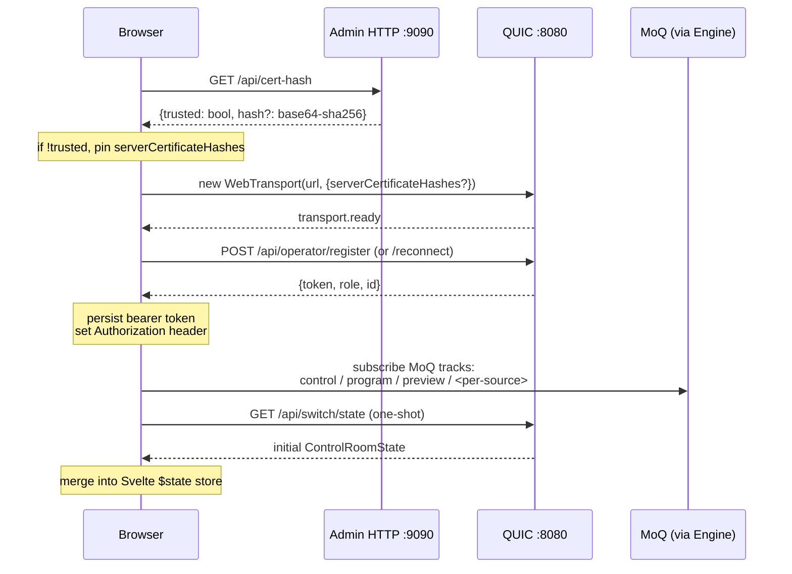

# UI ↔ server contract

> **Where you are:** [docs](../README.md) → integration → ui-server-contract
> **Read this first:** [architecture.md](../architecture.md)
> **See also:** [reference/api.md](../reference/api.md) · [reference/state-broadcast.md](../reference/state-broadcast.md) · [reference/fast-control.md](../reference/fast-control.md) · [subsystems/control-plane.md](../subsystems/control-plane.md)

**TL;DR** A Switchframe client needs four conversations with the engine. It sends commands over REST to change state, receives `ControlRoomState` broadcasts over a MoQ control track to know the current state, subscribes to MoQ video / audio / caption tracks per source to show what's on air, and emits fast-control datagrams during drag gestures so slider movement doesn't flood the REST layer. Auth is one bearer token per operator (session-wide for the single-operator demo, per-operator otherwise). The reference implementation is [`ui/src/`](../../ui/src/) — Svelte 5 on top of a vendored [`prism/`](../../ui/src/lib/prism/) transport layer — but the wire contract documented here is what any client needs to satisfy, not the specific choices the Svelte code made.

## The story

The UI in `ui/` is the reference client, but it isn't the only possible one. The engine deliberately splits its client-facing surface into three distinct wire formats, each tuned for its own access pattern:

- **REST over HTTPS/HTTP-3** for discrete commands and state reads (cut, load preset, update EQ band, save macro, upload clip). Commands are idempotent where possible and write the full updated `ControlRoomState` back in the response so clients don't have to wait for the broadcast.
- **MoQ tracks over WebTransport** for bulk continuous data — per-source video and audio for the multiview, the program and preview streams, and one `control` track that carries the current `ControlRoomState` JSON on every state change.
- **WebTransport datagrams** for high-frequency operator input — T-bar drag, DVE slot drag, graphics layer drag, PTP clock-sync probes. Fire-and-forget binary messages that arrive within a single frame budget.

This split lets the most common hot-path operations — dragging a PIP around, pulling a T-bar — run at pointer rate (~120 Hz) without producing a cascade of REST requests or state broadcasts. Discrete decisions (cut to camera 3) still go through REST and produce a single authoritative broadcast. Continuous streams (live video) use the same MoQ substrate Prism uses for everything else.

This doc describes the wire-level contract. If you want a tour of the Svelte UI's internal architecture, read the source directly — [`ui/src/lib/`](../../ui/src/lib/) is the place to start.

## How it works

### Connection bootstrap

1. **Cert-hash bootstrap.** QUIC requires TLS 1.3. If the engine is using a self-signed cert (default), the unauthenticated endpoint `GET /api/cert-hash` on the admin port returns the SHA-256 fingerprint; the browser passes it as `serverCertificateHashes` to `WebTransport` and the handshake succeeds. Trusted certs (mkcert, Let's Encrypt) skip this step — the endpoint returns `{trusted: true}`. See [operations/deployment.md#https--http3-certs](../operations/deployment.md#https--http3-certs).
2. **Operator registration.** `POST /api/operator/register` (unauthenticated) creates an operator record and returns a bearer token. Subsequent requests use `Authorization: Bearer <token>`. See [subsystems/control-plane.md#operators-sessions-and-locks](../subsystems/control-plane.md#operators-sessions-and-locks) and [reference/api/operator.md](../reference/api/operator.md). Demo mode (`--demo`) disables auth and the UI skips the bearer handshake.
3. **State bootstrap.** `GET /api/switch/state` returns the current [`ControlRoomState`](../reference/state-broadcast.md) as one JSON blob. The client merges it into local state so the UI can render immediately, before any MoQ broadcast arrives.
4. **MoQ subscriptions.** The browser subscribes to the tracks it cares about. The control-room store merges every broadcast by replacing state (never patching).

### REST command surface

Every UI button lands on a REST endpoint. The index is [reference/api.md](../reference/api.md); per-subsystem docs live under [reference/api/](../reference/api/). Clients must:

- Put `Authorization: Bearer <token>` on every request except the unauthenticated ones listed in [reference/api.md#authentication](../reference/api.md#authentication).
- Use `POST` / `PUT` / `DELETE` as documented; method is part of the Go 1.22 `ServeMux` pattern so the wrong method returns 405, not a generic 404.
- Accept JSON responses shaped as the current `ControlRoomState` (for mutating endpoints) or a purpose-specific object (for reads).
- Handle errors as `application/json` `{"error": "..."}` with status codes mapped per [reference/api.md#errors](../reference/api.md#errors). Don't parse the error body as a stack trace.
- Use `/api/v1/<path>` rather than `/api/<path>` for new clients — same handler, forward-compatible with a future `/api/v2/`.

An in-progress operation (macro run, clip upload, graphics sequence upload) returns 202 Accepted and emits progress via the state broadcast; don't poll for completion. A blocked operation (operator doesn't own the subsystem lock, recorder already active) returns 409 Conflict with a descriptive error message — surface that to the operator rather than retrying.

The reference [`switch-api.ts`](../../ui/src/lib/api/switch-api.ts) is exhaustive but opinionated (retries, timeouts, dual-engine routing). A minimal client only needs `fetch` and a JSON parser.

### MoQ video / audio subscriptions

Each source published by the engine appears as its own MoQ broadcast track. The browser subscribes by key (e.g., `cam-1`, `srt:camera1`, `clip:1`, `playout:1`) and receives:

- A **catalog** message describing the tracks in the broadcast (video codec string, dimensions, audio codec, any caption track).
- A **video track** carrying encoded H.264 (or HEVC) wire-format frames with monotonically increasing group IDs — group bumps on every keyframe. The catalog's `videoInitData` is the base64-encoded `avcC` / `hvcC` parameter-set description a `VideoDecoder.configure()` call needs.
- An **audio track** carrying AAC frames with PTS.
- A **caption track** (optional) carrying styled caption frames for browser-native rendering. This is independent of the SEI captions the Go server injects into the H.264 stream; the MoQ caption track gives the browser richer styling than CEA-608 SEIs can express. See [subsystems/captions.md](../subsystems/captions.md).

The program broadcast (`program`) carries the composited output with any DSK graphics already baked in. The preview broadcast (`preview`) is a low-bitrate proxy encode for browser multiview. Source broadcasts (`cam-1`, etc.) let the browser render each source tile from its own decoder.

Clients are free to subscribe to any subset. The Svelte UI subscribes to every source plus `program` and `preview`; a metrics dashboard might subscribe to only `program`. The reference client is [`media-pipeline.ts`](../../ui/src/lib/transport/media-pipeline.ts), which orchestrates one [`MoQTransport`](../../ui/src/lib/prism/moq-transport.ts) per source and decodes into a pool of [`PrismRenderer`](../../ui/src/lib/prism/renderer.ts) surfaces. The low-level transport primitives are vendored in [`ui/src/lib/prism/`](../../ui/src/lib/prism/) — they're the browser side of the [Prism](https://github.com/zsiec/prism) relay the engine uses for MoQ.

Per-source stall detection is the client's responsibility. The reference implementation (`source-errors.svelte.ts`) marks a source as stalled after a threshold of no frames and surfaces this in the UI so the operator can see a failing source before the engine's own health monitor crosses its thresholds.

### Control track — state broadcast

The `control` MoQ track is how every state change reaches every client. Each broadcast is a JSON-encoded [`ControlRoomState`](../reference/state-broadcast.md) object, shipped as a whole on every state change (no diffs, no patches — just replace). Typical payload is 10–30 KB.

Clients must:

- Subscribe to the `control` track on WebTransport connect.
- JSON-parse each message and merge by replacement into local state.
- Use the monotonic `seq` field to drop out-of-order broadcasts (server bumps `seq` on state-changing commands; a broadcast with a lower `seq` than the last accepted one is stale).
- Use `timestamp` (Unix ms) to tell when the last broadcast happened — a missing `seq` bump still increments `timestamp` for per-frame updates (peaks, replay progress) and the UI can show "last seen N seconds ago" when that timestamp stops advancing.
- Optimistically update local state on a command and mark a `pendingAction` with a 2-second timeout so the UI feels instant; clear the pending marker when the server broadcast confirms or the timeout expires. See [`control-room.svelte.ts`](../../ui/src/lib/state/control-room.svelte.ts) for the reference pattern.

When the MoQ subscription hasn't attached yet (early in startup, or on reconnect), fall back to polling `GET /api/switch/state` at 1 Hz. Stop polling once MoQ comes up. The engine tolerates both — the `control` track broadcasts are the primary feed; REST polling is the compatibility fallback.

The full state schema is in [reference/state-broadcast.md](../reference/state-broadcast.md). TypeScript types live in [`ui/src/lib/api/types.ts`](../../ui/src/lib/api/types.ts); they mirror [`server/internal/types.go`](../../server/internal/types.go) and are kept in sync by convention, not by code generation.

### Fast-control datagrams

During a drag gesture (pulling a T-bar, dragging a DVE slot, moving a graphics layer, adjusting a DVE parameter knob), the client emits one WebTransport datagram per `pointermove` — ~120 Hz. Each datagram is 5–26 bytes of binary payload: a type byte followed by a packed struct of floats and ints. The engine applies the update directly to the compositor; no `ControlRoomState` broadcast fires during the drag. On `pointerup`, the client sends one REST call with the final position that triggers validation, persistence, and the authoritative state broadcast.

The full wire spec is [reference/fast-control.md](../reference/fast-control.md). TypeScript encoders and the two-phase commit pattern live in [`fast-control.ts`](../../ui/src/lib/transport/fast-control.ts). The server-side dispatcher and parsers are in [`server/fastctrl/`](../../server/fastctrl/) and [`server/cmd/switchframe/app_fastctrl.go`](../../server/cmd/switchframe/app_fastctrl.go).

PTP clock sync (0xFE / 0xFF ping / pong) is optional but recommended if the client cares about a deterministic timeline (multi-region redundancy, timestamped log analysis). The UI runs a small loop that probes every few seconds and measures round-trip time plus engine-vs-browser clock offset; subsequent datagrams carry an 8-byte PTP timestamp prefix so the engine can order them deterministically across dual engines.

### Auth, operators, and locks

Two token types are accepted on the `Authorization: Bearer <token>` header:

- **Session API token** — a 32-byte hex string minted by the engine at startup (printed to stdout, configurable via `--api-token`). Demo mode and single-operator production deployments use this. No per-operator attribution on commands.
- **Operator bearer token** — issued by `POST /api/operator/register` (see [reference/api/operator.md](../reference/api/operator.md)). Each authenticated request records the operator name as `ControlRoomState.LastChangedBy` so the UI can badge the most recent change.

Operator registration optionally takes an `inviteToken` body field; the server maps known invite tokens (configured via `SWITCHFRAME_INVITE_TOKENS`) to roles. See [subsystems/control-plane.md#roles-and-permissions](../subsystems/control-plane.md#roles-and-permissions) for the role matrix (`director`, `audio`, `graphics`, `captioner`, `viewer`).

After registration, the client should:

- Store the token in `localStorage` or equivalent so a tab refresh doesn't re-register.
- `POST /api/operator/heartbeat` every ~10 seconds so the session stays fresh (the server auto-reaps stale sessions at 60 s).
- Use `POST /api/operator/lock/<subsystem>` and `DELETE /api/operator/lock/<subsystem>` to lock / release a subsystem when the operator is actively driving it; the middleware rejects commands from other operators with 409 while the lock is held.

The UI reference implementation stores the token in `localStorage` keyed by `switchframe_operator_token`. Control-plane-issued URL-fragment token handoff (`#token=...` on first visit) is supported via [`checkFragmentToken`](../../ui/src/lib/api/switch-api.ts).

### Comms (voice intercom)

Operator voice comms runs over its own WebTransport bidirectional stream — not a REST endpoint. Open one bidi stream to `/operator-comms`, send a JSON hello handshake (`{action:"hello",operatorId:"..."}`), then exchange framed audio packets: `[type byte][BE16 length][payload]`. Inbound type `0x01` is Opus-encoded microphone audio (20 ms frames at 48 kHz mono, 32 kbps); outbound type `0x01` is the N-1 mix of other participants. Type `0x02` is JSON control (currently only `{action:"mute",muted:bool}`). See [subsystems/comms.md](../subsystems/comms.md) for the full protocol. The reference implementation is [`ui/src/lib/audio/comms.ts`](../../ui/src/lib/audio/comms.ts).

### Canvas rendering

Every source renderer in the UI is either a WebGPU-backed `PrismRenderer` (preferred) or a Canvas 2D fallback. Video frames decoded via `VideoDecoder` land in a [`VideoRenderBuffer`](../../ui/src/lib/prism/video-render-buffer.ts) that supports multiple consumers; the program/preview windows and the multiview tile for the same source share one decode pipeline and render into independent canvases. That lets a 1080p camera appear in four tiles without four decoders.

Transition rendering for dissolves on the UI side uses [`dissolve.ts`](../../ui/src/lib/video/dissolve.ts) with a WebGPU shader and a Canvas 2D fallback for browsers without WebGPU. This is purely for the smooth preview blend in the multiview during a CUT/AUTO; the authoritative program output is rendered server-side and arrives pre-composited on the `program` track.

## Key types and entry points

- **Connection:** [`connection.ts`](../../ui/src/lib/transport/connection.ts) → `createPrismConnection`; [`connection-manager.ts`](../../ui/src/lib/transport/connection-manager.ts) handles lifecycle, retries, and engine selection.
- **State store:** [`control-room.svelte.ts`](../../ui/src/lib/state/control-room.svelte.ts) → `createControlRoomStore` with `applyUpdate`, `applyFromMoQ`, `optimisticCut`, `optimisticPreview`.
- **REST client:** [`switch-api.ts`](../../ui/src/lib/api/switch-api.ts) → `SwitchApi` class with methods mirroring every REST endpoint; [`types.ts`](../../ui/src/lib/api/types.ts) for TypeScript shapes; [`base-url.ts`](../../ui/src/lib/api/base-url.ts) for same-origin / engine-specific URL resolution.
- **Fast-control:** [`fast-control.ts`](../../ui/src/lib/transport/fast-control.ts) → `createFastControl(transport)` with `sendTransitionPosition`, `sendDVESlotTransform`, `sendGraphicsLayerPosition`, optional commits.
- **Clock-sync:** [`clock-sync.ts`](../../ui/src/lib/transport/clock-sync.ts) → PTP ping/pong probe; the `withTimestamp` helper in `fast-control.ts` consumes its offset.
- **Media pipeline:** [`media-pipeline.ts`](../../ui/src/lib/transport/media-pipeline.ts) → orchestrates per-source MoQ transports and decode pipelines; [`manager.ts`](../../ui/src/lib/pipeline/manager.ts) holds lifecycle.
- **MoQ / Prism primitives:** [`ui/src/lib/prism/`](../../ui/src/lib/prism/) — transport, decoder, renderer (vendored from Prism).
- **Comms:** [`ui/src/lib/audio/comms.ts`](../../ui/src/lib/audio/comms.ts) → `CommsAudioManager` over a WebTransport bidi stream.
- **Operator session:** [`operator.svelte.ts`](../../ui/src/lib/state/operator.svelte.ts) → token storage, heartbeat loop, role tracking.
- **Reconciliation (multi-engine):** [`reconciler.svelte.ts`](../../ui/src/lib/state/reconciler.svelte.ts) — when two engines are running active-active, the reconciler picks authoritative state per-subsystem.

## Gotchas and invariants

- **The control track is not ordered.** MoQ is best-effort on the control track; use `seq` to drop stale broadcasts. Don't assume the broadcast that confirms your command is the next one you receive.
- **Optimistic updates should time out.** The server's command queue can sequence commands for dual-engine execution, which can add a few hundred milliseconds of delay. The reference client uses a 2 s timeout on pending actions; after that, revert to server state.
- **Seq can be equal across broadcasts.** Mid-operation updates (per-frame replay position, mixer peaks, macro step transitions) don't bump `seq` — only `timestamp` advances. Compare `(seq, timestamp)` as a pair for deduplication.
- **`seq` can go backward in multi-engine mode.** The reconciler may switch authoritative state from Engine A (seq=100) to Engine B (seq=80) mid-session. The `forceUpdate` path in the reference store bypasses the seq check for this case. Single-engine clients never observe it.
- **Cert-hash bootstrap is sensitive to time skew.** Self-signed certs are valid for 14 days; if the client's clock is wildly wrong or the cert rotates between cert-hash fetch and WebTransport connect, the handshake fails. Re-fetch on connection error.
- **Fast-control datagrams are not guaranteed.** They are deliberately fire-and-forget UDP-style messages on the QUIC connection. Dropped datagrams are expected. Always send a commit REST call on `pointerup` — that's the only authoritative state change.
- **Don't expect ordering between MoQ tracks.** Audio and video arrive on separate tracks; they are PTS-aligned at the server but may arrive out of order at the client. Use each frame's PTS for playback timing, not arrival order.
- **Bearer tokens are 64-char hex.** Session tokens and per-operator tokens use the same format. `localStorage` key is implementation detail; the protocol only knows about the `Authorization: Bearer <token>` header.
- **Demo mode disables auth.** The server installs a no-op auth middleware when `--demo` is set. Never deploy demo mode to a public-reachable address — the REST API is wide open.
- **Dual-engine routing is optional.** Single-engine clients set `engineBaseUrl` to the current origin and ignore the reconciler. The reference client supports dual-engine via [`dual-api-client.ts`](../../ui/src/lib/api/dual-api-client.ts) and [`dual-connection.ts`](../../ui/src/lib/transport/dual-connection.ts); skip those files if you only need single-engine.
- **SSE / polling is the fallback, not the primary.** `GET /api/switch/state` at 1 Hz should kick in only when the `control` MoQ track isn't producing broadcasts. Don't poll over REST if MoQ is working — you'll duplicate state updates and add cost.
- **The cert-hash endpoint is on the admin port.** `GET /api/cert-hash` lives on port `:9090` by default, not `:8080`. Clients bootstrap from the same origin if the engine is fronted by a reverse proxy that unifies the two ports; otherwise, know the admin port.

## Related docs

- **Concepts:** [pipeline](../concepts/pipeline.md) · [media-path](../concepts/media-path.md) · [locking-and-concurrency](../concepts/locking-and-concurrency.md)
- **Reference:** [api](../reference/api.md) · [state-broadcast](../reference/state-broadcast.md) · [fast-control](../reference/fast-control.md) · [config-and-flags](../reference/config-and-flags.md)
- **Subsystems:** [control-plane](../subsystems/control-plane.md) · [switcher](../subsystems/switcher.md) · [comms](../subsystems/comms.md) · [captions](../subsystems/captions.md) · [graphics-and-dve](../subsystems/graphics-and-dve.md) · [output](../subsystems/output.md)
- **Integration:** [cef-protocol](cef-protocol.md) · [asr-sidecar](asr-sidecar.md)
- **Operations:** [deployment](../operations/deployment.md)
- **Root:** [architecture](../architecture.md) · [README](../README.md)
