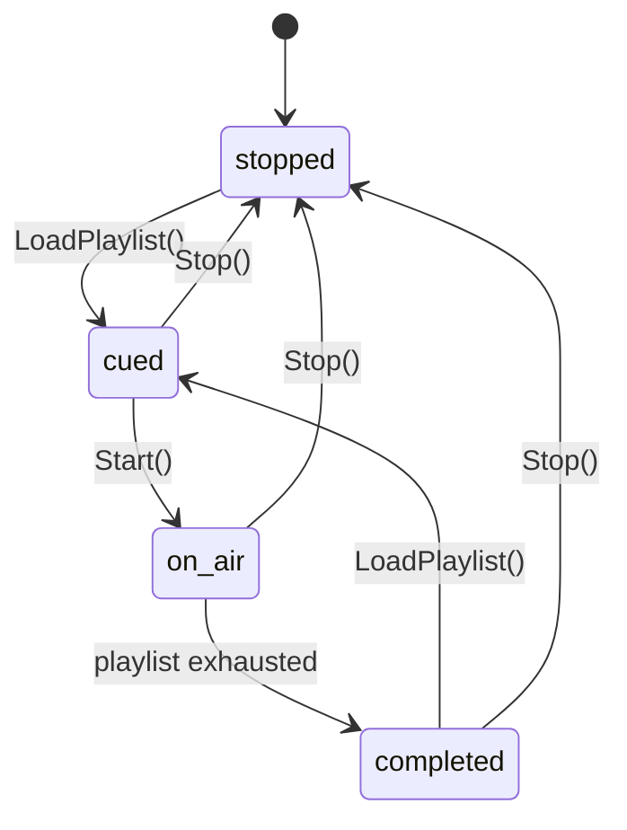
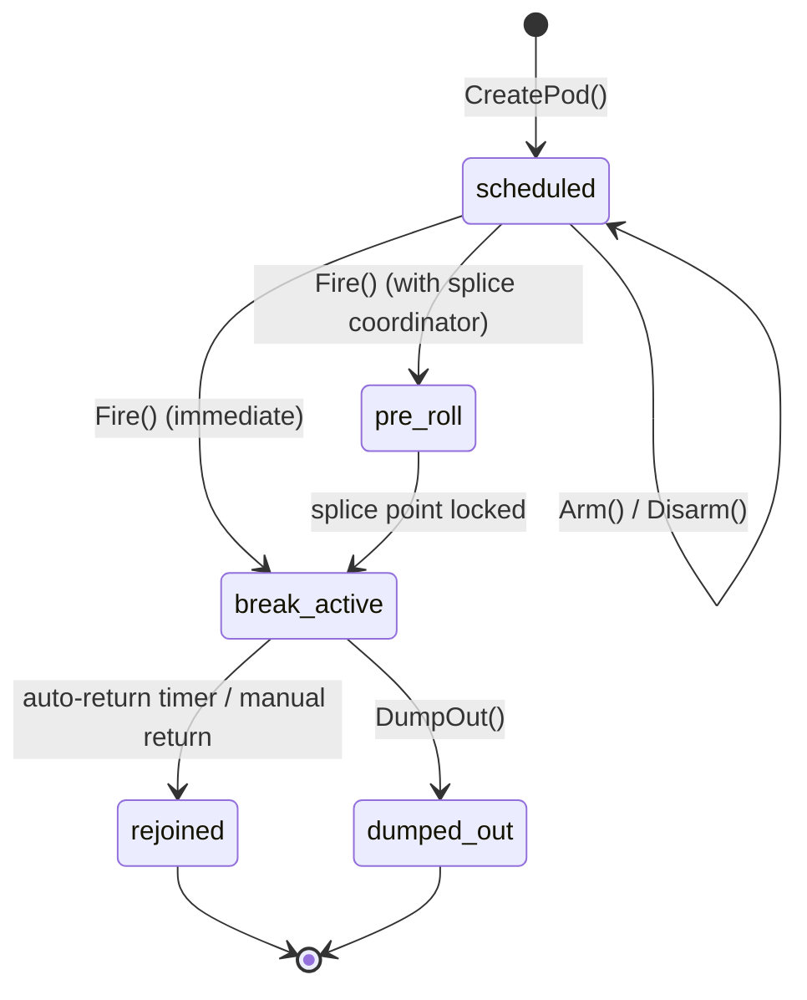
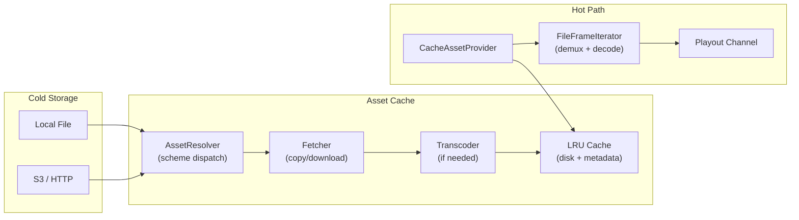

# Playout

1. [What Playout Does](#1-what-playout-does)
2. [Quick Start](#2-quick-start)
3. [Channels](#3-channels)
4. [Playlist Format](#4-playlist-format)
5. [Channel Lifecycle](#5-channel-lifecycle)
6. [Pod Management](#6-pod-management)
7. [Secondary Events](#7-secondary-events)
8. [Asset Cache](#8-asset-cache)
9. [Splice Coordination](#9-splice-coordination)
10. [As-Run Logging](#10-as-run-logging)
11. [BXF Import & Export](#11-bxf-import--export)
12. [Health & Recovery](#12-health--recovery)
13. [State Broadcast](#13-state-broadcast)
14. [REST API Reference](#14-rest-api-reference)
15. [Configuration](#15-configuration)
16. [File Reference](#16-file-reference)

---

## 1. What Playout Does

Playout is SwitchFrame's schedule-driven automated playback engine. It turns the production switcher into a **production-playout hybrid** — live switching and automated playout coexist in the same system, sharing the video pipeline, audio mixer, graphics compositor, and SCTE-35 signaling.

Each playout channel plays through a JSON playlist sequentially, outputting decoded YUV frames into the switcher pipeline at the correct frame rate. Channels register as virtual sources (`playout:1`, `playout:2`) that can be cut or dissolved to program, mixed through the audio engine, and viewed in the browser multiview alongside live cameras.

### Key capabilities

- **2 playout channels** — Independent playlists, cursors, and transport controls per channel
- **3 item types** — Clip (media file playback), live (camera hold), slate (timed black)
- **Pod management** — Commercial break scheduling with SCTE-35 integration, templates, and priority
- **Secondary events** — Timed graphics, audio, caption, and SCTE-35 events anchored to item start or end
- **Asset cache** — LRU disk cache with schedule-aware prefetch and automatic transcode
- **Splice coordination** — Frame-accurate break entry using black detection
- **As-run logging** — JSONL persistence with query API and BXF export
- **BXF import** — Load playlists from broadcast exchange format schedules
- **Crash recovery** — Persistent state snapshots with automatic channel re-cue
- **Watchdog** — Stall detection with configurable auto-recovery

---

## 2. Quick Start

### Enable playout

Start SwitchFrame with the `--playout` flag:

```bash
./switchframe --playout
```

Playout is auto-enabled in demo mode (`make demo`).

### Load a playlist

```bash
curl -X POST https://localhost:8080/api/playout/channels/1/load \
  -H "Content-Type: application/json" \
  -d '{
    "id": "morning-block",
    "name": "Morning Block",
    "default_transition": {"type": "cut"},
    "items": [
      {
        "id": "opener",
        "type": "clip",
        "title": "Show Opener",
        "asset_uri": "/media/opener.ts",
        "duration_ms": 15000
      },
      {
        "id": "segment-1",
        "type": "live",
        "title": "Live Camera 1",
        "source": "camera:1"
      },
      {
        "id": "break-slate",
        "type": "slate",
        "title": "Commercial Break",
        "duration_ms": 5000
      }
    ]
  }'
```

### Start playback

```bash
curl -X POST https://localhost:8080/api/playout/channels/1/start
```

The channel transitions from `cued` to `on_air` and begins playing through the playlist automatically.

---

## 3. Channels

SwitchFrame supports **2 playout channels** (`MaxChannels = 2`). Each channel:

- Registers as a virtual switcher source with key `playout:1` or `playout:2`
- Has its own playlist, cursor, transport state, and on-air mode
- Has an independent pod board for commercial break management
- Outputs decoded YUV frames to `Switcher.IngestReplayVideo()` and audio to the mixer

Channels are pre-created at Manager startup. A channel must have a playlist loaded before it can start.

### On-Air Modes

| Mode | Description |
|------|-------------|
| `automated` | Default. Playlist advances automatically when each item completes. |
| `manual` | Pauses playlist advancement. The current item continues but the channel waits for an explicit Next before advancing. |
| `break` | Set automatically when a pod fires. The channel holds until the break completes and returns to `automated`. |

---

## 4. Playlist Format

A playlist is a JSON object containing an ordered list of items:

```json
{
  "id": "evening-show-2026-03-25",
  "name": "Evening Show",
  "channel": "playout:1",
  "default_transition": {
    "type": "dissolve",
    "duration_ms": 500
  },
  "items": [
    {
      "id": "item-001",
      "type": "clip",
      "title": "Cold Open",
      "asset_uri": "/media/cold-open.ts",
      "duration_ms": 45000,
      "in_point_ms": 0,
      "out_point_ms": 45000,
      "secondary_events": [
        {
          "type": "graphics_on",
          "layer": 1,
          "template": "lower-third-host",
          "offset_ms": 3000,
          "anchor": "start"
        },
        {
          "type": "graphics_off",
          "layer": 1,
          "offset_ms": -2000,
          "anchor": "end"
        }
      ]
    },
    {
      "id": "item-002",
      "type": "live",
      "title": "Host Desk",
      "source": "camera:1",
      "secondary_events": [
        {
          "type": "scte35_cue",
          "offset_ms": 0,
          "anchor": "start",
          "scte35": {
            "break_duration_ms": 120000,
            "auto_return": true
          }
        }
      ]
    },
    {
      "id": "item-003",
      "type": "slate",
      "title": "Standby Slate",
      "duration_ms": 10000
    },
    {
      "id": "item-004",
      "type": "clip",
      "title": "Interview Package",
      "asset_uri": "s3://bucket/interview.mp4",
      "duration_ms": 180000,
      "hold": true,
      "transition": {
        "type": "dissolve",
        "duration_ms": 1000
      }
    }
  ]
}
```

### Playlist Fields

| Field | Type | Description |
|-------|------|-------------|
| `id` | string | Unique playlist identifier |
| `name` | string | Display name |
| `channel` | string | Target channel key (e.g., `"playout:1"`) |
| `default_transition` | object | Transition used between items unless overridden |
| `items` | array | Ordered list of playlist items |

### Item Types

| Type | Description | Required Fields |
|------|-------------|----------------|
| `clip` | Play a media file from the asset cache | `asset_uri` |
| `live` | Hold for a live camera source (waits for Next) | `source` |
| `slate` | Output black frames for a fixed duration | `duration_ms` (0 = hold indefinitely) |

### Item Fields

| Field | Type | Description |
|-------|------|-------------|
| `id` | string | Unique item identifier (required, no duplicates) |
| `type` | string | `"clip"`, `"live"`, or `"slate"` |
| `title` | string | Display title |
| `asset_uri` | string | Asset path or URI for clip items (local path, `file://`, `s3://`, `http://`) |
| `source` | string | Switcher source key for live items (e.g., `"camera:1"`) |
| `duration_ms` | int | Item duration in milliseconds |
| `in_point_ms` | int | Trim in point (clip items only, default 0) |
| `out_point_ms` | int | Trim out point (clip items only, 0 = play to end) |
| `hold` | bool | Hold last frame after clip completes instead of advancing |
| `transition` | object | Per-item transition override (`type` and `duration_ms`) |
| `scheduled_time` | string | ISO 8601 timestamp for as-run delta tracking |
| `secondary_events` | array | Timed events attached to this item |

### Validation Rules

- At least one item required
- Every item must have a non-empty, unique `id`
- Clip items require `asset_uri`
- Live items require `source`
- Only `clip`, `live`, and `slate` types are accepted
- Secondary events are validated for type and required fields

---

## 5. Channel Lifecycle



### States

| State | Description |
|-------|-------------|
| `stopped` | No playlist or playback inactive |
| `cued` | Playlist loaded, ready to start |
| `on_air` | Background goroutine playing through items |
| `completed` | All items played, channel idle |

### Clip Playback

When a clip item plays:

1. The `AssetProvider` opens the asset URI and returns a streaming `FrameIterator`
2. If in/out points are set, a `TrimIterator` wraps the base iterator
3. FPS is estimated from PTS spacing; frame pacing uses absolute time to prevent drift
4. Each decoded YUV frame is output via the raw video callback to the switcher pipeline
5. Audio frames are distributed alongside video at their original PTS
6. Secondary events are ticked at each frame's elapsed time
7. The splice coordinator receives each frame for black detection

If `hold` is true, the last frame is output at 1fps indefinitely until Next is signaled.

### Live Items

Live items block until Next is called. They represent a point where the operator should cut to a live camera. Start-anchored secondary events fire immediately.

### Slate Items

Slate items output BT.709 black frames (Y=16, U=V=128) at 30fps for the configured duration. If `duration_ms` is 0, the slate holds indefinitely until Next.

---

## 6. Pod Management

Pods represent commercial breaks. Each channel has an independent **pod board** that manages break scheduling, activation, and completion. Pods integrate with the SCTE-35 injector for downstream ad signaling.

### Pod Lifecycle



### Pod States

| State | Description |
|-------|-------------|
| `scheduled` | Created, waiting to be armed and fired |
| `pre_roll` | Fired with splice coordinator; scanning for splice point |
| `break_active` | On-air break; elapsed/remaining tracked at 50ms resolution |
| `rejoined` | Break completed normally (terminal) |
| `dumped_out` | Break ended early via dump-out (terminal) |

### Pod Operations

| Operation | Description |
|-----------|-------------|
| **Create** | Create a pod from config or template |
| **Arm** | Mark pod ready to fire |
| **Disarm** | Clear armed flag |
| **Fire** | Activate the pod: inject SCTE-35 cue-out, start break timer |
| **Hold** | Cancel auto-return, keep break active indefinitely |
| **Extend** | Add time to the break and restart auto-return timer |
| **Dump out** | End break early (requires `allow_dump_out` on pod config) |
| **Move** | Reassign pod to a new playlist position |
| **Swap** | Exchange positions of two pods |
| **Resize** | Change pod duration |
| **Defer** | Push pod to a later position |
| **Promote** | Increase priority (normal -> high -> mandatory) |
| **Demote** | Decrease priority (mandatory -> high -> normal) |

### Pod Templates

Four built-in templates provide common break patterns:

| Template | Duration | Auto-Return | Dump Out | Priority |
|----------|:--------:|:-----------:|:--------:|:--------:|
| `quarter` | 3 min | Yes | Yes | Normal |
| `timeout` | 1 min | Yes | Yes | Normal |
| `injury` | Indefinite | No (hold) | Yes | High |
| `mandatory_sponsor` | 2 min | Yes | No | Mandatory |

Custom templates can be created, updated, and deleted via the REST API. Pods created from templates inherit all default values.

### Priority

| Level | Behavior |
|-------|----------|
| `normal` | Standard priority |
| `high` | Wins contention against normal pods |
| `mandatory` | Cannot be preempted; dump-out may be disallowed |

---

## 7. Secondary Events

Secondary events are timed actions attached to playlist items. They fire at a computed time relative to the item's start or end.

### Event Types

| Type | Description | Required Fields |
|------|-------------|-----------------|
| `graphics_on` | Enable graphics on a layer | `layer`, `template` |
| `graphics_off` | Disable graphics on a layer | `layer` |
| `graphics_update` | Update graphics template | `layer`, `template` |
| `audio_level` | Set audio level for a source | `source_key`, `level_db` |
| `audio_mute` | Mute/unmute a source | `source_key`, `muted` |
| `audio_afv` | Set audio-follow-video | `source_key`, `afv` |
| `caption_mode` | Set caption mode | `caption_mode` (`off`, `passthrough`, `author`, `auto`) |
| `caption_text` | Inject caption text | `caption_text` |
| `scte35_cue` | Inject SCTE-35 cue | `scte35` object with `break_duration_ms` and `auto_return` |

### Anchoring

| Anchor | Behavior |
|--------|----------|
| `start` | Fire at `offset_ms` from item start. A positive offset delays the event. |
| `end` | Fire at `duration_ms + offset_ms` from item start. A negative offset fires before the item ends. |

Example: `{"anchor": "end", "offset_ms": -2000}` fires 2 seconds before the item completes.

Events are sorted by computed fire time and evaluated on each frame tick. Each event fires exactly once per item.

---

## 8. Asset Cache

The asset cache is an LRU disk cache that stores encoded media files locally for fast access during playback. It sits between cold storage (network, S3, etc.) and the hot streaming decoder.

### Architecture



### Prefetch Scheduler

The `Prefetcher` watches the playlist lookahead window (default: 5 items ahead) and proactively fetches upcoming clip assets:

- Scans on playlist load, cursor advance, or every 30 seconds
- Bounded concurrency (default: 2 parallel fetches)
- Skips already-cached and in-flight assets
- Automatically transcodes non-H.264 assets to pipeline-compatible format
- Uses `Peek()` for scan (no LRU touch) to avoid evicting assets being read

### Cache Entry States

| State | Description |
|-------|-------------|
| `pending` | Placeholder created, fetch not started |
| `fetching` | Download in progress |
| `transcoding` | Downloaded, FFmpeg transcode running |
| `cached` | Ready for playback |
| `error` | Fetch or transcode failed |

### LRU Eviction

When total cached bytes exceed `--playout-cache-max`, the oldest-accessed entries are evicted. Entries in `fetching` or `transcoding` state are protected from eviction.

### Storage Layout

```
~/.switchframe/playout-cache/
  cache_meta.json          Metadata persistence (atomic writes)
  assets/
    <sha256-of-uri>.ts     Cached media files
    <sha256-of-uri>.mp4
```

---

## 9. Splice Coordination

The `SpliceCoordinator` enables frame-accurate break entry by scanning the playout video stream for clean splice points (black frames) before injecting the SCTE-35 cue.

### Flow

1. Pod board calls `Fire()` on an armed pod
2. If a splice coordinator is configured, the pod transitions to `pre_roll`
3. The coordinator calls `BeginSplice()` with a configurable pre-roll window (default: 5 seconds)
4. Incoming decoded frames are analyzed by the `BlackDetector` for luma content
5. When a black frame is found within the splice window, the coordinator locks the splice point
6. The SCTE-35 cue-out is injected at the detected PTS
7. The pod transitions to `break_active` and the auto-return timer starts
8. If no splice point is found within the timeout (default: 2 seconds), the coordinator falls back to immediate splice

The black detector computes mean luma over a configurable window and threshold, allowing splice on content blacks like scene transitions.

---

## 10. As-Run Logging

The as-run logger provides a durable record of everything that happened during playout for traffic reconciliation, compliance, and debugging.

### Event Types

| Type | Description |
|------|-------------|
| `item_start` | Playlist item began playing (includes scheduled vs actual delta) |
| `item_end` | Playlist item finished (includes actual duration) |
| `secondary_event_fire` | A secondary event dispatched |
| `splice_active` | SCTE-35 splice point locked |
| `pod_operation` | Pod lifecycle event (fire, return, dump_out, hold, extend) |
| `manual_override` | Operator entered/exited manual mode |
| `cache_event` | Asset cache state change |
| `error` | Error condition (asset failure, persistent frame errors, crash recovery) |

### Storage

Events are written to both:

1. **Ring buffer** (default: 10,000 entries) for fast in-memory query
2. **JSONL files** (`~/.switchframe/playout-asrun/asrun-YYYY-MM-DD.jsonl`) for durable storage

JSONL files are append-only and date-stamped. Retention cleanup runs daily, removing files older than `--playout-asrun-retention` days (default: 30).

### Query API

The `GET /api/playout/channels/{n}/asrun` endpoint supports filters:

| Parameter | Type | Description |
|-----------|------|-------------|
| `type` | string | Filter by event type (e.g., `item_start`) |
| `since` | RFC 3339 | Events after this timestamp |
| `until` | RFC 3339 | Events before this timestamp |
| `limit` | int | Maximum events to return |

---

## 11. BXF Import & Export

[BXF (Broadcast Exchange Format)](https://www.smpte.org/standards/st2021) is the SMPTE standard XML format for schedule exchange between traffic and automation systems.

### Import

`POST /api/playout/import/bxf` accepts a BXF Schedule XML body and converts it to an internal playlist:

- Each `ScheduleDetail` becomes a playlist item
- Content type maps to `clip`, `live`, or `slate`
- Duration is parsed from `ScheduledDuration` or `Content/Duration`
- Scheduled times are preserved for as-run delta tracking
- Asset URIs use the `bxf://` scheme with the HouseNumber as identifier

### Export

`GET /api/playout/channels/{n}/asrun/export?format=bxf` exports as-run events as BXF AsRunLog XML, suitable for return to traffic systems.

---

## 12. Health & Recovery

### Watchdog

The watchdog monitors frame output cadence for all on-air channels:

- Default stall threshold: 5 seconds without a frame
- Default check interval: 1 second
- When a stall is detected, the watchdog calls `RecoverChannel()` automatically

### Manual Recovery

`POST /api/playout/channels/{n}/recover` triggers manual recovery:

1. Snapshots the current channel state (playlist, cursor, mode)
2. Stops the channel
3. Reloads the playlist at the saved cursor position
4. Restarts playback

### Crash Recovery

The `StatePersister` writes periodic atomic snapshots of all channel and pod state to disk. On restart, `Manager.Recover()` loads the snapshot:

- Restores playlists and cursor positions
- Re-cues channels that were on-air
- Restores non-terminal pods with wall-clock elapsed adjustment
- Emits as-run error events documenting the recovery

---

## 13. State Broadcast

Playout state is included in `ControlRoomState.playout` and pushed to browsers via the MoQ control track on every state change.

```typescript
interface PlayoutState {
  channels: PlayoutChannelInfo[];
}

interface PlayoutChannelInfo {
  id: number;             // 1-2
  state: "stopped" | "cued" | "on_air" | "completed";
  mode?: "automated" | "manual" | "break";
  playlistName?: string;
  currentItemId?: string;
  currentTitle?: string;
  nextItemId?: string;
  nextTitle?: string;
  itemIndex: number;
  itemCount: number;
  itemProgress?: number;  // 0.0-1.0
  itemRemainMs?: number;
  pods: PodStatusInfo[];
  podsArmed: number;
  podsCompleted: number;
}

interface PodStatusInfo {
  id: string;
  type: string;
  state: string;
  armed: boolean;
  elapsedMs?: number;
  remainingMs?: number;
  durationMs: number;
  priority: string;
  position?: string;
}
```

The `channels` array always contains exactly 2 elements (one per channel). Progress and remaining time use lock-free atomics for low-overhead reads at broadcast cadence.

---

## 14. REST API Reference

All endpoints require `--playout`. Returns `501 Not Implemented` when disabled.

### Channel Control

| Method | Path | Description |
|:------:|------|-------------|
| GET | `/api/playout/channels` | List status of all playout channels |
| GET | `/api/playout/channels/{n}` | Get status of a single channel |
| POST | `/api/playout/channels/{n}/load` | Load a playlist (JSON body) |
| POST | `/api/playout/channels/{n}/start` | Start playback |
| POST | `/api/playout/channels/{n}/stop` | Stop playback |
| POST | `/api/playout/channels/{n}/next` | Advance to next item |
| POST | `/api/playout/channels/{n}/previous` | Go back to previous item |
| POST | `/api/playout/channels/{n}/jump` | Jump to item by ID (`{"itemId": "..."}`) |
| POST | `/api/playout/channels/{n}/manual` | Enter manual mode |
| POST | `/api/playout/channels/{n}/auto` | Return to automated mode |
| GET | `/api/playout/channels/{n}/playlist` | Get loaded playlist items |
| POST | `/api/playout/channels/{n}/recover` | Trigger manual channel recovery |

### Pod Management

| Method | Path | Description |
|:------:|------|-------------|
| GET | `/api/playout/channels/{n}/pods` | List all pods for a channel |
| POST | `/api/playout/channels/{n}/pods` | Create pod (`{"template":"..."}` or `{"config":{...}}`) |
| GET | `/api/playout/channels/{n}/pods/{podId}` | Get pod details |
| DELETE | `/api/playout/channels/{n}/pods/{podId}` | Delete pod (not active) |
| POST | `/api/playout/channels/{n}/pods/{podId}/arm` | Arm pod |
| POST | `/api/playout/channels/{n}/pods/{podId}/disarm` | Disarm pod |
| POST | `/api/playout/channels/{n}/pods/{podId}/fire` | Fire armed pod |
| POST | `/api/playout/channels/{n}/pods/{podId}/hold` | Hold active break |
| POST | `/api/playout/channels/{n}/pods/{podId}/extend` | Extend break (`{"additional_ms": N}`) |
| POST | `/api/playout/channels/{n}/pods/{podId}/dump` | Dump out of break |
| POST | `/api/playout/channels/{n}/pods/{podId}/move` | Move pod (`{"position": "..."}`) |
| POST | `/api/playout/channels/{n}/pods/{podId}/swap` | Swap with another pod (`{"otherPodId": "..."}`) |
| POST | `/api/playout/channels/{n}/pods/{podId}/resize` | Resize duration (`{"duration_ms": N}`) |
| POST | `/api/playout/channels/{n}/pods/{podId}/defer` | Defer to position (`{"position": "..."}`) |
| POST | `/api/playout/channels/{n}/pods/{podId}/promote` | Increase priority |
| POST | `/api/playout/channels/{n}/pods/{podId}/demote` | Decrease priority |

### Pod Templates

| Method | Path | Description |
|:------:|------|-------------|
| GET | `/api/playout/pods/templates` | List all templates (built-in + custom) |
| POST | `/api/playout/pods/templates` | Create custom template |
| PUT | `/api/playout/pods/templates/{type}` | Update template |
| DELETE | `/api/playout/pods/templates/{type}` | Delete template |

### Cache

| Method | Path | Description |
|:------:|------|-------------|
| GET | `/api/playout/cache/status` | Cache statistics (used/max bytes, item count, errors) |
| POST | `/api/playout/cache/lookup` | Look up entry by URI (`{"asset_uri": "..."}`) |
| POST | `/api/playout/cache/evict` | Remove entry by URI (`{"asset_uri": "..."}`) |

### As-Run

| Method | Path | Description |
|:------:|------|-------------|
| GET | `/api/playout/channels/{n}/asrun` | Query as-run events (supports `type`, `since`, `until`, `limit` params) |
| GET | `/api/playout/channels/{n}/asrun/export` | Export as-run (default JSON, `?format=bxf` for BXF XML) |

### BXF Import

| Method | Path | Description |
|:------:|------|-------------|
| POST | `/api/playout/import/bxf` | Import BXF schedule XML (`?channel=1&name=...`) |

### Health

| Method | Path | Description |
|:------:|------|-------------|
| GET | `/api/playout/health` | Watchdog health summary for all channels |

---

## 15. Configuration

### CLI Flags

| Flag | Default | Description |
|------|:-------:|-------------|
| `--playout` | `false` | Enable playout subsystem |
| `--playout-cache-max` | `200` | Asset cache maximum size in GB |
| `--playout-asrun-retention` | `30` | As-run JSONL file retention in days |

### Storage Paths

| Path | Contents |
|------|----------|
| `~/.switchframe/playout-cache/` | Asset cache directory |
| `~/.switchframe/playout-cache/cache_meta.json` | Cache metadata (atomic writes) |
| `~/.switchframe/playout-cache/assets/` | Cached media files |
| `~/.switchframe/playout-asrun/` | As-run JSONL log files |
| `~/.switchframe/playout-asrun/asrun-YYYY-MM-DD.jsonl` | Daily as-run log |
| `~/.switchframe/playout-state.json` | Persisted channel/pod state for crash recovery |

### Concurrency

The `Manager` uses a single `sync.Mutex` protecting the channels array, pod boards, and callback pointers. State change callbacks are invoked outside the lock to prevent deadlock.

Each `Channel` uses a `sync.Mutex` for state and cursor, with `atomic.Int64` for progress and remaining time (lock-free reads on the broadcast hot path). The playback goroutine uses absolute-time pacing with `time.Timer` for drift-free frame output.

Each `PodBoard` uses its own `sync.Mutex` protecting the pod map and active pod ID. Auto-return timers and elapsed trackers run as cancellable goroutines.

The `Cache` uses a `sync.Mutex` with atomic persistence (temp file, fsync, rename).

The `AsRunLogger` uses a `sync.Mutex` protecting both the ring buffer and the JSONL encoder.

---

## 16. File Reference

```
server/playout/
  types.go              ChannelState, OnAirMode, ItemType, Playlist, PlaylistItem,
                        TransitionConfig, SecondaryEvent, ChannelStatus, Pod, PodState,
                        PodConfig, PodPriority, CacheEntry, CacheStatus, AsRunEvent,
                        AsRunEventType, sentinel errors
  channel.go            Channel: run goroutine, playClipItem/playLiveItem/playSlateItem,
                        LoadPlaylist, Start/Stop/Next/Previous/JumpTo, TakeManual/ReturnToAuto,
                        TakeBreak/ReturnFromBreak, hold-last-frame, progress atomics
  manager.go            Manager: 2 channels, pod boards, lifecycle callbacks, state aggregation,
                        Recover(), RecoverChannel(), Close()
  pod_board.go          PodBoard: CRUD, Arm/Disarm/Fire, Hold/Extend/DumpOut, Move/Swap/Resize,
                        Promote/Demote, auto-return timer, elapsed tracker, splice integration
  pod_template.go       PodTemplate, PodTemplateStore, 4 builtin templates
  secondary.go          SecondaryEventScheduler: BeginItem, Tick, Reanchor, dispatch
  iterator.go           FrameIterator interface, SliceIterator, TrimIterator,
                        AssetProvider, CacheAssetProvider, FakeAssetProvider
  file_iterator.go      FileFrameIterator: demux + decode pipeline for cached media files
  manifest.go           ValidatePlaylist, ValidateSecondaryEvent, LoadPlaylist, SavePlaylist
  cache.go              Cache: LRU disk cache, Put/Get/Peek/Evict, Reserve, evictLRU, persist
  asset.go              AssetResolver, Fetcher: scheme-dispatched asset fetch (local/S3/HTTP)
  prefetch.go           Prefetcher: schedule-aware lookahead fetch with bounded concurrency
  transcode.go          Transcoder: FFmpeg-based format normalization for cache pipeline
  splice.go             SpliceCoordinator: frame-accurate break entry with black detection
  blackdetect.go        BlackDetector: luma analysis for splice point detection
  asrun.go              AsRunLogger: ring buffer + JSONL persistence, Query, CleanupOldFiles
  persist.go            PersistedState, StatePersister: atomic state snapshots for crash recovery
  watchdog.go           Watchdog: stall detection with configurable threshold and auto-recovery
  bxf/
    playlist.go         ImportPlaylist: BXF Schedule XML to internal Playlist
    asrun.go            ExportAsRun: as-run events to BXF AsRunLog XML

server/control/
  api_playout.go        Channel control, cache, as-run, BXF import, health REST handlers
  api_playout_pods.go   Pod CRUD, lifecycle, template REST handlers

server/cmd/switchframe/
  app_playout.go        Application wiring: cache, prefetcher, provider, manager,
                        lifecycle callbacks, secondary handler, SCTE-35 adapter,
                        as-run logger, watchdog, splice coordinator
  main.go              --playout, --playout-cache-max, --playout-asrun-retention flags
```

---

*See also: [Architecture](architecture.md) · [API Reference](api.md) · [Clips](clips.md) · [SCTE-35](scte35.md) · [Pipeline](pipeline.md) · [Deployment](deployment.md)*
