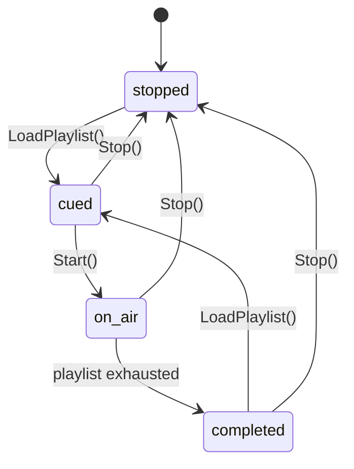
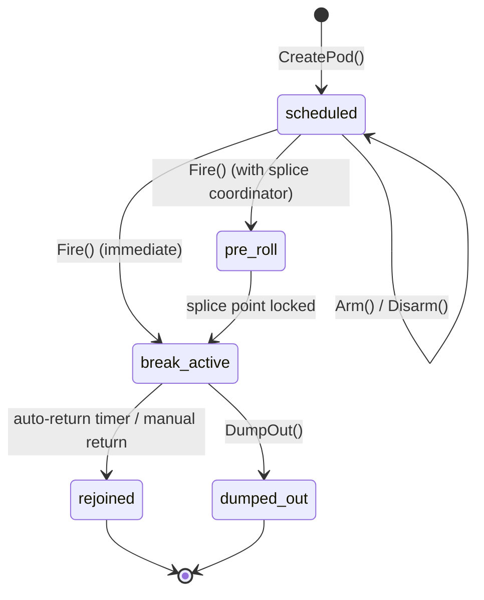
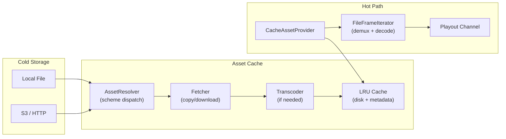

# Playout

1. [What Playout Does](#1-what-playout-does)
2. [Quick Start](#2-quick-start)
3. [Architecture](#3-architecture)
4. [Channels](#4-channels)
5. [Playlist Format](#5-playlist-format)
6. [Channel Lifecycle](#6-channel-lifecycle)
7. [Transitions](#7-transitions)
8. [Live Source Tap](#8-live-source-tap)
9. [Idle Loop](#9-idle-loop)
10. [Pod Management](#10-pod-management)
11. [Secondary Events](#11-secondary-events)
12. [Sample Content](#12-sample-content)
13. [Asset Cache](#13-asset-cache)
14. [Splice Coordination](#14-splice-coordination)
15. [As-Run Logging](#15-as-run-logging)
16. [BXF Import & Export](#16-bxf-import--export)
17. [Health & Recovery](#17-health--recovery)
18. [State Broadcast](#18-state-broadcast)
19. [REST API Reference](#19-rest-api-reference)
20. [UI](#20-ui)
21. [Configuration](#21-configuration)
22. [File Reference](#22-file-reference)

---

## 1. What Playout Does

Playout is SwitchFrame's schedule-driven automated playback engine. It turns the production switcher into a **production-playout hybrid** — live switching and automated playout coexist in the same system, sharing the video pipeline, audio mixer, graphics compositor, and SCTE-35 signaling.

Each playout channel is a **virtual compositor** — a self-contained frame source that internally muxes between clip playback, live source pass-through, slate, and idle loops. From the switcher's perspective, `playout:1` is always a single source that continuously emits frames. Channels register as virtual sources that can be cut or dissolved to program, mixed through the audio engine, and viewed in the browser multiview alongside live cameras.

### Key capabilities

- **2 playout channels** — Independent playlists, cursors, and transport controls per channel
- **Virtual compositor model** — Tick-driven frame router with internal transitions, GPU source tap, idle loop
- **3 item types** — Clip (media file playback), live (camera hold), slate (timed black)
- **Internal transitions** — Dissolve, dip, wipe between items (GPU-first, CPU SIMD fallback)
- **Idle loop** — Configurable idle asset loops between items and during pre/post-show
- **Pod management** — Commercial break scheduling with SCTE-35 integration and manifest-defined templates
- **Secondary events** — Timed graphics, audio, caption, and SCTE-35 events anchored to item start or end
- **Sample content** — Built-in sample clips and template playlists for out-of-the-box demos
- **Asset cache** — LRU disk cache with schedule-aware prefetch and automatic transcode
- **Splice coordination** — Frame-accurate break entry using black detection
- **As-run logging** — JSONL persistence with query API and BXF export
- **BXF import** — Load playlists from broadcast exchange format schedules
- **Crash recovery** — Persistent state snapshots with automatic channel re-cue
- **Watchdog** — Stall detection with configurable auto-recovery

---

## 2. Quick Start

### Enable playout

Start SwitchFrame with the `--playout` flag:

```bash
./switchframe --playout
```

Playout is auto-enabled in demo mode (`make demo`).

### Load a playlist

```bash
curl -X POST https://localhost:8080/api/playout/channels/1/load \
  -H "Content-Type: application/json" \
  -d '{
    "id": "morning-block",
    "name": "Morning Block",
    "idle_asset": "/media/holding-slate.ts",
    "idle_loop": true,
    "default_transition": {"type": "dissolve", "duration_ms": 500},
    "pods": [
      {"label": "Halftime", "duration_ms": 180000, "auto_return": true},
      {"label": "Commercial", "duration_ms": 120000, "auto_return": true}
    ],
    "items": [
      {
        "id": "opener",
        "type": "clip",
        "title": "Show Opener",
        "asset_uri": "/media/opener.ts",
        "duration_ms": 15000
      },
      {
        "id": "segment-1",
        "type": "live",
        "title": "Live Camera 1",
        "source": "camera:1"
      },
      {
        "id": "break-slate",
        "type": "slate",
        "title": "Commercial Break",
        "duration_ms": 5000
      }
    ]
  }'
```

### Start playback

```bash
curl -X POST https://localhost:8080/api/playout/channels/1/start
```

The channel transitions from `cued` to `on_air` and begins playing through the playlist automatically. Between items and before the first item, the idle asset loops continuously.

### Use a template playlist

```bash
# List available template playlists
curl https://localhost:8080/api/playout/templates

# Get a pre-built playlist from a template
curl https://localhost:8080/api/playout/templates/live-event
```

---

## 3. Architecture

Each playout channel is a virtual compositor with three layers: a playlist scheduler that drives the state machine, a frame router with internal compositor that selects and blends frame sources per tick, and an output stage that delivers a single stream of frames.

```
┌─────────────────────────────────────────┐
│          Playlist Scheduler             │  manifest-driven state machine
│   (idle loop, scheduled items, pods)    │  wall-clock advancement
├─────────────────────────────────────────┤
│        Frame Router + Compositor        │  selects frame source per tick
│   (clip decoder, GPU cache tap, slate,  │  blends transitions internally
│    idle loop, transition blender)       │  GPU-first, CPU fallback
├─────────────────────────────────────────┤
│           Output Stage                  │  single stream of frames
│   (→ GPU source manager as playout:1)   │  preview encoding + MoQ relay
└─────────────────────────────────────────┘
```

### Frame Sources

The frame router picks one source per tick based on the current playlist item:

| Item Type | Frame Source | Mechanism |
|-----------|-------------|-----------|
| `clip` | FileFrameIterator | Streaming decode to YUV (existing) |
| `live` | GPU source manager cache | Read latest cached GPU frame for `item.source` — zero-copy VRAM pointer swap |
| `slate` | Pre-allocated black frame or decoded slate asset | Generated once, reused |
| Idle | IdleLoop iterator | Same as clip but auto-rewinds on EOF |

### Tick-Driven Model

The scheduler runs a tick loop at the channel's frame rate. Each tick:

1. The scheduler evaluates the current state (idle, playing, transitioning)
2. Checks for wall-clock scheduled time advancement
3. The frame router selects the appropriate frame source
4. If transitioning, the compositor blends outgoing and incoming frames
5. The resulting frame is emitted to the switcher pipeline

### GPU Preview & Browser Relay

On channel start, `playout:N` registers with the GPU source manager via `RegisterSource()` with `PreviewConfig`. This creates a dedicated preview encoder (480p NVENC/VideoToolbox) and MoQ relay, the same pattern used by clip players and SRT sources.

Frame flow:
- Clip/slate playback: decoded YUV uploaded to GPU via `gpuSourceMgr.IngestYUV()`
- Live tap: GPU source manager aliases `playout:1`'s cached frame to live source's frame (no upload)
- Transitions: blended result (already in VRAM on GPU path) stored as `playout:1`'s cached frame

---

## 4. Channels

SwitchFrame supports **2 playout channels** (`MaxChannels = 2`). Each channel:

- Registers as a virtual switcher source with key `playout:1` or `playout:2`
- Has its own playlist, cursor, transport state, and on-air mode
- Has an independent pod board for commercial break management
- Runs its own tick-driven scheduler and frame router
- Outputs frames to the GPU source manager and audio to the mixer

Channels are pre-created at Manager startup. A channel must have a playlist loaded before it can start.

### On-Air Modes

| Mode | Description |
|------|-------------|
| `automated` | Default. Playlist advances automatically when each item completes. |
| `manual` | Pauses playlist advancement. The current item continues but the channel waits for an explicit Next before advancing. |
| `break` | Set automatically when a pod fires. The channel holds until the break completes and returns to `automated`. |

---

## 5. Playlist Format

A playlist is a JSON object containing an ordered list of items plus playlist-level settings for idle assets, transitions, and pod templates.

```json
{
  "id": "evening-show-2026-03-25",
  "name": "Evening Show",
  "channel": "playout:1",
  "idle_asset": "/media/holding-slate.ts",
  "idle_loop": true,
  "default_transition": {
    "type": "dissolve",
    "duration_ms": 500
  },
  "pods": [
    {"label": "Halftime", "duration_ms": 180000, "auto_return": true},
    {"label": "Commercial", "duration_ms": 120000, "auto_return": true},
    {"label": "Sponsor", "duration_ms": 30000, "auto_return": true}
  ],
  "items": [
    {
      "id": "item-001",
      "type": "clip",
      "title": "Cold Open",
      "asset_uri": "/media/cold-open.ts",
      "duration_ms": 45000,
      "in_point_ms": 0,
      "out_point_ms": 45000,
      "loop": false,
      "secondary_events": [
        {
          "type": "graphics_on",
          "layer": 1,
          "template": "lower-third-host",
          "offset_ms": 3000,
          "anchor": "start"
        },
        {
          "type": "graphics_off",
          "layer": 1,
          "offset_ms": -2000,
          "anchor": "end"
        }
      ]
    },
    {
      "id": "item-002",
      "type": "live",
      "title": "Host Desk",
      "source": "camera:1",
      "transition": {"type": "dissolve", "duration_ms": 1000},
      "secondary_events": [
        {
          "type": "scte35_cue",
          "offset_ms": 0,
          "anchor": "start",
          "scte35": {
            "break_duration_ms": 120000,
            "auto_return": true
          }
        }
      ]
    },
    {
      "id": "item-003",
      "type": "slate",
      "title": "Standby Slate",
      "duration_ms": 10000
    },
    {
      "id": "item-004",
      "type": "clip",
      "title": "Interview Package",
      "asset_uri": "s3://bucket/interview.mp4",
      "duration_ms": 180000,
      "hold": true,
      "loop": false,
      "transition": {
        "type": "dissolve",
        "duration_ms": 1000
      }
    }
  ]
}
```

### Playlist Fields

| Field | Type | Description |
|-------|------|-------------|
| `id` | string | Unique playlist identifier |
| `name` | string | Display name |
| `channel` | string | Target channel key (e.g., `"playout:1"`) |
| `idle_asset` | string | URI of clip that loops when no item is active (pre-show, post-show, gaps). Omit for black. |
| `idle_loop` | bool | Whether idle asset loops (default `true`) |
| `default_transition` | object | Transition used between items unless overridden |
| `pods` | array | Pod template definitions with user-defined labels (see [Pod Management](#10-pod-management)) |
| `items` | array | Ordered list of playlist items |

### Item Types

| Type | Description | Required Fields |
|------|-------------|----------------|
| `clip` | Play a media file from the asset cache | `asset_uri` |
| `live` | Hold for a live camera source (waits for Next) | `source` |
| `slate` | Output black frames for a fixed duration | `duration_ms` (0 = hold indefinitely) |

### Item Fields

| Field | Type | Description |
|-------|------|-------------|
| `id` | string | Unique item identifier (required, no duplicates) |
| `type` | string | `"clip"`, `"live"`, or `"slate"` |
| `title` | string | Display title |
| `asset_uri` | string | Asset path or URI for clip items (local path, `file://`, `s3://`, `http://`) |
| `source` | string | Switcher source key for live items (e.g., `"camera:1"`) |
| `duration_ms` | int | Item duration in milliseconds |
| `in_point_ms` | int | Trim in point (clip items only, default 0) |
| `out_point_ms` | int | Trim out point (clip items only, 0 = play to end) |
| `hold` | bool | Hold last frame after clip completes instead of advancing |
| `loop` | bool | Replay clip until operator advances or next scheduled item arrives |
| `transition` | object | Per-item transition override (`type`, `duration_ms`, `easing`, `direction`). Omit = use playlist default. `{"type": "cut"}` = force hard cut. |
| `scheduled_time` | string | ISO 8601 timestamp for wall-clock scheduled advancement |
| `secondary_events` | array | Timed events attached to this item |

### Validation Rules

- At least one item required
- Every item must have a non-empty, unique `id`
- Clip items require `asset_uri`
- Live items require `source`
- Only `clip`, `live`, and `slate` types are accepted
- Secondary events are validated for type and required fields

---

## 6. Channel Lifecycle



### Channel States

| State | Description |
|-------|-------------|
| `stopped` | No playlist or playback inactive |
| `cued` | Playlist loaded, ready to start. Idle asset can play. |
| `on_air` | Tick-driven scheduler running through items |
| `completed` | All items played, channel returns to idle loop |

### Scheduler States (internal to on_air)

Within the `on_air` channel state, the scheduler maintains its own state machine:

| State | Description |
|-------|-------------|
| `idle` | No active item. Idle asset loops. Waiting for scheduled time or operator advance. |
| `playing` | An item is active (clip, live, or slate) |
| `transitioning` | Blending between outgoing and incoming items |

```
Idle ──→ Playing ──→ Idle
            ↕
       Transitioning
```

### Item Advancement

| Item Configuration | Behavior |
|---|---|
| `clip` with `duration_ms` | Auto-advance on completion |
| `clip` with `loop: true` | Replay until advance or next scheduled item |
| `clip` with `hold: true` | Hold last frame until advance |
| `live` | Hold indefinitely until advance or next scheduled item |
| `slate` with `duration_ms` | Auto-advance on timer expiry |
| Any item with `scheduled_time` | Scheduler auto-advances when wall clock reaches time |

### Scheduled Time Behavior

- If a scheduled item's time arrives while a previous item is playing, the scheduler interrupts and transitions to the scheduled item
- Gaps between items (previous completed, next not yet scheduled) are filled by the idle asset
- Enables the workflow: idle loop, countdown, auto-transition to live at scheduled time

### Clip Playback

When a clip item plays:

1. The `AssetProvider` opens the asset URI and returns a streaming `FrameIterator`
2. If in/out points are set, a `TrimIterator` wraps the base iterator
3. FPS is estimated from PTS spacing; frame pacing uses absolute time to prevent drift
4. Each decoded YUV frame is output via the frame router to the switcher pipeline
5. Audio frames are distributed alongside video at their original PTS
6. Secondary events are ticked at each frame's elapsed time
7. The splice coordinator receives each frame for black detection

If `hold` is true, the last frame is output at 1fps indefinitely until Next is signaled. If `loop` is true, the iterator rewinds and replays from the beginning.

### Live Items

Live items read from the GPU source manager's cached frame for the named source. Start-anchored secondary events fire immediately. The item holds until Next is called or a scheduled item preempts it.

### Slate Items

Slate items output BT.709 black frames (Y=16, U=V=128) at 30fps for the configured duration. If `duration_ms` is 0, the slate holds indefinitely until Next.

---

## 7. Transitions

Transitions between playlist items are handled internally by the playout compositor. Transitions are **opt-in** — hard cut is the default. A transition only occurs when explicitly configured on the item or as a playlist default.

### How Transitions Work

When a transition is active:

1. The frame router maintains two slots: `currentSource` and `nextSource`
2. Both sources produce frames simultaneously for the transition duration
3. Each tick: read from both, blend via compositor, emit result
4. After completion: `currentSource` = `nextSource`, old source closed

### Supported Types

| Type | Description |
|------|-------------|
| `cut` | Instant switch, no blend (default) |
| `dissolve` | Linear crossfade |
| `dip_black` | Fade out to black, fade in from black |
| `dip_white` | Same with white |
| `wipe` | Directional (horizontal, vertical, diagonal) |

All transition parameters are configurable: `type`, `duration_ms`, `easing`, `direction`.

No stinger support inside playout — stingers are a switcher-level feature. Stinger-like effects can be achieved with a clip item containing the stinger content.

### GPU Path (Metal/CUDA)

When GPU acceleration is available:

- Both frames are already in VRAM
- Uses existing `blend.metal` / `cuda/blend.cu` compute kernels (uniform mix, fade, wipe)
- Blend via GPU compute dispatch, result stays in VRAM
- Zero CPU involvement

### CPU Fallback

When no GPU is available:

- Uses existing `transition.BlendYUV420` SIMD kernels from `server/transition/blend.go`
- Both frames in CPU memory, blend in-place

---

## 8. Live Source Tap

During live items, the playout channel reads directly from the GPU source manager's cached VRAM frame for the named source (e.g., `srt:nflx`). This is a pointer swap — no CPU copy, no upload. The GPU pipeline processes it as `playout:1`'s frame (keying, layout, DSK, encode all apply).

The playout channel does **not** switch the program source. It reads the live source's frame and emits it as its own output. The main switcher program bus is unaffected.

### Fallback Behavior

- If the named source has no frame yet (offline), the idle asset or last good frame is held
- **CPU fallback (no GPU):** a raw frame hook on the switcher's `handleRawVideoFrame` path receives decoded YUV from the live source and re-emits through `IngestReplayVideo("playout:1", ...)`

---

## 9. Idle Loop

The `IdleLoop` wraps an `AssetProvider` with auto-rewind capability. When it reaches the end of the clip, it re-opens and starts from the beginning. If no idle asset is configured or the asset fails to open, it returns a pre-allocated BT.709 black frame.

### Configuration

The idle asset is set at the playlist level via `idle_asset`:

```json
{
  "idle_asset": "/media/holding-slate.ts",
  "idle_loop": true
}
```

- Omit `idle_asset` for black frames during idle
- Set `idle_loop` to `false` for a single-play idle asset (holds last frame after completion)

### When Idle Plays

- Before the first item starts
- Between items when the previous item completes and the next item has a future `scheduled_time`
- After all items complete (channel returns to idle)
- During pre-show and post-show gaps

### Implementation

`IdleLoop` does not run its own goroutine. It is called synchronously per tick by the scheduler. It is safe for concurrent use. The idle asset is decoded through the same `FileFrameIterator` pipeline used by clip items.

---

## 10. Pod Management

Pods represent commercial breaks. Each channel has an independent **pod board** that manages break scheduling, activation, and completion. Pods integrate with the SCTE-35 injector for downstream ad signaling.

### Pod Templates from Manifest

Pod templates are defined at the playlist level in the `pods` array with user-defined labels:

```json
{
  "pods": [
    {"label": "Halftime", "duration_ms": 180000, "auto_return": true},
    {"label": "Commercial", "duration_ms": 120000, "auto_return": true},
    {"label": "Sponsor", "duration_ms": 30000, "auto_return": true}
  ]
}
```

These drive the pod board UI buttons. Default labels ("Break 1", "Break 2") are used if the manifest does not specify templates.

### Pod Lifecycle



### Pod States

| State | Description |
|-------|-------------|
| `scheduled` | Created, waiting to be armed and fired |
| `pre_roll` | Fired with splice coordinator; scanning for splice point |
| `break_active` | On-air break; elapsed/remaining tracked at 50ms resolution |
| `rejoined` | Break completed normally (terminal) |
| `dumped_out` | Break ended early via dump-out (terminal) |

### Pod Operations

| Operation | Description |
|-----------|-------------|
| **Create** | Create a pod from config or template |
| **Arm** | Mark pod ready to fire |
| **Disarm** | Clear armed flag |
| **Fire** | Activate the pod: inject SCTE-35 cue-out, start break timer |
| **Hold** | Cancel auto-return, keep break active indefinitely |
| **Extend** | Add time to the break and restart auto-return timer |
| **Dump out** | End break early (requires `allow_dump_out` on pod config) |
| **Move** | Reassign pod to a new playlist position |
| **Swap** | Exchange positions of two pods |
| **Resize** | Change pod duration |
| **Defer** | Push pod to a later position |
| **Promote** | Increase priority (normal -> high -> mandatory) |
| **Demote** | Decrease priority (mandatory -> high -> normal) |

### Priority

| Level | Behavior |
|-------|----------|
| `normal` | Standard priority |
| `high` | Wins contention against normal pods |
| `mandatory` | Cannot be preempted; dump-out may be disallowed |

---

## 11. Secondary Events

Secondary events are timed actions attached to playlist items. They fire at a computed time relative to the item's start or end.

### Event Types

| Type | Description | Required Fields |
|------|-------------|-----------------|
| `graphics_on` | Enable graphics on a layer | `layer`, `template` |
| `graphics_off` | Disable graphics on a layer | `layer` |
| `graphics_update` | Update graphics template | `layer`, `template` |
| `audio_level` | Set audio level for a source | `source_key`, `level_db` |
| `audio_mute` | Mute/unmute a source | `source_key`, `muted` |
| `audio_afv` | Set audio-follow-video | `source_key`, `afv` |
| `caption_mode` | Set caption mode | `caption_mode` (`off`, `passthrough`, `author`, `auto`) |
| `caption_text` | Inject caption text | `caption_text` |
| `scte35_cue` | Inject SCTE-35 cue | `scte35` object with `break_duration_ms` and `auto_return` |

### Anchoring

| Anchor | Behavior |
|--------|----------|
| `start` | Fire at `offset_ms` from item start. A positive offset delays the event. |
| `end` | Fire at `duration_ms + offset_ms` from item start. A negative offset fires before the item ends. |

Example: `{"anchor": "end", "offset_ms": -2000}` fires 2 seconds before the item completes.

Events are sorted by computed fire time and evaluated on each frame tick. Each event fires exactly once per item.

---

## 12. Sample Content

### Built-In Sample Clips

Generated at startup via ffmpeg (graceful skip if unavailable). Stored in playout cache, available in all modes (not just demo):

- **"Holding Slate"** — 10s looping gradient, default idle asset
- **"Bumper In"** — 3s lead-in transition clip
- **"Bumper Out"** — 3s return-from-break clip
- **"Sample Ad A"** — 15s synthetic commercial
- **"Sample Ad B"** — 30s synthetic commercial
- **"Countdown"** — 10s countdown pattern

Sample clips double as ad content for pod breaks, making the pod workflow demonstrable out of the box.

### Template Playlists

Available in the UI via "New Playlist" dropdown, and via the REST API:

| Template | Description |
|----------|-------------|
| **"Live Event with Breaks"** | Idle slate, live hit, bumper, SCTE-35 ad pod, bumper, live hit, postgame. Demonstrates idle asset, live items, transitions, SCTE-35, pods. |
| **"VOD Playlist"** | Back-to-back clips with dissolves, loop on last item. Demonstrates clip sequencing, per-item transitions, loop. |
| **"Scheduled Broadcast"** | Items with `scheduled_time` over 30 minutes, idle fill between. Demonstrates wall-clock automation, idle fill. |

Templates pre-populate the timeline editor. Users can modify everything — templates are starting points.

---

## 13. Asset Cache

The asset cache is an LRU disk cache that stores encoded media files locally for fast access during playback. It sits between cold storage (network, S3, etc.) and the hot streaming decoder.

### Architecture



### Prefetch Scheduler

The `Prefetcher` watches the playlist lookahead window (default: 5 items ahead) and proactively fetches upcoming clip assets:

- Scans on playlist load, cursor advance, or every 30 seconds
- Bounded concurrency (default: 2 parallel fetches)
- Skips already-cached and in-flight assets
- Automatically transcodes non-H.264 assets to pipeline-compatible format
- Uses `Peek()` for scan (no LRU touch) to avoid evicting assets being read

### Cache Entry States

| State | Description |
|-------|-------------|
| `pending` | Placeholder created, fetch not started |
| `fetching` | Download in progress |
| `transcoding` | Downloaded, FFmpeg transcode running |
| `cached` | Ready for playback |
| `error` | Fetch or transcode failed |

### LRU Eviction

When total cached bytes exceed `--playout-cache-max`, the oldest-accessed entries are evicted. Entries in `fetching` or `transcoding` state are protected from eviction.

### Storage Layout

```
~/.switchframe/playout-cache/
  cache_meta.json          Metadata persistence (atomic writes)
  assets/
    <sha256-of-uri>.ts     Cached media files
    <sha256-of-uri>.mp4
```

---

## 14. Splice Coordination

The `SpliceCoordinator` enables frame-accurate break entry by scanning the playout video stream for clean splice points (black frames) before injecting the SCTE-35 cue.

### Flow

1. Pod board calls `Fire()` on an armed pod
2. If a splice coordinator is configured, the pod transitions to `pre_roll`
3. The coordinator calls `BeginSplice()` with a configurable pre-roll window (default: 5 seconds)
4. Incoming decoded frames are analyzed by the `BlackDetector` for luma content
5. When a black frame is found within the splice window, the coordinator locks the splice point
6. The SCTE-35 cue-out is injected at the detected PTS
7. The pod transitions to `break_active` and the auto-return timer starts
8. If no splice point is found within the timeout (default: 2 seconds), the coordinator falls back to immediate splice

The black detector computes mean luma over a configurable window and threshold, allowing splice on content blacks like scene transitions.

---

## 15. As-Run Logging

The as-run logger provides a durable record of everything that happened during playout for traffic reconciliation, compliance, and debugging.

### Event Types

| Type | Description |
|------|-------------|
| `item_start` | Playlist item began playing (includes scheduled vs actual delta) |
| `item_end` | Playlist item finished (includes actual duration) |
| `secondary_event_fire` | A secondary event dispatched |
| `splice_active` | SCTE-35 splice point locked |
| `pod_operation` | Pod lifecycle event (fire, return, dump_out, hold, extend) |
| `manual_override` | Operator entered/exited manual mode |
| `cache_event` | Asset cache state change |
| `error` | Error condition (asset failure, persistent frame errors, crash recovery) |

### Storage

Events are written to both:

1. **Ring buffer** (default: 10,000 entries) for fast in-memory query
2. **JSONL files** (`~/.switchframe/playout-asrun/asrun-YYYY-MM-DD.jsonl`) for durable storage

JSONL files are append-only and date-stamped. Retention cleanup runs daily, removing files older than `--playout-asrun-retention` days (default: 30).

### Query API

The `GET /api/playout/channels/{n}/asrun` endpoint supports filters:

| Parameter | Type | Description |
|-----------|------|-------------|
| `type` | string | Filter by event type (e.g., `item_start`) |
| `since` | RFC 3339 | Events after this timestamp |
| `until` | RFC 3339 | Events before this timestamp |
| `limit` | int | Maximum events to return |

---

## 16. BXF Import & Export

[BXF (Broadcast Exchange Format)](https://www.smpte.org/standards/st2021) is the SMPTE standard XML format for schedule exchange between traffic and automation systems.

### Import

`POST /api/playout/import/bxf` accepts a BXF Schedule XML body and converts it to an internal playlist:

- Each `ScheduleDetail` becomes a playlist item
- Content type maps to `clip`, `live`, or `slate`
- Duration is parsed from `ScheduledDuration` or `Content/Duration`
- Scheduled times are preserved for as-run delta tracking
- Asset URIs use the `bxf://` scheme with the HouseNumber as identifier

### Export

`GET /api/playout/channels/{n}/asrun/export?format=bxf` exports as-run events as BXF AsRunLog XML, suitable for return to traffic systems.

---

## 17. Health & Recovery

### Watchdog

The watchdog monitors frame output cadence for all on-air channels:

- Default stall threshold: 5 seconds without a frame
- Default check interval: 1 second
- When a stall is detected, the watchdog calls `RecoverChannel()` automatically

### Manual Recovery

`POST /api/playout/channels/{n}/recover` triggers manual recovery:

1. Snapshots the current channel state (playlist, cursor, mode)
2. Stops the channel
3. Reloads the playlist at the saved cursor position
4. Restarts playback

### Crash Recovery

The `StatePersister` writes periodic atomic snapshots of all channel and pod state to disk. On restart, `Manager.Recover()` loads the snapshot:

- Restores playlists and cursor positions
- Re-cues channels that were on-air
- Restores non-terminal pods with wall-clock elapsed adjustment
- Emits as-run error events documenting the recovery

---

## 18. State Broadcast

Playout state is included in `ControlRoomState.playout` and pushed to browsers via the MoQ control track on every state change.

```typescript
interface PlayoutState {
  channels: PlayoutChannelInfo[];
}

interface PlayoutChannelInfo {
  id: number;             // 1-2
  state: "stopped" | "cued" | "on_air" | "completed";
  mode?: "automated" | "manual" | "break";
  schedulerState?: "idle" | "playing" | "transitioning";
  playlistName?: string;
  currentItemId?: string;
  currentTitle?: string;
  nextItemId?: string;
  nextTitle?: string;
  itemIndex: number;
  itemCount: number;
  itemProgress?: number;  // 0.0-1.0
  itemRemainMs?: number;
  pods: PodStatusInfo[];
  podsArmed: number;
  podsCompleted: number;
}

interface PodStatusInfo {
  id: string;
  type: string;
  state: string;
  armed: boolean;
  elapsedMs?: number;
  remainingMs?: number;
  durationMs: number;
  priority: string;
  position?: string;
}
```

The `channels` array always contains exactly 2 elements (one per channel). Progress and remaining time use lock-free atomics for low-overhead reads at broadcast cadence.

---

## 19. REST API Reference

All endpoints require `--playout`. Returns `501 Not Implemented` when disabled.

### Channel Control

| Method | Path | Description |
|:------:|------|-------------|
| GET | `/api/playout/channels` | List status of all playout channels |
| GET | `/api/playout/channels/{n}` | Get status of a single channel |
| POST | `/api/playout/channels/{n}/load` | Load a playlist (JSON body) |
| POST | `/api/playout/channels/{n}/start` | Start playback |
| POST | `/api/playout/channels/{n}/stop` | Stop playback |
| POST | `/api/playout/channels/{n}/next` | Advance to next item |
| POST | `/api/playout/channels/{n}/previous` | Go back to previous item |
| POST | `/api/playout/channels/{n}/jump` | Jump to item by ID (`{"itemId": "..."}`) |
| POST | `/api/playout/channels/{n}/manual` | Enter manual mode |
| POST | `/api/playout/channels/{n}/auto` | Return to automated mode |
| GET | `/api/playout/channels/{n}/playlist` | Get loaded playlist items |
| POST | `/api/playout/channels/{n}/recover` | Trigger manual channel recovery |

### Pod Management

| Method | Path | Description |
|:------:|------|-------------|
| GET | `/api/playout/channels/{n}/pods` | List all pods for a channel |
| POST | `/api/playout/channels/{n}/pods` | Create pod (`{"template":"..."}` or `{"config":{...}}`) |
| GET | `/api/playout/channels/{n}/pods/{podId}` | Get pod details |
| DELETE | `/api/playout/channels/{n}/pods/{podId}` | Delete pod (not active) |
| POST | `/api/playout/channels/{n}/pods/{podId}/arm` | Arm pod |
| POST | `/api/playout/channels/{n}/pods/{podId}/disarm` | Disarm pod |
| POST | `/api/playout/channels/{n}/pods/{podId}/fire` | Fire armed pod |
| POST | `/api/playout/channels/{n}/pods/{podId}/hold` | Hold active break |
| POST | `/api/playout/channels/{n}/pods/{podId}/extend` | Extend break (`{"additional_ms": N}`) |
| POST | `/api/playout/channels/{n}/pods/{podId}/dump` | Dump out of break |
| POST | `/api/playout/channels/{n}/pods/{podId}/move` | Move pod (`{"position": "..."}`) |
| POST | `/api/playout/channels/{n}/pods/{podId}/swap` | Swap with another pod (`{"otherPodId": "..."}`) |
| POST | `/api/playout/channels/{n}/pods/{podId}/resize` | Resize duration (`{"duration_ms": N}`) |
| POST | `/api/playout/channels/{n}/pods/{podId}/defer` | Defer to position (`{"position": "..."}`) |
| POST | `/api/playout/channels/{n}/pods/{podId}/promote` | Increase priority |
| POST | `/api/playout/channels/{n}/pods/{podId}/demote` | Decrease priority |

### Pod Templates

| Method | Path | Description |
|:------:|------|-------------|
| GET | `/api/playout/pods/templates` | List all templates (built-in + custom) |
| POST | `/api/playout/pods/templates` | Create custom template |
| PUT | `/api/playout/pods/templates/{type}` | Update template |
| DELETE | `/api/playout/pods/templates/{type}` | Delete template |

### Sample Content & Templates

| Method | Path | Description |
|:------:|------|-------------|
| GET | `/api/playout/samples` | List built-in sample clips (name, title, path, duration) |
| GET | `/api/playout/templates` | List available template playlist names |
| GET | `/api/playout/templates/{name}` | Get a pre-built playlist for the named template |

### Cache

| Method | Path | Description |
|:------:|------|-------------|
| GET | `/api/playout/cache/status` | Cache statistics (used/max bytes, item count, errors) |
| POST | `/api/playout/cache/lookup` | Look up entry by URI (`{"asset_uri": "..."}`) |
| POST | `/api/playout/cache/evict` | Remove entry by URI (`{"asset_uri": "..."}`) |

### As-Run

| Method | Path | Description |
|:------:|------|-------------|
| GET | `/api/playout/channels/{n}/asrun` | Query as-run events (supports `type`, `since`, `until`, `limit` params) |
| GET | `/api/playout/channels/{n}/asrun/export` | Export as-run (default JSON, `?format=bxf` for BXF XML) |

### BXF Import

| Method | Path | Description |
|:------:|------|-------------|
| POST | `/api/playout/import/bxf` | Import BXF schedule XML (`?channel=1&name=...`) |

### Health

| Method | Path | Description |
|:------:|------|-------------|
| GET | `/api/playout/health` | Watchdog health summary for all channels |

---

## 20. UI

The playout UI is organized into three main components accessible from the Playout tab.

### Timeline Editor (`PlayoutTimeline.svelte`)

Full drag-and-drop timeline editor for building and editing playlists.

```
┌─────────────────────────────────────────────────────┐
│ Toolbar: [+ Add Item] [Templates v] [Import BXF]    │
│          [Save] [Load from File] [Clear]             │
├─────────────────────────────────────────────────────┤
│ Timeline Track:                                      │
│ ┌──────┐┌────────────┐┌───┐┌──────────┐┌───┐┌────┐ │
│ │Slate ││ Live: nflx  ││Bmp││ Ad Break  ││Bmp││Live│ │
│ │ 10s  ││  (manual)   ││ 3s││ SCTE 120s ││ 3s││    │ │
│ └──────┘└────────────┘└───┘└──────────┘└───┘└────┘ │
│ v Secondary events track                             │
│   *GFX     *SCTE          *SCTE         *GFX        │
└─────────────────────────────────────────────────────┘
```

Interactions:
- **Drag items** to reorder on the timeline
- **Resize item blocks** to change duration (clip/slate)
- **Click item** to open the item editor panel
- **Right-click** for context menu (duplicate, delete, insert before/after)
- **Drag from clip library** onto timeline to add
- **Secondary event markers** visible on sub-track, click to edit
- **Transition indicators** between items show type/duration
- **Live items** render as flexible-width blocks (no fixed duration)
- **Scheduled items** show absolute time markers on the timeline ruler

### Item Editor (`PlayoutItemEditor.svelte`)

Full property editor for the selected playlist item:

- Item type selector (clip/live/slate)
- Source/asset URI field
- Duration, in/out points
- Transition type, duration, easing, direction
- Loop and hold toggles
- Scheduled time picker
- Secondary events list with add/edit/delete

### Settings Panel (`PlayoutSettings.svelte`)

Playlist-level settings:

- Idle asset selector (from clip library + samples)
- Default transition configuration
- Pod label editor (add/remove/rename labels from manifest `pods` array)
- Playlist name and ID

---

## 21. Configuration

### CLI Flags

| Flag | Default | Description |
|------|:-------:|-------------|
| `--playout` | `false` | Enable playout subsystem |
| `--playout-cache-max` | `200` | Asset cache maximum size in GB |
| `--playout-asrun-retention` | `30` | As-run JSONL file retention in days |

### Storage Paths

| Path | Contents |
|------|----------|
| `~/.switchframe/playout-cache/` | Asset cache directory |
| `~/.switchframe/playout-cache/cache_meta.json` | Cache metadata (atomic writes) |
| `~/.switchframe/playout-cache/assets/` | Cached media files |
| `~/.switchframe/playout-asrun/` | As-run JSONL log files |
| `~/.switchframe/playout-asrun/asrun-YYYY-MM-DD.jsonl` | Daily as-run log |
| `~/.switchframe/playout-state.json` | Persisted channel/pod state for crash recovery |

### Concurrency

The `Manager` uses a single `sync.Mutex` protecting the channels array, pod boards, and callback pointers. State change callbacks are invoked outside the lock to prevent deadlock.

Each `Channel` uses a `sync.Mutex` for state and cursor, with `atomic.Int64` for progress and remaining time (lock-free reads on the broadcast hot path). The playback goroutine uses absolute-time pacing with `time.Timer` for drift-free frame output.

Each `PodBoard` uses its own `sync.Mutex` protecting the pod map and active pod ID. Auto-return timers and elapsed trackers run as cancellable goroutines.

The `Scheduler` uses a `sync.Mutex` for state transitions, with atomic loads for the current scheduler state on the read path.

The `Cache` uses a `sync.Mutex` with atomic persistence (temp file, fsync, rename).

The `AsRunLogger` uses a `sync.Mutex` protecting both the ring buffer and the JSONL encoder.

---

## 22. File Reference

```
server/playout/
  types.go              ChannelState, OnAirMode, ItemType, Playlist, PlaylistItem,
                        TransitionConfig, SecondaryEvent, ChannelStatus, Pod, PodState,
                        PodConfig, PodPriority, PodTemplateDef, CacheEntry, CacheStatus,
                        AsRunEvent, AsRunEventType, sentinel errors
  channel.go            Channel: tick-driven frame router with dual-source compositor,
                        idle loop, scheduled advancement, GPU source manager integration,
                        LoadPlaylist, Start/Stop/Next/Previous/JumpTo, TakeManual/ReturnToAuto,
                        TakeBreak/ReturnFromBreak, hold-last-frame, progress atomics
  scheduler.go          Scheduler: tick-driven playlist state machine (Idle/Playing/Transitioning),
                        wall-clock scheduled time advancement, item completion detection
  idle.go               IdleLoop: auto-rewinding asset iterator for idle periods,
                        black frame fallback, SetAsset for runtime changes
  compositor.go         Compositor: internal transition blender (GPU-first via GPUBlendFunc,
                        CPU SIMD fallback via transition.FrameBlender)
  samples.go            SampleClip generation via ffmpeg, TemplatePlaylist factory,
                        AvailableTemplates, built-in sample clip definitions
  manager.go            Manager: 2 channels, pod boards, lifecycle callbacks, state aggregation,
                        GPU tap, compositor, idle asset, preview registration,
                        Recover(), RecoverChannel(), Close()
  pod_board.go          PodBoard: CRUD, Arm/Disarm/Fire, Hold/Extend/DumpOut, Move/Swap/Resize,
                        Promote/Demote, auto-return timer, elapsed tracker, splice integration
  pod_template.go       PodTemplate, PodTemplateStore, generic default templates
  secondary.go          SecondaryEventScheduler: BeginItem, Tick, Reanchor, dispatch
  iterator.go           FrameIterator interface, SliceIterator, TrimIterator,
                        AssetProvider, CacheAssetProvider, FakeAssetProvider
  file_iterator.go      FileFrameIterator: demux + decode pipeline for cached media files
  manifest.go           ValidatePlaylist, ValidateSecondaryEvent, LoadPlaylist, SavePlaylist
  cache.go              Cache: LRU disk cache, Put/Get/Peek/Evict, Reserve, evictLRU, persist
  asset.go              AssetResolver, Fetcher: scheme-dispatched asset fetch (local/S3/HTTP)
  prefetch.go           Prefetcher: schedule-aware lookahead fetch with bounded concurrency
  transcode.go          Transcoder: FFmpeg-based format normalization for cache pipeline
  splice.go             SpliceCoordinator: frame-accurate break entry with black detection
  blackdetect.go        BlackDetector: luma analysis for splice point detection
  asrun.go              AsRunLogger: ring buffer + JSONL persistence, Query, CleanupOldFiles
  persist.go            PersistedState, StatePersister: atomic state snapshots for crash recovery
  watchdog.go           Watchdog: stall detection with configurable threshold and auto-recovery
  bxf/
    playlist.go         ImportPlaylist: BXF Schedule XML to internal Playlist
    asrun.go            ExportAsRun: as-run events to BXF AsRunLog XML

server/control/
  api_playout.go        Channel control, cache, as-run, BXF import, health,
                        sample clips, template playlists REST handlers
  api_playout_pods.go   Pod CRUD, lifecycle, template REST handlers

server/cmd/switchframe/
  app_playout.go        Application wiring: cache, prefetcher, provider, manager,
                        lifecycle callbacks, secondary handler, SCTE-35 adapter,
                        as-run logger, watchdog, splice coordinator, GPU source manager
                        registration, live tap, transition GPU dispatch, sample clips
  main.go              --playout, --playout-cache-max, --playout-asrun-retention flags
```

---

*See also: [Architecture](architecture.md) · [API Reference](api.md) · [Clips](clips.md) · [SCTE-35](scte35.md) · [Pipeline](pipeline.md) · [Deployment](deployment.md)*
