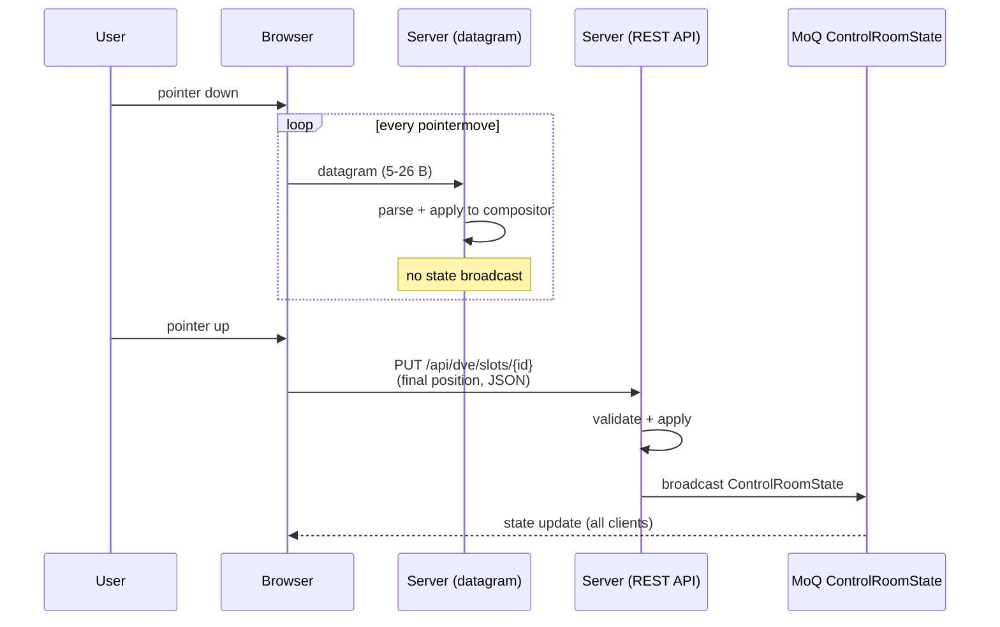

# Fast-Control Datagram Protocol

> **Where you are:** [docs](../README.md) → reference → fast-control
> **Read this first:** [architecture.md](../architecture.md)
> **See also:** [api.md](api.md) · [state-broadcast.md](state-broadcast.md) · [graphics-and-dve.md](../subsystems/graphics-and-dve.md) · [switcher.md](../subsystems/switcher.md)

**TL;DR** Fast-control is Switchframe's binary datagram protocol for high-frequency operator input: dragging a DVE slot, moving a graphics layer, pulling a T-bar. The UI ([`ui/src/lib/transport/fast-control.ts`](../../ui/src/lib/transport/fast-control.ts)) emits one compact datagram per `pointermove` over WebTransport; the server dispatches each to an O(1) handler table ([`server/fastctrl/dispatcher.go`](../../server/fastctrl/dispatcher.go)) keyed by the first byte. Ten message types cover the protocol: one for transition position, one for graphics layer position, six for DVE slot transforms and parameters, and two for PTP ping/pong clock sync. Datagrams are fire-and-forget — dropped packets are expected and harmless because the next one carries the current position. A final REST commit on `pointerup` broadcasts authoritative state via the control plane. See [api.md](api.md) for the REST side and [graphics-and-dve.md](../subsystems/graphics-and-dve.md) for the compositor that consumes these messages.

## Message type table

Every datagram starts with a type byte. The dispatcher indexes a `[256]Handler` table to route — no map lookup, no allocation, no hash collision.

| Type | Constant | Direction | Payload | Total | Sender | Handler |
|:----:|----------|-----------|:-------:|:-----:|--------|---------|
| `0x02` | `MsgTransitionPosition` | UI → server | 4 B | 5 B | `TransitionControls.svelte` (T-bar slider) | [`handleFastTransitionUpdate`](../../server/cmd/switchframe/app_fastctrl.go) → `switcher.SetTransitionPosition()` |
| `0x03` | `MsgGraphicsLayerPosition` | UI → server | 10 B | 11 B | `GraphicsOverlay.svelte` (layer drag/resize) | [`handleFastGraphicsUpdate`](../../server/cmd/switchframe/app_fastctrl.go) → `graphics.Compositor.UpdateLayerRect()` |
| `0x04` | `MsgDVESlotTransform` | UI → server | 25 B | 26 B | `LayoutOverlay.svelte` (DVE slot drag/resize/rotate) | [`handleFastDVETransform`](../../server/cmd/switchframe/app_fastctrl.go) → `dve.Compositor.UpdateSlotTransform()` |
| `0x05` | `MsgDVESingleParam` | UI → server | 7 B | 8 B | `DVEPanel.svelte` (knob/slider per parameter) | [`handleFastDVESingleParam`](../../server/cmd/switchframe/app_fastctrl.go) → `dve.Compositor.UpdateSlotTransform()` |
| `0x06` | `MsgDVESlotSource` | UI → server | 2+N B | 3+N B | `DVEPanel.svelte` (source assignment) | [`handleFastDVESlotSource`](../../server/cmd/switchframe/app_fastctrl.go) → `dve.Compositor.UpdateSlot()` |
| `0x07` | `MsgDVESlotEnable` | UI → server | 2 B | 3 B | `DVEPanel.svelte` (slot on/off toggle) | [`handleFastDVESlotEnable`](../../server/cmd/switchframe/app_fastctrl.go) → `dve.Compositor.SlotOn/SlotOff()` |
| `0x08` | `MsgDVEScaleMode` | UI → server | 10 B | 11 B | `DVEPanel.svelte` (scale mode + crop anchor) | [`handleFastDVEScaleMode`](../../server/cmd/switchframe/app_fastctrl.go) → `dve.Compositor.UpdateSlotTransform()` |
| `0x09` | `MsgDVEBorder` | UI → server | 12 B | 13 B | `DVEPanel.svelte` (border width/radius/color) | [`handleFastDVEBorder`](../../server/cmd/switchframe/app_fastctrl.go) → `dve.Compositor.UpdateSlotTransform()` |
| `0xFE` | `MsgPing` | UI → server | 0 or 4 B | 1 or 5 B | clock-sync probe | [`handleFastPing`](../../server/cmd/switchframe/app_fastctrl.go) → queues pong response |
| `0xFF` | `MsgPong` | server → UI | 12 B | 13 B | engine PTP timestamp | UI clock-sync loop |

## The story

A conventional HTTP API is the wrong transport for a drag gesture. Consider an operator dragging a DVE slot across a 4K output: 120 pointer events per second, each needing to land on the compositor before the next frame renders. Over REST that's a cascade of headers, JSON encoding, TLS handshakes, TCP windowing, and head-of-line blocking when one request stalls a second. The operator sees the PIP trail the cursor with a rubbery lag, and every move triggers a `ControlRoomState` broadcast that wakes up every other connected browser for no reason.

WebTransport datagrams solve this. They're fire-and-forget UDP messages running on the same QUIC connection as everything else. No framing, no ordering, no retransmission. A fast-control datagram is 5–11 bytes of payload; it crosses the wire in under a millisecond on a local network and gets applied to the compositor on the next frame boundary. Drop one? Fine — the next `pointermove` carries the current position. Reorder them? Fine — only the latest position matters. No state broadcast fires, so the other clients aren't pummeled with 120 updates per second of transient values.

That leaves one problem: authoritative state. If every drag movement is a silent datagram, the server's broadcast state would diverge from the actual compositor layout. The fix is a two-phase pattern. On `pointermove`, the UI sends datagrams. On `pointerup`, it sends one REST call with the final position — that one triggers validation, a state broadcast, and persistence if the subsystem cares. All clients see the committed final position; none of them see the intermediate drag noise.

## Wire format

Every datagram is:

```
Byte 0          Bytes 1..N
┌────────────┬─────────────────────────┐
│ Msg Type   │  Payload (type-specific) │
│ (uint8)    │                         │
└────────────┴─────────────────────────┘
```

The [`Dispatcher`](../../server/fastctrl/dispatcher.go) reads byte 0, strips it, and passes bytes 1..N to the handler registered at `handlers[type]`. Multi-byte integers are big-endian throughout; the UI uses `DataView` methods which default to big-endian.

### PTP timestamp prefix

There is one optional prefix. The [`fastctrl.Dispatcher.Dispatch`](../../server/fastctrl/dispatcher.go) method peeks at the first 8 bytes; if they parse as a plausible Unix microsecond timestamp (between 2020-01-01 and 2040-01-01), the dispatcher treats those 8 bytes as a PTP timestamp, strips them, and dispatches on the next byte. This lets the UI optionally tag every datagram with its emission time for PTP-coordinated multi-engine redundancy (see [project notes on multi-region](../../docs/plans/) — the receiver side is wired through `clock.Now`). Message type values (0x02–0x09, 0xFE, 0xFF) never produce a plausible timestamp as their uint64 interpretation, so legacy un-timestamped datagrams are dispatched correctly.

The UI's [`withTimestamp`](../../ui/src/lib/transport/fast-control.ts) helper applies the prefix when `opts.ptpNow` is provided, skipping it otherwise.

### Encoding conventions

- Integers are big-endian.
- Floats are IEEE 754 single-precision (`Float32`) big-endian.
- NaN and ±Inf in float fields are rejected at parse time.
- Positions and dimensions for graphics must be even-aligned (YUV420 chroma stride requirement); parsers reject odd values.

## Per-message specs

### 0x02 — Transition Position

Fires continuously from the T-bar slider during an active transition (dissolve, wipe, dip, stinger).

```
Byte   0      1    2    3    4
     ┌──────┬─────────────────┐
     │ 0x02 │    Position     │
     │ type │   float32 BE    │
     └──────┴─────────────────┘
```

| Offset | Size | Type | Field | Range |
|:------:|:----:|------|-------|-------|
| 0 | 1 | uint8 | Message type | `0x02` |
| 1–4 | 4 | float32 BE | Progress | [0.0, 1.0] |

`0.0` = fully on current program source. `1.0` = fully on preview (transition complete). Parser: [`ParseTransitionPosition`](../../server/fastctrl/transition.go). Handler: [`handleFastTransitionUpdate`](../../server/cmd/switchframe/app_fastctrl.go) → [`switcher.SetTransitionPosition()`](../../server/switcher/switcher.go). NaN and out-of-range values are rejected.

**Two-phase caveat:** T-bar does not use the REST commit pattern. Transition position is inherently transient — there is no "final position" to commit. The transition completes when position reaches 1.0 (or aborts at 0.0), which the switcher handles internally.

### 0x03 — Graphics Layer Position

Fires on `pointermove` during drag/resize of a DSK graphics layer.

```
Byte   0      1    2    3    4    5    6    7    8    9   10
     ┌──────┬────────┬────────┬────────┬────────┬────────┐
     │ 0x03 │LayerID │   X    │   Y    │   W    │   H    │
     │ type │ uint16 │ uint16 │ uint16 │ uint16 │ uint16 │
     └──────┴────────┴────────┴────────┴────────┴────────┘
```

| Offset | Size | Type | Field | Constraint |
|:------:|:----:|------|-------|------------|
| 0 | 1 | uint8 | Message type | `0x03` |
| 1–2 | 2 | uint16 BE | Layer ID | 0–65535 |
| 3–4 | 2 | uint16 BE | X position (pixels) | even-aligned |
| 5–6 | 2 | uint16 BE | Y position (pixels) | even-aligned |
| 7–8 | 2 | uint16 BE | Width (pixels) | even-aligned, non-zero |
| 9–10 | 2 | uint16 BE | Height (pixels) | even-aligned, non-zero |

Parser: [`ParseGraphicsLayerPosition`](../../server/fastctrl/graphics.go). Handler: [`handleFastGraphicsUpdate`](../../server/cmd/switchframe/app_fastctrl.go) → [`graphics.Compositor.UpdateLayerRect()`](../../server/graphics/compositor.go). Odd values or zero dimensions are rejected.

### 0x04 — DVE Slot Transform

Fires on `pointermove` during DVE slot drag, resize, or rotation. Full six-field transform.

```
Byte   0      1     2    3    4    5    6    7    8    9
     ┌──────┬──────┬─────────────────┬─────────────────┐
     │ 0x04 │Slot  │    PositionX    │    PositionY    │
     │ type │ u8   │   float32 BE    │   float32 BE    │
     ├──────┴──────┼─────────────────┼─────────────────┤
     │    Width    │     Height      │    Rotation     │
     │ float32 BE  │   float32 BE    │   float32 BE    │
     ├─────────────┼─────────────────┴─────────────────┤
     │   Opacity   │
     │ float32 BE  │
     └─────────────┘
```

| Offset | Size | Type | Field | Constraint |
|:------:|:----:|------|-------|------------|
| 0 | 1 | uint8 | Message type | `0x04` |
| 1 | 1 | uint8 | Slot ID | 0 ≤ slot < `dve.MaxSlots` (8) |
| 2–5 | 4 | float32 BE | PositionX | normalized, no NaN/Inf |
| 6–9 | 4 | float32 BE | PositionY | normalized, no NaN/Inf |
| 10–13 | 4 | float32 BE | Width | > 0.0, no NaN/Inf |
| 14–17 | 4 | float32 BE | Height | > 0.0, no NaN/Inf |
| 18–21 | 4 | float32 BE | Rotation (degrees) | no NaN/Inf |
| 22–25 | 4 | float32 BE | Opacity | [0.0, 1.0] |

Parser: [`ParseDVESlotTransform`](../../server/fastctrl/dve.go). Handler: [`handleFastDVETransform`](../../server/cmd/switchframe/app_fastctrl.go) → [`dve.Compositor.UpdateSlotTransform()`](../../server/dve/compositor.go). Zero-opacity is preserved as "hide this slot"; the handler only overwrites `xf.Opacity` when `t.Opacity > 0`, so accidental zero-opacity drags don't wipe the current value.

### 0x05 — DVE Single Parameter

Fires on `input` events from individual knobs and sliders. One parameter at a time. Compact — 7 payload bytes vs 25 for a full transform.

```
Byte   0      1     2    3     4    5    6    7
     ┌──────┬──────┬────────┬─────────────────┐
     │ 0x05 │Slot  │ParamID │      Value      │
     │ type │ u8   │ uint16 │   float32 BE    │
     └──────┴──────┴────────┴─────────────────┘
```

| Offset | Size | Type | Field | Constraint |
|:------:|:----:|------|-------|------------|
| 0 | 1 | uint8 | Message type | `0x05` |
| 1 | 1 | uint8 | Slot ID | 0–7 |
| 2–3 | 2 | uint16 BE | Param ID | see table below |
| 4–7 | 4 | float32 BE | Value | no NaN/Inf, param-dependent |

Parameter IDs (from [`dve.go`](../../server/fastctrl/dve.go)):

| ID | Constant | Field |
|:--:|----------|-------|
| `0x0000` | `DVEParamPositionX` | `xf.PositionX` |
| `0x0001` | `DVEParamPositionY` | `xf.PositionY` |
| `0x0002` | `DVEParamWidth` | `xf.Width` |
| `0x0003` | `DVEParamHeight` | `xf.Height` |
| `0x0004` | `DVEParamRotationDeg` | `xf.RotationDeg` |
| `0x0005` | `DVEParamPerspectiveX` | `xf.PerspectiveX` |
| `0x0006` | `DVEParamPerspectiveY` | `xf.PerspectiveY` |
| `0x0008` | `DVEParamCropTop` | `xf.CropTop` |
| `0x0009` | `DVEParamCropBottom` | `xf.CropBottom` |
| `0x000A` | `DVEParamCropLeft` | `xf.CropLeft` |
| `0x000B` | `DVEParamCropRight` | `xf.CropRight` |
| `0x000C` | `DVEParamOpacity` | `xf.Opacity` |
| `0x000D` | `DVEParamDefocusRadius` | `xf.DefocusRadius` |
| `0x000E` | `DVEParamBorderWidth` | `xf.Border.Width` |
| `0x000F` | `DVEParamCornerRadius` | `xf.Border.CornerRadius` |

(`0x0007` is reserved.) Parser: [`ParseDVESingleParam`](../../server/fastctrl/dve.go). Handler: [`handleFastDVESingleParam`](../../server/cmd/switchframe/app_fastctrl.go) — dispatches on `p.ParamID` into the matching transform field.

### 0x06 — DVE Slot Source

Assigns a source key string to a slot. Variable length — the only variable-length message.

```
Byte   0      1     2        3 .. 2+keyLen
     ┌──────┬──────┬────────┬─────────────┐
     │ 0x06 │Slot  │ KeyLen │  Key bytes  │
     │ type │ u8   │ uint8  │   UTF-8     │
     └──────┴──────┴────────┴─────────────┘
```

| Offset | Size | Type | Field | Constraint |
|:------:|:----:|------|-------|------------|
| 0 | 1 | uint8 | Message type | `0x06` |
| 1 | 1 | uint8 | Slot ID | 0–7 |
| 2 | 1 | uint8 | Key length | 0–255 |
| 3+ | N | bytes | Source key (UTF-8) | `len == KeyLen` |

Parser: [`ParseDVESlotSource`](../../server/fastctrl/dve.go). Handler: [`handleFastDVESlotSource`](../../server/cmd/switchframe/app_fastctrl.go) → [`dve.Compositor.UpdateSlot()`](../../server/dve/compositor.go). Source keys look like `srt:camera1`, `mxl:cam_a`, or Prism MoQ keys depending on the input path.

### 0x07 — DVE Slot Enable

Toggles a DVE slot on or off without changing its transform.

```
Byte   0      1     2
     ┌──────┬──────┬────────┐
     │ 0x07 │Slot  │Enabled │
     │ type │ u8   │ uint8  │
     └──────┴──────┴────────┘
```

| Offset | Size | Type | Field | Constraint |
|:------:|:----:|------|-------|------------|
| 0 | 1 | uint8 | Message type | `0x07` |
| 1 | 1 | uint8 | Slot ID | 0–7 |
| 2 | 1 | uint8 | Enabled | 0 or 1 |

Parser: [`ParseDVESlotEnable`](../../server/fastctrl/dve.go). Handler: [`handleFastDVESlotEnable`](../../server/cmd/switchframe/app_fastctrl.go) → `dve.Compositor.SlotOn` or `SlotOff`. Values > 1 are rejected.

### 0x08 — DVE Scale Mode

Changes a slot's scale mode (stretch/fill/fit) and crop anchor.

```
Byte   0      1     2      3    4    5    6      7    8    9   10
     ┌──────┬──────┬──────┬─────────────────┬─────────────────┐
     │ 0x08 │Slot  │ Mode │    AnchorX      │    AnchorY      │
     │ type │ u8   │ u8   │   float32 BE    │   float32 BE    │
     └──────┴──────┴──────┴─────────────────┴─────────────────┘
```

| Offset | Size | Type | Field | Constraint |
|:------:|:----:|------|-------|------------|
| 0 | 1 | uint8 | Message type | `0x08` |
| 1 | 1 | uint8 | Slot ID | 0–7 |
| 2 | 1 | uint8 | Mode | 0=stretch, 1=fill, 2=fit |
| 3–6 | 4 | float32 BE | AnchorX | [0.0, 1.0] |
| 7–10 | 4 | float32 BE | AnchorY | [0.0, 1.0] |

Parser: [`ParseDVEScaleMode`](../../server/fastctrl/dve.go) — mode bytes map via `scaleModeLookup` to `dve.ScaleModeStretch`/`Fill`/`Fit` string constants. Handler: [`handleFastDVEScaleMode`](../../server/cmd/switchframe/app_fastctrl.go) → `UpdateSlotTransform` sets `xf.ScaleMode` and `xf.CropAnchor`.

### 0x09 — DVE Border

Updates a slot's border width, corner radius, and BT.709 YCbCr color.

```
Byte   0      1     2    3    4    5     6    7    8    9    10    11    12
     ┌──────┬──────┬─────────────────┬─────────────────┬─────┬─────┬─────┐
     │ 0x09 │Slot  │     Width       │     Radius      │  Y  │ Cb  │ Cr  │
     │ type │ u8   │   float32 BE    │   float32 BE    │ u8  │ u8  │ u8  │
     └──────┴──────┴─────────────────┴─────────────────┴─────┴─────┴─────┘
```

| Offset | Size | Type | Field | Constraint |
|:------:|:----:|------|-------|------------|
| 0 | 1 | uint8 | Message type | `0x09` |
| 1 | 1 | uint8 | Slot ID | 0–7 |
| 2–5 | 4 | float32 BE | Border width (pixels) | ≥ 0.0, no NaN/Inf |
| 6–9 | 4 | float32 BE | Corner radius (pixels) | ≥ 0.0, no NaN/Inf |
| 10 | 1 | uint8 | Y (luma) | 0–255 |
| 11 | 1 | uint8 | Cb | 0–255 |
| 12 | 1 | uint8 | Cr | 0–255 |

Parser: [`ParseDVEBorder`](../../server/fastctrl/dve.go). Handler: [`handleFastDVEBorder`](../../server/cmd/switchframe/app_fastctrl.go) — sets `xf.Border.Width`, `xf.Border.CornerRadius`, and the `xf.Border.ColorY/Cb/Cr` tuple.

### 0xFE — Ping (clock sync)

Optional RTT/offset probe for PTP-coordinated multi-engine deployments. Sent by the UI's clock-sync loop.

```
Byte   0       1    2    3    4
     ┌──────┬─────────────────┐
     │ 0xFE │   Sequence      │
     │ type │   uint32 BE     │
     └──────┴─────────────────┘
```

| Offset | Size | Type | Field |
|:------:|:----:|------|-------|
| 0 | 1 | uint8 | Message type |
| 1–4 | 4 | uint32 BE | Sequence (optional; echoed in pong) |

Parser: [`ParsePing`](../../server/fastctrl/clocksync.go). The sequence field is optional — a bare `0xFE` with no payload is valid. Handler: [`handleFastPing`](../../server/cmd/switchframe/app_fastctrl.go) builds a pong via `BuildPong(clock.Now(), seq)` and pushes it into `App.fastCtrlPongCh` for the datagram writer goroutine to deliver.

### 0xFF — Pong (server → client)

The server's response to a ping. 13 bytes with the engine's current PTP microsecond timestamp and the echoed sequence.

```
Byte   0       1    2    3    4    5    6    7    8    9   10   11   12
     ┌──────┬─────────────────┬─────────────────────────────────────┐
     │ 0xFF │   Sequence      │           PTP microseconds          │
     │ type │   uint32 BE     │              uint64 BE              │
     └──────┴─────────────────┴─────────────────────────────────────┘
```

Builder: [`BuildPong`](../../server/fastctrl/clocksync.go). The UI's clock-sync loop consumes these to compute round-trip time and clock offset between the browser and the engine — the same timestamp feed that gates the PTP prefix on outbound datagrams.

## Two-phase commit pattern



**Phase 1 (drag):** every `pointermove` encodes and sends a datagram. The server applies the update immediately; the compositor picks it up on the next frame. No `ControlRoomState` broadcast fires — the MoQ control channel stays quiet during rapid gestures, which would otherwise drown the other connected browsers in transient state.

**Phase 2 (release):** on `pointerup`, the UI sends one REST call with the final position. The REST handler validates, applies, and broadcasts via `ControlRoomState`. This is the authoritative state — every connected client sees the committed position, and it persists to any configured store. See [api.md](api.md) for the REST endpoints and [state-broadcast.md](state-broadcast.md) for how the broadcast propagates.

The UI exposes the REST commit through `FastControl.commitTransitionPosition?()` and `commitDVESlotTransform?()` — optional because the T-bar doesn't use it (no "final position") but the DVE overlay does. See [`fast-control.ts`](../../ui/src/lib/transport/fast-control.ts) and [`LayoutOverlay.svelte`](../../ui/src/components/LayoutOverlay.svelte) for the wiring.

## Server-side dispatch

The dispatcher binding happens during app startup in [`app_fastctrl.go`](../../server/cmd/switchframe/app_fastctrl.go). WebTransport datagrams from the Prism distribution server hit the `OnDatagram` callback (configured in [`app.go`](../../server/cmd/switchframe/app.go)), which invokes `Dispatcher.Dispatch(data)`:

```go
func (d *Dispatcher) Dispatch(data []byte) error {
    if len(data) == 0 {
        return ErrEmptyDatagram
    }
    // optional PTP timestamp prefix is stripped here...
    h := d.handlers[data[0]]
    if h == nil {
        return ErrUnknownType
    }
    return h(data[1:])  // payload only — type byte stripped
}
```

Handlers log errors at debug level but do not disconnect the client. A malformed datagram is treated as noise — the next `pointermove` will produce a well-formed one.

Datagrams bypass the HTTP middleware chain (CORS, auth, operator locks). This is acceptable for the trusted-LAN single-operator deployment model. If multi-operator security requires per-datagram authentication in the future, the dispatcher is the right layer to inject it.

## Client-side encoding

The full client encoder lives in [`fast-control.ts`](../../ui/src/lib/transport/fast-control.ts). Each `encode*` function allocates a small `ArrayBuffer`, writes fields via `DataView` methods, and returns a `Uint8Array`:

```typescript
encodeTransitionPosition(position)                               // → 5 B
encodeGraphicsLayerPosition(layerId, x, y, w, h)                // → 11 B
encodeDVESlotTransform(slotId, x, y, w, h, rotation, opacity)    // → 26 B
encodeDVESingleParam(slotId, paramId, value)                     // → 8 B
encodeDVESlotSource(slotId, sourceKey)                            // → 3+N B
encodeDVESlotEnable(slotId, enabled)                              // → 3 B
encodeDVEScaleMode(slotId, mode, anchorX, anchorY)                // → 11 B
encodeDVEBorder(slotId, width, radius, y, cb, cr)                 // → 13 B
```

`createFastControl(transport)` acquires a writer lock on `transport.datagrams.writable` and returns a `FastControl` interface with `send*` methods. Each calls the matching encoder and writes to the datagram writer, catching errors silently — dropped datagrams are expected and harmless.

The writer's `onWriteError` callback is invoked when the underlying write rejects (typically because the transport has closed). Callers wire this to a reconnect/fallback path — in practice, if WebTransport isn't available at all, the UI uses throttled REST calls instead and skips fast-control entirely.

## Gotchas and invariants

- Dispatcher is O(1) by byte-indexed array. Never use a map. The 256-element table costs 2 KB at process startup and serves every datagram without allocation.
- PTP prefix detection is based on plausible timestamp range (2020-01-01 to 2040-01-01). Legacy datagrams whose first byte is 0x02–0x09 never parse as a plausible uint64 timestamp, so the prefix is optional and always correctly detected.
- Even-alignment requirements (graphics x/y/w/h) come from YUV420 chroma stride. The parser rejects odd values rather than silently aligning. The UI must round before sending.
- DVE slot transforms validate `Width > 0` and `Height > 0`. An operator dragging a slot to zero width triggers the min-size clamp in the UI, not a zero-sized write here — but if you bypass the UI, the parser rejects it.
- `0x04` (full transform) preserves current opacity when incoming opacity is 0. This is a deliberate asymmetry: a drag should never accidentally hide the slot. Use `0x05` with `DVEParamOpacity` to set opacity to zero intentionally.
- Handlers fire outside the HTTP middleware chain. Datagrams skip CORS, auth, and operator locks. Do not introduce privileged operations here — everything destructive goes through REST where the middleware gates it.
- `commitTransitionPosition` and `commitDVESlotTransform` on the client are optional because the T-bar never commits (no authoritative final position) but the DVE overlay does. Sections that control persistent state must provide a commit handler or the final position will not broadcast or persist.
- Ping (0xFE) and Pong (0xFF) use values outside the payload-message range so the dispatcher table never conflicts. The UI's clock-sync loop runs independently of gesture activity — it will still probe every few seconds when the UI is idle.

## Related docs

- **Concepts:** [pipeline.md](../concepts/pipeline.md) · [locking-and-concurrency.md](../concepts/locking-and-concurrency.md)
- **Reference:** [api.md](api.md) · [state-broadcast.md](state-broadcast.md) · [metrics.md](metrics.md)
- **Subsystems:** [switcher.md](../subsystems/switcher.md) · [graphics-and-dve.md](../subsystems/graphics-and-dve.md) · [transition.md](../subsystems/transition.md) · [output.md](../subsystems/output.md)
- **Integration:** [ui-server-contract.md](../integration/ui-server-contract.md)
