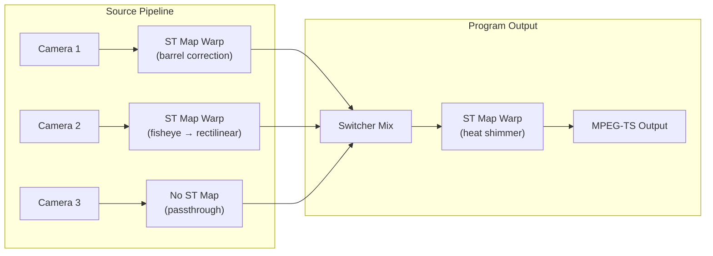
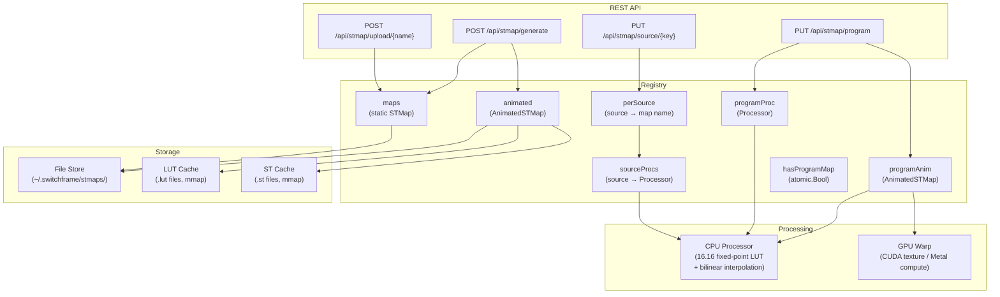
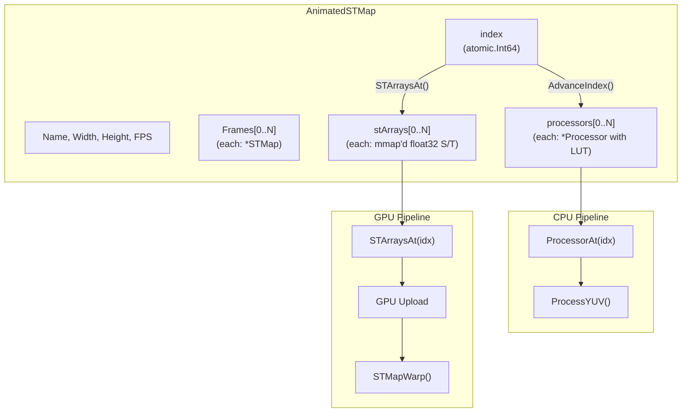
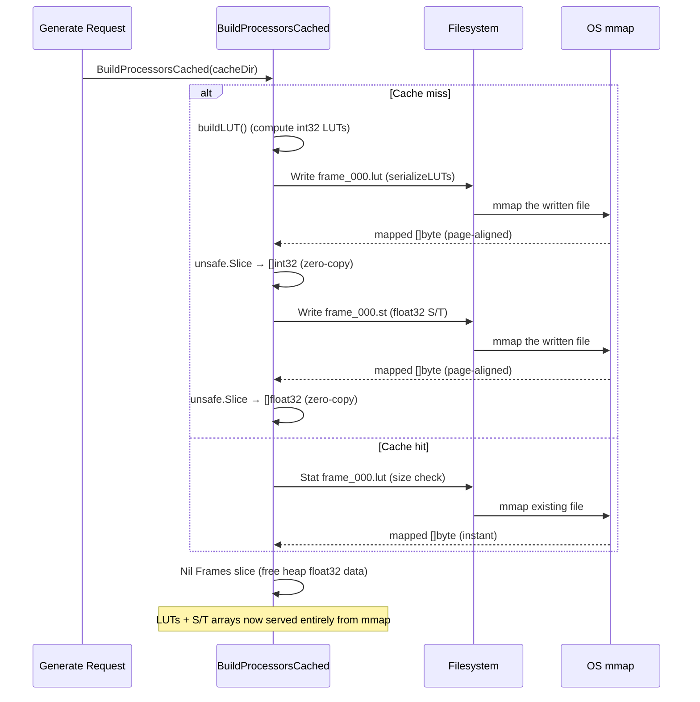

# ST Map (Per-Pixel Coordinate Remapping)

1. [Overview](#1-overview)
2. [Architecture](#2-architecture)
3. [Generators](#3-generators)
4. [File Formats](#4-file-formats)
5. [Animation](#5-animation)
6. [mmap Caching](#6-mmap-caching)
7. [REST API Reference](#7-rest-api-reference)
8. [State Broadcast](#8-state-broadcast)
9. [Performance Notes](#9-performance-notes)
10. [File Reference](#10-file-reference)

---

## 1. Overview

An ST map (also called a UV map or distortion map) is a 2D image where every pixel stores the normalized source coordinates it should sample from. The S channel (red) contains the horizontal coordinate (0.0–1.0) and the T channel (green) contains the vertical coordinate (0.0–1.0). An identity ST map maps each pixel to itself — a barrel distortion map shifts edge pixels inward, a vortex map swirls them around the center, and so on.

SwitchFrame uses ST maps for two purposes:

- **Lens correction** — Remove barrel/pincushion distortion, correct fisheye projection, or apply corner-pin perspective transforms. Applied per-source so each camera gets its own correction.
- **Creative effects** — Add heat shimmer, dream sequences, ripple effects, lens breathing, or vortex swirls to the program output. Animated ST maps cycle through frame sequences for smooth time-varying effects.

ST maps can be uploaded from external tools (Nuke, After Effects, Flame) as OpenEXR, 16-bit PNG, or raw float32 binary files. They can also be generated on the server from built-in generators with tunable parameters.



---

## 2. Architecture

The ST map system has four main components: the **Registry** (assignment state), the **Processor** (CPU warp engine), the **GPU path** (Metal/CUDA warp), and the **Store** (disk persistence).



### Registry

`Registry` is the central store for all ST maps and their assignments. It holds:

| Field | Type | Description |
|-------|------|-------------|
| `maps` | `map[string]*STMap` | Static maps by name |
| `animated` | `map[string]*AnimatedSTMap` | Animated maps by name |
| `perSource` | `map[string]string` | Source key → map name assignment |
| `sourceProcs` | `map[string]*Processor` | Cached per-source CPU processors |
| `programProc` | `*Processor` | Cached CPU processor for static program map |
| `programAnim` | `*AnimatedSTMap` | Reference for animated program map |
| `hasProgramMap` | `atomic.Bool` | Lock-free pipeline hot path check |

All mutations acquire `sync.RWMutex`. The `hasProgramMap` atomic allows the pipeline node to skip the lock entirely when no program map is active — the common case during normal operation.

State change callbacks are invoked outside the lock to prevent deadlock when the callback re-enters via `State()`.

### Processor (CPU Path)

The `Processor` precomputes 16.16 fixed-point lookup tables from the float32 ST map coordinates. The per-pixel warp hot path is integer-only — no float arithmetic at runtime.

Two sets of LUTs are maintained:

| LUT | Resolution | Purpose |
|-----|-----------|---------|
| `lutSX`, `lutSY` | Full (w×h) | Y plane coordinates |
| `lutCSX`, `lutCSY` | Half (w/2 × h/2) | Chroma plane coordinates (Cb, Cr) |

The chroma LUTs are computed by averaging the four luma ST values in each 2×2 block and converting to half-resolution pixel coordinates. This simple average introduces a theoretical 0.25-pixel horizontal chroma shift (vs. MPEG-2 left-center siting), which is visually negligible for moderate warps at 1080p.

`int32` is used for LUT values (sufficient for resolutions up to 32767px), halving LUT memory vs. `int64`: **16.6 MB** vs. **33.2 MB** at 1080p, improving CPU cache hit rate.

### GPU Path

On systems with CUDA or Metal, ST map warping runs on the GPU as a pipeline node (`gpuSTMapNode`):

- **CUDA** — Uses texture memory for hardware bilinear interpolation on the Y plane. A single `tex2D` fetch replaces 4 global memory reads + 3 multiply-adds per pixel. Falls back to global memory if texture creation fails.
- **Metal** — Compute shader with bilinear sampling (`stmap.metal`).

The GPU path uploads S/T float32 arrays to VRAM. For animated maps, pre-built mmap'd `.st` cache files provide zero-copy host-side data for upload — no runtime float32 generation.

The `gpuSTMapNode` caches uploaded GPU ST maps and only re-uploads when the map name changes (static) or the frame index advances (animated).

---

## 3. Generators

SwitchFrame includes built-in generators for common distortion corrections and creative effects. Generators are registered at init time and invoked by name via the REST API. Missing parameters use declared defaults; unknown parameters are ignored.

### Static (Correction) Generators

| Generator | Description | Parameters |
|-----------|-------------|------------|
| `identity` | No distortion (passthrough) | — |
| `barrel` | Brown-Conrady barrel distortion | `k1` (default: -0.3, range: -1 to 0), `k2` (default: 0.0, range: -1 to 1) |
| `pincushion` | Positive radial distortion | `k1` (default: 0.3, range: 0 to 1), `k2` (default: 0.0, range: -1 to 1) |
| `fisheye_to_rectilinear` | Equidistant fisheye → rectilinear projection | `fov` (default: 180°, range: 60° to 220°) |
| `corner_pin` | Four-corner bilinear perspective warp | `tl_x`, `tl_y`, `tr_x`, `tr_y`, `bl_x`, `bl_y`, `br_x`, `br_y` (each 0–1, corners default to image bounds) |

The `barrel` and `pincushion` generators share the Brown-Conrady radial model:

```
factor = 1 + k1·r² + k2·r⁴
src = center + offset · factor
```

where `r` is the normalized distance from center and `k1`/`k2` control the distortion strength.

### Animated (Creative) Generators

| Generator | Description | Parameters |
|-----------|-------------|------------|
| `heat_shimmer` | Per-row sinusoidal vertical displacement | `intensity` (default: 0.3, range: 0–1), `frequency` (default: 2.0 Hz, range: 0.5–10) |
| `dream` | Radial pull toward center with pulsing | `intensity` (default: 0.4, range: 0–1) |
| `ripple` | Concentric circular displacement from a point | `amplitude` (default: 8px, range: 1–30), `wavelength` (default: 60px, range: 10–200), `cx` (default: 0.5), `cy` (default: 0.5) |
| `lens_breathe` | Radial scale oscillation (breathing lens) | `amplitude` (default: 0.02, range: 0–0.1), `frequency` (default: 0.5 Hz, range: 0.1–5) |
| `vortex` | Angular displacement increasing with distance | `intensity` (default: 0.3, range: 0–1) |

Animated generators produce a cycle of frames (default: 90, max: 300) that loop seamlessly. All generators output at 30 fps. Frame count is configurable via the `frame_count` parameter in the generate request.

### Generator Registration

Generators use a registry pattern. Each generator registers a `GeneratorInfo` struct describing its name, description, type (`"static"` or `"animated"`), and parameter schema. The API exposes this metadata at `GET /api/stmap/generators` so the UI can render parameter editors with correct ranges and defaults.

```mermaid
flowchart LR
    subgraph registration ["init()"]
        barrel["registerGenerator<br/>(barrel, generateBarrel)"]
        shimmer["registerAnimatedGenerator<br/>(heat_shimmer, generateHeatShimmer)"]
    end

    subgraph lookup ["Generate()"]
        resolve["resolveParams<br/>(fill defaults)"]
        call["generatorFunc<br/>(params, w, h)"]
    end

    barrel --> resolve
    shimmer --> resolve
    resolve --> call
    call --> stmap["*STMap or *AnimatedSTMap"]
```

---

## 4. File Formats

ST maps can be loaded from three file formats. The upload endpoint auto-detects the format from Content-Type, file extension, or magic bytes.

### OpenEXR

The primary interchange format for ST maps in VFX workflows. SwitchFrame includes a pure Go EXR reader supporting:

| Feature | Support |
|---------|---------|
| Scanline format | Yes |
| Tiled format | No |
| Deep data | No |
| Multi-part | No |
| Compression: None | Yes |
| Compression: ZIPS (per-scanline zlib) | Yes |
| Compression: ZIP (per-16-scanline zlib) | Yes |
| Compression: PIZ, PXR24, B44, DWAA/DWAB | No |
| Pixel types: UINT, HALF, FLOAT | Yes |
| Max dimensions | 16384 × 16384 |

The R channel maps to S (horizontal) and the G channel maps to T (vertical). Channels must have 1:1 sampling.

The zlib decompression path implements OpenEXR's predictor reconstruction and byte interleave postprocessing (matching `ImfZip.cpp` in the reference implementation). A 100 MB decompression limit prevents zip bomb attacks.

### 16-bit PNG

A lower-precision alternative when EXR is unavailable. Supports:

- **NRGBA64** (16-bit non-premultiplied) — highest precision
- **RGBA64** (16-bit premultiplied) — un-premultiplied automatically
- **NRGBA** (8-bit) — accepted but with reduced precision (256 levels vs. 65536)
- **RGBA** (8-bit premultiplied) — un-premultiplied automatically

R → S, G → T. Dimensions must be positive and even (YUV420 requirement).

### Raw Float32 Binary

The native on-disk format used by the Store. Compact and lossless:

```
┌───────────────────────────────────────────────────────┐
│ Offset │ Size           │ Content                      │
│--------│----------------│------------------------------|
│ 0      │ 4 bytes        │ Width  (uint32, big-endian)   │
│ 4      │ 4 bytes        │ Height (uint32, big-endian)   │
│ 8      │ w×h×4 bytes    │ S plane (float32, LE)         │
│ 8+w×h×4│ w×h×4 bytes    │ T plane (float32, LE)         │
└───────────────────────────────────────────────────────┘
```

At 1080p: 8 + 1920×1080×4×2 = **16,588,808 bytes** (~15.8 MB).

### Format Auto-Detection

When the upload endpoint receives data without a recognized Content-Type or extension:

1. Check for EXR magic bytes (`76 2F 31 01`)
2. Try PNG decode
3. Try raw float32 binary parse

---

## 5. Animation

Animated ST maps are frame sequences that loop to produce time-varying effects. Each frame is a complete ST map at the target resolution.

### Structure



### Frame Lifecycle

1. **Generate** — `GenerateAnimated()` produces N frames of float32 S/T data
2. **Build Processors** — `BuildProcessorsCached()` converts each frame to int32 LUTs and writes cache files
3. **Free Source Data** — After caching, the float32 `Frames` slice is niled to free heap memory. LUT data is served from mmap.
4. **Runtime** — `AdvanceIndex()` atomically increments the frame counter; `ProcessorAt(idx)` returns the precomputed LUT; `STArraysAt(idx)` returns mmap'd float32 data for GPU upload

### Thread Safety

- `AdvanceIndex()` uses `atomic.Int64` — no lock contention
- `frameCount` is stored as `atomic.Int32` at construction time, safe to read before `BuildProcessors` completes
- `BuildProcessors` uses `sync.Once` — safe to call from any goroutine, guaranteed single execution

### Close Semantics

`Close()` must not be called while any goroutine is using `ProcessorAt()`. This is enforced by the Registry: `RemoveProgram()` is always called before `Delete()`, ensuring the pipeline has stopped referencing the processors before mmap regions are unmapped.

---

## 6. mmap Caching

Animated ST maps with 90+ frames at 1080p would require hundreds of megabytes of heap-allocated LUTs. The caching system uses memory-mapped files to eliminate this memory pressure and provide instant startup for previously generated maps.

### Cache Layout

```
~/.switchframe/stmap_cache/
  heat_shimmer_a1b2c3d4e5f6g7h8/    # generator_name + CacheKey hash
    frame_000.lut                     # int32 LUT data (CPU warp path)
    frame_000.st                      # float32 S/T data (GPU upload path)
    frame_001.lut
    frame_001.st
    ...
    frame_089.lut
    frame_089.st
```

### Cache Key

A deterministic 16-character hex string derived from SHA-256 of `name:width:height:frameCount` plus sorted parameter key-value pairs. Same inputs always produce the same cache key, enabling instant cache hits on server restart.

### Two Cache File Types

| Extension | Contents | Consumer | Size at 1080p |
|-----------|----------|----------|---------------|
| `.lut` | `[lutSX: w×h×int32][lutSY: w×h×int32][lutCSX: cw×ch×int32][lutCSY: cw×ch×int32]` | CPU Processor (warp kernel) | ~20.7 MB/frame |
| `.st` | `[S: w×h×float32][T: w×h×float32]` | GPU pipeline (VRAM upload) | ~15.8 MB/frame |

### How mmap Works in This System



On cache hit, `NewProcessorCached` skips LUT computation entirely — the mmap'd file is the LUT. The `unsafe.Slice` reinterpretation creates Go slice headers pointing directly into the mapped region with no data copying. This relies on all target platforms (linux/amd64, linux/arm64, darwin/arm64) being little-endian.

---

## 7. REST API Reference

All endpoints are registered when the ST map registry is initialized.

### Map Management

| Method | Path | Description |
|:------:|------|-------------|
| GET | `/api/stmap` | List all stored map names |
| GET | `/api/stmap/state` | Current assignments (sources, program, available) |
| GET | `/api/stmap/generators` | All generators with parameter schemas |
| POST | `/api/stmap/generate` | Generate a new map from a built-in generator |
| POST | `/api/stmap/upload/{name}` | Upload an ST map file (EXR, PNG, or raw) |
| GET | `/api/stmap/{name}` | Metadata for a stored map |
| DELETE | `/api/stmap/{name}` | Delete a stored map |
| GET | `/api/stmap/{name}/download` | Download as raw float32 binary |

### Assignment

| Method | Path | Description |
|:------:|------|-------------|
| PUT | `/api/stmap/source/{sourceKey}` | Assign a map to a source |
| DELETE | `/api/stmap/source/{sourceKey}` | Remove a source's map assignment |
| PUT | `/api/stmap/program` | Assign a map to the program output |
| DELETE | `/api/stmap/program` | Remove the program map assignment |

### Generate Request

```json
{
  "type": "barrel",
  "name": "cam1_correction",
  "params": {"k1": -0.25, "k2": 0.05},
  "width": 1920,
  "height": 1080,
  "assign_source": "cam1",
  "assign_program": false,
  "frame_count": 90
}
```

| Field | Type | Required | Description |
|-------|------|:--------:|-------------|
| `type` | string | Yes | Generator name (static or animated) |
| `name` | string | Yes | Map name (must pass `ValidateName`: no `/`, `\`, `.`, `..`) |
| `params` | object | No | Generator parameters (missing → defaults) |
| `width` | int | No | Width in pixels (default: pipeline format width) |
| `height` | int | No | Height in pixels (default: pipeline format height) |
| `assign_source` | string | No | Immediately assign to this source key |
| `assign_program` | bool | No | Immediately assign to program output |
| `frame_count` | int | No | Frames for animated generators (default: 90, max: 300) |

For animated generators, processors are pre-built in the HTTP handler goroutine (with mmap caching if `stmapCacheDir` is set) to avoid freezing the video pipeline on first use.

**Response** (201 Created):

```json
{
  "name": "cam1_correction",
  "width": 1920,
  "height": 1080,
  "type": "static"
}
```

For animated maps, the response includes `"frame_count"`.

### Upload Request

`POST /api/stmap/upload/{name}` with the file as the request body.

Format detection priority:
1. `Content-Type: image/x-exr` or `.exr` extension → EXR
2. `Content-Type: image/png` or `.png` extension → PNG
3. `.stmap` extension → raw float32
4. Auto-detect: magic bytes → EXR, else try PNG, else try raw

Maximum upload size: **64 MB**.

### Assign Source

```bash
curl -X PUT https://localhost:8080/api/stmap/source/cam1 \
  -H "Content-Type: application/json" \
  -d '{"map": "barrel_correction"}'
```

Returns the full `STMapState` snapshot.

### Assign Program

```bash
curl -X PUT https://localhost:8080/api/stmap/program \
  -H "Content-Type: application/json" \
  -d '{"map": "heat_shimmer"}'
```

Returns the full `STMapState` snapshot.

---

## 8. State Broadcast

ST map state is included in `ControlRoomState` and pushed to browsers via the MoQ control track after every mutation.

```typescript
interface STMapState {
  sources: Record<string, string>;    // source key → map name
  program?: {
    map: string;                       // map name
    type: "static" | "animated";
    frame: number;                     // current frame index (animated only)
  };
  available: string[];                 // all stored map names (sorted)
}
```

The `onStateChange` callback is set by the application at startup and fires after every `Store`, `StoreAnimated`, `AssignSource`, `RemoveSource`, `AssignProgram`, `RemoveProgram`, and `Delete` operation on the registry.

---

## 9. Performance Notes

### CPU vs. GPU

| Metric | CPU (amd64 asm) | CPU (arm64 asm) | CPU (generic Go) | GPU (CUDA texture) | GPU (Metal) |
|--------|:-:|:-:|:-:|:-:|:-:|
| Warp kernel | SIMD + prefetch | NEON + PRFM | Scalar Go | tex2D (HW bilinear) | Compute shader |
| Memory access | Random (L2/L3 misses) | Random (PRFM prefetch) | Random | Texture cache (spatial locality) | Texture sampler |
| Parallelism | Single-threaded (sequential planes) | Single-threaded | Single-threaded | Thread-per-pixel | Thread-per-pixel |

Sequential single-threaded processing was chosen for the CPU path after profiling showed goroutine parallelism (both 4-worker Y-plane splits and per-plane parallel) added 7–10 ms/frame of pthread_cond sync overhead under production load, negating any speedup.

### mmap Benefits

| Scenario | Without mmap | With mmap |
|----------|:------------:|:---------:|
| 90-frame animated map at 1080p (LUT memory) | ~1.86 GB heap | ~1.86 GB mmap (no GC pressure) |
| Startup with cached maps | Recompute all LUTs (~5 ms × 90 = 450 ms) | Instant (mmap existing files) |
| GPU upload source data | Regenerate float32 from formula | Zero-copy from .st files |
| GC impact | Large heap → longer GC pauses | Page-managed by OS, invisible to GC |

### SIMD Warp Kernels

The warp kernel (`warpBilinearRow`) has three implementations:

- **amd64** — Assembly with software prefetching to hide memory latency from random source pixel access patterns
- **arm64** — Assembly with NEON PRFM prefetch instructions
- **generic** — Pure Go fallback for other platforms

All three share the same function signature and are selected at compile time via build tags.

### LUT Sizing

| Resolution | Y LUT (lutSX + lutSY) | Chroma LUT (lutCSX + lutCSY) | Total per frame |
|------------|:---------------------:|:----------------------------:|:---------------:|
| 720p (1280×720) | 7.0 MB | 1.8 MB | 8.8 MB |
| 1080p (1920×1080) | 15.8 MB | 4.0 MB | 19.8 MB |
| 4K (3840×2160) | 63.3 MB | 15.8 MB | 79.1 MB |

---

## 10. File Reference

| File | Description |
|------|-------------|
| `server/stmap/types.go` | `STMap`, `AnimatedSTMap`, `ValidateName`, sentinel errors |
| `server/stmap/processor.go` | `Processor`: LUT build, `ProcessYUV` warp, `warpPlane` dispatch |
| `server/stmap/processor_cache.go` | `NewProcessorCached`: mmap-backed LUT persistence, `Close` |
| `server/stmap/registry.go` | `Registry`: store, assign, delete, state snapshot, atomic program check |
| `server/stmap/store.go` | `Store`: file-based persistence (`.stmap`, `.stmap-anim.json`) |
| `server/stmap/generator.go` | Generator registry, `Generate`, `GenerateAnimated`, parameter resolution |
| `server/stmap/generator_correction.go` | Static generators: identity, barrel, pincushion, fisheye, corner_pin |
| `server/stmap/generator_creative.go` | Animated generators: heat_shimmer, dream, ripple, lens_breathe, vortex |
| `server/stmap/exr.go` | Pure Go OpenEXR reader (scanline, ZIP/ZIPS, UINT/HALF/FLOAT) |
| `server/stmap/png.go` | 16-bit PNG reader (NRGBA64, RGBA64, NRGBA, RGBA, generic fallback) |
| `server/stmap/raw.go` | Raw float32 binary reader/writer |
| `server/stmap/cache_key.go` | `CacheKey`: deterministic SHA-256 hash, `DirComplete` |
| `server/stmap/st_cache.go` | `loadOrWriteSTCache`: mmap'd float32 S/T arrays for GPU path |
| `server/stmap/warp_kernels_amd64.s` | amd64 assembly bilinear warp with prefetch |
| `server/stmap/warp_kernels_arm64.s` | arm64 assembly bilinear warp with PRFM prefetch |
| `server/stmap/warp_kernels_generic.go` | Pure Go bilinear warp fallback |
| `server/control/api_stmap.go` | REST API handlers (12 endpoints) |
| `server/gpu/stmap.go` | CUDA: `GPUSTMap`, `UploadSTMap`, `STMapWarp` (texture + global mem) |
| `server/gpu/metal_stmap.go` | Metal: ST map warp compute dispatch |
| `server/gpu/node_stmap.go` | GPU pipeline node: `gpuSTMapNode` (static + animated caching) |
| `server/gpu/metal/stmap.metal` | Metal compute shader for ST map warp |
| `server/gpu/cuda/stmap.cu` | CUDA kernel for ST map warp (texture + global memory paths) |

---

*See also: [Architecture](architecture.md) · [Pipeline](pipeline.md) · [API Reference](api.md) · [Deployment](deployment.md)*
