# Audio Mixer

> **Where you are:** [docs](../README.md) → subsystems → audio
> **Read this first:** [architecture.md](../architecture.md)
> **See also:** [captions](captions.md) · [comms](comms.md) · [pipeline](../concepts/pipeline.md) · [output](output.md) · [mxl](mxl.md)

**TL;DR** The audio mixer is a clock-driven multi-source mixing engine that runs on its own ticker at roughly one AAC frame per tick (~21.3 ms at 48 kHz). Each source has a processed PCM ring buffer populated by the ingest path — the ticker pops exactly 1024 samples per frame, applies fader and crossfade gains, sums them into a single mix bus, and then runs master gain, BS.1770-4 LUFS metering, a brickwall limiter at -1 dBFS, and FDK-AAC encoding before handing the finished frame to the output callback. The pipeline is clock-driven so audio output is independent of how bursty the source frames arrive over SRT or MoQ, and so it stays aligned with video by seeding PTS from the first video frame and gently nudging toward wall-clock afterward.

## The story

In a live video switcher, audio has to hold together in two directions at once. Upstream, sources arrive bursty — SRT pushes four or five AAC frames in quick succession and then goes quiet, browser-to-server uploads deliver Opus at the mercy of ScriptProcessorNode, and MXL hands over raw PCM on a completely different cadence. Downstream, the MPEG-TS muxer, the SRT caller, and the MXL shared-memory writer all want a frame every 21.3 ms like clockwork. A naive "decode-then-output" pipeline would collapse as soon as the input rate drifted.

The mixer solves that by decoupling ingest from output. When a source frame shows up, the ingest path runs the full per-channel signal chain (trim, phase, high-pass, gate, EQ, compressor, balance) and stuffs the processed PCM into a per-source ring buffer. A separate ticker goroutine wakes every AAC frame, reads 1024 samples from each active buffer, sums them, applies master processing, and encodes. The sources can arrive whenever they want; the output stays on time.

This decoupling also makes the rest of the system easier. Transitions can ask the mixer "fade source A out and source B in over 4 frames" without worrying about how many AAC frames have actually arrived from either side. AFV (audio-follows-video) can flip active channels on a cut without glitches. The limiter and LUFS meter see a steady stream of real samples. And when a source goes silent, the ring buffer returns zeros instead of repeating stale PCM — less audible than a robotic freeze-repeat.

## How it works

```mermaid
flowchart LR
    subgraph ingest ["Ingest (bursty, per-source)"]
        IF["IngestFrame<br/>(AAC)"]
        IP["IngestPCM<br/>(raw, MXL)"]
        DEC["FDK AAC<br/>Decoder"]
        RS["Resampler<br/>(Kaiser sinc)"]
        DB["DelayBuffer<br/>(lip-sync)"]
        CH["Per-channel chain:<br/>trim -> phase -> HPF<br/>-> gate -> EQ<br/>-> compressor -> balance"]
        RB["PCMRingBuffer<br/>(processed)"]

        IF --> DEC --> RS --> DB --> CH --> RB
        IP --> RS
    end

    subgraph tick ["Output Ticker (~21.3ms)"]
        POP["Pop 1024 samples<br/>PopDriftCompensated"]
        GAIN["Apply fader +<br/>crossfade gain"]
        SUM["Sum into<br/>mix accumulator"]
        STG["Stinger overlay<br/>(optional)"]
        MG["Master gain"]
        LU["BS.1770-4<br/>LUFS meter"]
        LIM["Brickwall limiter<br/>(-1 dBFS)"]
        MXL["MXL raw tap<br/>(optional)"]
        ENC["FDK AAC encode<br/>(1024 samples)"]
        OUT["Output callback"]

        POP --> GAIN --> SUM --> STG --> MG --> LU --> LIM --> MXL --> ENC --> OUT
    end

    RB -.->|per active channel| POP
```

**Ingest path.** [`Mixer.IngestFrame`](../../server/audio/mixer_ingest.go) is the entry point for AAC sources (MoQ, SRT). It lazily initializes a per-channel FDK decoder, strips ADTS framing, decodes to `float32`, compensates for AAC priming-frame skew (FDK-AAC-LC silently discards 1–2 MDCT warmup frames, which the mixer pre-pads with silence so the ring-buffer timeline matches the source timeline), and runs the per-channel DSP chain. [`Mixer.IngestPCM`](../../server/audio/mixer_ingest.go) is the sibling entry point for sources that arrive as raw interleaved `float32` — primarily MXL shared-memory flows — and skips the AAC/ADTS steps. Both paths honor audio-forward routing for playout channels, deep-copying the payload to avoid aliasing.

**Per-source processing chain.** Each `Channel` carries its own DSP stack, configured live via `SetTrim`, `SetLevel`, `SetHPF`, `SetGate`, `SetEQ`, `SetCompressor`, `SetBalance`, `SetPhaseInvert`, and `SetAudioDelay`. The order is fixed: trim → phase invert → high-pass → gate → EQ → compressor → balance → ring buffer. Fader gain and transition crossfade gain are applied later, at read time by the ticker, because they can change faster than a source can deliver frames.

**The ring buffer.** [`PCMRingBuffer`](../../server/audio/ringbuf.go) is a sample-level circular buffer sized at `10 * 1024 * channels` samples. `Push` is newest-wins (overflow drops the oldest samples); `Pop` returns exactly N samples, zero-filling when starved; `PopDriftCompensated` is the production read path used by the ticker. Drift compensation is subtle: if the buffer depth exceeds a target of 2 AAC frames by more than 1 frame of hysteresis, the pop consumes one extra sample-frame; if it's below by more than the hysteresis, it consumes one fewer. That ±1 frame is absorbed by linear interpolation so the caller always gets exactly N samples. At 48 kHz this is a ±20 µs nudge per frame — completely inaudible, but it keeps push and pop rates aligned even when source clocks drift a few ppm from the server clock.

**Sample-rate conversion.** `Mixer.resampleIfNeeded` lazy-creates a [`Resampler`](../../server/audio/resample.go) per channel when the source rate doesn't match the mixer rate. The resampler is a polyphase FIR with a Kaiser-windowed sinc prototype (β=10 for ~100 dB stopband attenuation, far below audibility). Taps-per-phase are computed from the actual rate pair's transition band width using the Kaiser length formula — a 44.1→48 kHz conversion gets a tighter filter than a 16→48 kHz conversion because the narrower transition band demands more taps. State is preserved across calls so consecutive blocks chain without discontinuities.

**The output ticker.** [`Mixer.outputTicker`](../../server/audio/mixer_ticker.go) is one goroutine that wakes every `1024 / sampleRate` seconds — about 21.3 ms at 48 kHz. Each tick calls `tick()`, which in turn calls `produceSamplesLocked` ([mixer_mix.go](../../server/audio/mixer_mix.go)) to read from every active channel and sum, then `applyMasterChain` to run master gain, LUFS, limiter, program mute, and peak metering, then the FDK encoder. The finished `media.AudioFrame` goes to the registered output callback and, if set, a direct-delivery callback for the MPEG-TS muxer (atomic pointer, no lock). When `ClockDriven: true` is passed in `MixerConfig`, the internal ticker is skipped entirely and an external reference clock drives output via `ProduceSamples` instead — used by the synchronous multi-region processing path.

**Crossfades.** Audio must follow video transitions. A cut triggers a 4-tick (~85 ms) crossfade via `OnCut`, AFV program changes use the same mechanism via `OnProgramChange`, and video transitions call `OnTransitionStart` / `OnTransitionPosition` / `OnTransitionComplete` to drive multi-frame crossfades with a selectable curve (`Crossfade` equal-power cos/sin, `DipToSilence`, `FadeOut`, `FadeIn`). Inside the mix loop, each tick interpolates the gain linearly across the frame's sample pairs so L/R stay phase-aligned; at transition boundaries the mixer flushes the incoming source's ring buffer so stale pre-transition audio doesn't bleed through. Stinger audio ([`SetStingerAudio`](../../server/audio/mixer.go)) overlays additively, with 10 ms fade-in and 50 ms fade-out envelopes to prevent clicks, and is resampled to the mixer rate on assignment.

**The master chain.** After mixing, `applyMasterChain` runs master fader gain (SIMD-accelerated via `vec.ScaleFloat32`), then the BS.1770-4 [`LoudnessMeter`](../../server/audio/loudness.go), then the [`Limiter`](../../server/audio/limiter.go), then the optional MXL raw tap, then program mute (FTB), then a 5 ms fade-in ramp on unmute to keep the freshly-reset limiter from punching through, then peak metering. MXL gets PCM *before* the AAC encoder so shared-memory consumers see the same mix the broadcast output does, untouched by codec artifacts.

**LUFS metering.** The [`LoudnessMeter`](../../server/audio/loudness.go) implements ITU-R BS.1770-4 compliant loudness measurement. Each channel runs through a two-stage K-weighting filter (a pre-filter high-shelf around 1.5 kHz plus an RLB high-pass around 38 Hz) computed from the sample rate via the bilinear transform. 100 ms blocks accumulate weighted squared energy; a 4-block ring gives the momentary (400 ms) reading, a 30-block ring gives short-term (3 s), and an append-only list provides gated integrated loudness with the spec's -70 LUFS absolute gate and relative -10 LU gate. Integrated LUFS is amortized — full recomputation runs every N blocks (1 / 10 / 100 based on list size) to avoid O(n²) work on long sessions, and the integrated block list is capped at 360,000 blocks (~10 hours) with old blocks halved away when the cap is hit. All three readouts are cached as atomic `float64` bits for lock-free reads from the control plane.

**Limiter.** The [`Limiter`](../../server/audio/limiter.go) is a brickwall peak limiter defaulting to -1 dBFS with a 0.1 ms attack and 50 ms release. It runs a linked-stereo peak envelope detector per sample-frame: if the envelope exceeds the target (threshold or ceiling, whichever is lower) the per-sample gain is `target/envelope`, clamped in-place to guarantee nothing leaves above the ceiling. Gain reduction is stored as an atomic `float64` bits so the control plane can read it without touching the envelope state.

**Three-band EQ and compressor.** [`EQ`](../../server/audio/eq.go) is three parametric bands (low 80–1000 Hz, mid 200–8000 Hz, high 1000–16000 Hz) using RBJ Audio EQ Cookbook peakingEQ coefficients in a Direct Form II Transposed biquad. Parameters and coefficients live in an `atomic.Pointer[eqParams]` snapshot that's replaced wholesale on each `SetBand` — `Process` loads it once per call. Crucially, the filter state (`s1`, `s2`) is *not* reset on coefficient change: the biquad converges to the new response within ~10 samples on its own, which is sonically smoother than the click you'd get from zeroing state. A `denormalGuard` DC offset (1e-25) is injected and removed per sample to keep the biquad out of denormal territory during silence, where the CPU can slow down 10–100× on x86 handling subnormal floats. [`Compressor`](../../server/audio/compressor.go) is a single-band dynamics processor with an exponential envelope follower and a 256-entry gain table indexed by dB-over-threshold — the table collapses the `pow(10, -reduction/20)` into a lookup. Linked stereo: the peak driving the envelope is the max across channels, so L and R compress together and don't image-shift. Gain reduction is atomic for metering.

**Lip-sync delay.** [`DelayBuffer`](../../server/audio/delay_buffer.go) is a fixed 32-slot circular buffer of `*media.AudioFrame` with wall-clock timestamps. At 0 ms delay it's a pass-through with no allocation; at up to 500 ms it stores frames and releases them when the oldest has aged past the configured delay. Per-source, configured via `Mixer.SetAudioDelay`.

**PTS and video alignment.** Audio PTS is *not* derived from input AAC PTS. Instead, `Mixer.SeedPTSFromVideo` takes the first video frame's PTS and records it with wall-clock time; subsequent frames advance by exactly one AAC frame duration (1024 × 90000 / sampleRate ticks), with a gentle wall-clock resync that adds or subtracts half a frame duration if drift exceeds ±1 frame. Audio frames arrive before video during FFmpeg probe, so the video seed is authoritative and overrides any earlier self-seeding. This keeps A/V PTS aligned across gaps; during a fade-to-black or source loss, the wall-clock resync prevents audio from drifting ahead. The muxer consumes `Mixer.RingBufferLatency90k()` as a dynamic lip-sync offset, since the audio ring buffer adds FIFO latency that the video path (newest-wins frame sync) doesn't have.

**FDK-AAC via direct cgo.** Both the decoder ([`fdk_decoder.go`](../../server/audio/fdk_decoder.go)) and encoder ([`fdk_encoder.go`](../../server/audio/fdk_encoder.go)) are thin Go wrappers around inline C that calls `libfdk-aac` directly — no intermediate library. The encoder uses AAC-LC with ADTS transport, auto-selects ~64 kbps per channel, and enables the FDK afterburner for better quality. Both reuse internal buffers to eliminate per-frame allocations. The first call to the encoder (done in `ensureEncoder`) is primed with 1024 samples of silence so the MDCT warmup transient doesn't become an audible pop at the passthrough→mix boundary. cgo link directives live in a separate [`fdk_cgo.go`](../../server/audio/fdk_cgo.go) to avoid duplicate-library link warnings.

**SIMD.** The [`audio/vec`](../../server/audio/vec/) subpackage provides `AddFloat32`, `ScaleFloat32`, `MulAddFloat32`, `PeakAbsFloat32`, and `PeakAbsStereoFloat32` with amd64 and arm64 hand-tuned assembly and a generic Go fallback. The assembly lives in a separate Go package because cgo (FDK-AAC link directives) and Go assembly cannot coexist in the same package.

## Key types and entry points

- Entry: [`server/audio/mixer.go`](../../server/audio/mixer.go) → `NewMixer()`, `IngestFrame()`, `IngestPCM()`, `ProduceSamples()`, `OnCut()`, `OnTransitionStart()`, `SeedPTSFromVideo()`
- Config: [`MixerConfig`](../../server/audio/mixer.go) — sample rate, channels, output callback, decoder/encoder factories, `ClockDriven` flag
- Per-source: [`Channel`](../../server/audio/mixer.go) — trim/level/mute/AFV state, lazy FDK decoder, HPF/gate/EQ/compressor/balance/delay, `PCMRingBuffer`, reusable scratch buffers
- Master chain: [`Mixer.applyMasterChain`](../../server/audio/mixer_mix.go) — gain, LUFS, limiter, MXL tap, mute, ramp, metering
- Ticker: [`Mixer.outputTicker`](../../server/audio/mixer_ticker.go) / [`Mixer.tick`](../../server/audio/mixer_ticker.go) → [`Mixer.produceSamplesLocked`](../../server/audio/mixer_mix.go)
- Ring buffer: [`PCMRingBuffer.PopDriftCompensated`](../../server/audio/ringbuf.go) — exact-N reads with ±1-frame drift steering
- State: `Mixer.channels` guarded by `Mixer.mu`; transition state (`transCrossfade*`, `cutFramesRemaining`) also under `mu`; gain reduction, LUFS readouts, output-frame counters, and ring-buffer latency all atomic for lock-free metering reads
- Codecs: [`FDKDecoder`](../../server/audio/fdk_decoder.go), [`FDKEncoder`](../../server/audio/fdk_encoder.go) — direct cgo wrappers around `libfdk-aac`
- Master bus: [`Limiter`](../../server/audio/limiter.go), [`LoudnessMeter`](../../server/audio/loudness.go)
- Per-channel DSP: [`HPF`](../../server/audio/hpf.go), [`Gate`](../../server/audio/gate.go), [`EQ`](../../server/audio/eq.go), [`Compressor`](../../server/audio/compressor.go), [`BalanceGains`](../../server/audio/balance.go), [`DelayBuffer`](../../server/audio/delay_buffer.go), [`Resampler`](../../server/audio/resample.go)
- Utility: [`PeakLevel`](../../server/audio/metering.go), [`LinearToDBFS`](../../server/audio/metering.go), [`EqualPowerCrossfadeRanged`](../../server/audio/crossfade.go), [`DBToLinear`](../../server/audio/mixer.go)
- SIMD kernels: [`server/audio/vec/`](../../server/audio/vec/)

## Gotchas and invariants

- **Ingest push order: decode → priming compensation → resample → mute check → chain → ring buffer push.** The priming compensation runs once per channel, the first time the decoder emits non-empty PCM, and pushes one AAC-frame of silence per previously-observed empty priming frame. This keeps the ring-buffer timeline aligned with the source wall clock; without it, valid PCM lands early and audio plays ahead of video.
- **Muted channels skip ring-buffer push entirely** and compute peaks only, so there's no unmute crossfade and no stale buffer to flush — unmute starts clean on the next frame.
- **Inactive (non-AFV) channels still push to the ring buffer in the PCM path.** The buffer is kept primed so that activation via AFV doesn't start from an empty ring. `tick()` reads only from active channels, so inactive data isn't mixed.
- **Transition flush is mandatory.** `OnCut` and `OnTransitionStart` both call `ch.ringBuf.Reset()` on the incoming source. Without the flush, stale audio buffered before the transition (potentially hundreds of milliseconds old) would play out during the fade-in and cause audible A/V desync.
- **Fader gain and crossfade gain are applied by the ticker at read time, not by the ingest path.** This is why per-channel PCM stored in `lastDecodedPCM` is pre-fader/pre-transition — it represents the processed-but-unfaded state and is used for instant-crossfade recovery from rapid source changes.
- **Biquad filter state is not reset on coefficient change.** The EQ, HPF, and loudness K-weighting filters all rely on the fact that a biquad naturally converges to a new response within ~10 samples; zeroing `s1`/`s2` would cause a step discontinuity. `Reset()` is only called on explicit lifecycle events (program mute, `LoudnessMeter.Reset`).
- **LUFS Reset is two-phase.** The public `Reset` clears atomic readouts immediately (for responsive metering) and sets a `pendingReset` atomic flag; the actual filter/accumulator clearing runs inside `Process` on the next call, preserving the "filter state is single-writer" invariant.
- **AAC priming**: both decoder and encoder need MDCT warmup. The decoder silently returns `nil, nil` for the first 1–2 frames (the mixer counts these and pre-pads silence in the ring buffer). The encoder is primed in `ensureEncoder()` with a silent 1024-sample frame whose output is discarded.
- **PTS masking.** `advanceOutputPTS` formerly ANDed the PTS with `0x1FFFFFFFF` (33 bits) for legacy passthrough paths where no seed has arrived; the main path leaves the PTS unmasked and relies on the MPEG-TS muxer to rebase and wrap, so the audio PTS can grow monotonically and track the video seed cleanly across long sessions.
- **Ring-buffer latency is a lip-sync offset, not a bug.** The audio path's 2-frame buffer target adds ~43 ms of FIFO latency; the video path doesn't have an equivalent buffer. The muxer reads `Mixer.RingBufferLatency90k()` every frame and subtracts it from the video PTS to keep A/V aligned on output.
- **Close is idempotent and careful about lock ordering.** `sync.Once` wraps shutdown; decoders are collected under `m.mu` and then closed outside the lock so cgo calls can't block the mixer, and the ticker is given 5 s to exit before shutdown continues.
- **Program mute is more than "zero the buffer".** It also resets the limiter and each compressor / gate so envelopes don't start from stale values on unmute; a 5 ms linear ramp smooths the unmute, preventing the "uncompressed burst" you'd otherwise get on the first sample.
- **The `audio/vec` package is separate from `audio/` because cgo and Go assembly can't coexist.** Don't fold it back in.

## Related docs

- **Concepts:** [pipeline](../concepts/pipeline.md) · [frame-sync-and-timing](../concepts/frame-sync-and-timing.md) · [locking-and-concurrency](../concepts/locking-and-concurrency.md) · [media-path](../concepts/media-path.md)
- **Reference:** [api](../reference/api.md) · [state-broadcast](../reference/state-broadcast.md) · [metrics](../reference/metrics.md) · [config-and-flags](../reference/config-and-flags.md)
- **Subsystems:** [captions](captions.md) · [comms](comms.md) · [switcher](switcher.md) · [transition](transition.md) · [output](output.md) · [srt-ingest](srt-ingest.md) · [mxl](mxl.md) · [codec](codec.md) · [playout](playout.md)
- **Integration:** [ui-server-contract](../integration/ui-server-contract.md) · [asr-sidecar](../integration/asr-sidecar.md)
- **Operations:** [deployment](../operations/deployment.md)
