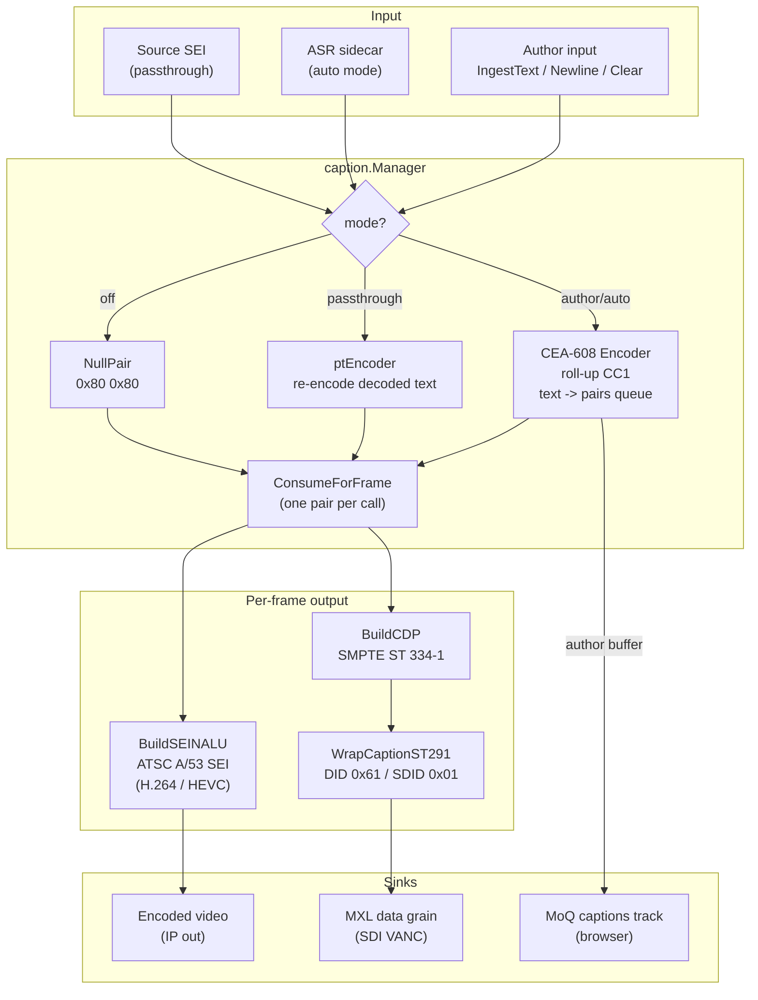

# Closed Captions

> **Where you are:** [docs](../README.md) → subsystems → captions
> **Read this first:** [architecture.md](../architecture.md)
> **See also:** [audio](audio.md) · [comms](comms.md) · [codec](codec.md) · [mxl](mxl.md) · [output](output.md)

**TL;DR** The caption subsystem runs a small state machine with four modes — off, pass-through, author, and auto — and every video frame it emits exactly one CEA-608 cc_data pair. Authored text runs through a CEA-608 encoder that produces roll-up byte pairs with odd parity, rate-limited to one pair per frame (~60 displayable characters per second). Each pair is wrapped into an ATSC A/53 `user_data_registered_itu_t_t35` SEI message and injected into the H.264 or HEVC Annex B bitstream just before the first VCL NALU of every access unit. For MXL SDI output the same pair is also packed into a SMPTE ST 334-1 Caption Distribution Packet and wrapped as an ST 291 VANC ancillary-data packet. Even in "off" mode a null pair `0x80 0x80` is emitted every frame so that downstream decoders detect caption carriage from the very first frame.

## The story

Closed captions are one of those features where the hard part isn't what it looks like. The information density is trivial — two bytes per frame, most of which are often padding. What makes it tricky is that the captions have to look continuous and correct *to downstream equipment that's deliberately picky*. A CEA-608 decoder in an Evertz or Harmonic box doesn't just look for text; it scans every access unit for the ATSC A/53 SEI, and if it doesn't see that SEI continuously from the first frame, it assumes the stream doesn't carry captions at all. If the SEI turns up ten seconds later, the decoder may never pick it up — or worse, may latch onto a stale channel from a previous source.

So the caption manager's job is to *always* produce a pair, even when nobody's captioning anything. Off mode emits a null pair. Pass-through mode re-encodes the decoded text through its own CEA-608 encoder (rather than trusting bytes from the source) so every pair carries correct parity and control codes. Author mode queues operator text. The encoder rate-limits at one pair per frame, and the manager's `ConsumeForFrame` always returns *some* pair — either a real one from the queue, or the null pair.

The second half of the job is wrapping that pair for the specific transport. For IP output (MoQ, SRT, recording) the wrapping is an H.264 SEI NALU with ATSC A/53 payload, inserted before the first VCL NALU of every access unit by the encode node's Annex B post-processor. For MXL SDI output the same pair becomes a SMPTE ST 334-1 Caption Distribution Packet — a format that carries 608 pairs inside a 708-friendly envelope — and gets wrapped as an ST 291 VANC packet with DID 0x61 / SDID 0x01 and written as an MXL data grain. Both paths pull from the same source of truth: `Manager.ConsumeForFrame`.

One invariant is worth internalizing: every frame emits exactly one pair. Not zero. Not two. Queue drain is paced one-per-frame so character animation (roll-up scrolls line by line as the text streams) happens at the speed viewers expect, and the byte stream matches the 29.97 fps rate CEA-608 assumes.

## How it works

**Modes.** [`caption.Mode`](../../server/caption/types.go) — `ModeOff`, `ModePassThrough`, `ModeAuthor`, `ModeAuto`. `SetMode` resets both encoders and clears the author buffer, so mode transitions don't leak half-queued pairs from the previous mode. Off still emits a null pair every frame for the reasons given above.

**The encoder.** [`caption.Encoder`](../../server/caption/encoder.go) is a CEA-608 CC1 roll-up encoder with a byte-pair queue. On first use `ensureInit` pushes the roll-up command (sent twice per spec) and a PAC (Preamble Address Code) positioning the cursor at row 14 — the safe-area bottom row where most broadcast captions live. `IngestText` decodes the input rune-by-rune through a rune table ([`rune_table.go`](../../server/caption/rune_table.go)) that maps Unicode to basic CEA-608 bytes, ASCII sequences, two-byte special/extended codes, or — for anything outside the spec's Latin coverage — a `?` substitution with a rate-limited warning. Odd parity is applied to every byte (bit 7 set to produce an odd count of 1-bits) because CEA-608 was designed for NTSC line-21 analog transport where a wrong parity bit meant dropped data. There's one subtle piece: two-byte special/extended codes (prefix 0x11/0x12/0x13 in byte 0) must land in a single transmitted pair — a conformant decoder identifies them by inspecting byte 0, so if the prefix lands in byte 1 of a pair the code gets dropped or rendered as garbage. The encoder's pair-aware packer detects this and inserts a 0x80 alignment pad when needed. `IngestNewline` emits a CR (sent twice), and `Clear` emits Erase Displayed Memory (sent twice).

**Per-frame consumption.** [`Manager.ConsumeForFrame`](../../server/caption/manager.go) returns a slice containing exactly one pair — a real pair from the active encoder queue, or the null pair if the queue is empty. The switcher calls this once per program frame. `ConsumeForFrameWithVANC` also dispatches to the registered VANC sink; the sink is captured under lock and then called after the lock is released to avoid blocking other manager operations.

**SEI injection.** [`caption.BuildSEINALU`](../../server/caption/sei.go) constructs a full SEI NALU in ATSC A/53 format. The payload layout is `[country_code 0xB5][provider_code 0x0031 ATSC]["GA94"][user_data_type 0x03 cc_data][cc_count byte with process flags][em_data 0xFF][cc_data triples][marker 0xFF]`. Each input pair becomes two triples: a field-1 data triple with `cc_valid=1, cc_type=00` and a field-2 null triple with `cc_valid=0, cc_type=01`. The field-2 null is important — without it, broadcast VANC receivers may falsely activate CC2 rendering from uninitialized bytes. Emulation prevention bytes (0x03) are inserted where the payload contains `00 00 {00,01,02,03}` patterns — the state machine tracks *output* zero runs, not input zero runs, because a newly-inserted 0x03 resets the run. Codec selection is variadic: `"h265"` produces a two-byte HEVC PREFIX_SEI header, anything else produces the one-byte H.264 SEI header.

**Insertion position.** [`caption.InsertSEIBeforeVCLInto`](../../server/caption/sei.go) walks the Annex B bitstream to find the first VCL NALU and splices the caption SEI in just before it. For H.264 the VCL types are 1 (non-IDR slice), 2–4 (data partitions), and 5 (IDR); for HEVC they're 0–31 (type extracted as `(byte >> 1) & 0x3F`). The function is alias-safe: if the destination buffer shares a backing array with the input Annex B data it allocates a fresh slice to prevent the overlapping copy from corrupting itself. This is how captions ride every access unit without rewriting the encoder.

**pic_timing SEI companion.** [`caption.PicTimingConfig`](../../server/caption/pic_timing.go) and `BuildPicTimingSEI` produce a companion `pic_timing` SEI (`payload_type=1`) that's required by broadcast-compliant decoders to precede the caption SEI in the same access unit. NVENC and x264 with `nal-hrd=cbr` both emit HRD parameters that make `cpb_removal_delay_length=24` and `dpb_output_delay_length=24` the safe defaults. Timecode injection writes SMPTE 12M timecode via a `clock_timestamp` structure derived from the pipeline's frame rate. HEVC uses a separate `time_code` SEI (payload type 136) rather than carrying the clock timestamp inside `pic_timing`. pic_timing is configured independently of the caption feature — it's a general-purpose encoder-output requirement — but lives in the caption package because the two SEIs are always built together.

**MXL VANC output.** [`caption.BuildCDP`](../../server/caption/vanc.go) builds a Caption Distribution Packet per SMPTE ST 334-1: a header with magic `0x96 0x69`, a frame-rate code (29.97, 30, 60, etc.), flags indicating `ccdata_present` and `caption_service_active`, a 16-bit sequence counter, a `cc_data` section mirroring the SEI structure, a footer restating the sequence counter, and a single-byte checksum (`256 - sum mod 256`). [`WrapCaptionST291`](../../server/caption/vanc.go) then frames the CDP inside an ST 291 VANC packet with `DID=0x61`, `SDID=0x01`, a 1-byte data count (capped at 254), a 0x00 payload descriptor (non-fragmented), the CDP body, and a byte-oriented 8-bit checksum. The final packet is written to MXL shared memory via `mxlOutput.Writer().WriteDataGrain`. The sequence counter increments atomically per frame so downstream MXL consumers can detect dropped packets.

**Wiring.** [`App.initCaptions`](../../server/cmd/switchframe/app_captions.go) creates the manager, registers it with the switcher for SEI injection (`sw.SetCaptionManager`), registers it with the output manager so recording and SRT outputs see caption frames, wires state-change callbacks to trigger control-room state broadcast, sets the broadcast sink so authored captions go to the MoQ captions track on both the full-quality program relay and the browser-facing program-preview relay, and if MXL is configured registers a VANC sink that builds the CDP + ST 291 packet per pair. `App.initPicTiming` runs independently of the caption feature flag — SMPTE 12M timecode is an output-encoder concern, not a caption-feature concern.

**Author-mode broadcast.** When operator text changes (`IngestText`, `IngestNewline`, `Clear`), `buildAuthorCaptionFrame` constructs a [`ccx.CaptionFrame`](../../server/caption/manager.go) with structured rows positioned on CEA-608 rows 12–15 (bottom-of-screen, 4-line roll-up), white foreground on semi-transparent black, center-justified. This frame is broadcast on a separate MoQ captions track — the browser renders it natively via the ccx library, independent of the CEA-608 SEI in the main video. The SEI carries the same text to traditional decoders; the MoQ track carries it to the browser with full styling.

## Key types and entry points

- Entry: [`server/caption/manager.go`](../../server/caption/manager.go) → `NewManager()`, `SetMode()`, `IngestText()`, `ConsumeForFrame()`, `PendingCaptionSEI()`
- Mode: [`caption.Mode`](../../server/caption/types.go) — `ModeOff`, `ModePassThrough`, `ModeAuthor`, `ModeAuto`
- Pair type: [`CCPair`](../../server/caption/types.go) — 2-byte cc_data pair; `NullPair()` returns `{0x80, 0x80}`
- Encoder: [`caption.Encoder`](../../server/caption/encoder.go) → `IngestText()`, `IngestNewline()`, `Clear()`, `NextPair()`
- SEI: [`BuildSEINALU`](../../server/caption/sei.go), [`InsertSEIBeforeVCLInto`](../../server/caption/sei.go), [`ExtractCCPairsFromSEI`](../../server/caption/sei.go)
- pic_timing: [`PicTimingConfig`](../../server/caption/pic_timing.go), `BuildPicTimingSEI()`, `DefaultPicTimingConfig()`, `DefaultHEVCPicTimingConfig()`
- VANC: [`BuildCDP`](../../server/caption/vanc.go), [`WrapCaptionST291`](../../server/caption/vanc.go), [`ParseCaptionST291`](../../server/caption/vanc.go)
- Rune mapping: [`lookupRune`](../../server/caption/rune_table.go)
- State: `Manager.mode`, `Manager.encoder`, `Manager.ptEncoder`, `Manager.authorBuffer`, `Manager.sourceCaptions` guarded by `Manager.mu`; sinks (`vancSink`, `broadcastSink`, `onStateChange`) set under lock, invoked outside lock
- Wiring: [`App.initCaptions`](../../server/cmd/switchframe/app_captions.go), [`App.initPicTiming`](../../server/cmd/switchframe/app_captions.go)

## Gotchas and invariants

- **Exactly one pair per frame.** `ConsumeForFrame` always returns a slice of length 1 — never zero, never two. Off mode returns the null pair. Queues that happen to drain during a frame emit a null for that frame.
- **Null pairs are not optional.** The entire reason every mode emits a null is that downstream ATSC A/53 decoders (Evertz, Harmonic) detect caption availability by inspecting `cc_data` on the access unit. If the SEI doesn't appear continuously from frame 1, the decoder will never acquire the channel.
- **Re-encode passthrough, don't forward bytes.** `SetPassThroughText` runs decoded text through `ptEncoder` so every pair has correct parity and control-code framing. Trusting source bytes is unsafe: they might be from a different carriage format, have wrong parity, or carry stale channel state.
- **Every pair produces two cc_data triples.** Field 1 (actual data, `cc_type=00`) plus field 2 null (`cc_valid=0, cc_type=01`). The field-2 null prevents false CC2 activation on decoders that scan all valid entries.
- **Emulation prevention byte insertion tracks output zeros, not input zeros.** A freshly-inserted 0x03 resets the zero run in the *output* stream, so `00 00 00 00 00` correctly becomes `00 00 03 00 00 03 00`. Input-only tracking would produce wrong results on long zero runs.
- **SEI insertion is alias-aware.** `InsertSEIBeforeVCLInto` uses `unsafe.Pointer` arithmetic to detect whether the destination buffer aliases the input; on alias it allocates fresh. Callers who want to reuse a buffer must pass the same capacity; otherwise pass `nil`.
- **Two-byte special/extended codes must not straddle a pair.** The encoder's pair packer buffers one pending basic byte; if a two-byte code arrives while a byte is pending, the pending byte is flushed with a 0x80 pad so the two-byte code lands on a fresh pair boundary.
- **Odd parity applies to every data byte.** `oddParity(b)` sets bit 7 to make the 1-count odd. Control codes, PACs, text bytes, CR, EDM — all get parity. The null pair `0x80 0x80` is exactly two parity bits set.
- **pic_timing precedes the caption SEI in the same access unit.** Broadcast-compliant decoders require this ordering. Both SEIs are inserted together by the encode node before the first VCL NALU.
- **cc_count is a 5-bit field (max 31 triples).** Since each input pair becomes 2 triples, the effective input cap is 15 pairs per SEI — both `BuildSEINALU` and `BuildCDP` truncate to 15 to respect this.
- **CDP and SEI use the same pair-to-triples expansion.** Adhering to this symmetry keeps VANC and IP outputs byte-identical at the pair level, which matters for broadcast QC workflows.
- **Sequence counter increments per VANC packet**, wraps at 16 bits, and is mirrored in both the CDP header and footer so receivers can verify packet integrity.
- **Author-mode MoQ broadcast is independent of the SEI path.** The browser-native caption rendering (`ccx.CaptionFrame` over the MoQ captions track) has its own styling, positioning, and timing. The SEI is for downstream decoders; the MoQ track is for browsers.
- **`SetMode` resets both encoders and the author buffer.** Don't try to preserve state across mode changes; the wire format depends on control-code initialization that's not valid in another mode.

## Related docs

- **Concepts:** [pipeline](../concepts/pipeline.md) · [media-path](../concepts/media-path.md) · [locking-and-concurrency](../concepts/locking-and-concurrency.md) · [frame-sync-and-timing](../concepts/frame-sync-and-timing.md)
- **Reference:** [api](../reference/api.md) · [state-broadcast](../reference/state-broadcast.md) · [file-formats](../reference/file-formats.md) · [metrics](../reference/metrics.md)
- **Subsystems:** [audio](audio.md) · [comms](comms.md) · [switcher](switcher.md) · [codec](codec.md) · [output](output.md) · [mxl](mxl.md)
- **Integration:** [asr-sidecar](../integration/asr-sidecar.md) · [ui-server-contract](../integration/ui-server-contract.md)
- **Operations:** [deployment](../operations/deployment.md)
