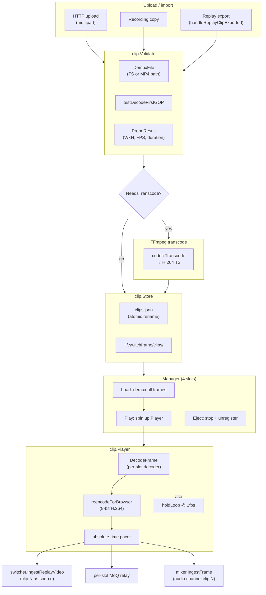

# Clip Library

> **Where you are:** [docs](../README.md) → subsystems → clips
> **Read this first:** [architecture.md](../architecture.md)
> **See also:** [replay.md](./replay.md) · [playout.md](./playout.md) · [../pipeline.md](../pipeline.md)

**TL;DR** The clip library stores MPEG-TS / MP4 / MOV media files and plays them through one of four virtual player slots that register with the switcher as `clip:1`…`clip:4`. Uploads are probed and validated (container + test-decode of the first GOP), transcoded to H.264 MPEG-TS if needed, and recorded in a JSON store with path-traversal protection. A format-dispatching demuxer produces `BufferedFrame` / `BufferedAudioFrame` slices — TS is read with `go-astits`, MP4/M4V/MOV is parsed by walking the `go-mp4` box tree and assembling samples from the `stbl` tables. The player decodes each frame to YUV420, re-encodes to a browser-friendly 8-bit H.264 stream, and supports pause, seek, variable speed (0.25×–2.0×), loop, and hold-last-frame — emitting raw YUV to the switcher pipeline and wire data to a per-slot MoQ relay. Ephemeral clips (replay exports) are auto-pruned; loaded clips are protected.

## The story

The clip library is the "B-roll ingest" of the control room. Operators upload promo clips, commercial fills, VT packages, and sting elements into a fixed-size on-disk library. Each clip lives as a single media file plus a JSON metadata record. At runtime, any clip can be loaded into one of four player slots; each slot registers with the switcher as if it were a live camera, so the operator can cut or dissolve to `clip:1` the same way they cut to `cam-A`. Slot audio mixes through the audio engine with AFV enabled by default, so switching to a clip brings its audio up automatically.

The path from upload to playback is: **validate → store → demux → decode → re-encode → emit**. Validation is three stages: extension check, full demux (so a malformed TS doesn't sneak past), and test decode of the first GOP to confirm the codec is actually decodable and the reported dimensions match what the decoder produces. Formats that can't be demuxed natively (MKV, WebM, AVI, FLV, MXF, WMV, MPG, OGV, plus non-H.264 MP4s) are transcoded to H.264 MPEG-TS via FFmpeg first.

The demuxer is where the two container formats diverge. MPEG-TS goes through `asticode/go-astits` — each PES packet is parsed into an annex B NALU stream, length-prefixed, parameter sets stripped into separate fields, and a `BufferedFrame` emitted per access unit. MP4/MOV goes through `abema/go-mp4`: the box tree is walked to extract track metadata (`avcC` / `hvcC` parameter sets, `stts`/`ctts`/`stss`/`stsz`/`stsc`/`stco` sample tables), then samples are reassembled from chunk offsets. Audio streams are extracted in parallel, ADTS framing stripped, sample rate + channel count captured from the ADTS header (or `esds` box for MP4), and every 1024-sample AAC frame timestamped from base PTS.

The Manager orchestrates the four player slots. `Load` demuxes the file up-front (all frames into memory — they're small), `Play` spins up a `Player` with its own decoder and encoder, and `Eject` closes everything and unregisters the source. A per-slot MoQ relay runs alongside the switcher ingest so browsers can subscribe to a preview of the clip independently of what's on program. When GPU preview encoding is available, each slot's YUV stream goes through the GPU source manager to produce a 480p proxy; the full-quality encoder is bypassed and the GPU preview encoder feeds the relay instead.

The Player re-encodes every frame. That's surprising at first — why not pass through the source wire data? Because source clips may be 10-bit 4:2:2 HEVC, may have scene cuts at arbitrary points (and browsers need a keyframe to start decoding), and may contain B-frames with DTS != PTS reordering that the browser stack handles poorly. A fresh encode to 8-bit H.264 `tune=zerolatency` (bframes=0) guarantees browser compatibility and lets us insert a forced IDR on demand — for seek, loop restart, or first-frame delivery.

When playback ends on a non-loop clip, the Player transitions to `StateHolding` and emits the last frame at 1 fps to keep the source alive for the switcher's health monitor. The browser also needs a keyframe to start decoding, so the player caches the last *keyframe's* wire data (not the last frame's) and repeats that on the relay during hold — late-joining subscribers still decode correctly.

## How it works

### Store: metadata persistence with atomic writes

`clip.Store` wraps a directory (usually `~/.switchframe/clips/`) that holds the media files alongside `clips.json`. `NewStore` reads the JSON on startup and hydrates a `map[string]*Clip`. Every mutation (`Add`, `Update`, `Delete`, `Pin`, `CleanEphemeral`) calls `save()`, which writes to a temp file, fsyncs, and renames — crash-safe. IDs are 16-byte random hex generated once per clip.

The store enforces a byte budget on *non-ephemeral* clips. Ephemeral clips (replay exports, recordings) bypass the check — they exist on the assumption that `CleanEphemeral` will sweep them up. `Pin` promotes an ephemeral clip to permanent and re-applies the budget check.

Path traversal is blocked implicitly: the store never joins user-supplied filenames directly; the Manager always composes paths via `filepath.Join(store.Dir(), clip.Filename)` and the filename is generated server-side during upload or replay export.

### Validation pipeline

`Validate(path)` performs three stages:

1. **Container probe.** Extension must be in `supportedExtensions` (`.ts`, `.mp4`, `.m4v`, `.mov`). `DemuxFile` runs the full demuxer — an invalid TS header rejects here, not at playback.
2. **Test decode.** `testDecodeFirstGOP` takes frames from the first keyframe up to the next keyframe (or 30 frames, whichever is smaller), creates a codec-appropriate decoder via `codec.NewVideoDecoderForCodec`, and decodes each frame. If the decoder produces dimensions that differ from the SPS-declared dimensions by more than one macroblock (16 px H.264, 64 px HEVC CTU), the clip is rejected as `ErrCorruptFile`. EAGAIN "buffering" errors from B-frame reordering are expected and skipped. For synthetic test data where decode fails entirely, zero dimensions + a warning are returned rather than a hard failure.
3. **Metadata.** Duration is computed from the min/max PTS span (frames may be in decode order, so `minPTS` and `maxPTS` are scanned rather than assumed). FPS is estimated from the same span and snapped to standard broadcast rates (23.976, 24, 25, 29.97, 30, 50, 59.94, 60). `ParseSPSDimensions` provides a pure-Go H.264 SPS parser with emulation-prevention byte stripping and proper chroma-format handling for the frame crop units.

### Format dispatch: TS vs. MP4 demuxer

`DemuxFile` routes by extension:

- `.ts`, `.mts`, `.m2ts` → `demuxTSFile`. Opens via `go-astits`, parses each PES packet. For video, it strips SPS/PPS/VPS (and HEVC filler/AUD) into `BufferedFrame` parameter set fields, keeps SEI in the wire data, and marks keyframes when an IDR NALU appears or the adaptation field sets `RandomAccessIndicator`. Audio PES packets carry concatenated ADTS frames which `codec.SplitADTSFrames` breaks into individual 1024-sample AAC payloads; each gets its own PTS computed from the PES base PTS + frame index.
- `.mp4`, `.m4v`, `.mov` → `demuxMP4`. First pass walks the box tree (`parseMP4Tracks`) through `moov → trak → mdia → minf → stbl` collecting track `timescale`, codec-config boxes (`avcC` for H.264, `hvcC` for HEVC), and sample table boxes (`stts`, `ctts`, `stss`, `stsz`, `stsc`, `stco`/`co64`). Second pass (`readVideoSamples`, `readAudioSamples`) computes per-sample file offsets from `stsc` + `stco`, reads the sample bytes (which are already AVC1 length-prefixed), and decorates keyframes (from `stss`) with parameter sets from the config box. Video frames stay in sample-table order (decode order) for correct B-frame decoding; audio frames are sorted by PTS.

Both paths return `([]BufferedFrame, []BufferedAudioFrame, error)`. The downstream Player doesn't care which container the frames came from.

### Transcode for unsupported formats

`NeedsTranscode(path)` checks the extension first — the nine transcode-only extensions always need it. For `.mp4`/`.mov` it probes via `codec.ProbeFile` (FFmpeg-backed) and triggers transcode if the codec isn't H.264 or HEVC. If the probe fails, MP4-family containers fall back to transcode but TS files are trusted (they come from the switcher's own recorder or replay export, which always produce clean H.264).

`CanTranscodeFallback` flags native containers that may still benefit from a transcode detour if the Go-native demuxer fails — this handles fragmented MP4s and unusual box layouts that `abema/go-mp4` chokes on but FFmpeg handles.

The actual transcode uses `codec.TranscodeFile` (with `codec.TranscodeFileWithProgress` for the progress variant, see [`server/codec/ffmpeg_transcode.go`](../../server/codec/ffmpeg_transcode.go)), which invokes FFmpeg via `libavformat` / `libavcodec` to produce an H.264 MPEG-TS.

### Manager: four slots with lifecycle callbacks

`clip.Manager` owns a `[MaxPlayers]*playerSlot` array. `Load` acquires the clip from the store, demuxes the file, ejects any prior content, and stores frames in the slot as `StateLoaded`. `Play` creates a decoder (codec-aware via `DecoderFactoryForCodec` — HEVC clips get an HEVC decoder), creates the player with frame + audio arrays, registers output callbacks that tag frames with the slot's key (`clip:1`…`clip:4`), and invokes `onPlayerStart` *before* `p.Start(ctx)` to prevent a race where the player emits frames before the source is registered with the switcher.

`onPlayerStart` in the app ([`server/cmd/switchframe/app_clips.go`](../../server/cmd/switchframe/app_clips.go)) registers the clip as a raw YUV source, adds a mixer channel with AFV, and — if GPU preview is enabled — registers the slot with the GPU source manager so a 480p preview encoder feeds the relay. The full-quality encoder's wire data then bypasses the relay broadcast (the `clipGPUPreview` flag gates this). `onPlayerStop` reverses: unregister source, remove mixer channel, release GPU preview, reset group IDs.

The Manager exposes the usual transport controls: `Pause`/`Resume`, `Stop`, `Seek(playerID, position)`, `SetSpeed(playerID, speed)`, `SetLoop(playerID, loop)`. `Play` auto-resumes a paused slot instead of returning `ErrPlayerBusy`. `LoadByName` resolves a clip by name for cross-engine snapshot restore where clip IDs differ but names are consistent.

### Player: decode → re-encode pipeline

`Player.run` estimates source FPS from the frame PTS span, then enters an outer loop over the clip (for loop mode) and an inner `playClip` loop over frames. Each inner iteration:

1. Pulls non-blocking seek and speed-change signals.
2. Decodes the current frame. Wire format is converted to Annex B via `codec.WireToAnnexBInto` (reuses a scratch buffer), SPS/PPS (or VPS+SPS+PPS for HEVC) prepended on keyframes into a separate buffer (`prependBuf` can't alias `annexBBuf` because `PrependSPSPPSInto` reads from one while writing to the other), and handed to the decoder. EAGAIN buffering is counted separately from real errors.
3. Re-encodes the decoded YUV via `reencodeForBrowser`. The encoder is created lazily on the first decoded frame and recreated if dimensions change mid-clip. The output is Annex B; `codec.AnnexBToWireInto` converts to wire format with a deep copy (downstream relay consumers hold frames asynchronously and the aliased scratch buffer would be overwritten).
4. Outputs the frame `dupCount` times for slow motion (dup=1 for speeds ≥ 1.0; `math.Round(1/speed)` for < 1.0). Each output emits raw YUV to the switcher pipeline and wire data to the browser relay, with an absolute-time pace waiting for `playbackStart + pacingIdx * frameDuration`.
5. Saves the hold frame (last YUV + last keyframe wire data + SPS/PPS) under a mutex so `holdLoop` can read it later.
6. Emits audio frames proportionally across output video frames.

After the last frame, `DrainableDecoder` support drains buffered B-frame tail via `SendEOS` + `ReceiveFrame` — decoded frames get output-PTS increments and go to the same callbacks. On non-loop completion the Player transitions to `StateHolding`, calls `OnDone`, and enters `holdLoop` which emits the last keyframe at 1 fps until context cancellation. Loop mode instead flushes the decoder (SPS/PPS may differ between playthroughs), resets decode counters, and re-enters `playClip`.

### Per-player MoQ relay

Each slot has a dedicated relay registered at startup via `server.RegisterStream("clip:N")`. The app's `SetVideoOutput` callback wraps each frame in a `media.VideoFrame` with a monotonically increasing group ID that bumps on every keyframe (starting at 1 because Prism uses 0 as a "not damaged" sentinel). `SetVideoInfo` is called on every keyframe with fresh SPS/PPS — clip resolution may vary between plays, so the MoQ catalog stays current. Audio is broadcast on the same relay plus fed to the mixer via `IngestFrame`. See the MoQ / distribution layer in [../pipeline.md](../pipeline.md).

### Replay → clip export bridge

When a replay is played, the replay Manager spawns a background goroutine that muxes the extracted clip to a temp MPEG-TS file and invokes the `onClipExported` callback. In the main app, `handleReplayClipExported` in [`server/cmd/switchframe/app_clips.go`](../../server/cmd/switchframe/app_clips.go) validates the file, moves it into the clip store (falling back to copy on cross-filesystem rename), and adds it as `Ephemeral: true, Source: SourceReplay`. See [replay.md](./replay.md) for the sending side.

## Key types and entry points

- Lifecycle: [`server/clip/manager.go`](../../server/clip/manager.go) → `Manager.Load`, `Manager.LoadByName`, `Manager.Play`, `Manager.Pause`, `Manager.Stop`, `Manager.Eject`, `Manager.PlayerStates`.
- Store: [`server/clip/store.go`](../../server/clip/store.go) → `Store.NewStore`, `Store.Add`, `Store.Get`, `Store.List`, `Store.Delete`, `Store.Pin`, `Store.CleanEphemeral`.
- Player: [`server/clip/player.go`](../../server/clip/player.go) → `Player.run`, `Player.playClip`, `Player.outputFrame`, `Player.reencodeForBrowser`, `Player.holdLoop`, `Player.emitAudioForVideoFrame`, `Player.SetSpeed`, `Player.Seek`.
- Validation: [`server/clip/validator.go`](../../server/clip/validator.go) → `Validate`, `IsAcceptedExtension`, `NeedsTranscode`, `CanTranscodeFallback`, `testDecodeFirstGOP`, `ParseSPSDimensions`.
- Demux dispatch: [`server/clip/demux.go`](../../server/clip/demux.go) → `DemuxFile`, `demuxTSFile`, `demuxTS`, `parseVideoFrameForClip`, `parseAudioFramesForClip`.
- MP4 box tree parser: [`server/clip/demux_mp4.go`](../../server/clip/demux_mp4.go) → `demuxMP4`, `parseMP4Tracks`, `readVideoSamples`, `readAudioSamples` (`mp4Track` holds the parsed metadata + sample tables).
- Types: [`server/clip/types.go`](../../server/clip/types.go) → `Clip`, `ClipSource`, `PlayerState`, `BufferedFrame`, `BufferedAudioFrame`, `VideoDecoder`, `FlushableDecoder`, `DrainableDecoder`, `VideoEncoder`, sentinel errors, `MaxPlayers = 4`.
- App wiring: [`server/cmd/switchframe/app_clips.go`](../../server/cmd/switchframe/app_clips.go) → `App.initClips`, `handleReplayClipExported`, per-slot relay registration, GPU preview gating.

## Gotchas and invariants

- **Register source before starting player.** `onPlayerStart` runs *before* `p.Start(ctx)` in `Manager.Play`. The player emits frames from its goroutine; if it started before the source was registered with the switcher, the first few frames would land in a non-existent source and be silently dropped.
- **Decode order preserved.** Video frames come out of the demuxer in decode (PES/sample table) order, not PTS order. Sorting by PTS would break B-frame decoding because the decoder needs reference frames before the B-frames that depend on them. Audio, which has no reordering, *is* sorted by PTS.
- **Separate Annex B scratch and prepend buffers.** `PrependSPSPPSInto` reads from `annexBBuf` while writing to `prependBuf`; sharing a buffer would corrupt the input before the copy finished. The two fields on `Player` are intentionally separate allocations.
- **Lazy encoder with dimension re-init.** `reencodeForBrowser` creates the encoder on the first decoded frame so encoder settings match actual decode output (which can differ from SPS dimensions by one macroblock). If dimensions change mid-clip (variable-resolution clips), the encoder is closed and recreated.
- **Hold emits last keyframe, not last frame.** `holdLoop` replays `holdKeyWireData` — the last keyframe's wire data — to the browser relay at 1 fps, not the literal last frame. Late-joining browser decoders need an IDR to start; a non-IDR last frame would leave them stuck on "loading" until playback ended.
- **Audio stripped from held frames.** `nextClipFrame` in the playout path strips audio when returning a held frame — audio was already delivered on first emission; repeating it would leak audio on every hold tick. The clip Player's own `holdLoop` only runs at 1 fps so the audio repeat is harmless in direct playback but the *principle* (audio emitted once per source frame) holds.
- **Ephemeral protection.** `CleanEphemeral` excludes clips whose IDs appear in `loadedIDs` (from `Manager.LoadedClipIDs`). A clip that's loaded into a slot won't be swept out from under the operator even if it's an auto-export and older than the TTL.
- **GPU preview gates full-quality relay.** When `clipGPUPreview[idx]` is true, the `SetVideoOutput` callback *returns early* instead of broadcasting. The GPU source manager runs its own preview encoder that feeds the relay directly; broadcasting the full-quality stream too would send duplicate frames with mismatched group IDs.
- **Group IDs never zero.** MoQ group IDs must start at 1 because Prism uses 0 as a "not damaged" sentinel. The app wiring explicitly clamps `groupID` to 1 when the first frame isn't a keyframe.
- **Path traversal.** Clip filenames are server-generated (random ID or timestamp-prefixed `replay_source_HHmmss.ts`). User-supplied names are never used as filenames. `Store.Dir()` + generated filename is the only path composition.
- **Loop invalidates video-info state.** On loop restart the Player flushes the decoder, resets decode error tracking, and most importantly clears `videoInfoSent` so the browser gets fresh SPS/PPS on the first keyframe after the rewind. Without this, clients that connected mid-clip would never receive the video info JSON.
- **Replay export is ephemeral.** Replay clips land with `Source: SourceReplay, Ephemeral: true`. They'll be swept by `CleanEphemeral` after the TTL unless `Pin` is called to promote them. Loading them into a slot protects them from sweep.

## Related docs

- **Concepts:** [../pipeline.md](../pipeline.md) (the switcher ingests `clip:N` as a virtual raw YUV source and routes frames through the same pipeline as live cameras), [../locking-and-concurrency.md](../locking-and-concurrency.md) (the Manager's mutex boundaries and why callbacks are captured under lock then called without it).
- **Reference:** [../api.md](../api.md) (REST endpoints for upload, list, load, play, pause, seek, stop), [../fast-control.md](../fast-control.md) (datagram protocol used elsewhere in the same operator stack).
- **Subsystems:** [replay.md](./replay.md) (the replay export bridge produces ephemeral clips), [playout.md](./playout.md) (the playout asset cache uses the same transcode detour for unsupported formats), [../mxl.md](../mxl.md) (the MXL source layer similarly wraps into virtual source keys).
- **Integration / Operations:** [../deployment.md](../deployment.md) (`--clip-storage-max`, `--clip-ephemeral-ttl`, and `StateDir` layout), [../gpu.md](../gpu.md) (GPU preview encoder used by clip slots when available).
