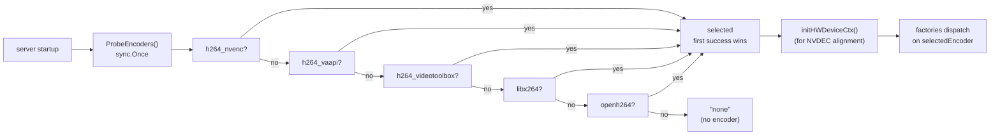

# Video Codec Infrastructure

> **Where you are:** [docs](../README.md) → subsystems → codec
> **Read this first:** [architecture.md](../architecture.md)
> **See also:** [output.md](output.md) · [srt-ingest.md](srt-ingest.md) · [mxl.md](mxl.md) · [gpu.md](../concepts/gpu.md) · [pipeline.md](../concepts/pipeline.md) · [clips.md](../clips.md)

**TL;DR** The `codec` package is Switchframe's glue around every H.264 and HEVC encoder and decoder in the tree. At startup, [`ProbeEncoders()`](#probeencoders-startup-auto-detection) tests a priority-ordered list of candidates — NVENC, VA-API, VideoToolbox, libx264 — and picks the first one that opens and produces a real frame. The rest of the system uses factory functions ([`NewVideoEncoder`](#encoder-factories), [`NewVideoDecoder`](#decoder-factories), and their HEVC and 10-bit variants) that dispatch through the probe result so callers never know which backend they got. Underneath, [`FFmpegEncoder`](#ffmpeg-encoder-and-decoder) and [`FFmpegDecoder`](#ffmpeg-encoder-and-decoder) wrap libavcodec via cgo with constrained-VBR rate control tuned for SRT transport, [`OpenH264`](#openh264-fallback) is the pure-software fallback when FFmpeg isn't linked, [`ffmpeg_probe_file`](#file-probe) and [`ffmpeg_transcode`](#c-transcode) provide avformat-backed file probing and format normalization for clip uploads, and [`nalu.go`](#nalu-and-adts-helpers) / [`adts.go`](#nalu-and-adts-helpers) provide AVC1↔Annex B conversion and ADTS header construction. Stubs under `!cgo || noffmpeg` keep non-FFmpeg builds compiling.

## The story

At any moment Switchframe has half a dozen codec instances running: a per-source decoder for each SRT input, a program encoder for the main output, a preview encoder per source for browser multiview, a confidence encoder for thumbnails, and a replay encoder if instant replay is armed. The *right* choice of backend for each of these depends on what hardware is on the box, what codec the source uses, and what resolution the output targets. Bringing up a switcher shouldn't require the operator to know any of this.

The codec package solves that in two moves. First, [`ProbeEncoders()`](../../server/codec/probe.go) runs at startup and probes every candidate H.264 encoder the binary knows about, testing each with a small real encode to prove it works. Second, all callers go through factories — `NewVideoEncoder`, `NewPreviewEncoder`, `NewVideoDecoder`, `NewHEVCVideoEncoder`, etc. — that dispatch on the probe result. The switcher, SRT ingest, MXL ingest, output engine, and replay engine all just ask for an encoder or decoder and get the right backend. If the machine has an L4 GPU, they all get NVENC. If it's a laptop, they all get libx264. If it's an Apple Silicon MacBook, they get libx264 (by design — see [macOS priority](#macos-priority-and-rate-control) below). The rest of the codebase never imports a specific backend.

The package also owns the details that everyone downstream needs: how to convert between AVC1 (length-prefixed) and Annex B (start-code-prefixed) NALU framing, how to build ADTS headers for AAC, how to pull codec profile strings out of SPS, how to probe a file's codec before a clip upload decides whether to transcode it. Utility code sits in `nalu.go` and `adts.go` with no build tag — those are pure Go, and every codec-handling path in the tree uses them.

## How it works

### `ProbeEncoders()`: startup auto-detection



[`ProbeEncoders()`](../../server/codec/probe.go) is gated by `sync.Once` and tested once per process. It walks the `candidates` list (which on macOS is reordered to put `libx264` before `h264_videotoolbox` — see below) and for each candidate calls [`tryEncoder`](../../server/codec/probe.go). `tryEncoder` asks for a 256×256 encoder, pushes 30 constant-color frames through it, and succeeds on the first one that produces real output. The 30-frame budget covers the warmup of slower hardware encoders; libx264 with `tune=zerolatency` produces output on frame 1. The 256×256 size is chosen because NVENC on FFmpeg 7.x segfaults with smaller resolutions like 64×64 (a real bug in the NVENC wrapper that only manifests at tiny sizes).

The first encoder that succeeds becomes `selectedEncoder`. OpenH264 is probed separately after the FFmpeg candidates — it's the final fallback when everything else fails. If nothing works, `selectedEncoder` is `"none"` and `NewVideoEncoder` returns an error.

After selection, [`initHWDeviceCtx`](../../server/codec/probe.go) creates a matching hardware device context (CUDA for NVENC, VAAPI for VA-API, VideoToolbox for VT) and stashes it in a package-level `hwDeviceCtxPtr`. Decoders pick that up via [`HWDeviceCtx()`](../../server/codec/probe.go) and use it to attempt hardware-accelerated decode. Software encoders get no device context, and decoders fall back to software decode.

HEVC has a parallel path: [`ProbeHEVCEncoders()`](../../server/codec/probe.go) with its own `hevcCandidates`, `selectedHEVCEncoder`, and probe once. It's called lazily by `NewHEVCVideoEncoder`, not at startup — most deployments won't need HEVC.

[`ListAvailableEncoders()`](../../server/codec/probe.go) and `ListAvailableHEVCEncoders()` return the full set of working backends plus a `IsDefault` flag marking the probe winner. The UI uses this to populate the encoder-selection dropdown on the output config page; the runtime can then switch via [`NewFFmpegEncoder`](../../server/codec/ffmpeg_encoder.go) with an explicit codec name.

### macOS priority and rate control

On every platform the order is NVENC → VAAPI → VideoToolbox → libx264, *except* macOS where it's NVENC → VAAPI → libx264 → VideoToolbox. The reason is in the comments next to the `init()` block in [`probe.go`](../../server/codec/probe.go): **libx264 is 1.8–2.2× faster than VideoToolbox on Apple Silicon with working rate control.** VideoToolbox has a ~20 ms fixed round-trip floor from hardware dispatch and, more damningly, its FFmpeg rate control is broken — you ask for 10 Mbps ABR and get ~20 Mbps output. That's fine for local recording but ruins SRT transport where the CBR pacer expects predictable bitrate. Hence: on macOS, libx264 is preferred unless the operator explicitly selects VT. HEVC on macOS is a different story — `hevc_videotoolbox` has good rate control and stays in default priority — so the HEVC probe keeps VT in its natural slot.

### Encoder factories

The high-level entry points live in [`video.go`](../../server/codec/video.go):

- **`NewVideoEncoder(w, h, bitrate, fpsNum, fpsDen, opts...)`** — full-quality program encoder. Dispatches on `selectedEncoder`. Uses `DefaultGOPSecs` (2 s) unless overridden in `EncoderOptions`. Always constrained-VBR (ABR target + 1.2× VBV ceiling) for predictable SRT output.
- **`NewPreviewEncoder(w, h, bitrate, fpsNum, fpsDen, preset...)`** — low-bitrate multiview encoder. Uses a shorter `PreviewGOPSecs`. On systems with hardware encoders it routes through `NewFFmpegEncoder` (GPU encode is essentially free and avoids CPU contention with decoders); otherwise it falls back to `NewFFmpegPreviewEncoder` (libx264 `ultrafast` preset). The important note is that each call gets `nil` for `hwDeviceCtx` so each encoder creates its *own* CUDA context — sharing a single context across concurrent goroutines crashes the NVENC driver because `cuCtxPushCurrent`/`cuCtxPopCurrent` around `nvEncEncodePicture` isn't thread-safe.
- **`NewVideoDecoder()` / `NewVideoDecoderSingleThread()`** — decoder factories. Single-thread variant disables frame-level multithreading (which buffers N frames before producing output — bad for clip and replay decoders that need per-frame immediate output).
- **`NewHEVCVideoDecoder()`, `NewHEVCVideoDecoderSingleThread()`, `NewVideoDecoderNative10bit()`, `NewVideoDecoderForCodec(codec)`** — HEVC decoder variants and the 10-bit 4:2:2 path that preserves full bit depth for professional-mode pipelines.
- **`NewHEVCVideoEncoder()`, `NewHEVCVideoEncoder10bit()`** — HEVC encoders. The 10-bit variant uses `main422-10` (libx265) or `main10` (NVENC).

Each factory returns a `transition.VideoEncoder` or `transition.VideoDecoder` interface, which is how the switcher, transition engine, replay, output, and clips see codecs. They never import `codec` directly for encoder types — they just ask the factory.

### FFmpeg encoder and decoder

[`FFmpegEncoder`](../../server/codec/ffmpeg_encoder.go) is a cgo wrapper around `libavcodec`'s encoder API. The C struct `ffenc_t` carries `AVCodecContext`, `AVFrame`, and `AVPacket`; the Go wrapper manages lifecycle and provides Go-typed `Encode(yuv, pts, forceIDR)` returning encoded bytes + keyframe flag + error.

The encoder config matters and is worth calling out. Every FFmpeg encoder Switchframe creates uses **constrained VBR**:

```c
h->ctx->bit_rate = bitrate;
h->ctx->rc_max_rate = bitrate + bitrate / 5;    // 1.2x peak ceiling
h->ctx->rc_buffer_size = bitrate + bitrate / 5; // 1-second VBV at peak rate
```

This matches broadcast practice (Haivision KB, AWS MediaLive): ABR target with a tight VBV ceiling gives the encoder per-frame quality flexibility while producing output that SRT-compatible CBR pacers can wrap with null packets to hit a fixed muxrate. See [output.md](output.md) for the downstream CBR side.

Colorspace is always set: BT.709 primaries/matrix/TRC, `AVCOL_RANGE_MPEG` (limited range 16–235), and chroma sample location `LEFT`. This is signalled into the VUI in the SPS so decoders render correctly on any browser or downstream. Thread count scales to online CPU count, clamped to [2, 8] — high enough to sustain real-time at 1080p even with multiple decoders hogging cores, not so high that slice boundaries become visible.

[`FFmpegDecoder`](../../server/codec/ffmpeg_decoder.go) is the decoder half. Factory functions dispatch on `thread_count`: auto (default `ncpu` clamped 2–4, used for source decoders) or 1 (used for clip and replay decoders where frame threading's N-frame output delay would corrupt per-frame timing). `error_concealment = FF_EC_GUESS_MVS | FF_EC_DEBLOCK` asks the decoder to use neighboring motion vectors to mask damaged macroblocks during transition warmup or source changes — produces visibly fewer glitches than simple frame copy.

Hardware acceleration wires `hw_device_ctx` when non-nil; the decoder then attempts to decode into CUDA/VAAPI frames. Downloads to CPU memory are on demand — the SRT decoder, for example, stays on the GPU when NVDEC is active and hands decoded device pointers to the pipeline (see [gpu.md](../concepts/gpu.md) for the CUDA path).

`FFmpegOpenMu` in [`ffmpeg_cgo.go`](../../server/codec/ffmpeg_cgo.go) serializes `avcodec_open2` and `avformat_open_input` calls. NVENC initializes the CUDA runtime inside `avcodec_open2`, and if the SRT decoder's `avformat_open_input` runs concurrently — which calls into the same CUDA driver — the driver SEGVs. This mutex is held briefly during codec opening and dropped immediately; once opened, encode/decode operations are safe to run concurrently per-context. It's a package-level `sync.Mutex` used by every codec initialization in the tree.

### OpenH264 fallback

[`OpenH264Encoder`](../../server/codec/openh264_encoder.go) and [`OpenH264Decoder`](../../server/codec/openh264_decoder.go) are the pure-software fallback. Build tag `openh264`. Used when FFmpeg is compiled out or when `ProbeEncoders` couldn't open any FFmpeg candidate. The encoder uses Cisco's OpenH264 directly via cgo with Real-Time mode and aggressive transition-friendly settings: scene-change detection disabled (the dissolve *is* the scene change, don't let the encoder IDR-spike mid-transition), frame skip disabled (stuttering looks worse than bitrate overshoot), adaptive quantization enabled (preserves edges from both sources during blending). [`openh264_cgo.go`](../../server/codec/openh264_cgo.go) is a build-tag-gated file holding the pkg-config directive so link flags only appear in builds that actually want OpenH264.

The stub in [`stub_codec.go`](../../server/codec/stub_codec.go) returns `errOpenH264Disabled` for every method when the build tag is absent — callers get a clear error rather than a missing symbol at link time.

### File probe

[`ProbeFile(path)`](../../server/codec/ffmpeg_probe_file.go) opens a media file with `avformat_open_input`, calls `avformat_find_stream_info`, and returns a `FileProbeResult` with `VideoCodecID`, `AudioCodecID`, `Width`, `Height`, `HasVideo`, `HasAudio`. The clip upload path uses this to decide whether an uploaded file needs transcoding (see [clips.md](../clips.md) and [`validator.go`](../../server/clip/validator.go)). The `IsH264()` / `IsHEVC()` helpers map codec IDs to the two codec strings Switchframe natively carries.

Width/height validation guards against empty or truncated files: FFmpeg can sometimes probe a zero-byte truncated TS as `h264` with `width=0`, and the `HasVideo` flag only gets set if dimensions are plausible.

### C transcode

[`TranscodeFile`](../../server/codec/ffmpeg_transcode.go) normalizes arbitrary FFmpeg-readable input (MP4, MOV, MKV, random codecs) into Switchframe's canonical format: H.264 + AAC in MPEG-TS. This is the path the clip library uses when an operator uploads a file in a codec the pipeline can't decode directly.

The C function `ff_transcode_file` does the full loop: open input, find decoder, open output context (format `mpegts`), create H.264 encoder (via FFmpeg's encoder API) and AAC encoder, probe and configure SwsContext for pixel-format conversion and SwrContext for sample rate/channel conversion, then run `avcodec_send_packet` / `avcodec_receive_frame` / sws_scale / swr_convert / encode / write loop until EOF. Progress reporting writes a 0–100 integer into a caller-owned `progress_pct` pointer so the UI can show a progress bar during long transcodes.

`TranscodeFileWithProgress` is the Go-friendly wrapper that takes an `*int32` updated from the C side. See [clips.md](../clips.md) for the full clip upload and validation flow.

### NALU and ADTS helpers

[`nalu.go`](../../server/codec/nalu.go) provides AVC1↔Annex B conversion, NALU extraction, and SPS/PPS prepending. These are pure Go with no cgo dependency and sit on the hot path for every frame that moves between Switchframe's internal wire format (AVC1: 4-byte big-endian length prefix per NALU) and the Annex B format (0x00000001 start code) that encoders emit and decoders expect.

- `AVC1ToAnnexB()` / `AVC1ToAnnexBInto(data, dst)` convert length-prefixed to start-code-prefixed. The `Into` variant reuses a caller-provided buffer to avoid per-frame allocation on the hot path — the muxer uses this to convert the wire-format video frames to Annex B just before writing them to TS.
- `AnnexBToAVC1()` / `AnnexBToAVC1Into(annexB, dst)` go the other direction. Used by source decoders that produce Annex B from libavcodec encoders — the switcher pipeline carries AVC1 internally so MoQ/WebCodecs in the browser can handle it.
- `ExtractNALUs(avc1)` walks AVC1 data and returns the NALU bodies as sub-slices. Used to find SPS/PPS (NALU types 7 and 8 respectively) in an IDR frame for `VideoInfo` initialization.
- `PrependSPSPPS()` / `PrependSPSPPSInto` prepends parameter sets with start codes before Annex B data. The muxer uses this on keyframes so the output TS always carries SPS/PPS with every IDR (required for decoder startup mid-stream).
- `PrependVPSSPSPPS` variants (in the same file) do the same for HEVC where VPS is required alongside SPS/PPS.
- `ParseSPSCodecString(sps)` extracts the first three bytes after the NALU type byte and formats as `avc1.XXXXXX`, the WebCodecs-compatible codec string — `avc1.640028` is High profile Level 4.0. Browsers need this in their `VideoDecoder.configure()` call.

[`adts.go`](../../server/codec/adts.go) provides AAC ADTS header utilities. ADTS is the streaming frame format — each AAC access unit is prefixed with a 7-byte (or 9-byte with CRC) header carrying sample rate, channel count, and frame length.

- `BuildADTS(sampleRate, channels, frameLen)` constructs the 7-byte no-CRC header. Used by the muxer and the AAC encoder glue to wrap raw AAC for MPEG-TS.
- `EnsureADTS(data, sampleRate, channels)` returns data with a header prepended if it doesn't already have one, idempotent.
- `IsADTS(data)`, `ADTSHeaderLen(data)`, `ADTSFrameLen(data)` inspect existing ADTS.
- `SplitADTSFrames(data)` handles concatenated ADTS (multiple AAC frames in one buffer) and strips headers, producing raw payloads.
- `ParseADTSInfo(data)` extracts sample rate and channel count from a header — the RTMP direct FLV path uses this to build the `AudioSpecificConfig` for the remote.

Sample rate index handling uses a small table + nearest-match fallback — non-standard rates snap to the nearest MPEG-4 Audio index rather than producing the escape value (which would require a 24-bit explicit frequency field that `BuildADTS`'s 7-byte header doesn't include).

### Shared types

[`types.go`](../../server/codec/types.go) defines `EncoderInfo` — the JSON-serializable struct returned by `ListAvailableEncoders` for the UI. It has just three fields: `Name` (e.g. `h264_nvenc`), `DisplayName` (e.g. `"NVENC (CUDA)"`), and `IsDefault` (the probe winner).

Build-tag matrix:

- **`cgo && !noffmpeg`** — full FFmpeg path. Real encoders, decoders, transcode, probe.
- **`!cgo || noffmpeg`** — stubs in [`stub_ffmpeg.go`](../../server/codec/stub_ffmpeg.go) and [`stub_codec.go`](../../server/codec/stub_codec.go). Every factory returns `errFFmpegDisabled`. `ProbeEncoders` returns `"none", "none"`. Compiles cleanly so the rest of the tree builds without FFmpeg.
- **`cgo && openh264`** — OpenH264 fallback compiled in. Usually set when FFmpeg is also present, so OpenH264 is probed as a final fallback.
- **`!openh264`** — OpenH264 stubs return `errOpenH264Disabled`.

The `cgo.go` and `openh264_cgo.go` files isolate the cgo link directives so `#cgo pkg-config:` lines appear exactly once per library in the link step, avoiding duplicate-library warnings from the linker.

## Key types and entry points

- Entry / probe: [`server/codec/probe.go`](../../server/codec/probe.go) → `ProbeEncoders()`, `ProbeHEVCEncoders()`, `HWDeviceCtx()`, `ListAvailableEncoders()`
- Factories: [`server/codec/video.go`](../../server/codec/video.go) → `NewVideoEncoder()`, `NewPreviewEncoder()`, `NewVideoDecoder()`, `NewHEVCVideoEncoder()`, `NewVideoDecoderForCodec()`
- FFmpeg encoder: [`server/codec/ffmpeg_encoder.go`](../../server/codec/ffmpeg_encoder.go) → `NewFFmpegEncoder()`, `Encode()` (C: `ffenc_open`, `ffenc_encode`)
- FFmpeg decoder: [`server/codec/ffmpeg_decoder.go`](../../server/codec/ffmpeg_decoder.go) → `NewFFmpegDecoder()`, `Decode()` (C: `ffdec_open`, `ffdec_decode`)
- File probe: [`server/codec/ffmpeg_probe_file.go`](../../server/codec/ffmpeg_probe_file.go) → `ProbeFile()`, `FileProbeResult.IsH264()`
- Transcode: [`server/codec/ffmpeg_transcode.go`](../../server/codec/ffmpeg_transcode.go) → `TranscodeFile()`, `TranscodeFileWithProgress()`
- OpenH264: [`server/codec/openh264_encoder.go`](../../server/codec/openh264_encoder.go), [`openh264_decoder.go`](../../server/codec/openh264_decoder.go)
- NALU helpers: [`server/codec/nalu.go`](../../server/codec/nalu.go) → `AVC1ToAnnexB()`, `AnnexBToAVC1Into()`, `ExtractNALUs()`, `PrependSPSPPSInto()`, `ParseSPSCodecString()`
- ADTS helpers: [`server/codec/adts.go`](../../server/codec/adts.go) → `BuildADTS()`, `EnsureADTS()`, `SplitADTSFrames()`, `ParseADTSInfo()`
- Cgo flags: [`server/codec/ffmpeg_cgo.go`](../../server/codec/ffmpeg_cgo.go), [`openh264_cgo.go`](../../server/codec/openh264_cgo.go)
- Types: [`server/codec/types.go`](../../server/codec/types.go) → `EncoderInfo`; `FFmpegOpenMu` in [`ffmpeg_cgo.go`](../../server/codec/ffmpeg_cgo.go)
- Stubs: [`server/codec/stub_codec.go`](../../server/codec/stub_codec.go), [`stub_ffmpeg.go`](../../server/codec/stub_ffmpeg.go)

## Gotchas and invariants

- `ProbeEncoders` runs exactly once per process via `sync.Once`. If you need to retest (for example after a GPU reset), you must restart the process. The probe is fast (< 1 second per candidate) but not free, so keeping it one-shot is intentional.
- Never share a CUDA `hwDeviceCtx` across concurrent NVENC encoders. Each call to `NewFFmpegEncoder` must pass `nil` for `hwDeviceCtx` so the encoder creates its own context. `cuCtxPushCurrent`/`cuCtxPopCurrent` around `nvEncEncodePicture` is not thread-safe when multiple threads share a context — symptom is frame corruption on the output, not a crash.
- `FFmpegOpenMu` must be held around `avcodec_open2` and `avformat_open_input`. NVENC's CUDA runtime init inside `avcodec_open2` races with any concurrent driver call. Holding the mutex for the codec-open window is sufficient; it does NOT need to cover encode/decode.
- On macOS the default H.264 encoder is `libx264`, not VideoToolbox. If you specifically want VT you must select it in the UI; the probe deliberately demotes it below libx264 because its rate control is broken for SRT use. HEVC keeps VT in default priority because `hevc_videotoolbox` rate control is healthy.
- `EnsureADTS` only looks at the first two bytes for the sync word. Input that starts with a non-zero-filler byte followed by `0xFF ... 0xF*` will be misidentified. Source data always starts at an AAC frame boundary in Switchframe's flows, so this has not been an issue.
- `ExtractNALUs` returns sub-slices of the input — the caller must not retain them beyond the input's lifetime. The muxer and frame-pool paths know this; if you stash a NALU (for SPS/PPS preservation), copy it first.
- `AVC1ToAnnexBInto(data, dst)` requires `cap(dst) >= len(data)` or allocates. For hot-path use, reuse a single buffer across frames (see the muxer's `annexBBuf`).
- The `noffmpeg` build tag is for portability builds (e.g. a pure-Go distribution). With `noffmpeg`, no codec works — the server starts, serves UI, but cannot produce video. `ProbeEncoders` returns `"none", "none"` and callers get `errFFmpegDisabled`. This is a supported but non-media configuration.
- `ProbeFile` is not fast on large files. It's bounded by `avformat_find_stream_info`'s default probesize (5 MB) and analyze duration (5 s). For multi-gigabyte clips this is fine; for hundred-gig recordings consider streaming probe.

## Related docs

- **Concepts:** [pipeline.md](../concepts/pipeline.md) · [media-path.md](../concepts/media-path.md) · [gpu.md](../concepts/gpu.md)
- **Reference:** [config-and-flags.md](../reference/config-and-flags.md) · [file-formats.md](../reference/file-formats.md) · [api.md](../reference/api.md)
- **Subsystems:** [output.md](output.md) · [srt-ingest.md](srt-ingest.md) · [mxl.md](mxl.md) · [switcher.md](switcher.md) · [replay.md](replay.md) · [clips.md](../clips.md)
- **Operations:** [deployment.md](../operations/deployment.md)
