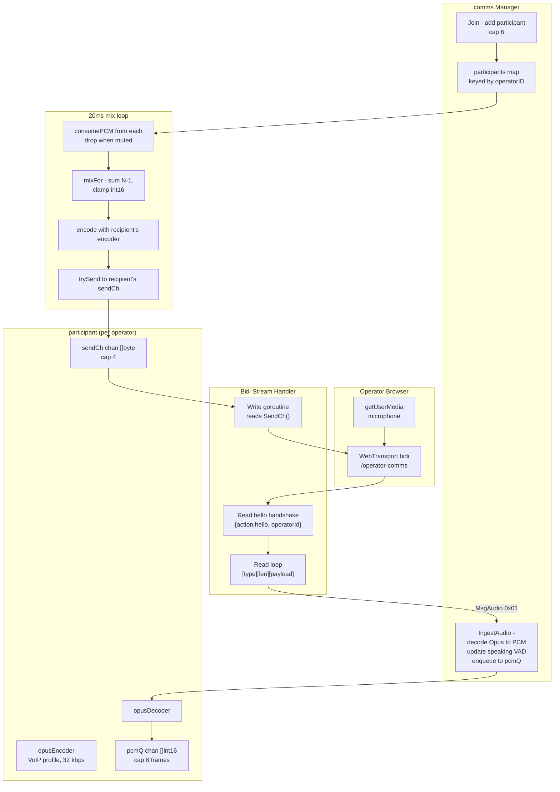

# Operator Voice Comms

> **Where you are:** [docs](../README.md) → subsystems → comms
> **Read this first:** [architecture.md](../architecture.md)
> **See also:** [audio](audio.md) · [captions](captions.md) · [control-plane](control-plane.md) · [fast-control](../fast-control.md)

**TL;DR** Comms is an N-1 party-line voice channel that lets up to six operators hear each other in real time while they're running the show. Each browser opens a WebTransport bidirectional stream to the server, sends Opus-encoded microphone audio in 20 ms frames, and receives a personalized mix back — "N minus 1" meaning each participant's mix sums every *other* participant's PCM but excludes their own, so nobody hears themselves echoed. The server runs one 20 ms mix loop, does all encoding and decoding with libopus via cgo, and scales to six participants by keeping everything per-frame and lock-free on the hot path. A simple RMS-threshold VAD drives the "speaking" indicator surfaced in the control-room state.

## The story

A live switcher is a coordinated act between people. The TD calls shots, the audio op checks a fader, the graphics op lines up a lower-third, the director asks for a specific camera. In a truck they talk over an intercom; over a LAN or WAN they need something that feels the same. The goal is low enough latency that a "go" doesn't turn into a "wait, what?" and high enough audio quality that a mumble doesn't get rendered as a mumble squared.

The technical shape is simple once you've thought about it: each operator's browser uploads microphone audio to the server, the server mixes everything together, and the server sends each operator a mix of *everybody else* — not a mix of everybody, because hearing yourself delayed by network and mix-cycle jitter is immediately disorienting. This is "N-1": if there are N participants, each person gets a mix of the other N-1 voices. Conference-bridge terminology from telephony, doing exactly what it says.

WebTransport carries it. A single bidirectional stream per participant: inbound audio goes up, outbound mix comes down, with a tiny wire protocol that framed each message as `[type][length(BE16)][payload]`. The first message is a hello handshake carrying the operator ID; every subsequent message is either encoded Opus audio (0x01) or a JSON control message (0x02, currently only used for mute). When the stream closes — browser refresh, tab close, network drop — the server auto-leaves the participant so no ghosts linger in the session.

Opus is a natural fit. The codec was designed for this exact use case (interactive voice, variable network, low latency) and the hraban/opus.v2 binding gives us tight cgo bindings to libopus. Every participant has their own encoder and decoder pair because Opus carries some state across frames (predictive coding, adaptive complexity) and mixing that state across participants would break.

One design choice worth calling out: the mixer is *per-frame*, not per-sample. Every 20 ms the mix loop grabs one frame from each participant's PCM queue, sums them into a scratch buffer with int32 accumulation and int16 clamping, encodes the result once per participant (because the exclude-self set is different for each listener), and fires off six sends. Simple, correct, and fast enough for six participants on any modest machine.

## How it works

**Wire protocol.** `[1 byte type][2 bytes BE length][payload]`, same framing in both directions. Type 0x01 is encoded Opus audio (payload is the Opus frame bytes, typically under 200 bytes per 20 ms at 32 kbps). Type 0x02 is a JSON control message; today the only defined action is `{"action":"mute","muted":bool}`. The handshake is a 0x02 message with `{"action":"hello","operatorId":"..."}` and must be the first frame on a new stream — without a valid hello the server closes the stream immediately. The inbound 0x01 path reads the Opus frame and calls `Manager.IngestAudio`; the outbound write goroutine reads from the participant's `sendCh` and wraps each mix packet with the same framing.

**The Manager.** [`comms.Manager`](../../server/comms/manager.go) owns the participant table, the mixer, and the mix-loop goroutine. `NewManager` starts the 20 ms ticker immediately; `Join` is idempotent (re-joining an existing operator just updates the display name) and enforces a six-participant cap (`MaxParticipants`). `Leave` removes the participant and closes their send channel, which unblocks the write goroutine. `SetMuted` flips a flag on the participant; muting while speaking drains the participant's PCM queue so stale audio doesn't play out when they unmute. `State()` returns `nil` when the channel is empty so it can be omitted from the broadcast state payload entirely rather than serialized as an empty object.

**Per-participant state.** [`comms.participant`](../../server/comms/participant.go) pairs an Opus encoder with an Opus decoder (each participant gets both, because every participant both sends and receives), a scratch PCM buffer for decode, an 8-frame PCM queue (`pcmQ`) for inbound audio waiting to be mixed, and a 4-frame send channel (`sendCh`) for outbound encoded mix. The encoder is configured for VoIP (`opus.AppVoIP`) at 32 kbps — a comfortable bitrate for 48 kHz mono voice with headroom for a mix of up to five voices. `decodeAudio` decodes one frame and non-blockingly enqueues it; if the queue is full the oldest frame is dropped first, which favors freshness over latency under congestion. `consumePCM` pops the next frame for the mix loop — or drains the queue and returns nil if the participant is muted.

**Opus via cgo.** [`opus_cgo.go`](../../server/comms/opus_cgo.go) wraps the hraban/opus.v2 library. `newOpusEncoder` creates a VoIP-profile encoder at 32 kbps; `newOpusDecoder` just needs the sample rate and channel count. A [`opus_stub.go`](../../server/comms/opus_stub.go) build-tag pair provides no-op implementations for builds without cgo or with the `noopus` tag — the rest of the package handles unavailable-codec cases by propagating `ErrOpusUnavailable` from `Join`.

**Constants.** 48 kHz mono, 960 samples per 20 ms frame, 6-participant cap — all defined in [`comms/types.go`](../../server/comms/types.go).

**The mix loop.** [`Manager.mixLoop`](../../server/comms/manager.go) runs on a 20 ms ticker. Each `mixTick` snapshots the participants map (under lock, briefly), calls `consumePCM` on each to collect the available frames (nil entries from muted or starved participants are skipped), drops the lock, and then for each participant builds a mix that excludes that participant via [`mixer.mixFor`](../../server/comms/mixer.go). The mix is encoded using *that participant's* encoder (you can't reuse an encoder across recipients because Opus predictive state would corrupt) and sent via `trySend`. Sends are non-blocking; a full `sendCh` drops the packet — better than blocking the mix loop for one slow recipient.

**N-1 mix.** [`mixer.mixFor`](../../server/comms/mixer.go) zeros a scratch buffer, then for each input source whose ID doesn't match the recipient, accumulates sample-by-sample into int32 and clamps back to int16 at the edges. This is intentionally simple: there's no ducking, no equal-power scaling, no AGC. With six participants and typical voice levels the clamping is rarely exercised, and any gain-shaping would require agreement between participants about what "speech level" means. A fresh slice is returned so the caller can't alias the scratch buffer (important because encode runs after return).

**Voice activity detection.** `participant.updateSpeaking` computes the RMS of the decoded PCM frame and compares against a -40 dBFS threshold (`speakingThresholdRMS = 328` for int16). This drives the `Speaking` bool in the `ParticipantInfo` payload that the control plane broadcasts, which in turn animates the "talking" indicator in the UI. Speaking is updated per ingested frame rather than per mix tick so the indicator lights up within 20 ms of the first valid Opus packet.

**Stream lifecycle.** [`App.handleCommsBidiStream`](../../server/cmd/switchframe/app_comms.go) is the WebTransport-level handler; it reads the hello, then runs `handleCommsStream`. `handleCommsStream` launches one write goroutine that reads from `p.SendCh()` and writes framed packets back to the client, and then runs the read loop in the calling goroutine. A `done` channel closes when the read loop exits, which lets the write goroutine notice and return cleanly. A `defer` on the handler calls `Manager.Leave` so the participant is always removed when the stream ends — browser refresh, tab close, network drop, server graceful shutdown.

**Broadcast integration.** The manager accepts an `onBroadcast` callback in its constructor; `Join`, `Leave`, and state changes call it so the control plane knows to push a fresh state snapshot. The comms state is a field on `ControlRoomState` populated from `Manager.State()` — when there are no participants, `State()` returns `nil` and the JSON serializer omits the field entirely.

## Key types and entry points

- Entry: [`server/comms/manager.go`](../../server/comms/manager.go) → `NewManager()`, `Join()`, `Leave()`, `IngestAudio()`, `SetMuted()`, `State()`
- Integration: [`App.handleCommsBidiStream`](../../server/cmd/switchframe/app_comms.go), [`App.handleCommsStream`](../../server/cmd/switchframe/app_comms.go)
- Participant: [`server/comms/participant.go`](../../server/comms/participant.go) → `newParticipant()`, `decodeAudio()`, `consumePCM()`, `SendCh()`, `trySend()`, `close()`
- N-1 mixer: [`server/comms/mixer.go`](../../server/comms/mixer.go) → `mixFor(excludeID, inputs)`
- Codecs: [`opusEncoder`](../../server/comms/opus_cgo.go), [`opusDecoder`](../../server/comms/opus_cgo.go) — cgo wrappers around libopus via `gopkg.in/hraban/opus.v2`
- Wire types: [`MsgAudio`, `MsgControl`](../../server/comms/types.go); constants `SampleRate=48000`, `Channels=1`, `FrameSize=960`, `MaxParticipants=6`
- State: `Manager.participants` guarded by `Manager.mu`; each `participant` has its own `mu` guarding `muted`/`speaking`/`closed`; `pcmQ` and `sendCh` are buffered channels used for lock-free producer/consumer handoff
- Mix loop: [`Manager.mixLoop`](../../server/comms/manager.go) → `mixTick()` on a 20 ms ticker, started by `NewManager`

## Gotchas and invariants

- **N-1 means mix excludes self.** `mixer.mixFor` takes an `excludeID` precisely so each participant's output stream doesn't carry their own voice. Mixing everything together and expecting clients to subtract themselves is not an option — the round-trip echo would be intolerable.
- **Each recipient needs their own encode.** Because the exclude-self mix differs per recipient, there's a separate encode per participant per tick. Six encodes × 50 ticks/sec = 300 encode calls/sec at worst; Opus VoIP is cheap enough to absorb that comfortably.
- **Opus state is per-participant, not per-stream.** Never reuse an encoder across participants or decoders across sources. Predictive coding state would corrupt.
- **Mix loop skips when under two participants.** A single person in the session has nobody to hear, so `mixTick` bails early if `len(participants) < 2`. This also avoids wasted encode cycles when the first person joins before anyone else.
- **Muted participants drain their queue.** `consumePCM` on a muted participant pulls every queued frame and returns nil. Without the drain, unmuting would replay 160 ms of stale audio before the fresh voice arrives.
- **The send channel is small on purpose.** `sendCh` is buffered at 4 packets (~80 ms of audio). If a recipient's network is backed up enough that we can't push into `sendCh`, `trySend` returns false and the packet is dropped — better than stalling the mix loop.
- **The PCM queue drops oldest on overflow.** `pcmQ` is 8 frames (160 ms). The browser's ScriptProcessorNode sometimes delivers Opus in bursts of 4 frames at once, so 8 is the right size. On overflow we drop the oldest — fresh voice matters more than buffered history.
- **Handshake is mandatory and first.** Without a valid `{"action":"hello","operatorId":"..."}` as the first control message on a new stream, the handler closes immediately. This means the client can't upload audio before the server knows who's talking.
- **Auto-leave on stream close.** The `defer Leave(operatorID)` in the handler is the only safe way to ensure ghost participants don't linger. Browser refresh kills the stream cleanly; network drops eventually kill it via QUIC idle timeout. Either way, the defer fires.
- **Close-of-participant is not the close-of-channel.** `participant.close` closes `sendCh` (which unblocks the write goroutine) but does *not* close the codecs — they're garbage-collected when the participant is removed from the map. Codec close is intentionally left implicit because cgo-backed Close calls can block, and we don't want to block `Leave` on codec teardown.
- **`trySend` holds the participant mutex through the send.** This is intentional: the non-blocking select never blocks under the lock, and holding the lock prevents a TOCTOU race with `close()` that could write to a closed channel.
- **Mixer output is a fresh slice, not scratch.** `mixFor` returns a newly-allocated `[]int16` because the caller encodes before the next call; aliasing the scratch would corrupt the in-flight encode.
- **Speaking detection is RMS on a 20 ms frame.** Short and cheap. No hangover, no noise-gate hysteresis — the UI is responsible for any visual smoothing of the indicator.
- **Opus is the only codec.** Build-tag switching (`noopus` or non-cgo) degrades to stub implementations; `Join` returns `ErrOpusUnavailable` in that case and the control plane surfaces the failure through the HTTP API.

## Related docs

- **Concepts:** [media-path](../concepts/media-path.md) · [locking-and-concurrency](../locking-and-concurrency.md) · [pipeline](../pipeline.md)
- **Reference:** [api](../api.md) · [state-broadcast](../reference/state-broadcast.md) · [fast-control](../fast-control.md) · [metrics](../reference/metrics.md)
- **Subsystems:** [audio](audio.md) · [captions](captions.md) · [control-plane](control-plane.md) · [switcher](switcher.md)
- **Integration:** [ui-server-contract](../integration/ui-server-contract.md)
- **Operations:** [deployment](../deployment.md)
