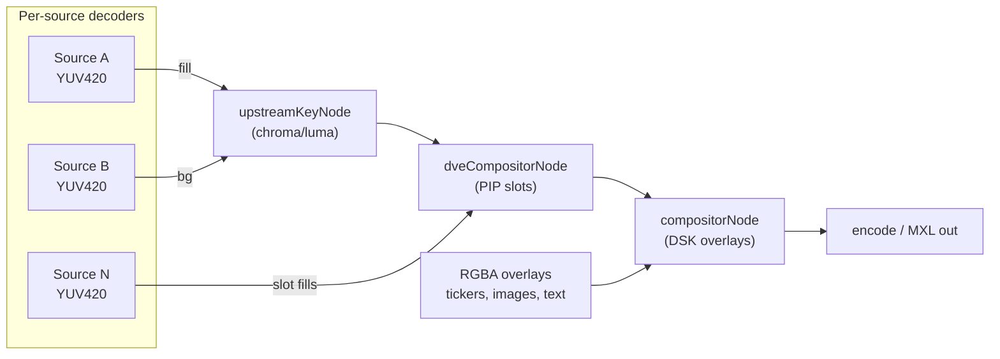

# Graphics and DVE

> **Where you are:** [docs](../README.md) → subsystems → graphics-and-dve
> **Read this first:** [architecture.md](../architecture.md)
> **See also:** [pipeline.md](../concepts/pipeline.md) · [switcher.md](switcher.md) · [stmap.md](stmap.md)

**TL;DR** Switchframe composites broadcast graphics and picture-in-picture effects in three distinct stages. Upstream keying runs per source before mixing (chroma/luma composites where a talent stands on a virtual-set fill), the DVE compositor arranges up to eight source slots into PIP layouts with 2D affine and 3D homogeneous transforms, and the downstream keyer (DSK) overlays browser-rendered RGBA graphics onto the finished program frame. All three operate directly in YUV420 planar space with SIMD kernels for alpha blending, so the hot path never touches RGB except at the overlay boundary. The compositors share a single design principle: snapshot under lock, process lock-free.

## The story

Live production has three kinds of compositing that look similar but behave very differently. Switchframe treats them as three separate subsystems sharing a common YUV420 toolkit, so operators can reason about the signal flow independently.

**Upstream keys** are per-source composites applied before a source reaches the program bus. A weather presenter in front of a green screen has an upstream chroma key that replaces the green with a virtual background. The key fires whether or not the source is on-air, because other subsystems (preview monitor, multiview, confidence recording) all need to see the keyed result. Upstream keys produce an alpha mask from the source's own luma or chroma, then blend a *fill* source onto a *background* source.

**DVE** (Digital Video Effects) is the picture-in-picture compositor. It takes up to eight source frames, applies per-slot transforms (position, scale, rotation, perspective, crop, border, shadow, 3D rotation on a plane or cube), and flattens them onto the program canvas in z-order. DVE is how you build a four-box debate panel, a corner PIP of the away team bench, or an over-the-shoulder news graphic slot.

**Downstream keying** is the last stage before the frame leaves the switcher. A DSK layer holds an RGBA bitmap — a lower third, a score bug, a station logo, an animated ticker, a typewriter-style headline — and blends it over whatever the program happens to be. DSKs have no relationship to source tally or routing; they're always on top and can fade in/out independently of transitions.

The reason these three are documented together is that they all solve the same low-level problem: blend an RGBA overlay or a YUV420 fill onto a YUV420 program frame, respecting BT.709 color space, without copying the frame more than once and without the hot path ever touching a mutex that a control-plane goroutine might be fighting over. They share SIMD kernels in [`graphics/blend.go`](../../server/graphics/blend.go), [`graphics/alphablend_kernels_*.s`](../../server/graphics/), and [`dve/composite.go`](../../server/dve/composite.go), and they all plug into the pipeline as [`switcher.PipelineNode`](switcher.md) instances with the same `Active() / Process()` contract.

## How it works

The video processing pipeline runs these three subsystems in a fixed order. Upstream keys come first because they need the fill sources from the source-decoder cache before the program frame is produced. DVE comes next because it mixes multiple sources into one frame — it has to happen after upstream keys have been baked into their respective fills. The DSK compositor runs last so graphics sit on top of everything else, matching how a hardware switcher puts the "DS" in "downstream".

Every stage reads the frame in-place, mutates it, and returns it. No stage allocates a new frame buffer per call; scratch buffers are owned by the node and resized only when the pipeline format changes.

### Downstream keyer (DSK)

The `graphics.Compositor` in [`server/graphics/compositor.go`](../../server/graphics/compositor.go) manages up to `DefaultMaxLayers` (8) independent graphics layers. Each layer has its own RGBA bitmap, position rect, z-order, fade position, optional animation, optional ticker state, and optional animated PNG sequence. Layers are composited bottom-up in z-order; each layer's blend modifies the frame before the next layer reads it.

The core call is `Compositor.ProcessYUV()`, which takes a raw YUV420 buffer plus reusable scratch buffers from the caller (the pipeline node owns them, so they stay hot in cache between frames). It has a fast path that returns instantly when no layer is active, visible, and non-transparent — checked under an `RLock` before the more expensive compositing pass. For 10-bit color pipelines, `ProcessYUV10` handles YUV422P10LE using the same layer model and a dedicated set of 10-bit blend kernels (`AlphaBlendRGBA10`, `AlphaBlendRGBARect10`).

Full-frame overlays take the fast path: `AlphaBlendRGBA()` blends the whole overlay against the whole frame using per-row SIMD kernels (`alphaBlendRGBARowY`, `alphaBlendRGBAChromaRow`). Sub-frame overlays go through `AlphaBlendRGBARectInto()`, which nearest-neighbor-scales each row of the overlay into a scratch strip, checks for a fully-transparent row (a 16-pixel-stride sparse probe), and then dispatches the *same* SIMD kernels — so sub-frame and full-frame blending share the hot-path code.

The two planes are blended separately. The Y plane is per-pixel. The chroma planes are blended at 4:2:0 resolution, which in practice means using the top-left pixel of each 2x2 block as the chroma donor. This is the standard BT.709 integer downsample (the one in `downsampleMask2x2()`), trading a small amount of chroma sharpness for a 4x speedup on the most bandwidth-hungry part of the blend.

Three engines live on top of the compositor:

- **`TextAnimationEngine`** ([`text_animation.go`](../../server/graphics/text_animation.go)) drives typewriter (character-at-a-time reveal) and fade-word animations. Both modes render text through [`textrender.Renderer`](../../server/graphics/textrender/textrender.go), which uses the embedded Inter font (Regular + Bold) with `golang.org/x/image/font/opentype` and caches font faces per point size. Fade-word pre-renders each word once at full opacity and just alpha-blits per frame, so only the alpha channel changes during animation.
- **`TickerEngine`** ([`ticker.go`](../../server/graphics/ticker.go)) pre-renders a long horizontal text strip (capped at `maxStripWidth = 65536` px to keep RAM sane) with a gap-text-gap-text layout for seamless looping. The strip is installed on the layer as a `tickerState`, and `Compositor.ProcessYUV` advances `xOffset` by `speed / pipelineFPS` each call — frame-locked scroll, so the ticker runs at exactly the pipeline's cadence whether that's 29.97 or 59.94.
- **`SequenceEngine`** / `sequence.go` plays animated PNG sequences (`seqPhaseIn` → `seqPhaseLoop` / `seqPhaseHold` → `seqPhaseOut`) with the same frame-locked advancement model. `CutOn`/`AutoOn`/`CutOff`/`AutoOff` route from `Compositor.On/Off/AutoOn/AutoOff` to the engine so operators see one unified on-air lifecycle regardless of whether the layer is a static PNG, a ticker, a text animation, or a PNG sequence.

Fade-in and fade-out animations (`AutoOn`, `AutoOff`) run in a dedicated goroutine at 60 Hz, interpolating `layer.fadePosition` linearly while the compositor's `RLock`-protected blend pass reads the current value. The pulse and transition animation modes (`runPulseAnimation`, `runTransitionAnimation`) use the same pattern, with transition supporting `ToRect`, `ToAlpha`, and easing curves (`applyEasing`: `linear`, `smoothstep`, `ease-in-out`). The `FlyIn`/`FlyOut`/`FlyOn` helpers are specializations of transition mode that compute an off-screen start or end rect using `offScreenRect()` and the registered `resolutionProvider`.

Each layer can also carry a persisted PNG via `SetImage` / `GetImage` / `DeleteImage`. The original PNG bytes stay in the layer for retrieval, and a decoded RGBA buffer is used for compositing. Setting an image also activates the layer and sizes the rect to the image's native dimensions (capped to program resolution, even-aligned for YUV420).

For GPU pipelines, `Compositor.SnapshotVisibleLayers()` returns a deep-copied `[]VisibleLayerSnap` under lock. The GPU compositor node ([`gpu/gpu_nodes.go`](../../server/gpu/gpu_nodes.go)) calls this once per frame, uploads overlay RGBA to GPU memory (or re-uses cached uploads when `VisibleLayerSnap.Gen` matches last frame), and dispatches Metal/CUDA blend kernels. The generation counter (`layer.overlayGen`) is the only piece of shared state the GPU path actually needs to invalidate.

### Upstream key chain

Upstream keying is orchestrated by two cooperating types: [`graphics.KeyProcessor`](../../server/graphics/key_processor.go) holds the per-source `KeyConfig`s (chroma, luma, or neural), and [`graphics.KeyProcessorBridge`](../../server/graphics/key_processor_bridge.go) caches the most recent YUV420 fill frame for each source with an enabled key.

Configuration lives in `KeyConfig`: key type, enabled flag, key color in YCbCr (for chroma), similarity/smoothness/spill-suppression (for chroma), low/high clip and softness (for luma), and an optional `FillSource` pointing at a different source to supply the fill layer. If `FillSource` is empty, the keyed source is both fill and alpha input (classic "self-fill" green-screen shot). When it's populated, the source-key acts as an alpha signal only — think of a broadcast switcher's "key + fill" pair where one input carries the matte and another carries the picture. This split is exposed as `KeyProcessor.KeyFills()` (tally RED — appears on air) and `KeyProcessor.KeyAlphas()` (tally AMBER — auxiliary contribution).

Per-frame flow (CPU path, `KeyProcessorBridge.ProcessYUV`):

1. Fast-exit if no keys are enabled.
2. Iterate keys in sorted source order (deterministic, rebuilt lazily via `rebuildSortedKeys`).
3. For each enabled key, look up the cached fill frame. If fill dimensions match the program, use directly; otherwise scale via a caller-registered `ScaleFunc` into a per-source cache.
4. Call `KeyProcessor.Process()`.

`KeyProcessor.Process()` then:

1. For chroma keys with spill suppression, copy the fill into a reused work buffer (so spill suppression can mutate the fill's chroma without racing the next IngestFillYUV).
2. Generate the alpha mask:
   - **Chroma** via `ChromaKeyWithSpillColorInto()` in [`keyer.go`](../../server/graphics/keyer.go). The kernel computes a squared Cb/Cr distance from `keyColor`, builds a chroma-resolution mask (half the pixels — each 2x2 luma block shares one Cb/Cr pair), then expands to full-res via per-row SIMD in `expandChromaMaskRow`. Similarity becomes a hard cutoff; smoothness defines a feather zone where alpha ramps from 0 to 255. The inner loop stays in integer fixed-point (fractional thresholds become `int` squared distances + a precomputed reciprocal range).
   - **Luma** via `LumaKeyInto()`: build a 256-entry byte LUT mapping each Y value to an alpha byte, then call `lumaKeyMaskLUT` (SIMD on amd64/arm64) to apply the LUT bulk.
3. Blend fill onto the background using the mask. Y plane uses `blendMaskY` per-pixel; chroma planes use `downsampleMask2x2` to average a 2x2 mask block into one chroma sample, then `blendMaskY` again on Cb and Cr. The fixed-point formula `w = alpha + (alpha>>7)` maps 0-255 into 0-256 so the final blend `(bg*(256-w) + fill*w + 128) >> 8` avoids a divide.
4. Clamp the output to BT.709 legal range: Y to [16, 235], Cb/Cr to [16, 240]. Blend arithmetic can preserve super-black/super-white values in the source; clamping after composite is the only way to guarantee a legal signal going downstream.

The bridge exposes `IngestFillYUV` (called by the source decoder callback), `RemoveFillSource` (called when a key is disabled), and parallel `*10` variants for 10-bit YUV422P10LE pipelines. For GPU pipelines, `SnapshotEnabledKeys()` returns deep-copied `[]EnabledKeySnap`s so the GPU node can dispatch without holding locks.

### DVE compositor

The DVE subsystem in [`server/dve/`](../../server/dve/) is the most ambitious of the three: it has to be a full broadcast-quality PIP compositor with rotation, perspective, crop, fade, border, shadow, and 3D effects — all running at pipeline cadence on the CPU, with a GPU fast path waiting in the wings.

A [`dve.Layout`](../../server/dve/types.go) is a named list of up to `MaxSlots` (8) slots. Each [`dve.Slot`](../../server/dve/types.go) carries a `SourceKey` (which source fills it), a z-order, an enabled flag, and a [`dve.Transform`](../../server/dve/types.go) that describes everything visual about the slot:

- **Geometry**: position, size, rotation, anchor (normalized 0-1 with zero-value fallback to center), perspective tilt X/Y.
- **Crop**: top/bottom/left/right inset, softness (feather), crop anchor.
- **Visual effects**: opacity, border (width + YUV color + corner radius + softness + inner width), shadow (enabled, offset, blur, opacity), defocus radius, mirror H/V, mosaic, saturation, brightness, contrast.
- **3D** (opt-in via `Mode3D == "3d"`): a [`Transform3D`](../../server/dve/types.go) with Euler rotations, FOV, camera distance, shape (`plane` or `cube`), lighting (enabled, direction, ambient, specular), reflection, and page-turn controls.
- **Source mapping**: `ScaleMode` (`stretch` / `fill` / `fit`) and `CropAnchor`, or a simpler `RectMode` where the user expresses position + size as an `OutputRect` and `Transform.ResolveRect()` computes the geometry + crop for the selected scale mode.

`Compositor.ProcessFrame()` in [`compositor.go`](../../server/dve/compositor.go) is the per-frame hot path. It uses a two-phase pattern that shows up everywhere in this subsystem:

**Phase 1** (under lock):
- Tick active animations via `tickAnimations()` — completed ones fire their `OnComplete` callback and drop off the list.
- Snapshot each enabled slot into a `slotSnapshot` on the reusable `snapCache` slice. The snapshot captures a deep copy of the fill frame (into the slot's own `snapBufs[idx]`, so subsequent `IngestSourceFrame` writes don't race), the resolved rect (running it through any active `slotAnimation.InterpolateRect`), alpha, and scratch buffer references.

**Phase 2** (lock-free):
- For fill-mode slots, crop the fill into an aspect-matching sub-region using `ComputeCropRect()` + `CropYUV420Region()` from [`crop.go`](../../server/dve/crop.go).
- If the transform needs warping (rotation or perspective), route to `processSlotDVEWarp()`. Otherwise scale the source to the slot rect with `transition.ScaleYUV420WithQuality(..., ScaleQualityFast)` (bilinear — Lanczos is 5-15x slower and imperceptible at PIP scale).
- Cache the scaled result back under lock, keyed by (srcW, srcH, dstW, dstH, pts). A fresh ingested frame invalidates the cache, but static slot dimensions mean repeated frames reuse the scaled output.
- Composite onto the output frame: `ComposePIPOpaque` for full opacity (three plane-by-plane `copy()` loops — fast), or `BlendRegion` for sub-1.0 alpha (same loops plus `transition.BlendUniformBytes` SIMD per row).
- Draw the border via `DrawBorderYUV`, which fills four strips (top/bottom/left/right) on Y and chroma planes at half resolution.

The DVE warp path (`processSlotDVEWarp`) is the slow lane for rotated or perspective slots. It builds an inverse homogeneous transform from `ComputeForwardTransform()` (translation-scale-rotate-perspective-translation chain) via `ComputeInverseTransform()`. For every output pixel in the slot's axis-aligned bounding box, it inverse-transforms to a source coordinate, clamps to fill bounds, and bilinear-samples the Y and chroma planes. It writes both the warped YUV and an alpha mask (255 where covered, 0 elsewhere) into pooled buffers (`dveWarpBuf`, `dveAlphaBuf`), then composites using `blendWithMask` so rotated corners don't overwrite the background.

Slot transitions drop into [`dve.SlotOn`](../../server/dve/compositor.go) / `SlotOff` via a configurable per-slot `SlotTransition` (`cut`, `dissolve`, or `fly`). Cut just flips `Enabled`. Dissolve appends a `slotAnimation` that interpolates alpha from 0 to 1 (or 1 to 0). Fly uses `flyInOrigin()` to compute the nearest off-screen start/end rect and animates the rect — same animation struct, different parameters. Animations are cubic-bezier-eased via the `Keyframe.EaseOutX`/`EaseOutY` handles (see [Animations, keyframes, and easing](#animations-keyframes-and-easing) below).

### Animations, keyframes, and easing

DVE animations have two forms. **Simple slot transitions** (on/off) use the `slotAnimation` struct directly — one segment, FromRect/ToRect, FromAlpha/ToAlpha, a `time.Duration`, and an optional easing function. **Keyframe animations** are the real thing: a [`dve.Animation`](../../server/dve/animation.go) is a named set of `Track`s, each targeting one parameter on one slot. Every `Track` holds a sorted sequence of `Keyframe`s, and each keyframe has a cubic-bezier control point pair (`EaseOutX`, `EaseOutY`) that controls the curve of the segment *after* it.

`Track.Evaluate()` walks the keyframes, finds the segment the current time sits in, and computes `cubicBezier(t, 0, 0, k0.EaseOutX, k0.EaseOutY)` — a single-handle bezier where the first control point is fixed at the origin. Newton-Raphson solves for the bezier parameter, falling back to bisection when convergence fails. The eased value then linearly interpolates between keyframe values. `Animation.EvaluateTransform()` dispatches track values onto a base `Transform` by parameter name (`"positionX"`, `"rotationDeg"`, `"border.width"`, etc.).

The animation *library* lives in [`animations_library.go`](../../server/dve/animations_library.go) and [`animations_extended.go`](../../server/dve/animations_extended.go). These are factory functions that build pre-canned animations for the DVE editor: entrances (`AnimFlyInLeft`, `AnimZoomIn`, `AnimSpinIn`, `AnimBounceIn`), exits (`AnimFlyOutLeft`, `AnimDropOut`, `AnimSpinOut`), and emphasis loops (`AnimPulse`, `AnimBreathScale`, `AnimRock`, `AnimFloat`, `AnimShake`, `AnimGlowPulse`, `AnimShadowDance`, `AnimSlowSpin`). Each returns an `*Animation` with the right tracks and keyframes; the caller (usually the REST handler in `api_dve.go`) attaches it to a slot.

### Transitions: 2D and 3D DVE library

The transition library in [`transition.go`](../../server/dve/transition.go) and [`transitions_library.go`](../../server/dve/transitions_library.go) is different from slot animations: these are **whole-frame transitions** between program and preview, driven by the switcher's transition engine at a position value from 0.0 to 1.0. Each `DVETransitionFunc` returns two `Transform`s — one for the outgoing program, one for the incoming preview — both at full frame size, both with whatever combination of position, rotation, 3D, perspective, and opacity the transition requires.

The 2D stable: `PushTransition` (direction), `SqueezeTransition`, `SpinTransition`, `ZoomTransition`, `FlyTransition` (with scale overshoot), `SwingTransition`, `SlideRevealTransition`, `ScaleRotateTransition`, `CrossZoomTransition`, `ShrinkGrowTransition`, `BarnDoorTransition`, `MosaicTransition` (defocus-dissolve), `CornerPeelTransition`.

The 3D stable (`Mode3D = "3d"`): `CubeSpinTransition`, `FlipTransition`, `DoorTransition`, `CarouselTransition`, `TumbleTransition`, `SwingDoorTransition`, `FoldTransition`, `CubeRollTransition`, `GlobeSpinTransition`, `PageTurnTransition` (with anchor at the pivot edge), `BounceTransition` (damped spring), `BlurDissolveTransition`.

`DVETransitionForType(string)` and `IsDVETransition(string)` route a transition type identifier (like `"dve-page-turn"` or `"dve-cube"`) to the right factory. All names are enumerated in `AllTransitionTypes()`.

### 2D matrix and 4x4 homogeneous 3D

The 2D path uses [`Matrix3x3`](../../server/dve/matrix.go), a row-major 3x3 homogeneous transform stored as a `[9]float32`. `ComputeForwardTransform()` chains `Translation(-anchor) → Scale → Rotation → Perspective → Translation(pos + anchor)` (right-to-left application), yielding a single matrix that maps source pixels to output pixels. `Invert()` computes the cofactor-based inverse with a small singularity threshold; `ComputeAABB()` transforms the four source corners to compute the minimum bounding rect (clamped and even-aligned for YUV420) so the warp loop knows which output pixels to process.

The 3D path lives in [`matrix4.go`](../../server/dve/matrix4.go). `Compute3DMVP()` builds a Model-View-Projection matrix for a unit video plane centered at the origin: `Projection(FOV, aspect, near, far) * View(translate -distance) * Model(RotateX * RotateY * RotateZ)`. `Invert4()` does cofactor-expansion inversion for ray-casting (for each output pixel, project back to find the corresponding point on the 3D geometry). The 3D shader (Metal/CUDA) uses these matrices directly; the CPU 3D path is currently a stub and 3D transitions rely on GPU dispatch.

### Presets and recall

The DVE preset store ([`dve/preset.go`](../../server/dve/preset.go)) persists complete `Preset`s (ID, name, slots, transition duration, easing) as JSON in a directory, with atomic write via temp-file-and-rename and path-traversal-safe IDs. `BuiltinPresets()` seeds eight factory presets (PIP in each corner, side-by-side, quad, three-box, over-shoulder) that exist regardless of what the user has saved — handy for demo mode and first-run UX.

`RecallPreset()` is the interesting bit. When the operator recalls a preset, instead of snapping to it, the function generates a transient `Animation` that interpolates every differing transform parameter from the *current* layout to the *target* layout over the preset's `TransitionMs` duration. Enable/disable transitions translate to opacity fades (0→target or current→0). This gives preset recall the look of a production workflow — everything slides and morphs in sync rather than cutting.

### Crop modes and fill calculation

When a source's aspect ratio doesn't match its slot, there are three ways to handle it:

- **`stretch`** (default): squash/stretch the source to fit. Trivial; no crop.
- **`fill`**: scale preserving aspect ratio so the source *covers* the slot, then crop the overflow. `ComputeCropRect()` in [`crop.go`](../../server/dve/crop.go) picks the largest aspect-matching sub-region, positioned by `CropAnchor` (normalized 0-1, default center). `CropYUV420Region()` extracts that sub-region into a per-slot crop buffer, then the scaler runs on the cropped data.
- **`fit`**: scale preserving aspect ratio so the source *fits inside* the slot, centered. Letterbox or pillarbox as appropriate. Handled in `Transform.ResolveRect()` by computing a fit rect and centering it within `OutputRect`.

All crop and position values are even-aligned (`EvenAlign(v int) int { return v &^ 1 }`) to keep YUV420 chroma planes in sync.

### Border rendering

`DrawBorderYUV` in [`composite.go`](../../server/dve/composite.go) draws a solid-color border *outside* a rect by filling four strips (top, bottom, left, right) on the Y plane at full resolution and on Cb/Cr at half resolution. It uses `fillYRows` for the luma and `fillChromaRows` for the chroma, both of which are tight row loops. Corner radius and inner-width / softness are not implemented on the CPU border path yet — they live in the GPU shaders (`gpu/metal/dsk.metal`, `gpu/metal/composite.metal`), with `isSimple(transform)` in the compositor detecting whether any advanced border parameters are set and falling back to the simple hard-edge rectangle if not.

## Key types and entry points

**DSK (graphics compositor):**
- Entry: [`server/graphics/compositor.go`](../../server/graphics/compositor.go) → `Compositor.ProcessYUV()` and `Compositor.ProcessYUV10()`
- State: `Compositor.layers` (map of ID → `*graphicsLayer`), `Compositor.sortedIDs` (z-order), guarded by `Compositor.mu`
- Lifecycle: `AddLayer`, `RemoveLayer`, `SetOverlay`, `SetLayerRect`, `On`, `Off`, `AutoOn`, `AutoOff`, `Animate`, `StopAnimation`, `FlyIn`, `FlyOn`, `FlyOut`, `SlideLayer`
- Hot path: `AlphaBlendRGBA()`, `AlphaBlendRGBARectInto()` in [`blend.go`](../../server/graphics/blend.go)
- GPU bridge: `Compositor.SnapshotVisibleLayers()` returning `[]VisibleLayerSnap`
- Pipeline node: [`switcher/node_compositor.go`](../../server/switcher/node_compositor.go) → `compositorNode.Process()`
- Text/ticker engines: [`text_animation.go`](../../server/graphics/text_animation.go), [`ticker.go`](../../server/graphics/ticker.go), [`sequence.go`](../../server/graphics/sequence.go)
- Text rendering: [`textrender/textrender.go`](../../server/graphics/textrender/textrender.go) → `Renderer.RenderText()`, `Renderer.MeasureText()`

**Upstream key chain:**
- Entry: [`server/graphics/key_processor.go`](../../server/graphics/key_processor.go) → `KeyProcessor.Process()`
- Bridge: [`server/graphics/key_processor_bridge.go`](../../server/graphics/key_processor_bridge.go) → `KeyProcessorBridge.ProcessYUV()` and `KeyProcessorBridge.ProcessYUV10()`
- State: `KeyProcessor.keys` (source → `KeyConfig`), `KeyProcessor.sortedKeys` (deterministic order), guarded by `KeyProcessor.mu`
- Fill cache: `KeyProcessorBridge.fills` / `fills10` (per source), guarded by `KeyProcessorBridge.mu`
- Hot path: `ChromaKeyWithSpillColorInto()`, `LumaKeyInto()` in [`keyer.go`](../../server/graphics/keyer.go); `blendMaskY`, `downsampleMask2x2` in [`key_processor.go`](../../server/graphics/key_processor.go)
- Tally: `KeyProcessor.KeyFills()` (RED/on-air), `KeyProcessor.KeyAlphas()` (AMBER/auxiliary)
- GPU bridge: `KeyProcessorBridge.SnapshotEnabledKeys()` returning `[]EnabledKeySnap`
- Pipeline node: [`switcher/node_upstream_key.go`](../../server/switcher/node_upstream_key.go) → `upstreamKeyNode.Process()`

**DVE compositor:**
- Entry: [`server/dve/compositor.go`](../../server/dve/compositor.go) → `Compositor.ProcessFrame()`
- Layout: [`server/dve/types.go`](../../server/dve/types.go) → `Layout`, `Slot`, `Transform`, `Transform3D`
- State: `Compositor.layout` (atomic `*Layout`), `Compositor.fills` (source → `*fillEntry`), guarded by `Compositor.mu`
- Ingest: `Compositor.IngestSourceFrame(sourceKey, yuv, w, h, pts)`
- Lifecycle: `SetLayout`, `UpdateSlot`, `UpdateSlotTransform`, `UpdateSlotRect`, `SlotOn`, `SlotOff`, `SetSlotTransition`, `AutoDissolveSource`
- Hot path: `ComposePIPOpaque`, `BlendRegion`, `DrawBorderYUV`, `FillRectBlack` in [`composite.go`](../../server/dve/composite.go); `ComputeCropRect`, `CropYUV420Region` in [`crop.go`](../../server/dve/crop.go); `processSlotDVEWarp` for rotated/perspective slots
- Math: `Matrix3x3.Multiply/Invert`, `ComputeForwardTransform`, `ComputeInverseTransform`, `ComputeAABB` in [`matrix.go`](../../server/dve/matrix.go); `Matrix4x4.Multiply4/Invert4`, `Compute3DMVP`, `Compute3DInverseMVP` in [`matrix4.go`](../../server/dve/matrix4.go)
- Animation: [`animation.go`](../../server/dve/animation.go) → `Animation`, `Track`, `Keyframe`, `Animation.EvaluateTransform()`, `cubicBezier()`
- Animation library: [`animations_library.go`](../../server/dve/animations_library.go), [`animations_extended.go`](../../server/dve/animations_extended.go) (factories + `AnimationCatalog()`)
- Transition library: [`transition.go`](../../server/dve/transition.go), [`transitions_library.go`](../../server/dve/transitions_library.go) → `DVETransitionForType()`, `IsDVETransition()`, `AllTransitionTypes()`
- Presets: [`preset.go`](../../server/dve/preset.go) → `PresetStore.Save/Load/Delete/List`, `BuiltinPresets()`, `RecallPreset()`
- GPU bridge: `Compositor.SnapshotSlots()` returning `[]SlotSnap` with pre-computed `DVEInvMatrix`
- Pipeline node: [`switcher/node_dve_compositor.go`](../../server/switcher/node_dve_compositor.go) → `dveCompositorNode.Process()`

**Application wiring (where these are instantiated):**
- [`server/cmd/switchframe/app.go`](../../server/cmd/switchframe/app.go) (the "Graphics compositor (DSK)" init block) — constructs the DSK compositor, wires resolution and FPS providers, attaches to switcher, starts the `htmlgfx` manager, constructs the DVE compositor and preset store. The upstream key processor + bridge are built in the same initialization block.

## Gotchas and invariants

- **Even alignment everywhere.** YUV420 means chroma is at half resolution in both dimensions. Every rect that ever touches the compositor (layer rect, DVE slot rect, animation interpolation, fly target) is even-aligned via `&^ 1` before use. Violating this produces chroma offset artifacts that look like color bleed on moving edges.
- **Fade position < 1/255 is treated as transparent.** The DSK compositor skips any layer whose `fadePosition < 1.0/255.0`, even if the layer is technically "active". This matches what the SIMD kernels would do anyway (0 * 256 = 0) but avoids running them at all. The same lower bound applies in the rect-mode scratch path.
- **The DSK fast path takes a brief RLock gap.** `ProcessYUV` acquires a write lock for ticker/sequence advancement, releases it, then re-acquires an `RLock` for compositing. In the gap, an animation goroutine can modify layer state (fade, rect, active). This is benign — at most a one-frame (~16-41 ms) delay in observing animation changes, invisible to the eye and a good trade for keeping the write lock scope tight.
- **Ticker advancement is rational, not float.** `pixelsPerFrame = speed * fpsDen / fpsNum`. With `SetPipelineFPS(30000, 1001)` for NTSC 29.97 fps, ticker scroll is exactly frame-accurate without drifting over a multi-hour broadcast.
- **Upstream key processing must copy the fill before spill suppression.** Chroma spill suppression modifies chroma in place. Without copying the fill, the next `IngestFillYUV` from the source decoder would race with a mid-blend read. The `spillWorkBuf` in `KeyProcessor.Process()` is the one place we must allocate (or reuse) a 3MB copy per chroma-spill frame. Luma keys and chroma keys without spill skip this copy.
- **BT.709 legal-range clamp runs after the composite.** Blending preserves super-black (Y<16) or super-white (Y>235) values from the source; `clampYPlane` and `clampCPlane` in `KeyProcessor.Process()` clamp to legal range so the signal going to the DVE compositor and DSK is always legal.
- **`KeyProcessor.sortedKeys` is the deterministic compositing order.** Never rely on Go's map iteration order. The sorted slice is rebuilt on every `SetKey` / `RemoveKey` so the compositing result is stable across restarts.
- **DVE atomic layout store.** `Compositor.layout` is `atomic.Pointer[Layout]`. `SetLayout` does allocation, buffer prep, and fill pruning under the mutex, then stores the pointer. `ProcessFrame` loads the pointer without a lock. That means a frame in flight may see either the old or new layout, never a torn one.
- **DVE scaled-result cache is PTS-keyed.** A source at the same PTS emitting the same frame reuses the cached scaled result. When `IngestSourceFrame` sees a new PTS, it calls `clear(entry.scaledCache)` — every slot's cached scale is invalidated at once, because the source's content has changed.
- **3D CPU path is a stub.** The CPU DVE warp path supports 2D transforms only (rotation, perspective). 3D (`Mode3D == "3d"`) requires GPU dispatch. On CPU-only builds, 3D transitions effectively become 2D passthrough with 3D metadata ignored — safe but visually uninteresting.
- **Singular matrices fall back to identity.** Both `Matrix3x3.Invert` and `Invert4` compare the determinant to a small epsilon (1e-12 and 1e-10 respectively) and return `false`. `ComputeInverseTransform` catches the false and substitutes `Identity()`, so an extreme animation (89.99° rotation with near-zero scale) degrades gracefully instead of producing NaN pixels.
- **Compositor layer count is bounded.** `AddLayer` returns `ErrTooManyLayers` once 8 layers exist. The compositor doesn't garbage-collect layers; `RemoveLayer` is the only way to free a slot. This keeps z-ordering stable across operator sessions.
- **Fill-source tally split is load-bearing.** If you build a new tally sink, make sure it respects the fact that a key's fill (`KeyProcessor.KeyFills()`) is RED (on-air) and its alpha-only source (`KeyProcessor.KeyAlphas()`) is AMBER (auxiliary). Mixing them up would make talent see their self-shot go red mid-take — confusing and wrong.

## Related docs

- **Concepts:** [pipeline.md](../concepts/pipeline.md), [media-path.md](../concepts/media-path.md), [frame-sync-and-timing.md](../concepts/frame-sync-and-timing.md), [gpu.md](../concepts/gpu.md), [locking-and-concurrency.md](../concepts/locking-and-concurrency.md)
- **Reference:** [api.md](../reference/api.md), [fast-control.md](../reference/fast-control.md), [state-broadcast.md](../reference/state-broadcast.md), [file-formats.md](../reference/file-formats.md)
- **Subsystems:** [switcher.md](switcher.md), [transition.md](transition.md), [stmap.md](stmap.md), [output.md](output.md), [playout.md](playout.md)
- **Integration:** [ui-server-contract.md](../integration/ui-server-contract.md), [cef-protocol.md](../integration/cef-protocol.md)
