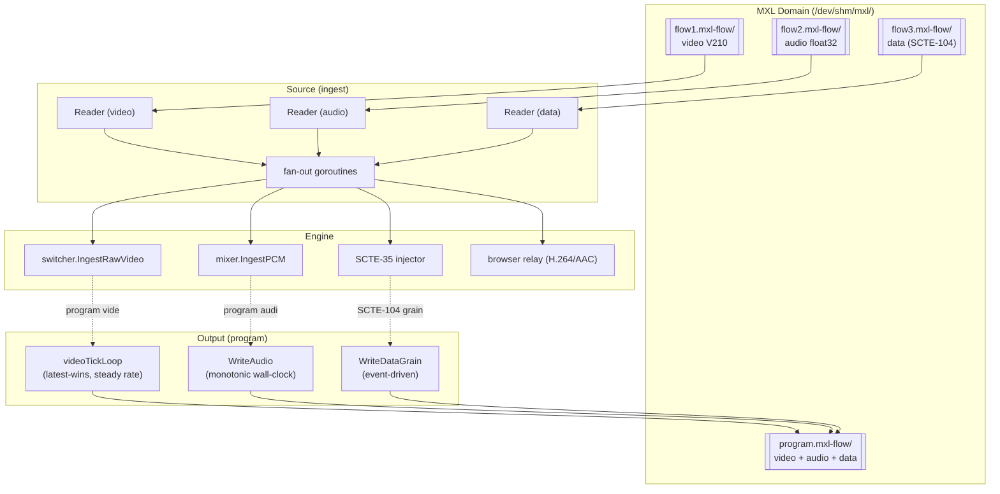

# MXL Shared-Memory Transport

> **Where you are:** [docs](../README.md) → subsystems → mxl
> **Read this first:** [architecture.md](../architecture.md)
> **See also:** [output.md](output.md) · [srt-ingest.md](srt-ingest.md) · [codec.md](codec.md) · [gpu.md](../concepts/gpu.md) · [captions.md](captions.md) · [scte35.md](../scte35.md)

**TL;DR** MXL is the path for uncompressed, broadcast-grade media: V210 10-bit 4:2:2 video and float32 PCM flowing through POSIX shared memory with wall-clock indexing. When Switchframe runs alongside another MXL application (a baseband ingest, an SDI capture, a graphics engine), sources and outputs appear as files in a domain directory (typically `/dev/shm/mxl`), NMOS IS-04 JSON flow definitions describe their format, and the MXL SDK gives everyone ring-buffered zero-copy access. Our [`Reader`](#reader-lifecycle) drains video, audio, and optional data flows into Go channels; our [`Writer`](#writer-lifecycle) publishes the program output at a steady tick rate with latest-frame-wins semantics; our [`Source`](#source-fan-out) and [`Output`](#output-program-to-shared-memory) wire those to the switcher, mixer, browser relay, and SCTE-104 data grains. All of it lives behind the `mxl` build tag — without it, the package is a stub that returns `ErrMXLNotAvailable` so dev builds stay portable.

## The story

Most of Switchframe's input paths are compressed: MoQ carries H.264, SRT carries any-codec-over-TS. MXL exists because a broadcast facility's signal chain is uncompressed between cameras, production switchers, and final encoders. Going through an H.264 round-trip mid-chain is both wasteful (CPU) and destructive (generation loss). If you have MXL running on the host — the NMOS IS-08 reference implementation, for example — you get a shared-memory transport that runs faster than the memory bus can saturate.

The wire format is V210: 10-bit 4:2:2 packed into 32-bit words, four pixels per dword pair. That's 40 bpp against YUV420p's 12 bpp — roughly 3.3× the bandwidth for 10-bit 4:2:2 fidelity. Internally, the switcher pipeline is 8-bit YUV420p (standard mode) or 10-bit 4:2:2 planar (professional mode with `Lossless10bit` enabled on the source). Conversion lives in [`v210.go`](../../server/mxl/v210.go) with SIMD kernels under [`v210asm/`](../../server/mxl/v210asm/) (amd64 and arm64 assembly, pure-Go fallback).

The MXL SDK is C, and we link it via cgo. The whole cgo implementation is under the `mxl` build tag; the default build uses a stub that makes MXL options fail fast with a clear error message. This keeps a laptop build from needing libmxl installed.

## How it works

### Discovery

An MXL domain is a directory — `/dev/shm/mxl` is the conventional Linux path. Inside it, each flow is a subdirectory named `<uuid>.mxl-flow` containing a `flow_def.json` (NMOS IS-04 "Flow" resource) and a shared-memory segment. [`Discover(domain)`](../../server/mxl/discovery.go) scans the directory, parses each flow definition via [`parseFlowDef`](../../server/mxl/discovery_parse.go), and asks the MXL SDK whether each flow has a live writer (`IsFlowActive`). The result is a list of `FlowInfo` structs the UI can render as a picker.

[`parseFlowDef`](../../server/mxl/discovery_parse.go) decodes the relevant NMOS fields: `format` tells us video vs audio vs data (mapping `urn:x-nmos:format:video` etc. to the internal `DataFormat` enum), `grain_rate` expresses the frame rate as a rational for video flows, `sample_rate` does the same for audio, `frame_width`/`frame_height` and `channel_count` populate the metadata. Anything else is ignored — we need just enough to hook up a reader.

### Reader lifecycle

[`Reader`](../../server/mxl/reader.go) is the continuous-pull abstraction. It has three flavors — video, audio, and data — each with its own goroutine and channel type. The goroutines run as blocking loops calling `ReadGrain` or `ReadSamples` on the underlying [`DiscreteReader`](../../server/mxl/types.go) or [`ContinuousReader`](../../server/mxl/types.go), which in turn calls the MXL SDK (`mxlFlowReaderGetGrain`, `mxlFlowReaderGetSamples`).

Three failure modes matter, and all three are distinguished by [sentinel errors](../../server/mxl/types.go) wrapped in [`statusError`](../../server/mxl/flow.go):

- **`ErrTimeout`** and **`ErrTooEarly`** are normal. The writer just hasn't produced the grain we asked for yet. We sleep briefly and retry without counting it as an error.
- **`ErrTooLate`** means the ring buffer wrapped past our read position — we fell behind. We re-sync to `HeadIndex() - 2` (slightly behind the writer for latency safety) and resume.
- Everything else is fatal. A counter bumps; 50 consecutive fatals kill the loop and the source disappears.

For audio, the read timeout is deliberately short (5 ms). The MXL SDK's internal polling grain is coarse, so a long C-side timeout holds the cgo thread hostage and starves concurrent flow readers. A 5 ms budget keeps the thread bouncing between Go and C so multiple audio streams can share cgo capacity.

PTS is derived from a monotonic counter inside each reader, starting at 0 and incrementing per grain (per-frame for video/data, per-batch for audio). Both loops capture `time.Now()` as `ReadTime` on the grain; downstream code (`processVideoGrain`, `processAudioGrain`) computes a shared wall-clock-based PTS off a `startTime` that's set by whichever flow produces the first grain. That gives video and audio a common epoch even if they start independently — if video arrives 200 ms after audio, the video PTS reflects that offset.

### The grain model vs the sample model

Video and ancillary data are "discrete" — one grain per frame, with slices holding the packed payload. Audio is "continuous" — a single rolling ring buffer with a per-sample index. The interfaces reflect this:

```go
DiscreteReader interface {
    ReadGrain(index uint64, timeoutNs uint64) ([]byte, GrainInfo, error)
    ConfigInfo() FlowConfig
    HeadIndex() (uint64, error)
    Close() error
}

ContinuousReader interface {
    ReadSamples(index uint64, count int, timeoutNs uint64) ([][]float32, error)
    ConfigInfo() FlowConfig
    HeadIndex() (uint64, error)
    Close() error
}
```

`ReadSamples` returns de-interleaved channels (one `[]float32` per channel). Each channel has its own backing segment in the ring buffer, and the SDK's `mxlWrappedMultiBufferSlice` can split a read across up to two fragments when the request straddles the ring wrap. The Go wrapper in [`flow.go`](../../server/mxl/flow.go) walks the fragments and copies into contiguous output slices.

### Writer lifecycle

[`Writer`](../../server/mxl/writer.go) is the publishing side. Its central invariant is **steady-rate output**: it writes exactly one grain per frame period even if the pipeline produced zero or five frames that period. The reason is that MXL readers sync to wall-clock indices — if we skip a grain, readers see `ErrTooEarly` and sleep; if we double-write, one overwrites the other. A steady tick matching the output frame rate keeps readers happy and produces a GST-compatible stream (the reference is `mxl-gst-testsrc`, which does exactly this).

The mechanism is a latest-wins buffer: `WriteVideo(yuv, w, h, pts)` converts YUV420p to V210 into one of three triple-buffered output slots (so the ticker can safely read the "published" buffer while the writer fills "next") and stores a pointer to the current buffer in `latestV210 atomic.Pointer[v210Frame]`. The `videoTickLoop` goroutine fires at the grain-rate interval, loads the latest pointer, computes `index = CurrentIndex(rate)` (wall-clock mapped to grain index), and calls `DiscreteWriter.WriteGrain`. During a cut, the last frame repeats while the switcher is waiting for the next keyframe — no gap. During a transition, the latest blended frame wins — no burst.

`WriteVideo10bit` is the professional-mode path that avoids the 10-bit→8-bit→10-bit round-trip. It takes YUV422P10LE input (preserves all 10 bits per sample and full 4:2:2 chroma) and converts losslessly to V210. Select this by setting `Lossless10bit: true` on the source config and running the pipeline in 10-bit 4:2:2 mode.

Audio uses a different model: wall-clock indexing with monotonic enforcement. `WriteAudio` de-interleaves incoming PCM into reusable per-channel buffers, computes the target index from `CurrentIndex(audioRate)`, and if that index is behind the previous write's end-of-batch, nudges forward to `lastAudioIndex + samplesPerCh`. This guarantees no overlap and no gap even when the wall clock disagrees with the sample count. The mixer produces audio on a 21.3 ms ticker, and this enforcement hides any minor drift at the edge.

`WriteDataGrain(data)` publishes SCTE-104 or other ancillary payloads. It's event-driven (called from the [`scte35` injector's sink](../../server/scte35/)), not ticker-driven: the current wall-clock index is computed fresh per call and the grain is written once. [`SetDataWriter`](../../server/mxl/writer.go) binds the data flow to the video frame rate so index domains align with video frame timing (matches how SCTE-104 in SDI is embedded in the VANC region of video frames).

### Source: fan-out

[`Source`](../../server/mxl/source.go) is the input-side orchestrator. Given a video flow, an audio flow, and an optional data flow (all opened by the caller against an `Instance`), it spins up per-flow readers and fan-out goroutines that:

1. Deliver raw YUV420p (or YUV422P10LE in lossless mode) to the switcher pipeline via `OnRawVideo`.
2. Deliver interleaved float32 PCM to the mixer via `OnRawAudio`.
3. Deliver raw data payloads (e.g. SCTE-104) via `OnDataGrain`.
4. Encode YUV to H.264 at full quality for the browser relay via `EncoderFactory`, or route to a `PreviewEncoder` for low-bitrate multiview.
5. Encode PCM to AAC via `AudioEncoderFactory` for the browser relay.
6. When `PreviewEncoder` is set AND `ReplayViewer` is set, dual-encode: preview feeds the relay at lower bitrate, full-quality feeds the replay viewer directly.
7. Fire `OnVideoInfo` once after the first keyframe with SPS/PPS so the caller can publish an `AVCDecoderConfig` on the relay — browsers need that to initialize their `VideoDecoder`.

The V210→YUV420p conversion is the hot path. [`V210ToYUV420pInto`](../../server/mxl/v210.go) processes two rows at a time, unpacking both rows' V210 data and averaging their chroma values directly into 4:2:0 output — fused unpack + 4:2:2→4:2:0 downsample with no full-frame intermediate. The per-row kernels (`V210UnpackRow`, `ChromaVAvg`) dispatch to SIMD in [`v210asm/`](../../server/mxl/v210asm/).

### Output: program to shared memory

[`Output`](../../server/mxl/output.go) publishes the program (not individual sources) to MXL. `Start` takes a video flow writer, an audio flow writer, a [`SwitcherSinkSetter`](../../server/mxl/output.go), and a [`MixerSinkSetter`](../../server/mxl/output.go); it wires the switcher's raw-video sink to `Writer.WriteVideo` and the mixer's raw-audio sink to `Writer.WriteAudio`.

`StartLifecycle` is the looser version used when the sinks can't be wired by interface (for example when 10-bit output needs the `WriteVideo10bit` overload — see `app_mxl_demo.go` which routes based on `pf.Format`). It sets up the lifecycle and ticker but leaves sink wiring to the caller. It optionally accepts a data writer for SCTE-104 output: the data flow indexes are computed against the video frame rate so ancillary grains align to frame boundaries (matching SDI VANC semantics).

`Stop` is synchronous: it cancels the context, closes the writer (which joins the ticker goroutine), and returns. That ordering is load-bearing — the caller often needs to call `Instance.Close()` immediately after, which would race against a still-open writer otherwise.

### Demo readers

Development without real MXL flows uses [`DemoVideoReader`](../../server/mxl/demo.go) and [`DemoAudioReader`](../../server/mxl/demo.go). The video reader generates a moving color-bar or green-screen test pattern in YUV420p (reusable buffer, generated per-call), converts to V210, and paces at a requested FPS via `time.Sleep`. Two patterns are built in: `PatternColorBars` for the default source and `PatternGreenScreen` for a chroma key demo (BT.709 green background with a sweeping white rectangle and a static logo in the corner). The audio reader generates a 440 Hz stereo sine tone at −20 dBFS.

Demo readers implement `DiscreteReader` and `ContinuousReader` directly, so `Source` and `Reader` can drive them exactly like real flows. See [`app_mxl_demo.go`](../../server/cmd/switchframe/app_mxl_demo.go) for the wiring.

### Cgo Instance management

[`Instance`](../../server/mxl/flow.go) wraps the SDK's `mxlInstance` handle. `NewInstance(domain)` creates it and spawns a 30-second GC ticker that calls `mxlGarbageCollectFlows` to clean up stale entries from crashed writers. `Close` uses a `sync.Once` so concurrent callers don't double-free; it joins the GC goroutine before destroying the handle so the C code isn't touching freed memory.

`OpenReader`, `OpenAudioReader`, `OpenWriter`, `OpenAudioWriter` are the flow handles. Each is a thin cgo wrapper that copies Go strings to C, calls the SDK, checks status, and wraps the resulting C handle in a Go struct implementing the reader or writer interface. The `statusError` function translates MXL status codes to Go errors with sentinel wrapping — `MXL_ERR_OUT_OF_RANGE_TOO_LATE` wraps `ErrTooLate`, `MXL_ERR_TIMEOUT` wraps `ErrTimeout`, etc., so `errors.Is(err, ErrTooLate)` is the idiomatic check in the reader loops.



## Key types and entry points

- Entry: [`server/mxl/types.go`](../../server/mxl/types.go) → `FlowOpener`, `DiscreteReader`, `ContinuousReader`, `DataFormat`, sentinel errors
- Discovery: [`server/mxl/discovery.go`](../../server/mxl/discovery.go) → `Discover()`; [`discovery_parse.go`](../../server/mxl/discovery_parse.go) → `parseFlowDef()`
- Cgo core: [`server/mxl/flow.go`](../../server/mxl/flow.go) → `Instance`, `statusError()`, reader/writer impls
- Reader: [`server/mxl/reader.go`](../../server/mxl/reader.go) → `Reader.videoLoop()`, `audioLoop()`, `dataLoop()`
- Writer: [`server/mxl/writer.go`](../../server/mxl/writer.go) → `Writer.WriteVideo()`, `WriteAudio()`, `videoTickLoop()`, `WriteDataGrain()`
- Source: [`server/mxl/source.go`](../../server/mxl/source.go) → `Source.Start()`, `processVideoGrain()`, `encodeAndBroadcastVideo()`
- Output: [`server/mxl/output.go`](../../server/mxl/output.go) → `Output.Start()`, `Output.StartLifecycle()`
- V210: [`server/mxl/v210.go`](../../server/mxl/v210.go) → `V210ToYUV420pInto()`, `YUV420pToV210Into()`, `V210LineStride()`
- SIMD: [`server/mxl/v210asm/`](../../server/mxl/v210asm/) → `V210UnpackRow`, `V210PackRow`, `ChromaVAvg` (amd64/arm64/generic)
- Demo: [`server/mxl/demo.go`](../../server/mxl/demo.go) → `DemoVideoReader`, `DemoAudioReader`
- Build tags: [`cgo.go`](../../server/mxl/cgo.go) (real, `cgo && mxl`), [`stub.go`](../../server/mxl/stub.go) (stub, `!cgo || !mxl`)

## Gotchas and invariants

- The `mxl` build tag is required for the real implementation. Without it, `NewInstance` and all open calls return `ErrMXLNotAvailable`. Error-check at startup and fall through to a non-MXL ingest path rather than panicking.
- V210 width must be divisible by 6. V210 packs 6 pixels into 16 bytes; non-multiple-of-6 widths don't round-trip. The pack/unpack routines return an explicit error. Pipeline format selection should enforce this at configuration time.
- Reader timeouts are load-bearing. The audio 5 ms timeout is NOT a latency budget — it's a cgo-thread-yield budget. Raising it starves concurrent flow readers. The video 100 ms timeout is a latency budget; increasing it delays `ctx.Done()` response by up to that much.
- `Writer.videoTickLoop` publishes at exactly one grain per tick. Do NOT call `WriteVideo` from multiple goroutines expecting all calls to land in MXL — only the latest wins between ticks. The pipeline deliberately produces at-most-one frame per tick so this is never an issue.
- Audio `WriteSamples` indices must be monotonic. The writer clamps `index` to `lastAudioIndex + samplesPerCh` to prevent overlap, but a caller providing indices going backwards still confuses readers. `CurrentIndex(rate)` is the right source.
- `ErrTooLate` vs `ErrTooEarly` both indicate "reader out of sync with writer" but require different recovery. Too-late: re-sync forward (`HeadIndex() - 2`). Too-early: wait. Never spin on either without backoff — the SDK's return timing is not guaranteed.
- MXL PTS starts monotonic-from-zero per flow. Video and audio PTS are independent domains. The `Source` orchestrator establishes a shared wall-clock epoch (`startTime` set by the first grain of either stream) to compute downstream PTS that aligns video and audio on the same 90 kHz clock.
- `Output.Stop()` must return before `Instance.Close()` is called. The output writer holds C flow handles; the instance owns the domain. Out-of-order shutdown causes use-after-free in the SDK. `Stop` is synchronous precisely to make this correct by default.
- The triple-buffered V210 output in `Writer` is sized 3× `V210BufSize(width, height)` — at 1080p that's ~3 × 5.5 MiB = ~16.5 MiB per writer. Multiple writers in the same process multiply this. Plan accordingly on small-memory hosts.

## Related docs

- **Concepts:** [pipeline.md](../concepts/pipeline.md) · [media-path.md](../concepts/media-path.md) · [frame-sync-and-timing.md](../concepts/frame-sync-and-timing.md) · [gpu.md](../concepts/gpu.md)
- **Reference:** [config-and-flags.md](../reference/config-and-flags.md) · [file-formats.md](../reference/file-formats.md)
- **Subsystems:** [output.md](output.md) · [srt-ingest.md](srt-ingest.md) · [codec.md](codec.md) · [switcher.md](switcher.md) · [audio.md](audio.md) · [captions.md](captions.md) · [scte35.md](../scte35.md)
- **Operations:** [deployment.md](../operations/deployment.md)
