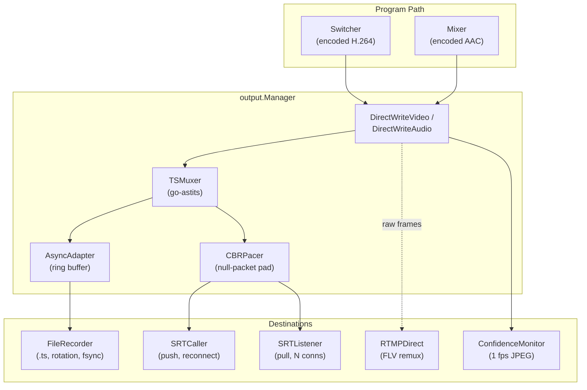

# Output Engine

> **Where you are:** [docs](../README.md) → subsystems → output
> **Read this first:** [architecture.md](../architecture.md)
> **See also:** [srt-ingest.md](srt-ingest.md) · [codec.md](codec.md) · [mxl.md](mxl.md) · [scte35.md](./scte35.md) · [captions.md](captions.md)

**TL;DR** The output engine is the wide end of the funnel: it takes the program video and audio that the switcher and mixer have produced and hands them to every destination the operator has configured — an on-disk recording, one or more SRT streams (push or pull), an RTMP ingest, or all of the above simultaneously. A single `output.Manager` owns the MPEG-TS muxer and a dynamic set of `Adapter` instances (plus a separate `FrameAdapter` path for RTMP direct FLV). The muxer is lazily created on first use and torn down when the last destination goes away, so an idle rig consumes zero CPU on output. A [CBR pacer](#cbr-pacing) inserts null packets to give SRT destinations a rock-steady muxrate, an [async adapter](#backpressure-and-async-writes) shields the hot path from slow disk or network, and a [confidence monitor](#confidence-monitoring) emits a 1 fps JPEG thumbnail for the UI.

## The story

In a typical rig, the operator hits **REC** and the program starts writing to disk. A minute later they want to push the same program to a CDN over SRT. A minute after that, marketing asks for an RTMP feed to the website. The output engine turns all of those into a single rule: *the switcher and mixer deliver frames; the manager fans them out to whichever destinations are currently enabled.*

Everything downstream of the switcher lives in [`server/output/`](../../server/output/). The switcher calls `Manager.DirectWriteVideo()` once per program video frame; the mixer calls `Manager.DirectWriteAudio()` once per audio frame. Those two methods are the entire input surface. They never block, never allocate, and never return errors — they drop into an atomic pointer, look up the current muxer, and fan the frame out. See the `DirectWriteVideo` and `DirectWriteAudio` methods on `Manager` for the exact hot path.

The manager is the orchestrator and everything else is an adapter. [`Adapter`](../../server/output/types.go) is the interface every TS-based destination implements (`ID`, `Start`, `Write(tsData)`, `Close`, `Status`). [`FrameAdapter`](../../server/output/types.go) is the parallel interface for destinations that bypass TS muxing entirely and take raw codec frames (`WriteVideo`, `WriteAudio`) — today that's only RTMP, which muxes to FLV directly via libavformat.

## How it works

The manager tracks three independent worlds: the legacy single `srtOutput` adapter, a single `recorder`, and the modern multi-destination map keyed by ID. On every mutation (`StartRecording`, `StartSRTOutput`, `AddDestination`/`StartDestination`, and their inverses) it calls `rebuildAdaptersLocked()` to compute the union of live adapters, then `ensureMuxerLocked()` to create the muxer if any adapter is active, or `stopMuxerIfNoAdaptersLocked()` to tear it down if none are.

### The TS muxer

[`TSMuxer`](../../server/output/muxer.go) wraps `go-astits` to produce 188-byte MPEG-TS packets. It is stateful and lazy: the first call to `WriteVideo()` with a keyframe triggers `init()`, which registers the video and audio elementary streams (H.264 or HEVC detected from `frame.Codec`, AAC with ADTS), optionally adds a SCTE-35 stream with the CUEI registration descriptor, writes initial PAT/PMT, NIT (with the "Switchframe" network name), and SDT (with a `service_type` derived from codec and resolution per ETSI EN 300 468). Non-keyframe video arriving before the first IDR is silently dropped; audio is dropped too because writing stale audio before video creates a PTS gap that causes visible A/V desync.

Once initialized, `WriteVideo()` does the heavy lifting: it converts 4-byte length-prefixed wire-format NALUs to Annex B, prepends SPS/PPS (or VPS+SPS+PPS for HEVC) on keyframes, optionally injects a caption SEI NALU before the first VCL NALU (from [`caption.Manager.PendingCaptionSEI()`](../../server/caption/sei.go) — see `hasCaptionSEI` which walks the SEI message list to avoid double injection), computes a PCR-on-keyframe adaptation field, rebases the upstream wall-clock PTS to a near-zero base (for SRT TSBPD compatibility), adds the current lip-sync offset to video PTS only (see [pipeline.md](../concepts/pipeline.md) and [frame-sync-and-timing.md](../concepts/frame-sync-and-timing.md) for why video gets offset and not audio), and finally writes the PES via `astits.Muxer.WriteData()`. Periodic NIT and SDT re-emission every 10 s and 2 s respectively keeps metadata fresh for late-joining viewers.

The muxer also maintains a small `pendingIDRSCTE35` queue. Calls to `WriteSCTE35()` after initialization buffer sections here instead of writing them immediately; they flush on the next keyframe (or after a 120-frame timeout) so SCTE-35 cues are co-located with the IDR they reference. See [scte35.md](./scte35.md) for the full cue lifecycle.

### Multi-destination model

Each destination has a config (`DestinationConfig` — type, address/port or URL, latency, encryption, per-destination `MaxBW`, `SCTE35Enabled`, optional `Engine` label for multi-engine redundancy) and a runtime `Destination` struct with its own lock, its own adapter, an optional `AsyncAdapter` wrapper, and a `status()` method that reports live bytes-written, state, dropped packets, and overflow count. See [`destination.go`](../../server/output/destination.go).

`AddDestination()` validates and creates a Destination but does not start it; the operator calls `StartDestination()` to arm it. In a pair of engines both store one destination under one ID (the UI sends the ID, `AddDestinationWithID()`), and the `Engine` field names the one that sends it: engine A unless the create says otherwise. The other engine holds it armed on standby and reports state `standby`. `ReassignDestinationEngine()`, sent to both engines, moves the sender: the old one stops its adapter and stands by, the new one starts it. An `srt-listener` has no standby: each engine listens on its own address and a receiver picks one. See [Dual-engine failover](#dual-engine-failover).

### CBR pacing

SRT is happiest when it sees a constant bitrate. Variable-rate encoders emit burst after lull: an IDR costs 10× the bytes of a P frame at 30 fps, and if your SRT socket has a 120 ms receive buffer, a badly-timed GOP can blow past it. Switchframe solves this with [`CBRPacer`](../../server/output/cbr_pacer.go), which sits between the muxer and any SRT adapter.

`SetCBRMuxrate(bps)` activates it. A 10 ms tick loop computes byte-debt against a monotonic clock (`targetBytes = elapsed_secs * bytesPerSec`), swaps the producer's accumulation buffer, and emits real TS bytes plus enough 188-byte null packets (PID `0x1FFF`) to hit the target. When real data exceeds the budget — typically during an IDR — the pacer sends it in full and marks a "burst tick" rather than drop frames; the SRT 120 ms buffer absorbs the brief overage. Null packets are pre-allocated in a 1 MiB slab once at startup and copied, never built per-tick. `CBRPacerStatus` exposes null-packet count, real bytes, padding bytes, and burst tick count for the debug snapshot. When CBR is on, the recorder still gets raw variable-rate TS (no wasted disk on null packets) but SRT destinations get the paced stream.

### Backpressure and async writes

Non-SRT destinations (currently just the recorder) write through [`AsyncAdapter`](../../server/output/async_adapter.go). It wraps an inner adapter with a 256-slot pooled-buffer channel (~8 seconds at 30 fps). `Write()` pool-copies the TS chunk, non-blocks into the channel, and returns immediately; a drain goroutine pulls from the channel and calls the real `Write()`. If the channel fills, packets are dropped and counted — a slow disk will not stall the muxer or starve SRT. `SRTListener` has its own per-connection buffered channel for the same reason; a slow VLC client gets its own drops rather than dragging down every other viewer.

### SRT push and pull

[`SRTCaller`](../../server/output/srt_caller.go) is push mode: it dials a remote receiver and writes TS bytes. On failure it enters `StateReconnecting`, stores new writes in a 4 MiB [`ringBuffer`](../../server/output/ringbuf.go), and spawns a reconnect goroutine that retries with exponential backoff + 20% jitter. When the connection comes back, the ring is discarded (delta frames after a gap would only produce decoder artifacts on the receiver) and the caller enters an **IDR gate**: it drops every write until the next keyframe (or 2 seconds pass, whichever comes first). The `onReconnect` callback fires with an `overflowed` boolean so the manager can log when ring capacity was exceeded — that's the signal that actual data was lost, not just stalled. Stats are polled every second from the underlying srtgo connection and pushed into [`srt.ConnStats`](../../server/srt/stats.go) for the UI.

[`SRTListener`](../../server/output/srt_listener.go) is pull mode: it binds a port, accepts up to `MaxConns` clients, and each client gets its own goroutine draining a 512-slot channel. `Write()` broadcasts the TS bytes to every channel non-blocking — slow clients get drops, fast ones get frames. The `onConnect` callback asks the encoder for an IDR keyframe when a new client joins, so the newcomer can start decoding immediately instead of waiting up to 2 s for a natural GOP boundary. Stats are polled per-connection and aggregated into a single `ConnStats` entry (they all serve the same stream).

The `chunkedConn` wrapper in [`srt_common.go`](../../server/output/srt_common.go) splits writes into ≤1316-byte SRT live payloads. [`srt_wire.go`](../../server/output/srt_wire.go) contains the real srtgo glue (`SRTConnect`, `SRTAcceptLoop`) injected into the manager via `SetSRTWiring()` so the output package stays testable without srtgo imports. [`srtgoConn`](../../server/output/srt_wire.go) adapts the srtgo `Conn` to the internal `srtConn` and `SRTStatter` interfaces.

### RTMP direct FLV

RTMP is a special case: it doesn't want MPEG-TS, it wants FLV. Rather than mux to TS and immediately demux-and-remux to FLV, [`RTMPDirect`](../../server/output/rtmp_direct.go) takes raw `media.VideoFrame` and `media.AudioFrame` and hands them to libavformat's FLV muxer over a cgo boundary. It is the only current `FrameAdapter` — `Manager.DirectWriteVideo()` and `DirectWriteAudio()` fan out to the frame adapter list separately from the muxer.

The C side parses SPS dimensions to populate FLV metadata (`sps_get_dimensions` — a minimal exp-Golomb decoder with emulation-prevention byte stripping), builds an `AVCDecoderConfigurationRecord` from SPS/PPS, builds an `AudioSpecificConfig` for AAC, and calls `avformat_write_header()`. After that each `WriteVideo` call copies the AVC1-format wire data into an `AVPacket`, tags it with the keyframe flag, and calls `av_interleaved_write_frame()`. On write failure, the direct adapter caches the last SPS+PPS so a reconnect doesn't have to wait for the next keyframe — it can re-open the FLV stream eagerly and then IDR-gate until the next real keyframe arrives. HEVC sources get transparently transcoded to H.264 because standard RTMP doesn't speak HEVC (see `transcodeHEVC()` and `rtmp_transcode.go`).

The stub in [`rtmp_direct_stub.go`](../../server/output/rtmp_direct_stub.go) returns `ErrRTMPNotAvailable` when FFmpeg is compiled out. `rtmpMaskURL()` replaces stream keys with `****` before logging — RTMP URLs carry secrets in the path.

### Confidence monitoring

[`ConfidenceMonitor`](../../server/output/confidence.go) generates a 320×180 JPEG thumbnail at most once per second from program keyframes so the UI can display a "we're still on air" preview. It maintains one persistent H.264 decoder, a rate limiter inside the critical section (to prevent concurrent decode entries), and cached scratch buffers for the scale + YUV→RGB → JPEG path. `IngestVideo()` fires from `DirectWriteVideo()`; `LatestThumbnail()` is polled by the admin HTTP endpoint. Decode errors are counted via `decodeErrors` and exposed in the debug snapshot.

### Viewer: the old path

Before the direct-write hot path, the manager used a [`Viewer`](../../server/output/viewer.go) that sat on the Prism program relay and fed TS to the muxer via buffered channels. That path is still present for backfill and exposes `SendVideo`/`SendAudio`/`SendCaptions` with non-blocking channel sends and the same video-priority drain as the switcher; new deployments go through `DirectWriteVideo`/`DirectWriteAudio` for lower latency (3 goroutine hops and 3 channel buffers eliminated).

### SCTE-35 packet filtering

[`scte35Filter`](../../server/output/scte35_filter.go) wraps an `Adapter` and strips TS packets matching the configured SCTE-35 PID before forwarding. It's used when a destination has `SCTE35Enabled: false` — for example, a YouTube RTMP relay doesn't want splice cues. The filter has a fast path that scans for a PID match without allocating (SCTE-35 packets are rare) and only copies when it has to strip. See [scte35.md](./scte35.md) for how cues get into the TS in the first place.

### Dual-engine failover

`ReconcileDestinations()` runs every second on an engine with an engine label and a peer, from the peer's last health poll (`/api/peer/health` lists in `sending` the destinations the peer sends, in `armed` the ones started on it and in `destinations` all of them). A poll sent before this engine last moved, armed or started a destination is not acted on for it, other than a peer that is down: after a switch-over the first ticks still see the old sender in the last poll. The UI sends a change to both engines and may land the second leg up to 4s after the first (a 3s request timeout and a retry 500ms later), so a poll sent within 4s of the change is not read as the peer still sending the destination or having stopped it.

- The standby takes over an armed RTMP, RTMPS or SRT caller destination once the peer has failed the peer-health failure threshold of polls (3 polls 5s apart by default, so 10-15s after the peer stops answering), or when the peer answers but has neither sent nor held it for that long, as after a restart that lost its state. It then names itself the sender.
- A standby whose peer holds the destination stopped disarms it; one whose peer process listed it and no longer does deletes it. A stop or delete the operator sent to both engines may reach only one. A peer that restarted, which its health uptime shows, is not read this way.
- An engine that comes back takes the destinations over from the peer's state snapshot at startup, under the same IDs and with the peer's sender, so it stays on standby. A destination it names itself the sender of, as one `--outputs-config` declares, waits for the first peer poll and goes to the peer if the peer sends it.
- Before an engine starts a destination on its own, on a takeover or from the peer's snapshot, it reads the peer's health once more and stands by if the peer sends it: a snapshot or a poll taken before the peer's takeover still names this engine. An operator's start or switch-over starts at once.
- Engines that cannot reach each other while both run both send: each sees the other down. When they reach each other again the leader keeps sending and the other stands by.
- A destination from `--outputs-config` takes its ID from its type, URL or address and port, and stream ID, so both engines store it under one ID whatever order their files list it in. Two entries with all of these equal are refused.

Destinations live in memory only; an engine restarted while its peer is down comes back without the destinations created over the API.

### Engine lifecycle and lip-sync

`ensureMuxerLocked()` creates the muxer on the first active output, `stopMuxerIfNoAdaptersLocked()` tears it down when the last goes away. `onMuxStart` fires to request an IDR keyframe so the muxer can initialize immediately rather than waiting up to a GOP for the next natural keyframe. `LatchLipSync()` permanently fixes the video-PTS delay once the ref-clock measurement has stabilized (see [frame-sync-and-timing.md](../concepts/frame-sync-and-timing.md)); `lipSyncSource` is otherwise polled per frame with 450-tick hysteresis and an EMA to smooth drift.

## Key types and entry points

- Entry: [`server/output/manager.go`](../../server/output/manager.go) → `NewManager()`, `Manager.DirectWriteVideo()`, `Manager.DirectWriteAudio()`
- Muxer: [`server/output/muxer.go`](../../server/output/muxer.go) → `TSMuxer.WriteVideo()`, `TSMuxer.WriteAudio()`, `TSMuxer.WriteSCTE35()`
- Pacer: [`server/output/cbr_pacer.go`](../../server/output/cbr_pacer.go) → `CBRPacer.tick()`, `ComputeMuxrate()`
- Recorder: [`server/output/recorder.go`](../../server/output/recorder.go) → `FileRecorder.Write()` with rotation + periodic `fsync`
- SRT push: [`server/output/srt_caller.go`](../../server/output/srt_caller.go) → `SRTCaller.reconnectLoop()` with IDR gate
- SRT pull: [`server/output/srt_listener.go`](../../server/output/srt_listener.go) → `SRTListener.AddConnection()`, `connWriter()`
- RTMP: [`server/output/rtmp_direct.go`](../../server/output/rtmp_direct.go) → `RTMPDirect.writeLoop()`, `rtmp_flv_open()` (C)
- Ring: [`server/output/ringbuf.go`](../../server/output/ringbuf.go) → TS-aligned overflow-tolerant buffer
- Async: [`server/output/async_adapter.go`](../../server/output/async_adapter.go) → 256-slot drop-on-full wrapper
- Destination: [`server/output/destination.go`](../../server/output/destination.go) → `DestinationConfig`, `DestinationStatus`
- Confidence: [`server/output/confidence.go`](../../server/output/confidence.go) → `ConfidenceMonitor.IngestVideo()`
- SCTE-35 filter: [`server/output/scte35_filter.go`](../../server/output/scte35_filter.go) → `scte35Filter.Write()`
- Types: [`server/output/types.go`](../../server/output/types.go) → `Adapter`, `FrameAdapter`, `AdapterState`, sentinel errors

## Gotchas and invariants

- `Manager.DirectWriteVideo()` and `DirectWriteAudio()` are called synchronously from the switcher encode goroutine and the mixer output ticker respectively. They must never block. Every downstream adapter is behind a non-blocking channel or atomic pointer. Writing a blocking adapter here will stall the program pipeline.
- Lock ordering: `Manager.mu` must be acquired before `Destination.mu`. Never acquire `Manager.mu` while holding a destination lock. `stopMuxerLocked()` drops the lock to call `onMuxStart` because the callback can re-enter manager methods.
- The muxer is lazy on the first video keyframe, not on first output. A destination starting mid-GOP will see zero bytes until the next IDR. The `onMuxStart` callback exists precisely to ask the encoder for an early IDR so startup latency is bounded.
- SRT reconnect never flushes the ring buffer — the remote decoder has lost state, so replaying buffered delta frames would just produce corruption. The ring data is always discarded and the caller IDR-gates until the next keyframe (with a 2 s forced-clear to avoid indefinite silence during transitions that emit only P-frames).
- `SRTListener.Write()` writes to per-client channels non-blocking — a slow client drops packets, it does not backpressure other clients. The `clientDrops` counter surfaces in the debug snapshot.
- CBR is all-or-nothing per-stream. Destinations that share the pacer get identical TS bytes. If you need per-destination bitrates, configure `MaxBW` on each destination config; the SRT layer will derive its own bandwidth ceiling from `InputBW * (1 + OverheadBW/100)`.
- The async wrapper is only applied to direct (non-paced) adapters. SRT destinations under CBR bypass `AsyncAdapter` because the pacer already batches per-tick. Adding async on top would double-buffer and break the pacing cadence.
- `RTMPDirect` HEVC→H.264 transcoding is lossy and CPU-heavy. Default deployments should encode H.264 into the RTMP path and reserve HEVC for SRT or recording destinations that can carry it natively.

## Related docs

- **Concepts:** [pipeline.md](../concepts/pipeline.md) · [frame-sync-and-timing.md](../concepts/frame-sync-and-timing.md) · [locking-and-concurrency.md](../concepts/locking-and-concurrency.md)
- **Reference:** [fast-control.md](../reference/fast-control.md) · [api.md](../reference/api.md) · [state-broadcast.md](../reference/state-broadcast.md) · [metrics.md](../reference/metrics.md)
- **Subsystems:** [srt-ingest.md](srt-ingest.md) · [codec.md](codec.md) · [mxl.md](mxl.md) · [captions.md](captions.md) · [scte35.md](./scte35.md) · [switcher.md](switcher.md) · [audio.md](audio.md)
- **Integration:** [ui-server-contract.md](../integration/ui-server-contract.md)
