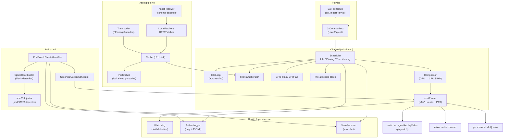

# Playout

> **Where you are:** [docs](../README.md) → subsystems → playout
> **Read this first:** [architecture.md](../architecture.md)
> **See also:** [clips.md](./clips.md) · [replay.md](./replay.md) · [../scte35.md](./scte35.md)

**TL;DR** Playout turns the production switcher into a production-playout hybrid. Two independent channels each run their own tick-driven frame router that reads a validated playlist of clip, live, and slate items, opens a streaming decoder per item, blends through a CPU/GPU compositor at item transitions, and exposes itself to the switcher as a virtual source (`playout:1`, `playout:2`). A pure state-machine scheduler (Idle / Playing / Transitioning) decides what to render every tick; an idle loop auto-rewinds a fallback asset when the playlist is exhausted; a pod board layers commercial-break scheduling with SCTE-35 injection and frame-accurate splice coordination on top. Asset pipeline is LRU disk cache + scheme-dispatched fetcher + schedule-aware prefetcher + FFmpeg transcoder, with a splice coordinator that watches the luma of incoming frames for black to time break entry exactly. A watchdog monitors frame cadence with auto-recovery; an as-run logger captures every item start / end / secondary event / pod operation into a ring buffer and JSONL file; a BXF importer/exporter speaks SMPTE S22 broadcast exchange format; a crash-recovery persister atomically snapshots state for re-cue on restart.

## The story

Broadcast playout is the silent engine of linear television — the thing that runs when operators go home. Most of the time it's scheduled clips, idle loops, and commercial pods running on autopilot; occasionally operators override manually to take a live event or extend a break. Switchframe's playout is designed so those two modes live in the same process: the production switcher and the automated playout pipeline share the audio mixer, the graphics compositor, the SCTE-35 signaller, and the output relay. From the switcher's perspective, a playout channel is just another source — you can cut to `playout:1`, put it on preview, or cross-dissolve to it.

The channel is a **virtual compositor**. Rather than expose the raw decoder output, each channel internally muxes between playlist items and idle fallback, and runs its own *internal* transitions (dissolve, dip, wipe) between successive items. When a clip ends and the next one starts, the channel blends frame-by-frame internally so the switcher sees one continuous, already-transitioned stream. That's the "-compositor" in virtual compositor.

Three item types cover the commercial playout workload. **Clip** opens an `AssetProvider` and streams decoded frames, with in/out trim points, hold-last-frame at end, loop, and per-item transition config. **Live** taps the GPU frame pointer of a named live source (zero-copy VRAM alias) with a CPU fallback that reads the latest decoded frame from the switcher's source cache — so a live camera can be dropped into a playlist the same way a clip is. **Slate** produces a pre-allocated BT.709 black frame for the configured duration — useful as a break-filler or test pattern.

The scheduler is a pure `state × time → decision` function. It keeps cursor position, resolved item duration, mode (Automated / Manual / Break), and pending-advance flags. Each tick it returns a `SchedulerDecision` describing what the channel should render: an item (normal playback), an idle signal (past end or waiting for a scheduled future item), a transition in progress (with outgoing, incoming, progress, and transition config), or completed. The channel handles rendering; the scheduler never touches decoders or pipelines.

Commercial pods are their own subsystem. A pod board per channel tracks pods through states (scheduled → armed → fired → break-active → return-pending → rejoined / dumped-out). Firing a pod can be immediate or splice-coordinated — in the latter case the splice coordinator watches incoming frames for black and locks the splice point to the first detected black frame within a window before the target PTS. SCTE-35 cue-out events are injected at the locked PTS so downstream ad servers see a frame-accurate out-point. Auto-return fires cue-in after the break duration; hold extends indefinitely; extend adds milliseconds; dump-out bails early.

Everything gets logged. The as-run logger writes to an in-memory ring buffer (queryable by time range, channel, and event type) and appends to a date-stamped JSONL file on disk, so both real-time dashboards and compliance exports work. A state persister snapshots channel + pod state periodically so a crash + restart resumes at the right cursor and re-cues non-terminal pods with wall-clock-adjusted elapsed time.

## How it works

### Channel: tick-driven frame router

`playout.Channel` is constructed per channel ID (1 or 2) with a `ChannelConfig` that carries the `AssetProvider` and pipeline format (width, height, FPS). Internally it owns a `Scheduler`, `IdleLoop`, `Compositor`, a pre-allocated slate frame, and the active clip iterator. `LoadPlaylist` validates the manifest, hands it to the scheduler, and transitions to `StateCued`. `Start` creates a `context.Context`, transitions to `StateOnAir`, and spawns `run(ctx)`.

`run` opens a ticker at `config.FPS` and loops: `ticker.C` fires, `tick(now)` runs, and the loop continues until `ctx.Done()` or the playlist completes. `tick` calls `scheduler.Tick(now)`, which returns a `SchedulerDecision`. If the decision is a transition, `tick` asks the compositor to blend outgoing and incoming frames. If it's an item, `tick` calls `frameForItem(item)` which dispatches to `nextClipFrame`, `tapLiveSource`, or `nextSlateFrame`. If it's idle, the idle loop's `NextFrame()` runs. The channel never lets output go dark — if every source returns nil, slate is emitted as last-resort fallback.

`emitFrame` sends raw YUV + audio frames (both proportional and PTS-correct) and feeds the splice coordinator's `IngestFrame` so black detection has real luma data to analyze. `outputPTS` increments by `90000 / FPS` ticks per frame; `outputAudioPTS` increments independently at AAC frame cadence (`1024 * 90000 / sampleRate`).

Clips whose native FPS differs from the pipeline FPS use nearest-neighbor FRC: `targetSourceFrame = outputFrame * clipFPS / pipelineFPS`. When the target hasn't advanced past the last emitted frame, the channel emits a video-only copy of the last frame (audio stripped — it was already delivered) instead of re-advancing the iterator. When the target jumps multiple frames ahead (fast clip on slow pipeline), the channel consumes and discards intervening frames but **collects audio from every skipped frame** and attaches it to the output `DecodedFrame` so no AAC is lost during FRC.

### Scheduler: pure state machine

`scheduler.Tick` is a switch on scheduler state:

- **Stopped / no playlist** → `Completed: true`. The channel transitions to `StateCompleted`.
- **Transitioning** → `tickTransition` computes progress from elapsed time vs. configured duration, returns the outgoing + incoming items and the `TransitionConfig`. When progress reaches 1.0 the scheduler advances cursor and returns to `Playing`.
- **Idle-waiting** → a scheduled future item's time hasn't arrived yet; returns `IsIdle: true`.
- **Playing** → bounds check (cursor past end → completed), resolve current item duration on first tick, then check for explicit `Next()`/`JumpTo()`/`Previous()` advance requests. Loop items never auto-advance unless `Next()` fires. Hold items stop advancing once `itemComplete` arrives and wait for an explicit `Next()`. Scheduled items whose `ScheduledTime` is in the future park in idle-waiting.

Mode (`ModeAutomated`, `ModeManual`, `ModeBreak`) gates auto-advance: both manual and break modes hold position. `TakeBreak`/`ReturnFromBreak` are driven by the pod board on pod fire/complete — the scheduler doesn't know about SCTE-35, just about the mode bit. `TakeManual` and `ReturnToAuto` are operator overrides.

The scheduler owns `itemStartTime` for each item and resolves duration from the `PlaylistItem` (`DurationMs` for slates, `(totalFrames / clipFPS) * 1000` for clips, indefinite for live). It emits no logs, allocates nothing per tick, and is deterministic — unit-testable without decoders.

### Idle loop: auto-rewinding asset iterator

`IdleLoop.NextFrame` ensures the output is *never* nil. If there's no asset URI or no provider, it returns a fresh copy of a pre-allocated BT.709 black frame (Y=16, UV=128). If an asset is configured, it opens a `FrameIterator` lazily on first call and returns frames. At EOF it closes the iterator and re-opens — auto-rewind. If reopen fails (asset missing, network hiccup) it falls back to black and tries again next tick. The PTS counter advances continuously so the switcher's frame sync sees a stable timeline.

`SetAsset` swaps the asset URI for the next tick (the current iterator is closed on the next `NextFrame` via a `dirty` flag so mutation is thread-safe).

### Compositor: GPU-first, CPU SIMD fallback

`Compositor.Blend` accepts two `DecodedFrame`s and a progress value. If a `GPUBlendFunc` is wired, GPU blend runs directly on the pre-allocated destination buffer. Otherwise the CPU path dispatches on transition type: `dissolve`/`mix` → `FrameBlender.BlendMix`, `dip`/`dip_black` → `BlendDip`, `wipe` with a wipemap pattern → `BlendWipeMap` (falls back to directional wipe `BlendWipe` if the gradient map fails to resolve). Unknown types or `dve-*` spatial transitions (which require the GPU pipeline) fall back to dissolve. The blend result is always deep-copied before return because `FrameBlender` reuses its internal output buffer.

Output PTS comes from the incoming frame (`b`); the result is always marked keyframe since a blend is by definition a complete, self-contained frame.

### Pod board: CRUD + lifecycle + splice

`PodBoard` per channel owns a `map[string]*Pod` plus `autoReturnCancels` / `trackCancels` for goroutine management. The full pod API:

- **CRUD:** `CreatePod(config)`, `CreateFromTemplate(typeName)`, `GetPod(id)`, `ListPods()`, `DeletePod(id)`.
- **Lifecycle:** `Arm(id)` (scheduled → armed), `Disarm(id)` (armed → scheduled), `Fire(id)` (armed → pre-roll or break-active).
- **Runtime control:** `Hold(id)` (stays in break indefinitely, cancels auto-return), `Extend(id, additionalMs)` (adds to remaining duration), `DumpOut(id)` (breaks the break early — only if `AllowDumpOut` is set).
- **Reordering:** `Move(id, position)`, `Swap(id1, id2)`, `Resize(id, durationMs)`, `Defer(id, position)`.
- **Priority:** `Promote`, `Demote`, `HighestPriorityArmed` (returns the next pod that should fire).

`Fire` branches on `config.Contractual` + splice availability. Without a splice coordinator, `fireImmediate` injects the SCTE-35 cue immediately and transitions to break-active. With a splice coordinator, it calls `BeginSplice` which enters scanning state; when black is detected within the window, `onSpliceReady(podID, pts, preRollMs)` fires, injects the cue at the locked PTS, and transitions. A `trackElapsed` goroutine updates `ElapsedMs` at tick rate; `runAutoReturn` starts a timer for `DurationMs` and fires auto-return on expiry. Both goroutines are cancellation-aware so `Hold`, `DumpOut`, and `completePod` all clean up correctly.

Pod priority determines contention: `PriorityMandatory` wins over `PriorityHigh` wins over `PriorityNormal`. `HighestPriorityArmed` scans armed pods and returns the highest priority — the UI binds this to the "next pod to fire" indicator.

### Pod templates: generic defaults + manifest overrides

`PodTemplateStore` seeds three built-in templates (`short` 30s, `standard` 120s, `long` 300s — all auto-return, allow-dump-out, normal priority). Manifests can add custom templates via the `PlaylistItem`-level `PodTemplates []PodTemplateDef` array; `LoadFromPlaylist` merges them into the store. `Instantiate(id)` on a template produces a new `Pod` with the template's defaults, which `CreateFromTemplate` then stores.

### Secondary events: timed graphics, audio, captions, SCTE-35

Each `PlaylistItem` can carry `SecondaryEvents` that fire at elapsed offsets anchored to item start or end. `SecondaryEventScheduler.BeginItem(events, durationMs)` computes absolute fire times and sorts them. `Tick(elapsedMs)` walks the sorted array firing any whose `fireMs` has arrived, marking them to prevent re-firing. Supported event types:

- `graphics_on`, `graphics_off`, `graphics_update` — dispatch to the graphics subsystem.
- `audio_level`, `audio_mute`, `audio_afv` — per-source mixer controls.
- `caption_mode`, `caption_text` — caption subsystem state.
- `scte35_cue` — on-the-fly SCTE-35 cue with full parameters (see [../scte35.md](./scte35.md)).

The channel calls `BeginItem` when an item change is detected and `Tick(elapsedMs)` on every subsequent tick of the same item; `EndItem` fires on item change or cleanup to discard pending events.

### Asset cache: LRU disk + metadata persistence

`Cache` is a directory-backed LRU store. `NewCache` loads `cache_meta.json` on startup and rebuilds the access-order list. `Put(entry)` validates that `LocalPath` is under the cache directory (path traversal guard), updates the running byte total, moves the entry to the tail of the access order, and runs LRU eviction if over the byte budget. `Get` refreshes the entry's `LastAccessed` and moves it to the tail. `Peek` reads without touching order — used by the prefetcher to check residency without influencing eviction.

`persist()` writes a sorted snapshot of all entries to `cache_meta.json` atomically (temp file + rename).

### Asset resolver + fetchers + prefetcher

`AssetResolver` picks the right `AssetFetcher` based on URI scheme. `LocalFetcher` copies files from local/NFS paths with an optional `AllowedPrefixes` allowlist. `HTTPFetcher` downloads via `http.Client`. Both write to a temp destination, `fsync`, close, and the caller renames into place.

`Prefetcher` runs a background goroutine that watches the playlist lookahead window (default 5 items ahead). On playlist or cursor change, or every 30 seconds, it scans the next items, asks the cache if the asset is already resident, and if not kicks off a fetch + transcode job (up to `MaxConcurrentFetches` parallel). The fetch lands in cache, optionally transcoded via FFmpeg to H.264 MPEG-TS in the target resolution. The `OnFetched` callback fires when each item completes.

`TranscodeChecker.NeedsByExtension` flags containers that always need transcode (MKV, WebM, AVI, FLV, MXF, WMV, MPG, OGV). For MP4/MOV a probe determines whether the content is already H.264/HEVC; if yes, no transcode.

### Splice coordination + black detection

`SpliceCoordinator.BeginSplice(pod)` stores a pending operation and sends a scheduled SCTE-35 cue via `SchedulePodCue` with the pre-roll (default 5 s). As frames flow through `IngestFrame`, the coordinator waits for the scheduled window (default 500 ms around the target PTS), asks `BlackDetector.AnalyzeFrame` to score each frame's Y plane (mean + max luma thresholds, configurable; defaults mean≤16 and max≤32), picks the first detected black frame, locks the splice PTS, and fires `onSpliceReady(podID, lockedPTS, preRollMs)` which lets the pod board inject the cue at that exact PTS and log an as-run event.

Timeout handling: if no black is found within the window, the coordinator fires at the configured fallback (default 2 s after target) with `SpliceReason: NoBlackFound` for the as-run record. This guarantees pods always fire even if upstream content doesn't cooperate.

### Watchdog: stall detection with auto-recovery

`Watchdog.RegisterChannel(id)` seeds a per-channel last-frame timestamp; `ReportFrame(id)` updates it on every emitted frame. The background loop ticks at `CheckInterval` (default 1 s), inspects `time.Since(lastFrame)` against `StallThreshold` (default 5 s), and fires `OnStall(channelID)` when a stall is detected. The Manager's stall handler calls `RecoverChannel` which snapshots state, stops the channel, reloads playlist at the saved cursor, and restarts — emitting an `AsRunError` with the recovery reason.

### As-run logger: ring buffer + JSONL persistence

`AsRunLogger` wraps a circular ring buffer (default 10,000 entries) plus a date-stamped JSONL file. Every `Log(event)` call appends to both — the ring is queryable by `AsRunQuery` filters (type, channel, time range, limit) for the UI's "recent events" panel, and the JSONL file is the durable record for compliance exports. `bxf.ExportAsRun(events)` converts a slice of `AsRunEvent` into a BXF `AsRun` XML document.

Retention is a separate goroutine (`stopRetention` channel) that prunes JSONL files older than `RetentionDays`.

### Crash recovery: state persister

`PersistedState` is a JSON document with a version field, timestamp, and per-channel snapshots (state, mode, cursor, full playlist, pod list). The Manager's `Snapshot()` builds this structure; `StatePersister` writes it atomically on configurable intervals. On startup, `Manager.Recover(statePath)` loads the snapshot, iterates channels, and for each: loads the playlist (which transitions to `StateCued`), overrides the cursor to the saved position, and restores non-terminal pods with wall-clock-adjusted `ElapsedMs`. Channels that were `OnAir` or `Cued` at snapshot time log an `AsRunError` with the recovery reason. `Start` must be called separately to resume playback.

The `persist.go` docstring documents a planned 1+1 active/standby protocol using the same format for state replication.

### BXF import / export

[`server/playout/bxf/`](../../server/playout/bxf/) speaks SMPTE S22 broadcast exchange format. `ImportPlaylist(msg, name)` converts a `BxfMessage` with a `Schedule` into a playout `Playlist` — schedule details become `PlaylistItem`s with `AssetURI: "bxf://HouseNumber"` for resolver dispatch. `ExportAsRun(events)` inverts the as-run log into a BXF `AsRun` document for automation-system round-trips.

### Built-in sample clips and template playlists

`samples.GenerateSampleClips(cacheDir)` invokes FFmpeg with `lavfi` sources to produce holding slates, bumpers, sample ads, and test patterns — no external assets required, so the demo mode works out of the box. `AvailableTemplates()` returns the set of built-in template playlist names; `TemplatePlaylist(name, samples)` constructs a complete `Playlist` from a template and the generated samples, including pre-wired pod templates. These drive `make demo-playout` and the first-run experience.

## Key types and entry points

- Channel lifecycle: [`server/playout/channel.go`](../../server/playout/channel.go) → `Channel.NewChannel`, `Channel.LoadPlaylist`, `Channel.Start`, `Channel.Stop`, `Channel.run`, `Channel.tick`, `Channel.emitFrame`, `Channel.frameForItem`, `Channel.nextClipFrame`, `Channel.tapLiveSource`, `Channel.nextSlateFrame`.
- Scheduler: [`server/playout/scheduler.go`](../../server/playout/scheduler.go) → `Scheduler.Tick`, `Scheduler.LoadPlaylist`, `Scheduler.Start`, `Scheduler.Next`, `Scheduler.JumpTo`, `Scheduler.TakeManual`, `Scheduler.ReturnToAuto`, `Scheduler.TakeBreak`, `Scheduler.SignalItemComplete`, `SchedulerDecision`, `TransitionReq`.
- Idle: [`server/playout/idle.go`](../../server/playout/idle.go) → `IdleLoop.NextFrame`, `IdleLoop.SetAsset`, `IdleLoop.Close`.
- Compositor: [`server/playout/compositor.go`](../../server/playout/compositor.go) → `Compositor.Blend`, `Compositor.Cut`, `GPUBlendFunc`.
- Manager: [`server/playout/manager.go`](../../server/playout/manager.go) → `Manager.NewManager`, `Manager.LoadPlaylist`, `Manager.Start`, `Manager.Stop`, `Manager.ChannelStates`, `Manager.Snapshot`, `Manager.Recover`, `Manager.RecoverChannel`, `Manager.OnChannelLifecycle`, `Manager.SetSCTE35Injector`, `Manager.PodBoard`, `Manager.TemplateStore`.
- Pod board: [`server/playout/pod_board.go`](../../server/playout/pod_board.go) → `PodBoard.CreatePod`, `PodBoard.CreateFromTemplate`, `PodBoard.Arm`, `PodBoard.Disarm`, `PodBoard.Fire`, `PodBoard.Hold`, `PodBoard.Extend`, `PodBoard.DumpOut`, `PodBoard.Move`, `PodBoard.Swap`, `PodBoard.Resize`, `PodBoard.Defer`, `PodBoard.Promote`, `PodBoard.Demote`, `PodBoard.HighestPriorityArmed`, `PodBoard.runAutoReturn`, `PodBoard.completePod`.
- Pod templates: [`server/playout/pod_template.go`](../../server/playout/pod_template.go) → `PodTemplate.Instantiate`, `PodTemplateStore.LoadFromPlaylist`, `BuiltinPodTemplates`.
- Secondary events: [`server/playout/secondary.go`](../../server/playout/secondary.go) → `SecondaryEventHandler`, `SecondaryEventScheduler.BeginItem`, `SecondaryEventScheduler.Tick`, `SecondaryEventScheduler.EndItem`, `ValidateSecondaryEvent`.
- Iterators: [`server/playout/iterator.go`](../../server/playout/iterator.go) → `FrameIterator`, `AssetProvider`, `SliceIterator`, `TrimIterator`; [`server/playout/file_iterator.go`](../../server/playout/file_iterator.go) → `FileFrameIterator`, `NewFileFrameIterator`.
- Manifest: [`server/playout/manifest.go`](../../server/playout/manifest.go) → `ValidatePlaylist`, `LoadPlaylist`, `SavePlaylist`.
- Cache / assets: [`server/playout/cache.go`](../../server/playout/cache.go) → `Cache.Put`, `Cache.Get`, `Cache.Peek`; [`server/playout/asset.go`](../../server/playout/asset.go) → `AssetResolver`, `LocalFetcher`, `HTTPFetcher`; [`server/playout/prefetch.go`](../../server/playout/prefetch.go) → `Prefetcher.Start`, `Prefetcher.Stop`; [`server/playout/transcode.go`](../../server/playout/transcode.go) → `Transcoder`, `TranscodeChecker`.
- Splice & black detection: [`server/playout/splice.go`](../../server/playout/splice.go) → `SpliceCoordinator.BeginSplice`, `SpliceCoordinator.IngestFrame`; [`server/playout/blackdetect.go`](../../server/playout/blackdetect.go) → `BlackDetector.AnalyzeFrame`.
- As-run: [`server/playout/asrun.go`](../../server/playout/asrun.go) → `AsRunLogger.Log`, `AsRunLogger.Query`, `AsRunEvent`; [`server/playout/bxf/`](../../server/playout/bxf/) → `bxf.ImportPlaylist`, `bxf.ExportAsRun`.
- Persist / watchdog: [`server/playout/persist.go`](../../server/playout/persist.go) → `PersistedState`, `PersistedChannel`, `StatePersister`; [`server/playout/watchdog.go`](../../server/playout/watchdog.go) → `Watchdog.RegisterChannel`, `Watchdog.ReportFrame`, `Watchdog.Health`.
- Samples: [`server/playout/samples.go`](../../server/playout/samples.go) → `GenerateSampleClips`, `AvailableTemplates`, `TemplatePlaylist`.
- Types: [`server/playout/types.go`](../../server/playout/types.go) → `Playlist`, `PlaylistItem`, `ItemType`, `TransitionConfig`, `SecondaryEvent`, `SCTE35EventData`, `PodConfig`, `Pod`, `PodState`, `PodPriority`, `ChannelState`, `OnAirMode`, `MaxChannels = 2`, sentinel errors.
- App wiring: [`server/cmd/switchframe/app_playout.go`](../../server/cmd/switchframe/app_playout.go) → `App.initPlayout` (cache + resolver + transcoder + prefetcher + provider + manager + per-channel relay + GPU preview registration).

## Gotchas and invariants

- **Channel never lets output go dark.** `tick` falls through slate → idle → pre-allocated black if every source returns nil. The switcher pipeline assumes each source always produces a frame; violating that causes frame sync to stall upstream.
- **FRC audio collection across skipped frames.** When the clip FPS exceeds pipeline FPS, `nextClipFrame` consumes multiple source frames per tick and collects audio from *every* one (including the ones whose video is discarded) into a `[]AudioFrameData` attached to the output `DecodedFrame`. Without this collection, audio would be gapped whenever a video frame is dropped for FRC.
- **Hold mode strips audio.** When the clip completes and `item.Hold` is true, the channel returns a video-only copy of the last frame. Audio was already delivered on first emission; repeating it would leak audio on every hold tick. The same rule applies to held-during-FRC frames.
- **GPU alias sentinel.** `tapLiveSource` returns `&c.gpuAliasedSentinel` (a `DecodedFrame` value) when a GPU alias succeeds. `emitFrame` recognizes the sentinel by pointer identity and emits a nil-YUV signal frame that triggers `RunFromCache` in the switcher pipeline. Blending two sentinels at a transition falls back to hard cut because they have no YUV to blend.
- **Live audio routed out-of-band.** For `ItemLive`, audio is routed to the playout mixer channel via the `onLiveAudio` callback (active=true on entry, active=false on exit). The playout channel's own audio output path sees no audio for live items — the mixer takes it directly from the live source.
- **Scheduler resets on loop.** Loop mode relies on the channel closing the iterator and forcing `clipItemID = ""` so the next tick re-opens from scratch. Without this, the scheduler would still think the item was in progress and the iterator wouldn't rewind.
- **Absolute-time pacing is via the Scheduler, not the channel.** The scheduler owns `itemStartTime` and advances based on wall-clock comparisons. The channel just ticks at pipeline FPS and calls the scheduler.
- **Pod priority is strict ordering.** `PriorityMandatory > PriorityHigh > PriorityNormal` is a total order, not a heuristic. Two armed mandatory pods race on fire timestamp; priority alone doesn't resolve ties.
- **Splice window + timeout.** If no black is found within `WindowMs` around the target, the coordinator fires at `TimeoutMs` past target with `SpliceReason: NoBlackFound`. Pods always fire on time; they never hang waiting for black that never comes.
- **Auto-return cancellation.** `Hold(id)` explicitly calls the stored cancel for `runAutoReturn` — otherwise the timer would still fire and end the break despite the hold. `DumpOut`, `Extend`, and `completePod` all participate in this cancellation dance.
- **State persister is crash-consistent.** `PersistedState.Version: 1` allows forward schema evolution. `Recover` only runs on a fresh Manager — calling it on a running system is undefined because active-channel mutation + replay of snapshot state races.
- **BXF imports map HouseNumber → `bxf://` URIs.** The asset resolver is expected to handle the `bxf://` scheme in the site's deployment (it isn't built-in). BXF schedules are not playable without the resolver extension.
- **Recover wall-clock adjust.** Active pods (`PodBreakActive`, `PodPreRoll`) get `ElapsedMs += wallDelta` on recovery. Without this, a pod that was 30 s into a 60 s break would restart as 30 s remaining instead of whatever the real clock says.
- **Channel Recreate on pipeline format change.** `SetPipelineFormat` recreates all *stopped* channels with the new dimensions. Running channels are not resized — restart required. Do pipeline format changes at quiet periods.

## Related docs

- **Concepts:** [../pipeline.md](../concepts/pipeline.md) (playout channels register as switcher sources and share the same video/audio pipeline), [../locking-and-concurrency.md](../concepts/locking-and-concurrency.md) (mutex boundaries between Manager, Channel, Scheduler, and PodBoard), [../gpu.md](../concepts/gpu.md) (the GPU alias path and preview encoder used by playout slots).
- **Reference:** [../api.md](../reference/api.md) (REST endpoints for playout channel control, pod CRUD, playlist upload, BXF import, as-run query), [../fast-control.md](../reference/fast-control.md) (datagram protocol on the same WebTransport connection).
- **Subsystems:** [clips.md](./clips.md) (same transcode machinery for unsupported source formats; the clip library is where replay exports land as ephemeral items), [replay.md](./replay.md) (shares PTS anchoring via the same program PTS provider), [../scte35.md](./scte35.md) (pod fire injects cue-out / cue-in through the SCTE-35 injector; rules engine and message construction covered there), [../mxl.md](./mxl.md) (live source pass-through — `ItemLive` can tap an MXL source), [../html5-graphics.md](../integration/cef-protocol.md) (secondary graphics events dispatch to the graphics subsystem).
- **Integration / Operations:** [../deployment.md](../operations/deployment.md) (`--playout-cache-max-gb`, `StateDir` layout, watchdog timing), [../asr.md](../integration/asr-sidecar.md) (secondary caption events can drive the ASR / caption subsystem).
