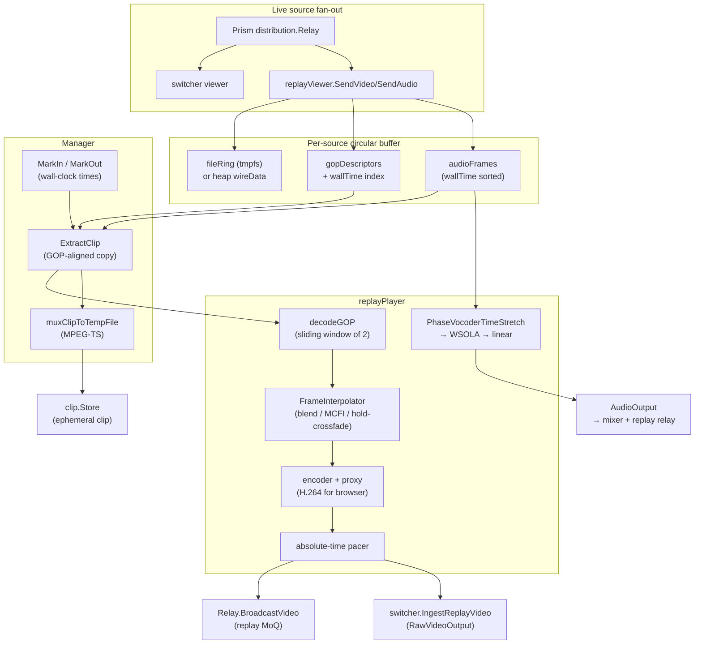

# Instant Replay

> **Where you are:** [docs](../README.md) → subsystems → replay
> **Read this first:** [architecture.md](../architecture.md)
> **See also:** [clips.md](./clips.md) · [playout.md](./playout.md) · [../pipeline.md](../pipeline.md)

**TL;DR** Instant replay keeps a per-source, GOP-aligned circular buffer of encoded video plus matching AAC audio tagged with wall-clock time. Operators mark an in-point and out-point, and a replayer extracts that slice, decodes it GOP-by-GOP, duplicates or interpolates frames for 0.25×–1.0× slow motion, re-encodes to a browser-friendly H.264 stream, and pushes the result through a dedicated `replay` relay and the switcher's raw video ingest. Audio is time-stretched with a phase vocoder (STFT-based, pitch-preserved) — falling back to WSOLA and then linear interpolation — so slow motion still sounds like music and voices rather than tape-slowed drones. The same Manager also exports the marked slice as an MPEG-TS temp file, which the [clip library](./clips.md) picks up as an ephemeral clip.

## The story

Live television needs three things at once: the program feed, a hundred-odd megabytes of recent footage held ready for the next replay, and a way to hand off a pre-encoded clip to the next operator without touching disk. The replay subsystem does all three out of the same ring buffer.

The replay Manager registers a lightweight `replayViewer` on every source relay the operator asks to buffer. That viewer sits alongside the switcher's own viewer on the Prism distribution fan-out — it observes every encoded video frame and every AAC frame but never blocks the broadcast path. Each frame is deep-copied into a `replayBuffer`, stamped with `time.Now()`, and indexed into GOP descriptors so the buffer can always produce a clip starting at a keyframe. When the buffer exceeds its time or byte budget, the oldest *complete* GOP is evicted — never a half-GOP, which would be unplayable.

On big machines the buffer can be thousands of frames, so the manager supports tmpfs-backed file rings. When `/dev/shm` exists (or a caller-provided path is usable), each source gets a `fileRing` and wire bytes live there while the Go heap only holds frame metadata. Parameter sets (VPS/SPS/PPS) stay on the heap because they're tiny.

The operator marks `IN` and `OUT`. The Manager records wall-clock timestamps. On `Play`, `ExtractClip` walks back through GOP descriptors to find the keyframe at or before the in-point, copies every frame up through the out-point, and pulls the audio frames whose wall time falls in the same window (extended by one video frame duration so the last AAC frame isn't cropped). The result is a deep copy — the buffer keeps running while the clip plays.

The player decodes the clip into YUV420 one GOP at a time (a sliding window keeps two GOPs hot). Frames come out in display order from the decoder, with source PTS re-assigned from the sorted frame list so B-frame reordering doesn't scramble timing. For slow motion, each decoded frame is either duplicated, alpha-blended with its neighbor, or replaced with a hold-crossfade — the `FrameInterpolator` interface picks the mode. Output frames are re-encoded (optionally through a proxy H.264 encoder for browsers plus the pipeline codec for recording), PTS-stamped against the live program timeline via the `PTSProvider`, and paced to an absolute wall-clock deadline so encode jitter doesn't accumulate.

Audio is the hard part. Duplicating AAC frames works for video but sounds terrible for sound. Instead, the player pre-stretches the whole audio clip once, before video playback begins: decode every AAC frame to PCM, run the [phase vocoder](#time-stretching-phase-vocoder-wsola-and-linear-fallback), re-encode to AAC, and emit the stretched frames proportionally across the slow-motion video. If the phase vocoder fails, WSOLA fires; if WSOLA fails, a linear resample ensures audio at least plays through without gaps.

## How it works

### Circular buffer with wall-clock clipping

The `replayBuffer` is a `[]bufferedFrame` plus a parallel `[]gopDescriptor`. A GOP descriptor holds `startIdx`, `endIdx`, and the keyframe's `wallTime`. `RecordFrame` drops delta frames before the first keyframe (they're unplayable in isolation), deep-copies the wire data (or writes it to the file ring), and extends or opens a GOP entry. `trimLocked` evicts oldest GOPs until both the time budget (`maxDuration`) and byte budget (`maxBytes`) are satisfied — trimming is GOP-atomic so the remaining buffer always starts at a keyframe. Audio frames older than the oldest surviving video frame are trimmed alongside.

`ExtractClip(inTime, outTime)` finds the GOP whose keyframe is at or before `inTime`, walks forward to the last frame at or before `outTime`, and deep-copies every frame in that half-open range. For tmpfs-backed buffers it pulls the wire bytes from the file ring. Audio is clipped to the video clip's wall-clock span plus one video frame duration — otherwise approximately one AAC frame (~21 ms at 48 kHz) gets clipped off the tail of every replay.

### Viewer on the distribution fan-out

The `replayViewer` implements Prism's `distribution.Viewer` interface. `SendVideo` and `SendAudio` are called on the same goroutine that broadcasts to live subscribers, so recording must be fast and never blocking — the buffer's only work inside those callbacks is a mutex + deep copy (or file ring write). `SendCaptions` is a no-op; captions aren't replayed.

### Player pipeline: decode, interpolate, re-encode, pace

`replayPlayer.run` splits the clip into GOPs, pre-decodes a window of two, and opens an encoder sized to the first decoded frame (`estimateBitrate` picks a reasonable target for 1080p / 720p / lower). When a proxy encoder factory is set, the player runs two encoders: a browser-compatible H.264 proxy feeds `Output` (the replay relay) and the main encoder (which may be HEVC or a higher profile) feeds `PipelineVideoOutput` for recording and SRT.

Per output frame the player:

1. Picks the current decoded frame.
2. Consults the `FrameInterpolator` — if `dup > 0` and interpolation is enabled, it blends between frame N and frame N+1 at `alpha = dup / dupCount`.
3. Emits raw YUV to the switcher pipeline (the primary path).
4. Waits for the next absolute deadline (`playbackStart + pacingIdx * frameDuration`) — pacing is computed *before* encode so encode-time jitter never compounds.
5. Encodes the frame, wraps it as a `media.VideoFrame`, and broadcasts to the relay.
6. Emits any audio frames whose source PTS lies within the current video frame's PTS window, proportional across the full slow-mo duration so audio spans the whole clip without pops.

`computeReplayTiming` uses `math.Round(1/speed)` for `dupCount` and derives `frameDuration` from `1 / (sourceFPS * speed * dupCount)` so the total video duration exactly matches the audio stretch ratio. Seeking pushes a float into a 1-capacity channel; the next loop iteration picks it up, rewinds decoder state, and reseeds `playbackStart`.

### Frame interpolation

`FrameInterpolator` is a one-method interface (`Interpolate(a, b, w, h, alpha) []byte`). Three implementations ship:

- `blendInterpolator` — linear alpha blend across all YUV420 bytes. Cheap, always-correct, but motion looks smeared.
- `holdCrossfadeInterpolator` (the default via `InterpolationHoldCrossfade`) — holds frame A for `alpha < 0.625` then crossfades to B with an eased curve in the remaining slot. Produces clean, artifact-free frames with a brief dissolve at every neighbor transition — no motion estimation needed.
- `MCFIState` (via `InterpolationMCFI`) — motion-compensated frame interpolation reusing the switcher's [frame rate conversion](../pipeline.md) kernels (`server/switcher/mcfi_interpolate.go`, SAD in assembly).

When replay runs on a GPU host with NVIDIA Optical Flow (NVOFA), `SetGPUReplay` attaches a `gpu.FRUC` instance and `Play` routes to `newGPUReplayPlayer` instead. The GPU player adds a configurable shutter angle (180° default) for film-style motion blur. See [../gpu.md](../gpu.md) for the GPU pipeline.

### Time-stretching: phase vocoder, WSOLA, and linear fallback

Slow-motion audio is the subsystem's most involved chunk of code. `preStretchAudio` runs once before video playback begins:

1. Decode every AAC frame to float32 PCM via the FDK decoder. ADTS headers are ensured via `codec.EnsureADTS` because source streams carry raw AUs.
2. Run the **phase vocoder** (`PhaseVocoderTimeStretch`). For speeds < 0.5× it cascades two passes at √speed so a 0.25× stretch becomes two 0.5× passes — this avoids the "phasiness" artifacts that kill quality at extreme slowdowns. Inside each pass the signal is windowed into 4096-sample Hann-windowed frames with 75% overlap, transformed via the `fftState` real-to-complex FFT, magnitude+phase extracted, instantaneous frequency estimated from phase difference at analysis hop, synthesis phase accumulated at the stretched synthesis hop, identity phase locking applied via a nearest-peak map (O(n) lookup vs. O(n·p) scan) to keep harmonics coherent, transients detected via adaptive spectral flux threshold (on transient onsets the synthesis phase is reset to the analysis phase to preserve attack), and the inverse FFT+window produces overlap-added output. Output RMS is matched to input RMS with per-sample clipping at ±0.95.
3. If the phase vocoder produced nothing (e.g. input shorter than the FFT window), WSOLA fires. WSOLA ignores the frequency domain: it overlap-adds 1024-sample windows but searches ±256 samples around each hop to find the best waveform-similarity match via normalized cross-correlation (`crossCorrFloat32`, SIMD-accelerated on amd64/arm64). Again, speeds < 0.5× cascade through two √speed passes.
4. If WSOLA also produced nothing, `linearTimeStretch` performs plain linear interpolation between samples. Pitch will drop, but playback is guaranteed continuous.
5. Segment the stretched PCM into 1024-sample AAC frames, re-encode, assign proportional PTS, and replace `AudioClip`. The `audioPreStretched` flag switches the runtime audio emitter from PTS-matched delivery to proportional distribution across all output video frames.

### FFT: radix-2 Cooley-Tukey with precomputed twiddles

The phase vocoder runs on a custom in-process FFT (`fftState`) rather than pulling in a big library. `newFFT(n)` precomputes:

- `twiddle[2*n]` — interleaved `[re, im]` for `W(k,N) = exp(-2πi·k/N)`.
- `r2cTwiddle[2*(n+1)]` — twiddles at double resolution for the real-to-complex unscramble step.
- `bitrev[n]` — bit-reversal permutation for the iterative FFT.

`forward` performs bit-reversal permutation in place, then runs `log2N` radix-2 butterfly stages via `butterflyRadix2`. The butterfly is where the SIMD lives:

- `fft_butterfly_amd64.s` — AVX2 path doing four butterflies per iteration, SSE path doing two, scalar fallback. Runtime dispatch via `avx2Available` (from `golang.org/x/sys/cpu`).
- `fft_butterfly_arm64.s` — NEON path processing two butterflies per iteration when `twiddleStride == 1` (the largest stages, which dominate work). Scalar fallback for other strides.
- `fft_butterfly_generic.go` — Pure Go fallback for other platforms.

`r2c` packs N real samples as `halfN` complex values, forward-FFTs size `halfN`, then unscrambles into `halfN+1` bins using the precomputed R2C twiddles. `c2r` inverts this. `inverse` conjugates, forward-FFTs, and scales by `1/n`.

### Clip export: replay → clip library

After `ExtractClip` succeeds, `Play` spawns a background goroutine that muxes the video+audio into a temporary MPEG-TS file via `output.TSMuxer`, interleaving by PTS. The resulting path is handed to the callback registered via `SetOnClipExported`. In the main app this lands at `handleReplayClipExported` in [`server/cmd/switchframe/app_clips.go`](../../server/cmd/switchframe/app_clips.go), which validates the file, moves it into the clip store directory, and adds it as an ephemeral clip. See [clips.md](./clips.md) for the receiving side.

## Key types and entry points

- Lifecycle: [`server/replay/manager.go`](../../server/replay/manager.go) → `Manager.NewManager`, `Manager.AddSource`, `Manager.MarkIn`, `Manager.MarkOut`, `Manager.Play`, `Manager.Stop`, `Manager.Close`.
- Buffer: [`server/replay/buffer.go`](../../server/replay/buffer.go) → `replayBuffer.RecordFrame`, `replayBuffer.RecordAudioFrame`, `replayBuffer.ExtractClip`, `replayBuffer.trimLocked`.
- Viewer: [`server/replay/viewer.go`](../../server/replay/viewer.go) → `replayViewer.SendVideo`, `replayViewer.SendAudio` (implements Prism `distribution.Viewer`).
- Player: [`server/replay/player.go`](../../server/replay/player.go) → `replayPlayer.run`, `replayPlayer.outputGOP`, `replayPlayer.preStretchAudio`, `replayPlayer.emitAudioForFrame`, `decodeGOP`, `computeReplayTiming`.
- Interpolation: [`server/replay/interpolator.go`](../../server/replay/interpolator.go) → `FrameInterpolator`, `blendInterpolator`, `holdCrossfadeInterpolator`, `newInterpolator` (`switcher.NewMCFIState` for MCFI).
- Audio time-stretch: [`server/replay/phasevocoder.go`](../../server/replay/phasevocoder.go) → `PhaseVocoderTimeStretch`, `phaseVocoderStretchSingle`, `stretchChannel`, `phaseVocoder.analyzeFrame`, `phaseVocoder.synthesizeFrame`, `phaseVocoder.instantaneousFrequency`, `lockPhases`, `transientDetector.isTransient`.
- WSOLA: [`server/replay/wsola.go`](../../server/replay/wsola.go) → `WSOLATimeStretch`, `wsolaStretchSingle`, `findBestOverlap`, `linearTimeStretch`.
- FFT: [`server/replay/fft.go`](../../server/replay/fft.go) → `newFFT`, `fftState.forward`, `fftState.r2c`, `fftState.c2r`, `fftState.inverse`; SIMD butterflies in [`server/replay/fft_butterfly_amd64.go`](../../server/replay/fft_butterfly_amd64.go), [`server/replay/fft_butterfly_arm64.go`](../../server/replay/fft_butterfly_arm64.go), [`server/replay/fft_butterfly_generic.go`](../../server/replay/fft_butterfly_generic.go).
- Types: [`server/replay/types.go`](../../server/replay/types.go) → `Config`, `Status`, `SourceBufferInfo`, `PlayerState`, sentinel errors.
- GPU player: [`server/replay/gpu_player.go`](../../server/replay/gpu_player.go) → `newGPUReplayPlayer` (NVOFA motion blur).

## Gotchas and invariants

- **GOP-atomic trimming.** The buffer never trims mid-GOP; the remaining first frame is always a keyframe. Requests whose in-point precedes the oldest keyframe clip back to that keyframe — slightly more footage than the operator asked for, but always decodable.
- **Audio clip end extension.** `ExtractClip` extends `clipEndTime` by one video frame duration so the final AAC frame isn't dropped. Missing this detail makes every replay sound as if it has a hiccup at the end.
- **Decoder B-frame drain.** `decodeGOP` feeds frames in wire order and relies on EAGAIN "buffering" to flag B-frames the decoder is holding. After feeding all input it calls `SendEOS` + `ReceiveFrame` until drained. PTS is assigned from a sorted list so the output is always in display order.
- **Proxy encode mode.** When `ProxyEncoderFactory` is set, the main encoder writes pipeline-codec frames (e.g. HEVC) to `PipelineVideoOutput` for recording, and a lightweight H.264 proxy feeds the browser relay. The two encoders share a group ID counter so MoQ clients see consistent GOP boundaries.
- **PTS anchoring.** `ptsProvider` returns the current program PTS; the player starts one frame ahead of that value so cutting to replay on program doesn't collide with the live PTS counter. Without this, PTS can jump backward when the switcher takes replay — breaking TS muxers and browser decoders.
- **Absolute-time pacing.** `playbackStart + pacingIdx * frameDuration` is the frame deadline. If encode overhead pushes us past deadline by more than 2× frame duration (for instance after pause/resume), the pacing anchor resets instead of bursting catch-up frames. Loop iterations also reseed `playbackStart`.
- **Phase vocoder cascading.** Anything slower than 0.5× cascades two √speed passes. A naive single-pass 0.25× stretch sounds hollow and smeared; two 0.5× passes don't.
- **RMS matching after phase vocoder.** Phase-incoherent resynthesis naturally attenuates broadband content; the RMS match at the end of `PhaseVocoderTimeStretch` restores perceived loudness. Skipping it yields noticeably quiet slow-mo audio.
- **tmpfs detection.** `detectTmpfsDir` refuses to `MkdirAll` if the only existing ancestor is `/`. This prevents running as root accidentally fabricating a deep tree on the root filesystem.
- **Mark source enforcement.** `MarkOut` requires the same source key as `MarkIn`. Operators can't mark-in on cam-A and mark-out on cam-B; they must issue a fresh `MarkIn` to change sources.
- **Clip export is best-effort.** The mux goroutine logs on failure and the replay playback proceeds regardless. The `Close` path waits for `exportWg` so the process doesn't exit with a dangling temp file.

## Related docs

- **Concepts:** [../pipeline.md](../pipeline.md) (video processing pipeline the replay output joins), [../locking-and-concurrency.md](../locking-and-concurrency.md) (where the replay mutex fits in the lock order), [../gpu.md](../gpu.md) (NVOFA replay path).
- **Reference:** [../api.md](../api.md) (REST handlers for mark-in/out, play, speed, quick-replay), [../fast-control.md](../fast-control.md) (datagram channel reuse).
- **Subsystems:** [clips.md](./clips.md) (receives exported replay clips as ephemeral entries), [playout.md](./playout.md) (also anchors PTS to the program timeline via the same provider), and the top-level [../switchframe-ui.png](../switchframe-ui.png) (operator view).
- **Operations:** [../deployment.md](../deployment.md) (`--replay-buffer-secs`, tmpfs configuration, GPU replay flags).
