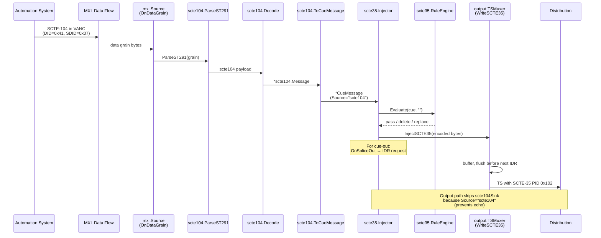

# SCTE-35 and SCTE-104

> **Where you are:** [docs](../README.md) → subsystems → scte35
> **Read this first:** [architecture.md](../architecture.md)
> **See also:** [output.md](./output.md) · [mxl.md](./mxl.md) · [api.md](../reference/api.md) · [playout.md](./playout.md)

**TL;DR** SCTE-35 is the ad-break marker that rides inside an MPEG-TS program as its own PID, telling downstream splicers and packagers exactly where a commercial opportunity begins and ends. SCTE-104 is the upstream automation-to-splicer protocol — the same semantics carried in a different envelope — that flows between traffic/automation systems and the live encoder over SDI ancillary data. Switchframe speaks both: the injector owns the SCTE-35 lifecycle and writes sections into the output TS; an optional SCTE-104 path reads and writes ST 291 VANC grains on MXL data flows and translates them bidirectionally via a shared `CueMessage` type. Together they let Switchframe sit in the middle of a broadcast plant, honor automation signals, condition them with rules, and emit standards-compliant cue points to every downstream destination.

## The story

Live ad insertion is a handshake between three parties: the automation system that owns the schedule, the encoder/splicer that modifies the bitstream, and the packager/ad server that serves the ad. Each interface speaks a slightly different dialect of the same idea — "here is where you can cut, and for how long." SCTE-35 lives inside the MPEG-TS on its own PID (stream type `0x86`) so packagers downstream can see splice opportunities without needing an out-of-band channel. SCTE-104 predates SCTE-35 on the automation side and carries the same semantics with a different wire format, originally over serial/TCP and today commonly wrapped in SMPTE ST 291 VANC ancillary packets alongside the video essence.

Switchframe's design recognizes that these two protocols are fundamentally the same event seen through different lenses. The internal [`scte35.CueMessage`](../../server/scte35/message.go) is the lingua franca: whether a splice originates from an SCTE-104 VANC grain on an MXL data flow, a REST call from an operator, a macro step, or a pass-through section from a contribution feed, it becomes a `CueMessage` before anything else happens to it. From there, one code path — the [`scte35.Injector`](../../server/scte35/injector.go) — owns lifecycle (inject, auto-return, hold, extend, cancel), rules evaluation, and fan-out. Injector output goes two places: into the output TS muxer as a real SCTE-35 section, and (optionally) back out as SCTE-104 via the MXL data flow so downstream automation hears the same event.

This symmetry is why the doc treats both protocols as one story. You rarely care about SCTE-35 without also caring about where the cue came from and whether an automation system needs to know what you did with it.

## SCTE-35

### How it works

SCTE-35 defines a binary section format — `splice_info_section` — with `table_id=0xFC` that rides on a dedicated MPEG-TS PID inside a program. The section carries a splice command (`splice_null`, `splice_insert`, or `time_signal`) plus optional segmentation descriptors that describe the kind of boundary (program break, ad avail, placement opportunity, chapter, etc.). Packagers and splicers downstream read the section and act on the cue.

Switchframe wraps the Comcast [scte35-go](https://github.com/Comcast/scte35-go) library in its own `CueMessage` type so the rest of the engine never touches the wire format. Encoding and decoding are in [`server/scte35/message.go`](../../server/scte35/message.go): `CueMessage.Encode(verify)` serializes to binary with optional round-trip CRC verification, and `Decode([]byte)` parses back. Two workarounds sit in that file worth knowing about: the library's decoder mishandles `splice_insert` cancel messages (it reads `unique_program_id`/`avail_num`/`avails_expected` outside the cancel guard), so we fall back to a hand-written `decodeSpliceInsertCancel` that validates CRC and extracts just the event ID and cancel bit. The same decoder bug is why encoding a cancel skips verification.

The [injector](../../server/scte35/injector.go) is the lifecycle owner. It runs three background goroutines after `NewInjector`:

- **Heartbeat loop** — emits `splice_null` at `HeartbeatInterval` so downstream SCTE-35-aware systems know the PID is alive. Some packagers use heartbeats to distinguish "no ads scheduled" from "upstream dropped the stream."
- **Auto-return poll** — every 15 ms (`autoReturnTickInterval`), compares the current program PTS (via `ptsFn()`) against each active event's `scheduledReturnPTS` and fires `ReturnToProgram` when reached. PTS arithmetic is done in the MPEG-TS 33-bit wrap-safe domain via `ptsReached` and `maskPTS33`.
- **Pre-roll repetition** — `ScheduleCue(msg, preRollMs)` sets the splice time PTS to `now + preRollMs*90` and launches `preRollRepeat`, which re-sends the same encoded section every second until the splice point (per SCTE-67 recommendation).

`InjectCue(msg)` is the immediate path: auto-assigns an event ID, runs the rules engine (see below), encodes, and routes the output to three sinks outside the lock — the TS muxer, the optional `scte104Sink` callback, and the webhook dispatcher. For `splice_insert` with `IsOut=true` and for `time_signal` with cue-out segmentation descriptors (per `isSegCueOut`), it also records the event in `activeEvents` so `HoldBreak`, `ExtendBreak`, `ReturnToProgram`, and `CancelEvent` can find it later.

Three subtle behaviors deserve mention: (1) `OnSpliceOut` fires after any cue-out, and in the app wiring this calls `Switcher.RequestKeyframe()` so downstream SRT receivers get a clean IDR at the splice point. (2) A single `time_signal` with multiple cue-out descriptors tracks each descriptor separately by `SegEventID` but shares one auto-return timer (the first cue-out's `SegEventID`); `ReturnToProgram` on any sibling cleans up all of them via `removeSiblingEventsLocked`. (3) `SyntheticBreakState` returns a late-joiner-friendly version of the most recent active break — a `splice_insert` with the remaining duration in immediate mode (no PTS) — so an SRT receiver that connects mid-break still gets correct cue-in timing.

The pass-through path lives in [`server/scte35/parser.go`](../../server/scte35/parser.go). `ParseFromTS(pid, data)` walks 188-byte TS packets, assembles multi-packet sections using `payload_unit_start_indicator` + `pointer_field`, and delegates to `Decode()`. `DetectSCTE35PID(pmtData)` reads a PMT and returns every elementary stream with `stream_type=0x86` so contribution feeds with unknown SCTE-35 PIDs can be probed.

### Key types and entry points

- [`CueMessage`](../../server/scte35/message.go) — internal cue representation. Includes command type, event ID, `IsOut`, `BreakDuration`, segmentation descriptors, delivery restrictions, `SpliceTimePTS`, `Tier`, `PTSAdjustment`, and a `Source` tag (`"api"`, `"macro"`, `"scte104"`, `"passthrough"`) used to avoid echo loops.
- [`SegmentationDescriptor`](../../server/scte35/message.go) — carries type ID, event ID, duration ticks, UPID, additional UPIDs, sub-segment numbering, and per-descriptor delivery restrictions.
- [`NewSpliceInsert`](../../server/scte35/message.go), [`NewTimeSignal`](../../server/scte35/message.go), [`NewTimeSignalMulti`](../../server/scte35/message.go) — constructors for the common shapes.
- [`Injector`](../../server/scte35/injector.go) — `NewInjector`, `InjectCue`, `ScheduleCue`, `ReturnToProgram`, `CancelEvent`, `CancelSegmentationEvent`, `HoldBreak`, `ExtendBreak`, `State`, `EventLog`, `ActiveEventIDs`, `SetRuleEngine`, `OnStateChange`, `SetSCTE104Sink`, `SyntheticBreakState`, `Close`.
- [`InjectorConfig`](../../server/scte35/injector.go) — heartbeat interval, default pre-roll, PID (default `0x102`), event ID start, limits (`MaxEventLog`, `MaxActiveEvents`), `VerifyEncoding`, webhook URL, engine label, default tier, and `OnSpliceOut` hook.
- [`ParseFromTS`, `DetectSCTE35PID`](../../server/scte35/parser.go) — pass-through MPEG-TS section extraction and PID discovery.
- [`RuleEngine`, `Rule`, `RuleCondition`, `RuleAction`](../../server/scte35/rules.go) — in-memory rules evaluator.
- [`RulesStore`](../../server/scte35/rules_store.go) — file-backed JSON CRUD with atomic writes and preset templates.
- [`WebhookDispatcher`, `WebhookEvent`](../../server/scte35/webhook.go) — bounded async HTTP POST dispatcher.

### Rules: signal conditioning

Real-world contribution feeds ship SCTE-35 that downstream systems may not want verbatim — short avails, program boundaries that trigger unwanted mid-roll, missing durations on rate cards that require a fallback. The [`RuleEngine`](../../server/scte35/rules.go) is a first-match-wins processor the injector consults via `Evaluate(msg, destID)`. Each `Rule` has a list of `Conditions` combined with AND/OR `Logic` (the singular `condition` JSON form is accepted for back-compat in `UnmarshalJSON`), an `Action` (`pass`, `delete`, `replace`), optional `ReplaceWith` parameters, and an optional `Destinations` filter. Conditions support operators `=`, `!=`, `<`, `>`, `<=`, `>=`, `contains`, `range`, and `matches` (regex, cached in `regexCache`). Fields you can match on: `command_type`, `event_id`, `is_out`, `segmentation_type_id`, `duration`, `upid`.

For descriptor-level fields (`segmentation_type_id`, `upid`, and per-descriptor `duration`), `extractFieldValues` returns one string per descriptor and `evaluateCondition` returns true if **any** descriptor matches. `matchRange` handles negative numbers carefully by scanning right-to-left for the separator `-` that's preceded by a digit.

Note: rules run **at injection time** with `destID=""` because the injector emits one encoded payload that's broadcast to every destination. Rules with `Destinations:` filters are effectively no-ops at injection; per-destination SCTE-35 enable/disable is instead handled downstream by the output manager's SCTE-35 packet filter (see Integration).

The [`RulesStore`](../../server/scte35/rules_store.go) persists rules to `~/.switchframe/scte35_rules.json` via atomic temp-file + fsync + rename writes. It holds a pointer to the `RuleEngine` and calls `syncEngine` on every mutation; critically, it never replaces the engine pointer because the injector captures it at startup (see `SetRuleEngine`). Preset templates live in `presetTemplates()`: "Strip short avails," "Strip program boundaries," "Fix missing duration," "Pass placement opportunities," "Block non-SSAI signals" — all start disabled.

### Webhooks

[`WebhookDispatcher`](../../server/scte35/webhook.go) is a single-worker, bounded-channel async HTTP poster. `Dispatch(WebhookEvent)` never blocks: if the queue is full (`webhookQueueSize=64`), the event is dropped and logged. The `EngineID` field on each event lets downstream dedup logic tell apart events from the A and B engines in dual-engine active-active deployments. Event types are `cue_out`, `cue_in`, `cancel`, `cancel_segmentation`, `hold`, `extend`, plus the occasional `heartbeat` if wired.

### Gotchas

- **Tier default.** `CueMessage.Tier == 0` is rewritten to `0xFFF` (unrestricted) at encode time per SCTE-35 §9.6 for backward compatibility. If you actually need tier 0, you must encode directly.
- **Timing vs. PTS.** `time_signal` with `Timing="immediate"` produces `time_specified_flag=0` and no PTS on the wire. `Timing="scheduled"` sets `time_specified_flag=1` with the current program PTS (populated by `InjectCue` if not supplied). `splice_insert` uses `SpliceImmediateFlag` the same way.
- **Cancel encoding quirks.** A `splice_insert` cancel sent through the library fails round-trip verify due to the decoder bug; `Encode(true)` silently drops verification for cancel messages and `Decode` uses a fallback parser.
- **Source tag avoids echo.** When a cue originates from SCTE-104 input, its `Source` is set to `"scte104"` and the injector skips the `scte104Sink` callback so the event doesn't bounce back to the MXL data flow it came from.
- **Active events limit.** `MaxActiveEvents` (default 256) prevents unbounded map growth from cue-outs that never auto-return or cancel. Exceeding it causes `InjectCue` to return `errActiveEventsLimit`.
- **PTS wrap.** `ptsReached` uses masked 33-bit arithmetic with a half-range check, so auto-return fires correctly across the ~26.5-hour PTS wraparound at 90 kHz.
- **IDR alignment.** `TSMuxer.WriteSCTE35` buffers sections and flushes them just before the next keyframe (up to `idrAlignTimeoutFrames=120` frames) so the cue and IDR are co-located in the output TS.

## SCTE-104

### How it works

SCTE-104 is a byte-oriented automation protocol. A [`Message`](../../server/scte104/message.go) wraps one or more [`Operation`](../../server/scte104/message.go)s; each operation has an OpID and a typed data payload. The four OpIDs Switchframe handles are `0x0101` splice_request, `0x0102` splice_null, `0x0104` time_signal_request, and `0x010B` segmentation_descriptor_request. `0xFFFF` is the Multiple Operation Message (MOM) wrapper that lets automation send several ops at once — typically a `time_signal_request` paired with one or more `segmentation_descriptor_request` ops.

The wire format comes in two flavors. Over serial or TCP, messages carry a full 12-byte header (messageSize, protocolVersion, ASIndex, message_number, DPI_PID_index, SCTE35_protocol_version) before the operation data. Over SMPTE ST 291 VANC, messages are typically abbreviated — just the OpID and operation data, no header. [`Decode`](../../server/scte104/decode.go) handles both: if the first two bytes match a known single-op OpID, it calls `decodeSOM` which heuristically detects whether a 12-byte header is present (by checking that the messageSize field matches one of two length conventions and the protocol version byte is plausibly small); otherwise it treats the payload as abbreviated VANC. MOM (`0xFFFF`) always has a full header and a variable-length timestamp determined by `time_type` (0=none, 1=UTC+GPS, 2=VITC, 3=GPI).

[`Encode`](../../server/scte104/encode.go) always produces a MOM — even for a single operation — because downstream splicer equipment tends to expect the uniform format. The timestamp is written as a single zero byte (`time_type=0`, no timestamp payload). Segmentation descriptor encoding follows the SCTE 104 2021 Table 8-29 layout: `seg_event_id(4) + flags_byte(1) + [component data] + duration(5 bytes, 40-bit 90kHz ticks) + upid_type(1) + upid_length(1) + upid(N) + type_id(1) + seg_num(1) + segs_expected(1) + [sub_segment fields if applicable]`. Component-level encoding is deliberately unsupported — `ProgramSegmentationFlag` must be true.

[`hasSubSegmentFields`](../../server/scte104/message.go) gates the optional sub-segment fields to the SCTE-35 Table 22 Start types that carry them: `0x34` / `0x36` (Provider/Distributor Placement Opportunity Start), `0x38` / `0x3A` (Overlay variants), and `0x44` / `0x46` (Ad Block Start). Legacy senders may omit these bytes even on those types, and decoding handles that gracefully.

### ST 291 VANC framing

SCTE-104-over-VANC is standardized with `DID=0x41` and `SDID=0x07` per SMPTE ST 2010. [`ParseST291`](../../server/scte104/st291.go) and [`WrapST291`](../../server/scte104/st291.go) handle this framing. The packet layout is `[DID] [SDID] [DC] [payload_descriptor] [scte104Data...] [CS]` where DC is the data count (UDW length, up to 255), the payload descriptor byte signals fragmentation (bits 1 and 2 — we reject fragmented packets with `ErrST291Fragmented`), and CS is an 8-bit byte-sum checksum. The max single-packet payload is 254 bytes (255 minus the 1-byte payload descriptor). The 8-bit checksum is a deliberate simplification — the full SMPTE ST 291 9-bit checksum over 10-bit words with parity applies to raw SDI, not to byte-oriented transports like MXL data grains.

### Bidirectional translation

[`ToCueMessage(msg)`](../../server/scte104/translate.go) walks a `*Message`'s operations looking for a primary op (splice_request, splice_null, or time_signal_request) and collects any co-located `segmentation_descriptor_request` ops. If no primary op exists but descriptors are present, it fabricates a `time_signal_request` so the CueMessage is still well-formed. `splice_request` maps `SpliceInsertType` 1/2 → `IsOut=true` (normal/immediate), 3/4 → `IsOut=false`, 5 → cancel. `BreakDuration` is the tricky conversion: SCTE-104 uses 100 ms units, SCTE-35 uses `time.Duration`. [`FromCueMessage(cue)`](../../server/scte104/translate.go) is the reverse direction — it rounds when converting duration back to 100 ms units (adds 50 ms before dividing) to avoid losing up to 99 ms, and it clamps to `uint16` max (65535 = ~109 minutes) to avoid silent overflow.

[`PreRollMs(msg)`](../../server/scte104/translate.go) extracts the pre-roll window from either a `splice_request` or `time_signal_request`, returning 0 for immediate/cancel types. This is how the SCTE-104 input path decides whether to call `InjectCue` (immediate) or `ScheduleCue` (with a pre-roll window).

### Key types and entry points

- [`Message`, `Operation`](../../server/scte104/message.go) — protocol-level wrappers.
- [`SpliceRequestData`](../../server/scte104/message.go) — 14-byte splice operation payload.
- [`TimeSignalRequestData`](../../server/scte104/message.go) — 2-byte pre-roll payload.
- [`SegmentationDescriptorRequest`](../../server/scte104/message.go) — variable-length descriptor payload with UPID and sub-segment fields.
- [`Decode`, `Encode`](../../server/scte104/decode.go) — binary codec for SOM and MOM.
- [`ParseST291`, `WrapST291`](../../server/scte104/st291.go) — VANC data grain wrapping with `DID=0x41`, `SDID=0x07`, 8-bit checksum.
- [`ToCueMessage`, `FromCueMessage`, `PreRollMs`](../../server/scte104/translate.go) — bidirectional bridge to `scte35.CueMessage`.

### Gotchas

- **SOM vs. abbreviated heuristic.** The decoder distinguishes full SOM (12-byte header) from abbreviated VANC payloads by checking messageSize and protocol version. If an abbreviated payload happens to start with bytes that coincidentally pass the messageSize check but have an out-of-range protocol version (>15), the heuristic rejects the false positive and falls through to abbreviated parsing. This is a best-effort guess — deploy traffic-generated messages through real equipment when in doubt.
- **Duration rounding.** SCTE-104 `BreakDuration` is in 100 ms units; SCTE-35 is in nanoseconds via `time.Duration`. Round-tripping loses precision. `FromCueMessage` rounds; `ToCueMessage` truncates (100 ms × units is exact on the SCTE-35 side).
- **VANC fragmentation.** Not supported in either direction. Payloads >254 bytes return `ErrST291PayloadTooLarge`; incoming fragmented packets return `ErrST291Fragmented`. In practice, SCTE-104 ad cues fit comfortably.
- **Component-level segmentation.** Encoder rejects it; only program-level segmentation flag is supported.

## Bridging SCTE-104 ↔ SCTE-35

The app wires both directions at startup in [`server/cmd/switchframe/app.go`](../../server/cmd/switchframe/app.go) via `initSCTE35` and `initSCTE104`. The single `scte35.CueMessage` type is the bridge — everything crossing the boundary converts to and from it.

**SCTE-104 → SCTE-35 (input).** The MXL source fans data grains into `OnDataGrain(key, data, pts)`. In `app.go`'s MXL source config, this callback runs `ParseST291 → Decode → ToCueMessage`, sets `cue.Source = "scte104"`, extracts `PreRollMs`, and calls either `Injector.ScheduleCue` (with pre-roll) or `Injector.InjectCue` (immediate). The injector then behaves identically to any other source — rules, active-event tracking, auto-return, webhook, muxer sink. The `Source="scte104"` tag is what tells the injector to **skip** the `scte104Sink` on output, preventing an echo loop where the inbound cue gets immediately written back to the MXL data flow.

**SCTE-35 → SCTE-104 (output).** `initSCTE104` registers a `scte104Sink` on the injector via `SetSCTE104Sink`. Every cue that the injector emits — whether it came from an API call, a macro, or a pass-through source — runs `FromCueMessage → Encode → WrapST291 → mxlOutput.Writer().WriteDataGrain`. Downstream automation can subscribe to the MXL output data flow and receive a clean SCTE-104 stream describing everything the engine is doing. This is what makes Switchframe a good citizen in a broadcast plant: automation doesn't have to trust the engine; it can observe the output VANC and reconcile.

**Output TS PID.** `initSCTE35` calls `outputMgr.SetSCTE35Injector(inj, pid)` and the injector's `muxerSink` calls `outputMgr.InjectSCTE35(data)`. When a TS muxer exists (first output is running), the manager forwards to `TSMuxer.WriteSCTE35`. The muxer's `SetSCTE35PID` controls whether the PMT advertises the SCTE-35 elementary stream: when non-zero (default `0x102`, set from `InjectorConfig.SCTE35PID`), it adds a `stream_type=0x86` entry and places a CUEI registration descriptor (`format_identifier=0x43554549`, "CUEI") in the PMT's `program_info` loop per SCTE-35 §8.1. Sections are muxed as PSI with a `pointer_field` rather than as PES. The IDR-alignment logic (`pendingIDRSCTE35`, `idrAlignFrameCount`) keeps cues co-located with the keyframes they reference so splicers downstream can make a clean cut. See [output.md](./output.md) for the full muxer flow.

**Per-destination enable/disable.** The output manager rebuilds adapter wrappers when a destination's `SCTE35Enabled` flag flips. For destinations that opt out, [`newSCTE35Filter`](../../server/output/scte35_filter.go) wraps the adapter and strips any TS packet carrying the configured SCTE-35 PID on a fast-path scan (no allocation if the buffer doesn't contain the PID; allocation only when it does). This is important in practice: a downstream SRT receiver that doesn't know about SCTE-35 can be isolated without changing the injector or the muxer, and a partner feed that contractually requires clean signaling can have its SCTE-35 stripped at the last mile.

**MXL data flow details.** On the write side, [`mxl.Writer.SetDataWriter`](../../server/mxl/writer.go) registers a `DiscreteWriter` atomically so the injector's sink can call `WriteDataGrain(packet)` without locks. Unlike the video path which is ticker-driven, data grains are event-driven — they write at whatever rate the injector emits. On the read side, [`mxl.Reader.dataLoop`](../../server/mxl/reader.go) polls `HeadIndex` and emits grains through the source's `OnDataGrain` callback. The reader handles "too late" errors (ring buffer wrapped past our position) by resyncing to head-2 instead of dying. See [mxl.md](./mxl.md) for the shared-memory layout and grain lifecycle.

## Related docs

- **Concepts:** [pipeline.md](../concepts/pipeline.md) · [media-path.md](../concepts/media-path.md) · [frame-sync-and-timing.md](../concepts/frame-sync-and-timing.md)
- **Reference:** [api.md](../reference/api.md) · [state-broadcast.md](../reference/state-broadcast.md) · [metrics.md](../reference/metrics.md) · [config-and-flags.md](../reference/config-and-flags.md) · [file-formats.md](../reference/file-formats.md)
- **Subsystems:** [output.md](./output.md) · [mxl.md](./mxl.md) · [playout.md](./playout.md) · [switcher.md](./switcher.md) · [srt-ingest.md](./srt-ingest.md)
- **Operations:** [deployment.md](../operations/deployment.md)
- **Integration:** [ui-server-contract.md](../integration/ui-server-contract.md)
- **Root:** [architecture.md](../architecture.md) · [README.md](../README.md)
