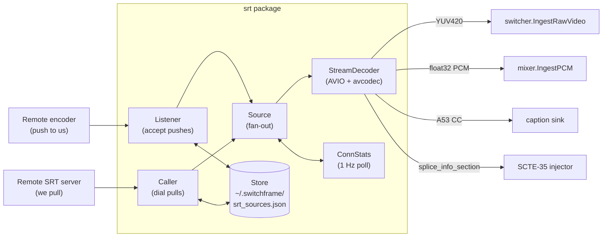

# SRT Ingest

> **Where you are:** [docs](../README.md) → subsystems → srt-ingest
> **Read this first:** [architecture.md](../architecture.md)
> **See also:** [output.md](output.md) · [codec.md](codec.md) · [switcher.md](switcher.md) · [audio.md](audio.md) · [scte35.md](../scte35.md)

**TL;DR** SRT is Switchframe's "bring any encoder" input path: point a camera, hardware encoder, or another switcher at us over the public internet, and we'll demux MPEG-TS, decode whatever codec it carries via FFmpeg, and deliver raw YUV420p + float32 PCM to the switcher pipeline and mixer in real time. The package runs in two directions — a [`Listener`](#listener-inbound-push) accepts inbound pushes, a [`Caller`](#caller-outbound-pull) dials outbound pulls — and both deposit connections into a common [`Source`](#source-orchestrator) orchestrator that owns a single [`StreamDecoder`](#the-ffmpeg-avio-bridge). Source configurations persist to a JSON [`Store`](#persistence-and-stats) so caller pulls survive restarts, and per-connection [`ConnStats`](#persistence-and-stats) are polled every second for the UI and the `/debug/snapshot` endpoint.

## The story

The reason this package exists is operational reality: operators in the field do not want to transcode before they send. They want to point OBS, a Haivision encoder, or a VidiU at a URL and have frames appear on the multiview. MoQ is better for last-mile delivery to browsers but requires Prism; RTMP is legacy and doesn't like H.265; RIST is niche. SRT is what the rest of the industry shipped with, and it's what we accept.

Every SRT connection Switchframe handles — push or pull — is eventually an [`io.ReadCloser`](../../server/srt/source.go) of MPEG-TS bytes. That reader gets handed to a [`StreamDecoder`](../../server/srt/decoder.go) which bridges Go's io-stream world into FFmpeg's avformat/avcodec world through a custom AVIO context. FFmpeg does the demuxing, picks decoders for whatever video and audio codecs the TS carries, and calls back into Go with decoded YUV frames and float32 PCM. The [`Source`](../../server/srt/source.go) orchestrator fans those callbacks out to the switcher's `IngestRawVideo`, the mixer's `IngestPCM`, and (optionally) a SCTE-35 sink and a caption sink.

Everything else — reconnection, stats, persistence, streamid routing — is scaffolding around that core path.

## How it works

### Listener: inbound push

[`Listener`](../../server/srt/listener.go) binds a port and accepts SRT push connections. Each accepted `srtgo.Conn` has a `streamid` string the remote chose — [`ExtractStreamKey`](../../server/srt/types.go) parses it. A bare streamid like `live/camera1` strips the `live/` prefix and becomes `camera1`; a structured streamid in the SRT Access Control format (`#!::u=admin,r=live/camera1,m=publish`) has its `r=` field extracted. Both are sanitized (path traversal sequences and unsafe characters removed) and prefixed with `srt:` to produce the final source key, e.g. `srt:camera1`. The same suffix rule means the same physical encoder connecting twice gets the same key, so reconnects preserve label, position, and delay-buffer state.

The listener has a `MaxSources` cap; when exceeded it rejects new connections by closing the socket. It also checks the persistent [`Store`](#persistence-and-stats) — if a config already exists for this key, it restores label/position/delay/latency from disk. New connections get a fresh config written. The `OnSource` callback is fire-and-forget: the app layer's `onSRTListenerSource` (see [`server/cmd/switchframe/app_srt.go`](../../server/cmd/switchframe/app_srt.go)) builds a [`Source`](#source-orchestrator) around the connection and starts it. `ReleaseSource()` is called when a connection terminates to free the `MaxSources` slot.

Listener mode is the right choice when the remote must initiate (e.g. behind a NAT where we can't dial in, or when the operator is giving an encoder a push URL and nothing else).

### Caller: outbound pull

[`Caller`](../../server/srt/caller.go) is the dual: Switchframe dials a remote SRT endpoint and pulls MPEG-TS from it. This is useful when the remote is a contribution encoder with a listen-mode URL, or when you're federating two Switchframe engines.

`Pull()` validates and persists a `SourceConfig`, then spins up a `connectLoop` goroutine with `srtgo.Dial()`. On failure it retries with exponential backoff + 25% jitter (see the shared [`backoff.Backoff`](../../server/internal/backoff/)). On success it calls the app's `OnSource` callback, which wires the connection into a `Source` and hands back a `doneCh` — the caller blocks on that channel, and when the source's `OnStopped` fires (on decode EOF or shutdown) the caller loops back and reconnects. This gives you infinite auto-reconnect with no per-connection goroutine leak: exactly one connect goroutine per key.

`RestoreFromStore()` is called at startup to re-establish all persisted caller pulls. The store distinguishes caller and listener configs by `Mode`, so the listener's persisted configs are untouched. `Stop(key)` cancels the connect loop and removes the config from the store — listener configs survive stop because they're restored on next accept.

### Source orchestrator

[`Source`](../../server/srt/source.go) is the thin layer that glues a connection to the rest of the system. It takes a `SourceConfig`, an `io.ReadCloser` (the SRT conn), a `ConnStats` for metrics, and a logger.

`Start(ctx)` creates a [`StreamDecoder`](#the-ffmpeg-avio-bridge) via the injected `decoderFactory` (overridable for tests) with the SRT conn as the `Reader` and callbacks that forward to the `Source.OnRaw*` fields. Three goroutines spin up: one that runs `dec.Run()` (blocking decode loop), one that watches ctx and calls `dec.Stop()` on cancel, and one that polls `srtgo.Conn.Stats()` every second and updates `ConnStats`. When the decode loop returns (EOF, error, or stop), `OnStopped` fires so the app can clean up pipeline state and, for caller mode, trigger the reconnect.

The fan-out in `handleVideoFrame` and `handleAudioFrame` is trivial: it just forwards the key and payload to the callback. The interesting work happens in the app layer's [`wireSRTSource`](../../server/cmd/switchframe/app_srt.go) which builds the callbacks — three buffered channels (pipeline, relay video, relay audio) drain into three dedicated goroutines so the FFmpeg decode loop never blocks on downstream work. See [pipeline.md](../concepts/pipeline.md) for why that matters (a single blocking callback stalls the entire read loop, creating bursty 100–1500 ms A/V gaps).

### The FFmpeg AVIO bridge

[`StreamDecoder`](../../server/srt/decoder.go) is the heart of the package. FFmpeg wants to read from a file or URL; we have a Go `io.Reader` that's actually an SRT socket. The bridge is a custom `AVIOContext` allocated via `avio_alloc_context` with a C `srtdec_read_packet` callback that calls into Go via `goSRTRead`, which in turn calls `d.cfg.Reader.Read()`. A 32 KiB buffer sits between them; `AVERROR_EOF` is returned on `io.EOF` so FFmpeg treats the end cleanly rather than as generic I/O failure, and other errors map to a generic -1. Spurious zero-length reads return 0 so AVIO retries without erroring.

The decoder instance is registered in a global `decoderRegistry` keyed by an `int` so C callbacks can look up the Go struct. The registry uses `sync.RWMutex` because `lookupDecoder` is called 30+ times per second per source (once per frame callback) while register/unregister are startup/shutdown only.

`srtdec_open` forces `mpegts` as the input format (SRT always carries TS), caps probe size and analyze duration to 940 KiB and 5 seconds (default FFmpeg values are tuned for files, not live streams), and calls `avformat_find_stream_info` to identify video, audio, and optional data (SCTE-35) streams. The video decoder uses slice threading (not frame threading — frame threading buffers N frames before producing output, creating N × 41 ms burst/gap patterns that starve the audio path). The audio decoder is single-threaded. [`swresample`](https://ffmpeg.org/) is set up to normalize any audio input to stereo float32 at 48 kHz, matching the mixer's expectation.

NVDEC hardware decode is enabled when `HWDeviceCtx` is passed (via [`codec.HWDeviceCtx()`](../../server/codec/probe.go)) and the codec is supported (H.264, HEVC, VP9, AV1). The `get_format` callback returns `AV_PIX_FMT_CUDA` to tell FFmpeg to decode straight into device memory; decoded frames go through the separate `goOnVideoFrameGPU` path which delivers CUDA device pointers for zero-copy GPU pipeline ingestion. If NVDEC returns 10 consecutive errors with zero successful decodes, `srtdec_reopen_video_software` rebuilds the decoder in pure software mode and retries the current packet — a graceful fallback for unsupported profiles without tearing down the whole source.

The main decode loop `srtdec_run` is `av_read_frame` → classify by `stream_index` → send to the right decoder → drain frames. Video frames go through `srtdec_process_video` which handles the full pixel format matrix: NVDEC CUDA surfaces pass through as device pointers, native YUV420P limited-range gets copied directly, full-range JPEG variants (`YUVJ420P`) convert to limited range via sws_scale with explicit colorspace coefficients (the pipeline is BT.709 limited; full range through would crush blacks and blow highlights), and everything else goes through sws for format conversion to YUV420P. Reusable output buffers on the C struct (`video_buf`, `audio_buf`) mean no per-frame `malloc`. Reusable Go-side copies on the `StreamDecoder` (`videoGoBuf`, `audioGoBuf`) mean no per-frame Go allocation either. At 1080p that's ~3.1 MiB per frame saved × 30 fps × N sources — the difference between viable and swapping.

CEA-608/708 captions hitchhike in H.264 SEI NALUs; FFmpeg surfaces them as `AV_FRAME_DATA_A53_CC` side data on decoded frames. `srtdec_process_video` checks for side data after each frame and forwards it via `goOnCaptionData` → `OnCaptions`. The [`caption.Manager`](../../server/caption/) ingests these for passthrough or author-mode rendering on the program output (see [captions.md](captions.md)).

SCTE-35 arrives on a separate MPEG-TS data PID. `av_find_best_stream(AVMEDIA_TYPE_DATA)` finds it at open; packets on that stream index are forwarded raw (no decoder) via `goOnSCTE35Data` → `OnSCTE35`. The [`scte35` package](../../server/scte35/) parses and re-injects them on the program output, preserving ad markers through the switcher (see [scte35.md](../scte35.md)).

The stub [`stub_decoder.go`](../../server/srt/stub_decoder.go) returns `ErrFFmpegNotAvailable` when cgo or FFmpeg are compiled out. The real decoder requires both.

### Persistence and stats

[`Store`](../../server/srt/store.go) is a simple file-backed JSON CRUD with `sync.RWMutex` guarding in-memory state and atomic temp-file + rename writes for durability. `~/.switchframe/srt_sources.json` holds caller pulls (restored on startup) and listener-discovered configs (restored on reconnect). Config fields cover the protocol (`Key`, `Mode`, `Address`, `StreamID`, `LatencyMs`), the UX (`Label`, `Position`, `DelayMs`), and the SRT tuning (`InputBW`, `OverheadBW` — tell SRT the expected input rate so it derives `MaxBW = InputBW * (1 + OverheadBW/100)` instead of chasing VBR spikes with auto-estimation). Validation ensures latency is within [0, 10 000] ms and delay within [0, 500] ms.

[`ConnStats`](../../server/srt/stats.go) is the live-metric holder. `StatsManager.Create(key, mode, streamID, latencyMs)` pre-populates an entry so the UI shows mode/streamID/latency the instant a pull is configured, before the connection succeeds. Every second, the `Source`'s poll goroutine calls `Stats(true)` on the srtgo connection (interval mode — loss and rate reflect the last poll window, not cumulative) and pushes into `ConnStats.Update`. The stats are both snapshotted into `ControlRoomState` (`SRTSourceInfo` — the narrow subset the UI needs) and surfaced as a full `ConnStatsSnapshot` via `StatsManager.DebugSnapshot()` which implements [`debug.SnapshotProvider`](../../server/debug/collector.go).

The output package uses the same `ConnStats` infrastructure for its SRT push and listener destinations; both recv- and send-side updates write to the same struct with overlapping RTT fields — see [output.md](output.md) and `ConnStats.UpdateSend` for the send-side path.

## Key types and entry points

- Entry: [`server/cmd/switchframe/app_srt.go`](../../server/cmd/switchframe/app_srt.go) → `App.initSRT()`, `App.wireSRTSource()`
- Listener: [`server/srt/listener.go`](../../server/srt/listener.go) → `Listener.Run()`, `resolveConfig()`
- Caller: [`server/srt/caller.go`](../../server/srt/caller.go) → `Caller.Pull()`, `Caller.connectLoop()`
- Source: [`server/srt/source.go`](../../server/srt/source.go) → `Source.Start()`, `Source.pollStats()`
- Decoder: [`server/srt/decoder.go`](../../server/srt/decoder.go) → `StreamDecoder.Run()`, `srtdec_open()`, `srtdec_run()` (C)
- StreamID routing: [`server/srt/types.go`](../../server/srt/types.go) → `ExtractStreamKey()`, `sanitizeStreamKey()`
- Persistence: [`server/srt/store.go`](../../server/srt/store.go) → `Store.Save()`, atomic temp-file + rename
- Stats: [`server/srt/stats.go`](../../server/srt/stats.go) → `StatsManager`, `ConnStats.Snapshot()`

## Gotchas and invariants

- The FFmpeg decode loop is single-threaded by design. `av_read_frame` → decode → callback → `av_read_frame`. If any callback blocks, the whole loop stalls — you lose video *and* audio until the block clears. All production callbacks must deep-copy and non-block into a channel; the heavy work happens in separate goroutines. See [`app_srt.go`](../../server/cmd/switchframe/app_srt.go) for the canonical three-goroutine fan-out pattern.
- The AVIO `Reader` callback must return `AVERROR_EOF` (not generic error) on clean end-of-stream. Returning -1 causes FFmpeg to treat the disconnect as a decode failure and emit spurious errors in the log.
- StreamID-to-key mapping is stable — the same remote reconnecting produces the same key. That's deliberate: labels, delay, and UI position must survive reconnects. If you need to force a fresh key, change the streamid.
- NVDEC paths deliver CUDA device pointers via `OnRawVideoGPU`; the CPU `OnRawVideo` callback *never fires* when NVDEC is active. The GPU frame is valid only during the callback — downstream consumers must immediately copy into a pool frame (see [gpu.md](../concepts/gpu.md)). The CPU path, by contrast, lets callbacks retain the YUV slice because the `videoGoBuf` is reused on the *next* frame, not during the current call.
- Probe size is capped at 5000 TS packets (~940 KB) and analyze duration at 5 seconds. HEVC streams with 2–4 second GOPs need the 5-second ceiling to find the first keyframe with SPS/VPS/PPS — shorter values cause `avformat_find_stream_info` to fail intermittently with "missing codec parameters."
- Audio is force-resampled to stereo float32 48 kHz by `swresample`. Sources at 44.1 kHz, 5.1, etc. are normalized at the edge so the mixer sees a uniform format. If you need a different target, change it in `srtdec_open` — propagating it as a config option has not been needed.
- Caller pulls auto-reconnect forever. If you want a pull to stay stopped across restarts, call `Caller.Stop(key)` explicitly — it deletes the config from the store. Simply SIGINT'ing the server and restarting will re-establish the pull.
- `MaxSources` on the listener rejects connections at accept time. It does *not* evict existing sources. A stuck connection holds a slot until `ReleaseSource()` is called on disconnect.

## Related docs

- **Concepts:** [pipeline.md](../concepts/pipeline.md) · [media-path.md](../concepts/media-path.md) · [frame-sync-and-timing.md](../concepts/frame-sync-and-timing.md)
- **Reference:** [api.md](../reference/api.md) · [state-broadcast.md](../reference/state-broadcast.md) · [config-and-flags.md](../reference/config-and-flags.md)
- **Subsystems:** [output.md](output.md) · [codec.md](codec.md) · [mxl.md](mxl.md) · [switcher.md](switcher.md) · [audio.md](audio.md) · [captions.md](captions.md) · [scte35.md](../scte35.md)
- **Operations:** [deployment.md](../operations/deployment.md)
