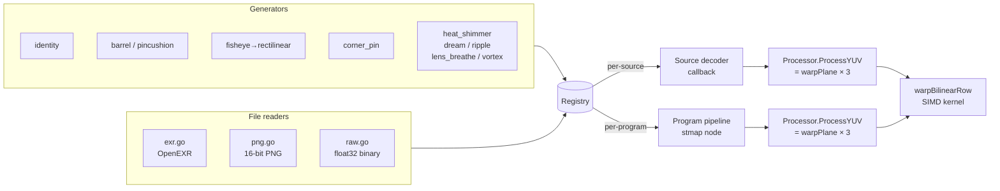

# ST Map Warp Engine

> **Where you are:** [docs](../README.md) → subsystems → stmap
> **Read this first:** [architecture.md](../architecture.md)
> **See also:** [pipeline.md](../concepts/pipeline.md) · [graphics-and-dve.md](graphics-and-dve.md) · [switcher.md](switcher.md)

**TL;DR** An ST map is a per-pixel coordinate remapping: for every output pixel, it stores the source `(s, t)` location to sample from. Switchframe uses ST maps for lens distortion correction (barrel, pincushion, fisheye-to-rectilinear, corner-pin perspective warp) and creative effects (heat shimmer, dream, ripple, lens breathe, vortex). The warp engine precomputes a 16.16 fixed-point lookup table from the float32 coordinates so the hot loop is integer-only, dispatches per-row to SIMD assembly (amd64 SSE2 with software prefetch, arm64 NEON with PRFM), and processes Y and chroma planes sequentially at their native YUV420 resolutions. Maps can be assigned per-source (warp applied in the source decoder callback) or per-program (warp applied to the final program frame), and they can be animated — frame counter advances atomically each pipeline tick.

## The story

"ST map" comes from the VFX world. A texture mapping UV pair `(u, v)` names a location in a texture. Renaming the axes to `(s, t)` — for "source" — gives you a *remapping*: each destination pixel's `(s, t)` value says "go fetch from this normalized location in the source image". An ST map is literally a two-channel float32 image where the R channel is S and the G channel is T, both in the range 0.0 to 1.0. A location of `(0.5, 0.5)` means "sample the exact center of the source". An identity map is the gradient where pixel `(x, y)` stores `((x+0.5)/W, (y+0.5)/H)`.

The useful part is that **anything you can express as per-pixel coordinate lookups becomes an ST map**. Lens distortion correction for a fisheye camera? Compute where each rectilinear output pixel maps onto the fisheye source plane, store those coordinates, apply with bilinear sampling — done. Corner-pin perspective warp to keystone-correct a projection? Compute a bilinear interpolation over the four corner mappings. Creative effects that morph source coordinates over time? Generate one ST map per animation frame, cycle them on pipeline tick. The warp kernel never changes; only the table does.

Switchframe's ST map system was designed around three ideas:

1. **Float32 on disk, int32 in RAM.** Maps are stored as float32 `(S, T)` arrays (and read from OpenEXR, 16-bit PNG, or raw binary), but the hot path runs on 16.16 fixed-point int32 LUTs precomputed once at load time. This halves memory vs int64 LUTs (16.6 MB vs 33.2 MB at 1080p) and keeps the per-pixel hot loop integer-only so the SIMD kernels can stay tight.
2. **Single-threaded warp.** Goroutine parallelism across planes or within a plane added 7-10 ms per frame of `pthread_cond` sync overhead under production load, negating any multi-core speedup. Switchframe's warp runs the Y, Cb, and Cr planes sequentially on the calling pipeline goroutine — zero coordination cost, better cache locality because no cross-core cache-line bouncing.
3. **Mmap the LUTs.** For animated maps where each frame has its own LUT, `BuildProcessorsCached` writes the int32 LUTs to disk under a cache directory and mmaps them on startup. Building takes ~5 ms per frame one-time; loading is effectively instant. The source float32 `S`/`T` slices can then be niled out — the LUT is all the warp path needs.

## How it works

The ST map subsystem is a three-layer stack: a **[`Registry`](../../server/stmap/registry.go)** holds all maps and assignments, a **[`Processor`](../../server/stmap/processor.go)** wraps one static `STMap` with its precomputed LUTs and exposes `ProcessYUV`, and a **[generator catalog](../../server/stmap/generator.go)** manufactures maps on demand from parametric formulas.



### The `STMap` type and identity construction

A [`stmap.STMap`](../../server/stmap/types.go) has a name, dimensions, and two `[]float32` slices of length `Width*Height` in row-major order. S is the horizontal coordinate, T is vertical. `NewSTMap(name, width, height)` allocates an empty map (validated for even dimensions — YUV420 requires it), and `Identity(width, height)` seeds the identity gradient with pixel-center sampling: `S = (x+0.5)/W`, `T = (y+0.5)/H`. Every creative-effect generator starts from `Identity` and perturbs S or T by a small per-pixel function.

### Building the lookup tables

`NewProcessor(stmap)` in [`processor.go`](../../server/stmap/processor.go) calls `buildLUT()`, which precomputes two int32 arrays per plane:

- **Luma LUTs** (`lutSX`, `lutSY`): at full resolution `W × H`. For each pixel, `lutSX[i] = int32((S[i] * W - 0.5) * 65536)`. The `-0.5` is the pixel-center shift so `S = 0.5` maps to pixel `W/2`, not pixel `W/2 + 0.5`. Multiplying by `65536 = 2^16` gives 16.16 fixed-point: the high 16 bits hold integer pixels, the low 16 hold a fractional 16-bit offset used as bilinear weights.
- **Chroma LUTs** (`lutCSX`, `lutCSY`): at half resolution `W/2 × H/2`. For each chroma location, the generator averages the four luma S/T values in the corresponding 2x2 block, then converts to half-res pixel coordinates with the same 0.5 center offset. This is a simple 4-corner average — not the geometrically correct MPEG-2 chroma siting (left-center weighted), which would introduce a 0.25-pixel horizontal chroma shift. For moderate warps at 1080p, the difference is visually negligible; extreme distortions might produce subtle chroma fringing.

Int32 is sufficient for resolutions up to 32767 px (32767 * 65536 < 2^31), which covers every realistic production format.

The processor also lazily builds `lut422CSX` / `lut422CSY` on first use of the 10-bit 4:2:2 warp path (`Warp10`) via `lut422Once`.

### The warp kernel

`warpPlane(dst, src, w, h, lutX, lutY)` calls into `warpBilinearRow`, which is platform-specific:

- **amd64** (`warp_kernels_amd64.s` + `warp_kernels_amd64.go`): SSE2 assembly with software prefetching (`PREFETCHNTA` on source pixels several lookups ahead). The random source access pattern causes L2/L3 cache misses for each output pixel — the prefetch hides those by kicking off the source read while the current pixel's arithmetic runs.
- **arm64** (`warp_kernels_arm64.s` + `warp_kernels_arm64.go`): NEON assembly with `PRFM` prefetch hints. Same hot-loop shape as amd64.
- **Generic Go fallback** ([`warp_kernels_generic.go`](../../server/stmap/warp_kernels_generic.go)): the algorithmic reference. For each pixel, clamp LUT coordinates to `[0, (W-1)<<16]` and `[0, (H-1)<<16]`, split into integer and fractional parts, look up four neighboring source pixels (clamping to the last column/row to avoid reading past the buffer), bilinear-interpolate using the fractional parts as 16-bit weights, clamp to byte range, and store. This is the fixed-point equivalent of the standard bilinear formula:
  ```
  top = p00*(1-fx) + p10*fx
  bot = p01*(1-fx) + p11*fx
  val = top*(1-fy) + bot*fy
  ```
  All arithmetic stays in 32-bit integers with 65536-scaled weights and a `+32768` rounding bias before each `>> 16`.

`Processor.ProcessYUV()` applies the warp to each plane in turn: Y at full resolution with `lutSX`/`lutSY`, then Cb and Cr at quarter-resolution (half-width × half-height) with `lutCSX`/`lutCSY`. Source and destination buffers must not alias — the caller typically provides two separate YUV420 buffers from the pipeline's frame pool.

### The generator catalog

Static generators are registered via `registerGenerator(info, fn)` and listed in [`generator_correction.go`](../../server/stmap/generator_correction.go):

| Name | Formula | Parameters |
|---|---|---|
| `identity` | `S = (x+0.5)/W`, `T = (y+0.5)/H` | (none) |
| `barrel` | Brown-Conrady radial: `r' = r * (1 + k1*r² + k2*r⁴)` with negative k1 | `k1` (default -0.3, [-1, 0]), `k2` (default 0.0) |
| `pincushion` | Same Brown-Conrady model with positive k1 | `k1` (default 0.3, [0, 1]), `k2` (default 0.0) |
| `fisheye_to_rectilinear` | Equidistant fisheye inversion: `theta = atan(r) * 2 / fov`, scale by `theta/r` | `fov` (default 180°, [60, 220]) |
| `corner_pin` | Bilinear interpolation over four corner mappings (tl, tr, bl, br) | `tl_x/y`, `tr_x/y`, `bl_x/y`, `br_x/y` each [0, 1] |

Animated generators return an [`AnimatedSTMap`](../../server/stmap/types.go) — a sequence of static maps plus an FPS and a frame counter. They're in [`generator_creative.go`](../../server/stmap/generator_creative.go):

| Name | Effect | Parameters |
|---|---|---|
| `heat_shimmer` | Per-row sinusoidal vertical displacement | `intensity` (default 0.3), `frequency` (default 2 Hz) |
| `dream` | Radial pull toward center with pulse | `intensity` (default 0.4) |
| `ripple` | Concentric displacement from a center point | `amplitude` (default 8 px), `wavelength` (default 60 px), `cx`, `cy` |
| `lens_breathe` | Radial scale oscillation from center | `amplitude` (default 0.02), `frequency` (default 0.5 Hz) |
| `vortex` | Angular displacement increasing with distance from center | `intensity` (default 0.3) |

Each animated generator builds `frameCount` STMaps sharing the same dimensions, with a phase that advances linearly through `2π` across the sequence so the animation is seamlessly looping. `GenerateAnimated(name, params, w, h, frameCount)` resolves defaults, calls the generator, and stashes metadata (`Generator`, `GenParams`, `Width`, `Height`) on the result so the map can be regenerated later when `BuildProcessorsCached` frees the float32 source data.

### Animated maps: frame counter and atomic advancement

`AnimatedSTMap` exposes `AdvanceIndex()` — atomically increment the frame counter and return the wrapped index — and `STArraysAt(idx)` which returns the float32 S/T arrays for that frame (served from mmap'd `.st` cache if built, otherwise from the in-memory `Frames` slice). The pipeline calls `AdvanceIndex` once per frame; GPU uploads pull from `STArraysAt(idx)`; CPU processors come from `ProcessorAt(idx)`.

`FrameCount()` loads the `atomic.Int32` field set at construction. It's race-free even before `BuildProcessors` runs, so the advancement math works correctly on the first pipeline tick.

### Registry: source and program assignments

The [`Registry`](../../server/stmap/registry.go) is the central store. Two dimensions:

- **Per-source assignments** (`perSource` map, `sourceProcs` cache). `AssignSource(sourceKey, mapName)` looks up the map (static first, then animated) and builds a cached `Processor` for that source. The switcher pulls this via `SourceProcessor(sourceKey)` in the source decoder callback, so the warp happens *before* the frame enters the program pipeline. Per-source stmaps are how you correct lens distortion on a wide-shot camera without affecting the rest of the program.
- **Per-program assignment** (`programMap`, `programProc`, `programAnim` fields). `AssignProgram(mapName)` sets either a static `Processor` or an `AnimatedSTMap` reference — a program map runs on the full composited frame after DVE and before DSK. The `hasProgramMap atomic.Bool` gives the pipeline a lock-free fast check so it can skip the program-stmap node entirely when nothing is assigned.

`SetOnStateChange(fn)` registers a broadcast callback; every mutating op calls it after dropping the lock so the browser sees assignments change in real time. The state payload ([`STMapState`](../../server/stmap/registry.go)) carries per-source map names, the current program map state (map name, static vs animated, current frame index), and the sorted list of all available maps.

Deletion is safe: `Delete(name)` clears any source or program assignment referencing the map, closes any mmap-backed processors, then removes the entry. The GPU path holds an RLock via `ProgramSnapshot()` / `ProgramGPUSnapshot()` while reading float32 arrays, so `Delete` cannot munmap a buffer a GPU upload is currently streaming from.

### File persistence

[`Store`](../../server/stmap/store.go) persists maps to a directory on disk using two formats:

- **Static**: `.stmap` files. Binary layout is `[uint32 BE width][uint32 BE height][float32 LE S[w*h]][float32 LE T[w*h]]`. `SaveStatic` and `LoadStatic` handle it. Same wire format as `WriteRaw` / `ReadRaw` in [`raw.go`](../../server/stmap/raw.go), which is the intentional reference implementation.
- **Animated**: `.stmap-anim.json` files. Metadata-only: generator name, resolved params, width, height, frame count, FPS. `LoadAnimatedMeta` reads it on startup, then `GenerateAnimated(meta.Generator, meta.Params, ...)` reconstructs the full animation. The frames themselves are regenerated every boot; they're cheap (a few ms each).

`ValidateName` rejects empty names, path separators, `..`, and anything whose `filepath.Base` differs from the original — standard path-traversal defense, same pattern as stinger store naming.

### Reading external formats

For lens-distortion workflows that produce ST maps in standard VFX formats:

- **[`ReadEXR`](../../server/stmap/exr.go)** parses OpenEXR scanline images (tiled and deep are rejected). Supports `UINT`, `HALF` (IEEE 754 16-bit float, decoded with `halfToFloat`), and `FLOAT` pixel types. Supports uncompressed, ZIP (16-scanline zlib), and ZIPS (per-scanline zlib) compression. ZIP blocks go through the EXR predictor reconstruction step (delta decode with bias 128) followed by byte interleave to undo the compressor's even/odd split. Only the R and G channels are extracted (S and T respectively). Dimensions are validated (max 16384×16384, even). The zlib decompress is bounded to 100 MB per block to prevent zip-bomb attacks.
- **[`ReadPNG`](../../server/stmap/png.go)** decodes 16-bit PNGs (`NRGBA64` / `RGBA64`) and normalizes R and G channels to `[0.0, 1.0]`. 8-bit PNGs (`NRGBA` / `RGBA`) also work but with 8-bit precision. Premultiplied-alpha formats (`RGBA`, `RGBA64`) are un-premultiplied before normalization. Dimensions must be even.
- **[`ReadRaw`](../../server/stmap/raw.go)** reads the internal binary format described above. Round-trips with `WriteRaw`.

All three emit the same [`*STMap`](../../server/stmap/types.go) and feed the same `NewProcessor` → LUT build path.

### GPU integration

The GPU pipeline uses a parallel code path that skips the CPU processor entirely. `Registry.ProgramGPUSnapshot()` returns an atomic read of the current program map with the `S` and `T` float32 arrays (pointers into the mmap'd cache for animated maps). The GPU stmap node ([`gpu/gpu_nodes.go`](../../server/gpu/pipeline_nodes.go)) uploads S/T as a texture and dispatches the warp kernel from [`gpu/metal/stmap.metal`](../../server/gpu/metal/stmap.metal) or the CUDA equivalent, which does bilinear sampling on the GPU. Per-source ST maps use `SourceSTArrays(sourceKey)` and the per-source GPU cache. The mmap-backed `.st` cache files keep GPU upload bandwidth stable across pipeline format changes — zero runtime generation.

## Key types and entry points

- Entry (CPU): [`server/stmap/processor.go`](../../server/stmap/processor.go) → `Processor.ProcessYUV()`
- Entry (pipeline hot path): calls from the switcher source decoder callback and the program pipeline node
- Registry: [`server/stmap/registry.go`](../../server/stmap/registry.go) → `Registry.AssignSource`, `Registry.AssignProgram`, `Registry.RemoveSource`, `Registry.RemoveProgram`, `Registry.Delete`, `Registry.State`
- Registry fast-path check: `Registry.HasProgramMap()` (lock-free `atomic.Bool`)
- Registry GPU bridge: `Registry.ProgramGPUSnapshot()`, `Registry.AnimatedSTArraysAt()`, `Registry.SourceSTArrays()`
- Types: [`server/stmap/types.go`](../../server/stmap/types.go) → `STMap`, `AnimatedSTMap`, `ValidateName`, `Identity()`
- Generators: [`server/stmap/generator.go`](../../server/stmap/generator.go) → `Generate`, `GenerateAnimated`, `ListGenerators`, `ListAnimatedGenerators`, `GeneratorInfoList`, `AnimatedGeneratorInfoList`
- Correction generators: [`server/stmap/generator_correction.go`](../../server/stmap/generator_correction.go) → `identity`, `barrel`, `pincushion`, `fisheye_to_rectilinear`, `corner_pin`
- Creative generators: [`server/stmap/generator_creative.go`](../../server/stmap/generator_creative.go) → `heat_shimmer`, `dream`, `ripple`, `lens_breathe`, `vortex`
- Persistence: [`server/stmap/store.go`](../../server/stmap/store.go) → `Store.SaveStatic`, `Store.LoadStatic`, `Store.SaveAnimatedMeta`, `Store.LoadAnimatedMeta`, `Store.Delete`, `Store.ListStatic`, `Store.ListAnimated`
- File readers: [`server/stmap/exr.go`](../../server/stmap/exr.go) → `ReadEXR`, `IsEXR`; [`server/stmap/png.go`](../../server/stmap/png.go) → `ReadPNG`; [`server/stmap/raw.go`](../../server/stmap/raw.go) → `ReadRaw`, `WriteRaw`
- LUT cache: `AnimatedSTMap.BuildProcessorsCached(cacheDir)` writes `.lut` (int32 CPU LUTs) and `.st` (float32 GPU arrays) files; `Processor.Close()` and `AnimatedSTMap.Close()` munmap backing regions
- SIMD kernels: [`server/stmap/warp_kernels_amd64.s`](../../server/stmap/warp_kernels_amd64.s) (SSE2 + `PREFETCHNTA`), [`server/stmap/warp_kernels_arm64.s`](../../server/stmap/warp_kernels_arm64.s) (NEON + `PRFM`), [`server/stmap/warp_kernels_generic.go`](../../server/stmap/warp_kernels_generic.go) (Go fallback)
- 10-bit warp: [`server/stmap/warp10_dispatch.go`](../../server/stmap/warp10_dispatch.go) + `warp10_kernels_*`
- Application wiring: [`server/cmd/switchframe/app.go`](../../server/cmd/switchframe/app.go) (the "ST map registry and file store" init block) — constructs `stmap.NewRegistry()`, opens `stmap.NewStore()`, loads persisted static maps and regenerates animated maps from metadata, pre-warms mmap LUT cache for built-ins unless `--stmap-prewarm=false`, wires registry to switcher via `SetSTMapRegistry`

## Gotchas and invariants

- **Even dimensions everywhere.** `NewSTMap`, `ReadEXR`, `ReadPNG`, and `ReadRaw` all reject odd widths or heights with `ErrInvalidDimensions`. YUV420 chroma subsampling requires even dimensions so that a `2×2` luma block corresponds to exactly one chroma sample.
- **Int32 LUT resolution cap.** The int32 LUT format is safe up to 32767 pixel dimensions (32767 * 65536 < 2^31). All realistic formats are far below this, but if you ever add 16K+ support you'll need to widen to int64 — which doubles the LUT memory and hurts cache locality.
- **Pixel-center offset matters.** The `-0.5` in `buildLUT` is not optional. Without it, identity maps produce a half-pixel offset that accumulates into visible drift on animated warps. Every generator that starts from `Identity` inherits the correct center offset for free.
- **Chroma LUT uses 4-corner average, not MPEG-2 chroma siting.** The theoretical correct geometry for H.264's default chroma location is left-center weighted. The 4-corner average introduces a 0.25-pixel horizontal chroma shift, visually negligible at 1080p but potentially visible as subtle fringing for extreme distortions. Fixing this would mean per-generator chroma LUTs, which we've deferred.
- **Single-threaded warp is intentional.** Profiling showed that parallelizing across planes or slicing the Y plane added 7-10 ms per frame of `pthread_cond` overhead. The sequential approach is both faster and simpler.
- **Source and destination must not alias.** The warp reads the whole source plane before writing to the destination; in-place warping would produce read-after-write corruption. Callers pass separate buffers from the pipeline frame pool.
- **`BuildProcessorsCached` nils `Frames` and `Processor.stmap`.** After caching, the float32 source data is freed; only the int32 LUT mmap and the mmap'd `.st` file remain. `STArraysAt` falls back cleanly — it serves from the mmap'd `.st` cache when `stArrays[idx].S` is non-nil, otherwise from `Frames` (pre-cache state). Don't assume `anim.Frames` is ever non-nil after startup.
- **`buildOnce sync.Once` is mandatory.** `BuildProcessors` / `BuildProcessorsCached` are called lazily from `ProcessorAt`, so a fresh pipeline goroutine could otherwise race with a background pre-warm goroutine. The `sync.Once` ensures only one builder runs and the others block until it finishes.
- **Delete must block GPU readers.** `Registry.Delete` acquires the registry write lock, but the GPU code paths hold an RLock via `ProgramSnapshot()` / `ProgramGPUSnapshot()` while uploading S/T arrays. The lock ordering — write acquires after readers — ensures `Close()` can munmap without the kernel aborting an in-flight GPU DMA. Never call `Close()` on an `AnimatedSTMap` while any code is referencing its processors or S/T arrays.
- **OpenEXR zlib decompression is bounded.** `maxDecompressedSize = 100 MB` per scanline block. A 4K ZIP block is ~491 KB uncompressed — the 100 MB cap is generous for legitimate files and tight enough to stop zip-bomb attacks.
- **Animated maps wrap indefinitely.** `AdvanceIndex()` does atomic increment modulo frame count — no end condition. Non-looping "one-shot" effects are not a supported mode; the caller would have to manage that externally (detach the map after N frames).
- **Regeneration is deterministic.** Because animated maps persist only their generator name and params (not frame data), the same parameter set must produce bitwise-identical frames across boots. All generators use deterministic floating-point math with no wall-clock time or randomness.

## Related docs

- **Concepts:** [pipeline.md](../concepts/pipeline.md), [media-path.md](../concepts/media-path.md), [gpu.md](../concepts/gpu.md), [locking-and-concurrency.md](../concepts/locking-and-concurrency.md)
- **Reference:** [api.md](../reference/api.md), [file-formats.md](../reference/file-formats.md), [state-broadcast.md](../reference/state-broadcast.md)
- **Subsystems:** [switcher.md](switcher.md), [graphics-and-dve.md](graphics-and-dve.md), [transition.md](transition.md), [playout.md](playout.md)
- **Integration:** [ui-server-contract.md](../integration/ui-server-contract.md)
