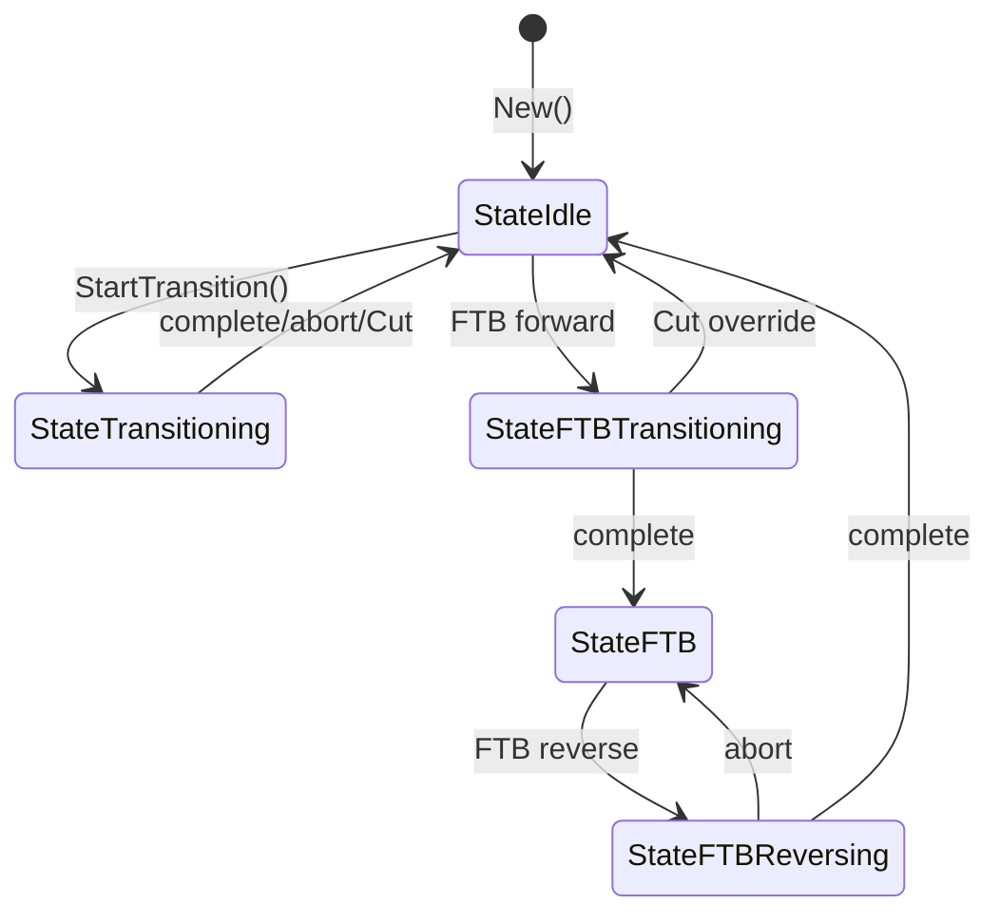

# Subsystem: switcher

> **Where you are:** [docs](../README.md) → subsystems → switcher
> **Read this first:** [architecture.md](../architecture.md)
> **See also:** [pipeline](../concepts/pipeline.md) · [media-path](../concepts/media-path.md) · [frame-sync-and-timing](../concepts/frame-sync-and-timing.md)

**TL;DR** — The `server/switcher/` package is the live production engine: it owns the list of sources, the Program/Preview state machine, the [always-decode-per-source decoders](../concepts/pipeline.md), the [atomic CPU pipeline](../concepts/pipeline.md#the-node-chain-and-atomic-swap), the [frame synchronizer](../concepts/frame-sync-and-timing.md), the health monitor, and the asynchronous video processing goroutine that drives everything toward the program relay. Most state lives under a single `sync.RWMutex`, but the per-frame hot paths are lock-free via `atomic.Pointer` handoffs so a Cut or a pipeline rebuild never blocks frame delivery.

## The story

If you asked a broadcast engineer what a switcher "is," they'd say: the buttons that change what's on air. In software, the switcher is the piece that owns the verb — CUT, AUTO, FTB, TRANSITION — and turns those verbs into deterministic frame output. Every other subsystem (audio mixer, transition engine, graphics compositor, DVE, captions, clips, playout) either feeds this package or is commanded by it.

The `switcher/` package was designed around two constraints that pulled in opposite directions. First, a live switcher has sub-millisecond operations: the moment an operator hits CUT, every millisecond of latency until program changes is visible to the viewer. Second, a live switcher has global state: "which source is on program" is shared between the frame handler, the state broadcaster, every Svelte client, the recording output, and a dozen subsystems that want to know when program changes. The naive resolution — one mutex protects everything — would serialize frame delivery behind state changes and ruin the first constraint.

The compromise the code arrives at is: **state under lock, pointers atomic**. The `Switcher` struct has a `sync.RWMutex` that protects the sources map, program source string, transition state, and wiring of subsystems. Any operation that touches those fields — Cut, SetPreview, RegisterSource, SetCompositor, SetPipelineFormat — acquires the write lock briefly. But the per-frame hot path (what goes through `handleRawVideoFrame` → `videoProcessingLoop`) loads the *pipeline pointer*, the *GPU runner*, the *raw sinks*, the *program epoch*, and similar live references via atomics. Rebuilding the pipeline takes the lock to capture the new node list, then drops the lock and does an atomic swap. The swap itself is a pointer store; per-frame reads see either the old pipeline or the new one, never a half-built chain.

This document walks that architecture file by file, then collects the invariants that keep it deadlock-free and frame-safe.

## How it works

### The Switcher struct, laid out

[`server/switcher/switcher.go`](../../server/switcher/switcher.go) defines `Switcher` with roughly 80 fields. Grouping by purpose:

| Group | Fields | Lock |
|---|---|---|
| Identity | `log`, `mu`, `sources`, `programSource`, `previewSource`, `programRelay` | `mu` (write for mutations) |
| State machine | `state`, `seq`, `cutsTotal`, `transitionsStarted`, `transitionsCompleted` | `mu` for `state`; atomics for others |
| Transition | `transConfig`, `transEngine`, `transTypeOrig`, audio handler | `mu` |
| Audio | `mixer`, `audioHandler`, `audioCut`, `audioTransition` | `mu` |
| Sync + timing | `frameSync`, `frameSyncActive`, `delayBuffer`, `refClock`, `clockRecovery`, `aacBuffer`, `useRefClock` | `mu` + atomics |
| Wall-clock PTS | `videoPTSStart`, `videoPTSEpoch`, `videoPTS`, `wallClockVideoEnabled` | `mu` (only touched in videoProcessingLoop) |
| GPU | `gpuRunner`, `gpuSourceMgr`, `gpuSourceActive`, `gpuTransActive` | `atomic.Pointer` / `atomic.Bool` |
| Pipeline | `pipeline`, `pipelineFormat`, `pipelineEpoch`, `framePool`, `pipeCodecs`, `drainWg` | `atomic.Pointer` for `pipeline`/`pipelineFormat`; `mu` for `pipeCodecs`, `framePool` |
| Callbacks | `onFormatChange`, `onCommandExecuted`, `onKeyframeBroadcast`, `onCaptionBroadcast`, `outputVideoCallback`, `outputAudioCallback`, `outputAudioCallbackDirect` | `atomic.Pointer` |
| Sinks | `rawVideoSink`, `rawPreviewSink` | `atomic.Pointer` |
| Encoder | `codecEncoder`, `codecDecoder`, `codecHWAccel`, `availableEncoders`, `encoderOpts`, `forceNextIDR` | `mu` + `atomic.Bool` for `forceNextIDR` |
| Diagnostics | per-stage timing counters, frame counts, route counters, broadcast interval, transition seam | all atomics |
| Async processing | `videoProcCh`, `videoProcDone` | channels |
| Command queue | `cmdQueue`, `cmdDispatcher`, `lastCommandSeq`, `lastExecutedSeq`, `recentCmdErrors` | `cmdqueue` internal |

The pattern is consistent: anything set once or changed rarely sits under `mu`. Anything read on every frame is an atomic. That split is what makes the hot path — see [the media-path walk-through](../concepts/media-path.md) — able to do per-frame work without contesting the lock that wiring and operator actions also need.

### The state machine: Cut, transitions, FTB

The explicit states live in [`switcher.go`](../../server/switcher/switcher.go):

```
StateIdle               // No transition, normal frame routing
StateTransitioning      // Mix/dip/wipe in progress
StateFTBTransitioning   // FTB forward in progress
StateFTB                // Faded to black, holding black
StateFTBReversing       // Fading back in
```

A declarative `validTransitions` map documents the allowed edges; `transitionState` logs a warning on an invalid transition but never panics (because a panic in the frame goroutine would take the broadcast down). The `isInTransition()` and `isFTBActive()` helpers map the states back to the REST-level booleans the UI renders.

[`Switcher.Cut`](../../server/switcher/switcher.go) is the simplest and most-used operation. Under the write lock it:

1. Looks up the target source and returns `ErrSourceNotFound` if absent.
2. If a transition is currently active, captures the engine and audio handler pointers and sets state to idle so the transition's `OnComplete` callback won't overwrite the new program source.
3. Swaps `programSource`.
4. If frame sync is active, calls `SetProgramSource(sourceKey)` to update the early-release target and demote/promote FRC quality appropriately.
5. Bumps `programEpoch` so in-flight `videoProcWork` items from the old source get dropped.
6. Sets `forceNextIDR` so the next encoded frame is a keyframe (downstream decoders sync immediately).
7. Increments `cutsTotal` and `seq`.
8. Builds a state snapshot under the lock, drops the lock, runs aborts and audio callbacks outside the lock, and notifies state change.

A cut is therefore sub-millisecond on the write side. The visible effect lands at the next frame boundary, guaranteed by the epoch mechanism.

[`Switcher.StartTransition`](../../server/switcher/switcher.go) is more involved — see [the transition subsystem doc](transition.md) for the engine lifecycle. Briefly: Phase 1 validates under the lock and sets state; Phase 2 creates the engine with no lock held (because codec init can be slow); Phase 3 stores the engine pointer and arms the `handleRawVideoFrame` route to the engine.

FTB (fade-to-black) is implemented on top of the transition engine with type `FTB` / `FTBReverse` and no `toSource`. It has its own states because the hold phase (`StateFTB`) needs to filter all frames — raw sources no longer reach the pipeline while the screen is black.



### source_viewer: the per-source proxy

[`source_viewer.go`](../../server/switcher/source_viewer.go) defines `sourceViewer`, a small struct that implements Prism's `distribution.Viewer` interface. It sits on a source's Relay and forwards every received frame to the central `frameHandler` (which `Switcher` itself implements) tagged with the source key.

The viewer has three atomic pointers: `delayBuffer`, `frameSync`, and `srcDecoder`. They are mutually-exclusive wiring knobs. On `SendVideo(frame)`:

1. If `srcDecoder` is non-nil (always-decode mode), the H.264 frame is sent to the decoder goroutine with `arrivalNano` for E2E latency measurement.
2. Otherwise, if `frameSync` is non-nil, the frame goes to `FrameSynchronizer.IngestVideo`.
3. Otherwise, if `delayBuffer` is non-nil, it goes to the delay buffer.
4. Otherwise, directly to the handler.

`SendAudio` is simpler — it never goes through frame sync (see [why](../concepts/frame-sync-and-timing.md)), only through delay buffer if set. `SendCaptions` is similar.

Cache-line padding between the atomic send counters (`videoSent`, `audioSent`, `captionSent`) prevents false sharing when multiple relays deliver frames concurrently.

### source_decoder: the always-decode goroutine

[`source_decoder.go`](../../server/switcher/source_decoder.go) defines `sourceDecoder`, a dedicated FFmpeg decoder goroutine per source. See [pipeline.md](../concepts/pipeline.md#always-decode-per-source) for why this exists.

Key design points:

- **Channel capacity 2, newest-wins drop.** `Send()` tries the channel, and on full drops the oldest then retries. Counted in `decodeDrops`. Two slots is the minimum for "one frame being decoded while the next arrives."
- **Reusable conversion scratch.** `annexBBuf` and `prependBuf` are per-decoder slices reused across frames. AVC1 length-prefix → Annex B start-code conversion and SPS/PPS prepending land there, not into fresh allocations.
- **`DecodeInto` fast path.** When the underlying `VideoDecoder` supports the `DecodeInto(data, dst) (yuv, w, h, err)` optional interface, the loop pre-acquires a pool buffer and passes it as the destination. On success the returned `yuv` slice points into the pool buffer — no copy needed. Falls back to `Decode()` + copy when the decoder doesn't support the optimization.
- **Per-source resolution normalization.** If the source's native resolution differs from the pipeline format, the decoder runs a bilinear scale in `scaleBuf`. Scaling on the decoder goroutine keeps the rest of the pipeline running at one consistent resolution.
- **Per-source ST map correction.** When an ST map is assigned via the registry, `proc.ProcessYUV(stmapBuf, buf, w, h)` applies a per-pixel warp (lens correction, fisheye rectilinearization, etc.). Skipped when the GPU source manager handles it on GPU instead (`gpuSourceActive.Load()`).
- **Format conversion.** When the pipeline runs in professional mode (YUV422P10LE + HEVC), 8-bit sources are upconverted to 10-bit 4:2:2 via `Upconvert420to422_10`.
- **Atomic stats.** Frame size and FPS exponential moving averages use `atomic.Uint64` with `Float64bits`/`Float64frombits` so they can be read from a different goroutine (the encoder parameter derivation path) without a race.
- **Source IDR does NOT propagate.** `IsKeyframe` is explicitly set to `false` on every decoded frame. The program encoder controls its own IDR cadence via `Switcher.forceNextIDR`. Propagating source keyframes caused excessive IDRs on the output (one per source GOP boundary).

The callback at the end of `decodeLoop` is the one built by [`Switcher.makeDecoderCallback`](../../server/switcher/switcher.go), routing through frame sync or delay buffer to the handler.

### handleRawVideoFrame and the switch statement

[`Switcher.handleRawVideoFrame`](../../server/switcher/switcher.go) is the routing brain. See [the media-path doc](../concepts/media-path.md#stage-3-the-switcher-handler) for the flow chart. Beyond the routing, the handler also:

- Updates per-source `rawFrameCount` and `lastGroupID` for stats and state broadcast.
- Feeds the `pipeCodecs.updateSourceStats(avgSize, avgFPS)` path, which derives encoder bitrate and resolution-appropriate defaults from the program source's observed stream.
- Ingests YUV into graphics key bridges and DVE compositor source caches when a GPU source manager is NOT attached. When the GPU source manager IS attached, it uploads to GPU and the CPU fill paths are bypassed.
- Seeds the audio PTS epoch on the first program video frame via `onFirstVideoPTS`, ensuring audio and video start from the same wall-clock moment.
- Routes to the [`transition.Engine`](../../server/transition/engine.go) via `IngestRawFrame` when a transition is active.

The design choice that makes `handleRawVideoFrame` fast on the hot path is to snapshot all needed state under a single `RLock` and drop it before doing any work. The read lock scales to many frame deliveries per second; writers (Cut, StartTransition) are rare enough that they don't starve.

### health.go: tally and alarms

[`health.go`](../../server/switcher/health.go) implements a per-source health monitor with three thresholds: stale (1s since last frame), no-signal (2s), offline (10s). It uses a `sync.Map` for per-source atomic `lastFrame` timestamps (lock-free updates from the frame hot path) and a `sync.RWMutex`-guarded map for the committed status.

The subtle part is **hysteresis**. Raw status changes would cause tally flicker on a congested network where frames occasionally arrive slightly late. The monitor requires three consecutive checks at a degraded status before committing (while recovery is immediate). Transitions are logged once at commit time. Status is re-evaluated on a ticker (typically 1 s) in a dedicated goroutine; on any change, the published callback fires so the state broadcaster reissues the current state to UIs.

`registerSource` / `removeSource` are symmetric. `lastFrameAgoMs` exposes time-since-last-frame for debug and perf sampling.

### delay_buffer.go: zero-goroutine delay

[`delay_buffer.go`](../../server/switcher/delay_buffer.go) — see [frame-sync-and-timing.md](../concepts/frame-sync-and-timing.md#delay-buffers). Worth calling out the `time.AfterFunc` design: scheduling each delayed frame individually instead of running a polling goroutine means zero goroutines when all delays are zero (the common case). A generation counter on `sourceDelay` invalidates still-scheduled callbacks from a removed source. A `stopped` flag covers full shutdown. The buffer is mutually exclusive with the frame synchronizer — `SetFrameSync` re-wires viewers between them.

### pipeline and node_* files

[`pipeline_node.go`](../../server/switcher/pipeline_node.go), [`pipeline_loop.go`](../../server/switcher/pipeline_loop.go), and the `node_*.go` files together compose the CPU video processing pipeline. See the [pipeline doc](../concepts/pipeline.md#the-node-chain-and-atomic-swap) for the full story.

Each node implements:
- `Name() string` — for debug and metrics.
- `Configure(PipelineFormat) error` — called once on build.
- `Active() bool` — checked at build to filter inactive nodes.
- `Process(dst, src *ProcessingFrame) *ProcessingFrame` — per-frame work.
- `Err() error`, `Latency() time.Duration`, `Close() error`.

Node files in the default chain:

- [`node_upstream_key.go`](../../server/switcher/node_upstream_key.go) — wraps `graphics.KeyProcessorBridge`.
- [`node_dve_compositor.go`](../../server/switcher/node_dve_compositor.go) — wraps `dve.Compositor`, re-configures on format change.
- [`node_compositor.go`](../../server/switcher/node_compositor.go) — wraps `graphics.Compositor` with scratch buffers for alpha blending.
- [`node_stmap.go`](../../server/switcher/node_stmap.go) — per-program ST map warp (not shown but listed in `buildNodeList`).
- [`node_raw_sink.go`](../../server/switcher/node_raw_sink.go) — deep-copy fan-out with refcount bump; wired for MXL and preview.
- [`node_encode.go`](../../server/switcher/node_encode.go) — async H.264/HEVC encode via goroutine + channel, with panic recovery that invalidates the encoder on cgo crashes so the next frame recreates it.

### pipeline_codecs.go: encoder pool

[`pipeline_codecs.go`](../../server/switcher/pipeline_codecs.go) encapsulates the program encoder. It holds an `encoderFactory` and lazily creates the encoder on first encode — which is where resolution and FPS are finally known. The `invalidateEncoder()` method (called from `SetPipelineFormat`, `SetEncoder`, and encode panic recovery) tears down the existing encoder so the next frame recreates it. Default bitrate scales with resolution: 2 Mbps at 480p, 6 at 720p, 10 at 1080p, 20 at 4K.

### frame_sync.go, frc*.go, mcfi_*.go

See the [frame-sync-and-timing doc](../concepts/frame-sync-and-timing.md). In summary:

- [`frame_sync.go`](../../server/switcher/frame_sync.go) is the `FrameSynchronizer` with the per-source ring buffers and tick loop.
- [`frc.go`](../../server/switcher/frc.go) is the `frcSource` per-source interpolation state and quality dispatch.
- [`frc_me.go`](../../server/switcher/frc_me.go) is motion estimation (SIMD SAD + diamond search).
- [`mcfi_interpolate.go`](../../server/switcher/mcfi_interpolate.go) is the standalone MCFI used by replay.
- [`mcfi_warp_fast.go`](../../server/switcher/mcfi_warp_fast.go) is the 16.16 fixed-point row-parallel warp.
- [`frcasm/`](../../server/switcher/frcasm/) has amd64 and arm64 assembly kernels for SAD and downsample.

### Reference clock mode

An advanced operating mode enabled via `SetReferenceClock`: instead of the frame sync's timer driving output, a single `sync_loop` goroutine pops frames directly from the ring buffers and drives both video pipeline and audio mixer from one clock source. Used in multi-region active-active where two regions must stay phase-locked. See [`sync_loop.go`](../../server/switcher/sync_loop.go) for the implementation. In this mode, `videoProcessingLoop` becomes a no-op drain — it only frees pool buffers — because the sync loop is the sole frame processor.

## Key types and entry points

- Core: [`server/switcher/switcher.go`](../../server/switcher/switcher.go) → `Switcher` struct, `New`, `Close`.
- Verbs: [`server/switcher/switcher.go`](../../server/switcher/switcher.go) → `Switcher.Cut`, `SetPreview`, `StartTransition`, `SetLabel`, `SetSourcePosition`.
- State machine: [`server/switcher/switcher.go`](../../server/switcher/switcher.go) → `State` enum, `validTransitions`, `Switcher.transitionState` (caller holds write lock).
- Per-source proxy: [`server/switcher/source_viewer.go`](../../server/switcher/source_viewer.go) → `sourceViewer`.
- Per-source decoder: [`server/switcher/source_decoder.go`](../../server/switcher/source_decoder.go) → `sourceDecoder`, `sourceDecoder.decodeLoop`.
- Sync + timing: [`server/switcher/frame_sync.go`](../../server/switcher/frame_sync.go), [`delay_buffer.go`](../../server/switcher/delay_buffer.go), [`sync_loop.go`](../../server/switcher/sync_loop.go).
- Pipeline: [`server/switcher/pipeline_node.go`](../../server/switcher/pipeline_node.go), [`pipeline_loop.go`](../../server/switcher/pipeline_loop.go), [`pipeline_codecs.go`](../../server/switcher/pipeline_codecs.go).
- Nodes: [`node_upstream_key.go`](../../server/switcher/node_upstream_key.go), [`node_dve_compositor.go`](../../server/switcher/node_dve_compositor.go), [`node_compositor.go`](../../server/switcher/node_compositor.go), [`node_raw_sink.go`](../../server/switcher/node_raw_sink.go), [`node_encode.go`](../../server/switcher/node_encode.go).
- Health: [`server/switcher/health.go`](../../server/switcher/health.go) → `healthMonitor`.
- Processing goroutine: [`server/switcher/switcher.go`](../../server/switcher/switcher.go) → `videoProcessingLoop`, `enqueueVideoWork`, `broadcastProcessedFromPF`.

State protection: `Switcher.mu` guards `sources`, `programSource`, `previewSource`, `state`, `transEngine`, and all subsystem pointers set via `SetX` methods. Hot-path reads that cannot afford the lock use `atomic.Pointer` (`pipeline`, `rawVideoSink`, `gpuRunner`, `outputVideoCallback`, ...). Per-source diagnostic counters on `sourceState` are atomic.

## Gotchas and invariants

**Lock order.** Acquire `Switcher.mu` before any subsystem lock (mixer, compositor, DVE). Within the frame sync, acquire `fs.mu` before `ss.mu`. See [locking-and-concurrency](../concepts/locking-and-concurrency.md) for the full ordering.

**Drop the Switcher lock before calling mixer/audio callbacks.** `Cut` and `handleAudioFrame` both follow the pattern: capture the handler under the lock, drop the lock, call the handler. Holding `s.mu` while calling into the mixer would create a lock cycle with the mixer's own mutex.

**The `programEpoch` is how Cut races are made safe.** Frames from the old program source may already be in `videoProcCh` when Cut bumps the epoch. `videoProcessingLoop` drops them at the top of the loop. Epoch=0 means "always process" and is used by transition/FRC output where the source key is legitimately empty.

**Direct output callback runs on the encode goroutine.** `outputVideoCallback` is invoked synchronously from `broadcastToProgram` / `broadcastOwnedToProgram`, which are called from the encode goroutine. The callback must not block long or it'll stall the encoder. It must not recurse into the switcher's lock.

**`forceNextIDR` is a one-shot.** It's a `CompareAndSwap(true, false)` — the first encode after the flag is set produces an IDR and clears it. Cut, SetEncoder, SetRawVideoSink (which rebuilds the pipeline), and new output viewer joins all set it.

**`RegisterSource` with always-decode logs a memory warning.** At 3 MB of YUV scratch per 1080p source, >85 active sources crosses the 256 MB threshold. The log is a soft warning — the system runs fine, but it's a flag for operators deploying unusual source counts.

**Virtual sources skip delay buffer and frame sync.** `RegisterVirtualSource` (used by replay) creates a source without a per-source decoder or delay wiring. Replay's own player controls frame timing and feeds YUV via `IngestReplayVideo`.

**`handleVideoFrame` (H.264 path) still exists.** It's used by legacy/test sources and virtual sources that produce pre-encoded output. Production WebTransport/SRT sources use `handleRawVideoFrame` via the always-decode decoder.

**Close order matters.** `Switcher.Close` stops the reference clock, stops the frame sync (to prevent sends to `videoProcCh`), closes `videoProcCh`, waits on `videoProcDone`, closes the frame pool, stops and closes the pipeline, waits on `drainWg` (background drains from prior swaps), closes `pipeCodecs`, and finally unregisters sources. Reversing any of those steps risks use-after-close on the encoder or a send on a closed channel.

**The health monitor is not started by `New`.** The app layer calls `healthMonitor.start(interval, publishFn)`. This is intentional — tests don't want a goroutine spontaneously firing state broadcasts.

**`seq` uses atomic operations even under `s.mu`.** State broadcast consumers read `seq` lock-free to detect updates; writing it requires `atomic.AddUint64` to not race with those reads, even though mutations are always under `s.mu`.

## Related docs

- **Concepts:** [pipeline](../concepts/pipeline.md), [media-path](../concepts/media-path.md), [frame-sync-and-timing](../concepts/frame-sync-and-timing.md), [locking-and-concurrency](../concepts/locking-and-concurrency.md), [gpu](../concepts/gpu.md)
- **Subsystems:** [transition](transition.md), [graphics-and-dve](graphics-and-dve.md), [audio](audio.md), [captions](captions.md), [output](output.md), [replay](replay.md), [stmap](stmap.md), [codec](codec.md), [srt-ingest](srt-ingest.md), [mxl](mxl.md), [control-plane](control-plane.md)
- **Reference:** [api](../reference/api/switching.md), [metrics](../reference/metrics.md#switcher-metrics), [state-broadcast](../reference/state-broadcast.md), [config-and-flags](../reference/config-and-flags.md)
- **Integration:** [ui-server-contract](../integration/ui-server-contract.md)
