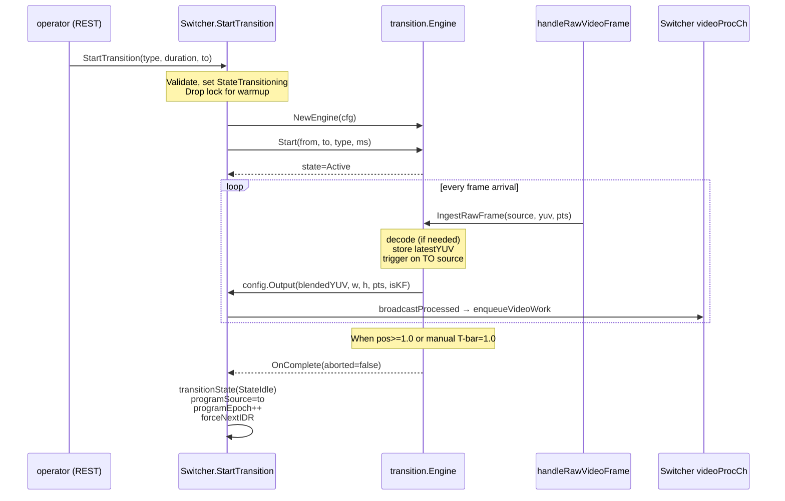

# Subsystem: transition

> **Where you are:** [docs](../README.md) → subsystems → transition
> **Read this first:** [architecture.md](../architecture.md)
> **See also:** [switcher](switcher.md) · [pipeline](../concepts/pipeline.md) · [media-path](../concepts/media-path.md)

**TL;DR** — The transition engine is what runs during a Mix/Dip/Wipe/FTB/Stinger. It is created on `StartTransition`, lives for ~500-1000 ms while both sources feed decoded YUV into it, blends them in the native Y'CbCr 4:2:0 (or 10-bit 4:2:2) domain using SIMD kernels, and produces one output frame per incoming TO-source frame until position reaches 1.0. The blend itself is fixed-point integer math with amd64/arm64 assembly kernels; resolution mismatches go through a Lanczos-3 or bilinear scaler; easing curves — smoothstep, CSS cubic-bezier, or custom — shape the position-over-time so the feel matches the operator's intent. A companion path (`SkipBlend` mode) exists for GPU transitions where the pipeline performs the pixel blend and the engine only tracks state.

## The story

A hard cut changes the program output on one frame boundary. A transition changes it over many — 30 frames for a 1-second dissolve at 30 fps — with each intermediate frame a computed blend of the outgoing and incoming sources. The operator wants to choose the feel (quick or slow, linear or eased), the type (fade, dip-to-black, directional wipe, branded stinger), and sometimes the exact position (a physical T-bar). Whatever they choose, the resulting frames have to stream out at the pipeline's tick rate without stuttering.

The engine's design follows three principles that fall out of live-broadcast reality. First, **never convert to RGB and back**. Hardware production switchers — ATEM, Ross, Datavideo — blend in the native YUV color space because every round-trip through RGB is lossy and expensive. FFmpeg's `xfade` does the same. Switchframe's [`transition`](../../server/transition/) package accepts YUV420 (or YUV422P10LE in the professional pipeline) in and emits YUV in the same format. Second, **use fixed-point integer math on the hot path**. A 1920×1080 blend visits 3 million bytes; the difference between a per-pixel `float64` multiply and a `(a*inv + b*w + 128) >> 8` is 3-5× in throughput. Third, **keep blend logic parallel to scale, color, and easing**, because every dimension has independent optimizations (SIMD kernels per architecture for blend; separable filters for Lanczos scaling; CSS-compatible curves for easing).

The engine also has to share the stage with the CPU video pipeline. Frames into the engine are both sources' decoded YUV; frames out of the engine are synthetic (they don't correspond to any single source) and flow through the same [`videoProcCh`](../../server/switcher/switcher.go) / processing loop as normal program output. A transition that completes mid-frame must leave the pipeline in a clean state for the next program source — that's the job of the engine's `cleanup` and the switcher's epoch bump.

This document walks the engine's lifecycle, blend modes, SIMD kernels, scalers, and easing curves, then collects the invariants that make all this work on a live broadcast.

## How it works

### Engine lifecycle

[`transition.Engine`](../../server/transition/engine.go) has five lifecycle verbs: `Start`, `StartSync`, `IngestFrame` / `IngestRawFrame`, `SetPosition` / `AutoAdvancePosition`, and `Stop` / `Abort` / `ForceComplete`. The normal flow is the asynchronous path triggered by `Switcher.StartTransition`:



`Start` creates any decoders the engine needs (none in always-decode mode; one or two when a legacy H.264 source needs decoding inside the engine), initializes a [`FrameBlender`](../../server/transition/blend.go) pre-sized to hint dimensions from the pipeline format so the first frame never waits on lazy allocation, resolves any gradient map for wipe-map transitions, pre-scales stinger frames if the type is `Stinger`, and starts a watchdog goroutine.

The watchdog ([`Engine.runWatchdog`](../../server/transition/engine.go)) periodically checks `lastFrameAt`; if no frames arrive from either source within 10 seconds (configurable), it aborts the transition. This is the protection against a source that silently fails mid-dissolve leaving the program frozen on a half-blended image.

Ingest alternates between Phase 1 (under the lock: snapshot engine state, decide isFrom/isTo, capture decoder), Phase 2 (outside the lock: decode, which can be 3-16 ms), and Phase 3 (back under the lock: store YUV, trigger blend, check auto-complete). Lock scope is deliberately minimized so two sources simultaneously ingesting don't serialize on the engine mutex. A `decodeWG` WaitGroup tracks in-flight decodes so `cleanup` can wait for them before closing decoders, preventing use-after-close.

### What triggers output

[`Engine.blendAndOutput`](../../server/transition/engine.go) decides whether the current ingest should produce output. The rule keeps output rate at exactly 1× source rate (not 2× — ingesting both sources would double the PTS advance and break A/V sync):

- For Mix/Dip/Wipe/Stinger: output is triggered by the TO source's frame. The FROM source's frames still arrive and populate `latestYUVA` so the blend has both inputs available; they just don't themselves trigger blend+output.
- For FTB/FTBReverse: output is triggered by the FROM source's frame (there is no TO source for FTB).

The trigger logic matters for the GPU path too: see [Switcher.handleRawVideoFrame](../../server/switcher/switcher.go)'s GPU transition branch which uses the same isTrigger rule before calling `RunTransition`.

### FrameBlender and the six blend modes

The [`FrameBlender`](../../server/transition/blend.go) holds the pre-allocated output buffer, wipe alpha scratch, and stinger chroma alpha scratch. It exposes six blend methods (plus 10-bit variants in `blend_10bit.go`):

| Method | Behavior | Kernel used |
|---|---|---|
| `BlendMix` | Linear interpolation; position maps 0→A, 1→B | `blendUniform` (single weight across whole frame) |
| `BlendDip` | Two-phase: A fades to black, then B fades from black. Black level depends on limited- vs full-range config | `blendFadeConst` per plane with plane-specific constants (Y→blackY, Cb/Cr→128) |
| `BlendWipe` | Directional (6 variants) with 4-pixel soft edge | `blendAlpha` with precomputed per-pixel alpha map (linear wipes collapse to row/column replication) |
| `BlendWipeMap` | Gradient-map-driven wipe with configurable soft edge, border, reverse, and multiply | Same `blendAlpha`, but alpha computed from `gradientMap` |
| `BlendFTB` | Single source fading to black | `blendFadeConst` per plane |
| `BlendStinger` | Per-pixel alpha composite of a stinger overlay on top of a base source; base switches at `CutPoint` | `blendAlpha` for Y (luma-resolution alpha); precomputed chroma alpha at subsampled resolution |

The core arithmetic is the same shape: `dst = (a*inv + b*w + 128) >> 8` where `inv + w = 256`. The `+128` rounds to nearest. The result for 8-bit inputs always fits in `uint16` so SIMD kernels can pack two pixels into one instruction. The blender's internal buffers — `wipeAlphaMap`, `wipeAlphaMapChroma`, `stingerChromaAlpha` — are pre-allocated at construction so blend calls never allocate.

**Black level matters.** `SetLimitedRange(true)` sets `blackY = 16` (BT.709 broadcast limited range); `false` sets `blackY = 0` (full-range). The default is limited-range to match the broadcast standard. Dip and FTB use this to fade toward the correct black value on the Y plane; chroma always fades toward 128 (the Cb/Cr neutral).

### SIMD kernels per architecture

Three blend kernels — `blendUniform`, `blendFadeConst`, `blendAlpha` — are the hot-path primitives. Each has three implementations selected at build time:

- [`blend_kernels_amd64.go`](../../server/transition/blend_kernels_amd64.go) + [`.s`](../../server/transition/blend_kernels_amd64.s) — SSE2/AVX2 assembly.
- [`blend_kernels_arm64.go`](../../server/transition/blend_kernels_arm64.go) + [`.s`](../../server/transition/blend_kernels_arm64.s) — NEON assembly.
- [`blend_kernels_generic.go`](../../server/transition/blend_kernels_generic.go) — scalar Go fallback for other platforms.

The generic version documents the math:

```go
func blendUniform(dst, a, b *byte, n, pos, inv int) {
  for i := 0; i < n; i++ {
    dstS[i] = byte((int(aS[i])*inv + int(bS[i])*pos + 128) >> 8)
  }
}
```

The amd64 and arm64 versions process 16 or 32 bytes per iteration using SIMD. [`blend_export.go`](../../server/transition/blend_export.go) exposes `BlendUniformBytes` so external packages (the DVE compositor, the playout internal transition blender) can reuse the same dispatched kernel without re-implementing SIMD for each variant.

The same pattern recurs for downsampling ([`downsample_kernels_*`](../../server/transition/)) used in alpha map chroma subsampling and for scaling ([`scaler_kernels_*`](../../server/transition/) + [`scaler_lanczos_*`](../../server/transition/)). The 10-bit variants live in parallel files with `_10bit` suffix because YUV422P10LE has a different memory layout (16-bit per-channel packed little-endian) and SIMD kernels are layout-specific.

### Scalers: bilinear, Lanczos-3, box

A transition may blend two sources that don't agree on resolution — a 720p camera mixed with a 1080p replay clip, for instance. The engine normalizes by scaling the non-matching source to the engine's fixed dimensions (set from the pipeline format or from the first decoded frame).

Three scaling paths are available:

- **Bilinear** ([`scaler.go`](../../server/transition/scaler.go)) — `ScaleYUV420`. The default, `ScaleQualityFast`. Uses 16.16 fixed-point arithmetic for sub-pixel coordinate mapping — no per-pixel float. Per-column source-X offsets are precomputed in a table to avoid step-accumulation rounding error. Corner mapping is exact.
- **Lanczos-3** ([`scaler_lanczos.go`](../../server/transition/scaler_lanczos.go)) — `ScaleYUV420Lanczos`. Sharper output, especially on downscales. Separable filtering (horizontal then vertical pass) with precomputed kernel weights. The three planes (Y, Cb, Cr) scale in parallel goroutines because Y is 4× the work of each chroma plane and would dominate otherwise.
- **Box 2×** ([`scaler_box.go`](../../server/transition/scaler_box.go)) — `BoxShrink2xYUV420`. Specialized 2× downscale using 2×2 block averaging. About 4× faster than bilinear at the same pixel count because each source pixel is read exactly once (no scatter-gather).

[`ScaleYUV420WithQuality`](../../server/transition/scaler_lanczos.go) dispatches between fast and high based on a `ScaleQuality` argument. The engine's default path uses fast bilinear; high-quality scaling is opted-in by the confidence monitor and preview encoder. The 10-bit variants ([`scaler_10bit*`](../../server/transition/), [`scaler_lanczos_10bit*`](../../server/transition/)) work on YUV422P10LE.

Resolution mismatches should rarely trigger inside the engine because [`source_decoder.go`](../../server/switcher/source_decoder.go) normalizes to pipeline resolution at decode time. The engine's scaler path is a defensive fallback; it logs a debug message when it runs.

### BT.709 color conversion

[`color.go`](../../server/transition/color.go) holds `YUV420ToRGB` (full-range) and `YUV420ToRGBLimited` (limited-range BT.709). The blend pipeline never uses these — all blending is in YUV — but the confidence monitor consumes `YUV420ToRGBLimited` when producing JPEG thumbnails for the operator preview. Keeping the conversion utilities in the transition package colocates them with the BT.709 math used for computing broadcast black in Dip/FTB.

The coefficients used (1.5748, -0.1873, -0.4681, 1.8556) are the BT.709 matrix. Limited-range scales Y through [16, 235] → [0, 1] and Cb/Cr through [16, 240] → [-0.5, 0.5] before the matrix multiply. Super-white and super-black values (Y outside [16, 235]) are handled gracefully by output clamping.

### Easing curves

[`easing.go`](../../server/transition/easing.go) provides the seven curve types:

| Type | Formula | Use |
|---|---|---|
| `linear` | `y = t` | Machine feel, no ease |
| `ease` | cubic-bezier(0.25, 0.1, 0.25, 1.0) | CSS default |
| `ease-in` | cubic-bezier(0.42, 0, 1.0, 1.0) | Starts slow, ends fast |
| `ease-out` | cubic-bezier(0, 0, 0.58, 1.0) | Starts fast, ends slow |
| `ease-in-out` | cubic-bezier(0.42, 0, 0.58, 1.0) | Slow on both ends |
| `smoothstep` | `t*t*(3-2t)` | Hermite interpolation; legacy default |
| `custom` | user cubic-bezier | Operator-defined |

[`EasingCurve.Ease(t)`](../../server/transition/easing.go) clamps input to [0,1] and dispatches. Linear and smoothstep are direct formulas; the four preset bezier curves and custom go through [`cubicBezierEase`](../../server/transition/easing.go), which solves `x(s) = t` for `s` via Newton-Raphson (8 iterations, `ε = 1e-7`) then returns `y(s)`. If the derivative goes near zero it falls back to binary search (64 iterations). The math uses [Horner's method](https://en.wikipedia.org/wiki/Horner%27s_method) for efficiency: each cubic bezier sample is a degree-3 polynomial evaluation that folds into three fused multiply-adds.

The default easing when no `EasingCurve` is provided is smoothstep, for backward compatibility with the original transition implementation. New transitions should pass an explicit curve.

### GPU transitions: SkipBlend mode

When a GPU pipeline is attached and supports transitions, the CPU engine is configured with `config.SkipBlend = true`. In this mode:

- `blendAndOutput` short-circuits after incrementing `framesBlended` — no CPU pixel blend runs.
- Position, easing, auto-complete timing, and state are still tracked.
- The GPU pipeline ([`gpu/gpu_nodes.go`](../../server/gpu/gpu_nodes.go) and its Metal/CUDA backends) reads the engine's state (position, transition type, wipe direction, stinger frame data via `StingerFrameAt`) and performs the blend on GPU.
- The transition completes via `ForceComplete()` from the GPU trigger path after the blend frame is produced — deliberately AFTER so the last blended frame reaches the encoder before `programSource` changes.

`SkipBlend` cuts CPU cost during a transition to near-zero (just state tracking) while preserving the exact same timing and easing behavior for the operator.

### Stinger transitions

Stingers are the branded transitions common in broadcast (a network bug animating across the frame). They are implemented as a PNG sequence with per-frame alpha plus an optional WAV audio track, loaded via [`stinger.Store`](../../server/stinger/store.go). At transition start, the engine receives a `StingerData` with decoded YUV + alpha for each frame, a `CutPoint` (position where the base source switches from A to B, typically 0.5), and optional audio.

Each blend picks a stinger frame by position (`frameIdx = int(pos * len(frames))`), picks the base source (A before `CutPoint`, B after), and calls `BlendStinger(base, stingerYUV, alpha)`. The blend is per-pixel alpha on Y and chroma-subsampled alpha on Cb/Cr.

Lazy scaling matters here: stinger frames may be rendered at 1280×720 but run on a 1920×1080 pipeline. The engine pre-scales eagerly at `Start` when dimensions are known (so the first frame doesn't stall for 15-30 ms scaling 30 frames), and falls back to lazy scaling on the first `blendStinger` call when dimensions weren't hinted.

## Key types and entry points

- Engine lifecycle: [`server/transition/engine.go`](../../server/transition/engine.go) → `Engine`, `NewEngine`, `Start`, `StartSync`, `IngestFrame`, `IngestRawFrame`, `SetPosition`, `Abort`, `Stop`, `ForceComplete`, `BlendRaw` (sync path).
- Blender and blend modes: [`server/transition/blend.go`](../../server/transition/blend.go) → `FrameBlender`, `BlendMix`, `BlendDip`, `BlendWipe`, `BlendWipeMap`, `BlendFTB`, `BlendStinger`.
- 10-bit blends: [`server/transition/blend_10bit.go`](../../server/transition/blend_10bit.go) → `BlendMix10`, `BlendDip10`, `BlendFTB10`, `BlendWipe10`, `BlendStinger10`.
- SIMD kernels: [`server/transition/blend_kernels_amd64.go`](../../server/transition/blend_kernels_amd64.go), `blend_kernels_arm64.go`, `blend_kernels_generic.go` → `blendUniform`, `blendFadeConst`, `blendAlpha`.
- Export for external reuse: [`server/transition/blend_export.go`](../../server/transition/blend_export.go) → `BlendUniformBytes`.
- Scalers: [`server/transition/scaler.go`](../../server/transition/scaler.go) → `ScaleYUV420`; [`scaler_lanczos.go`](../../server/transition/scaler_lanczos.go) → `ScaleYUV420Lanczos`; [`scaler_box.go`](../../server/transition/scaler_box.go) → `BoxShrink2xYUV420`; dispatcher: `ScaleYUV420WithQuality`.
- Color: [`server/transition/color.go`](../../server/transition/color.go) → `YUV420ToRGB`, `YUV420ToRGBLimited`.
- Easing: [`server/transition/easing.go`](../../server/transition/easing.go) → `EasingCurve`, `Ease`, `NewEasingCurve`, `NewCustomEasingCurve`, `cubicBezierEase`.
- Codec interface: [`server/transition/codec.go`](../../server/transition/codec.go) → `VideoDecoder`, `VideoEncoder`, `DecoderFactory`, `EncoderFactory`.
- Types: [`server/transition/types.go`](../../server/transition/types.go) → `Type`, `WipeDirection`, `State`, sentinel errors.
- Switcher integration: [`server/switcher/switcher.go`](../../server/switcher/switcher.go) → `Switcher.StartTransition`, `Switcher.broadcastProcessed`.

State guards: the engine has its own `sync.RWMutex` (`Engine.mu`). It never acquires the switcher's mutex. Engine operations do follow the pattern of capturing pointers under the lock, dropping the lock for slow work (decode, blend), then re-acquiring briefly to store results.

## Gotchas and invariants

**Blend in YUV, not RGB.** The entire blend pipeline operates on planar YUV420 (or YUV422P10LE). Round-tripping through RGB would double the CPU cost and introduce chroma resampling error on every transition frame. The only RGB conversions in the transition package (`YUV420ToRGB*` in `color.go`) exist for the confidence monitor's JPEG thumbnails, which are a low-rate side channel.

**Only the TO source triggers blend output.** For Mix/Dip/Wipe/Stinger the rule keeps output rate at 1× source rate and avoids 2× PTS advancement. For FTB/FTBReverse the rule inverts to the FROM source because there is no TO. `Switcher.handleRawVideoFrame`'s GPU branch uses the same rule — any change to the trigger logic must be mirrored in both places.

**The engine does not own the pipeline.** Engine output goes to `config.Output`, which the switcher wires to [`Switcher.broadcastProcessed`](../../server/switcher/switcher.go). That function wraps the blended YUV in a fresh `ProcessingFrame` and enqueues through the normal `videoProcCh` path — so the transition benefits from the atomic pipeline's graphics overlay, ST map, raw sinks, and async encode just like any other frame.

**Lazy blender init happens in two places.** At `Start` if `HintWidth/HintHeight` are set (from pipeline format); at first decode otherwise. Without the hint, the first few warmup frames (which may return EAGAIN from the H.264 decoder due to B-frame reorder) produce no output — a visible blank at the start of the transition. With the hint, `getBlackFrame` can substitute until real decodes succeed.

**`decodeWG` prevents use-after-close.** `IngestFrame` adds to `decodeWG` before releasing the lock for decode, and `Done`s after. `cleanup` waits on `decodeWG` before closing decoders so a concurrent decode goroutine doesn't crash on a closed FFmpeg context.

**Scale once, at the decoder, not at the engine.** [`source_decoder.go`](../../server/switcher/source_decoder.go) normalizes each source to pipeline resolution at decode time. The engine's scaler path is a defensive fallback and should rarely run in production — if you see it logging, something upstream changed resolution mid-flight.

**Gradient map wipes take precedence over directional wipes.** When both `WipeConfig` and `WipeDirection` are set, the engine uses `WipeConfig` (gradient-map). The gradient map is resolved once per dimensions at `Start` (or after lazy blender init) and cached in `wipeGradient`. If resolution fails (pattern not found), the engine falls back to directional.

**Easing is layered on top of linear position.** `Engine.position` (internal, 0→1 linear) is what the clock advances. The value returned to callers via `Position()` and used for blend is `easing.Ease(position)`. This matters for `AutoAdvancePosition`: the caller sees an eased value, but the engine completes when the linear position reaches 1.0, not when the eased value does.

**Stinger scaling is eager, not lazy.** `Start` pre-scales stinger frames when dimensions are known, because lazy-scaling 30 frames at 1080p on the first `blendStinger` call would take 15-30 ms and cause a visible stutter at the transition start. If `HintWidth` is zero, the engine falls back to lazy scaling at first blend — acceptable as a fallback, not ideal.

**GPU transitions set `SkipBlend = true`, not a different engine path.** The CPU engine still runs — it tracks position, handles auto-complete timing, manages stinger frame selection via `StingerFrameAt` — but `blendAndOutput` short-circuits before the pixel blend. The GPU pipeline performs the actual blend. Completing via `ForceComplete` (instead of the engine's normal auto-complete) ensures the last GPU-blended frame reaches the encoder before `programSource` changes.

**T-bar manual control overrides auto-advance.** [`Engine.SetPosition`](../../server/transition/engine.go) sets `manualControl = true` and `manualPosition`, and the next `currentPosition()` call returns the manual value instead of computing from elapsed time. Positions `>= 0.999` auto-complete; `<= 0.0` after previously moving past zero auto-abort. Manual takeover is what the fast-control WebTransport datagram uses during live T-bar drags.

**`BlendRaw` is the reference-clock path.** It's a synchronous blend with no goroutines, no watchdog, no codec pipeline. Used by the single `sync_loop` goroutine in reference-clock mode (multi-region active-active). The same blend modes and easing apply; the difference is timing is driven by the external reference clock.

## Related docs

- **Concepts:** [pipeline](../concepts/pipeline.md), [media-path](../concepts/media-path.md), [frame-sync-and-timing](../concepts/frame-sync-and-timing.md), [gpu](../concepts/gpu.md), [locking-and-concurrency](../concepts/locking-and-concurrency.md)
- **Subsystems:** [switcher](switcher.md), [graphics-and-dve](graphics-and-dve.md), [audio](audio.md), [codec](codec.md), [replay](replay.md), [playout](playout.md)
- **Reference:** [api](../reference/api.md#switcher-transition), [fast-control](../reference/fast-control.md#transition-position), [file-formats](../reference/file-formats.md#stinger), [metrics](../reference/metrics.md#transition)
- **Integration:** [ui-server-contract](../integration/ui-server-contract.md)
